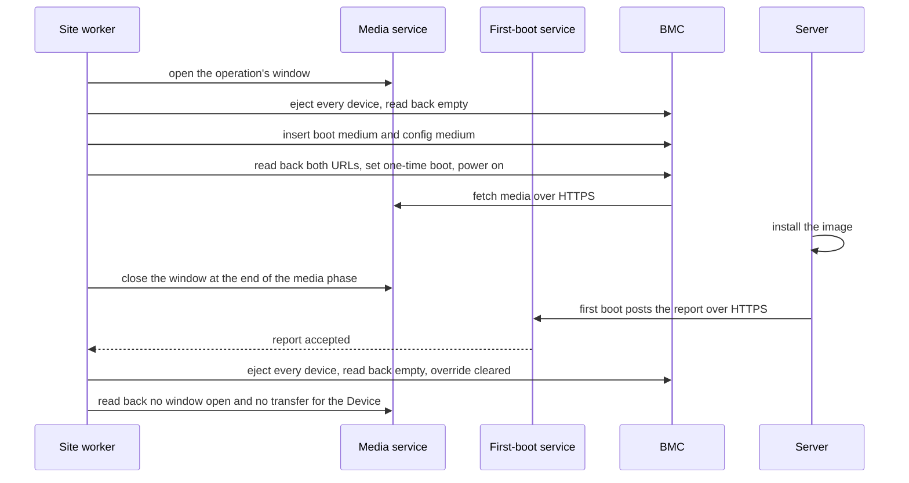

# Boot delivery methods

[Documentation overview](../../README.md) · [Functionality guide](../../functionality/README.md)

- [Summary](#summary)
- [Motivation](#motivation)
- [Proposal](#proposal)
- [Design details](#design-details)
  - [The delivery contract](#the-delivery-contract)
  - [Network boot](#network-boot)
  - [Virtual media](#virtual-media)
  - [Choosing a method](#choosing-a-method)
  - [Commissioning checks](#commissioning-checks)
  - [Addresses](#addresses)
  - [Isolation and security](#isolation-and-security)
  - [Failure modes](#failure-modes)
  - [Decisions](#decisions)
  - [Acceptance tests](#acceptance-tests)
- [Production readiness review questionnaire](#production-readiness-review-questionnaire)
- [Implementation history](#implementation-history)
- [Drawbacks](#drawbacks)
- [Alternatives](#alternatives)
- [Infrastructure needed](#infrastructure-needed)

## Summary

To install, wipe, or burn in a server, Fleet boots it from an image. A **boot
delivery method** is how that image reaches the server. This enhancement
defines two methods behind one contract:

- **Network boot.** Fleet answers the server's boot NIC over relayed DHCP and
  boots it over UEFI HTTP boot, only while the operation runs.
- **Virtual media.** Fleet tells the server's BMC, through Redfish, to mount
  boot media from a URL and boot from it once.

Each site declares the methods it offers, and a provider machine class can
require one. Customers never choose a method, and the Metal API does not
change.

Image selection, sealed bootstrap data, power, and the custody fence are the
same for both methods. Each method prepares delivery, proves what the server
booted, and proves that the delivery path closed afterwards.

Network boot is built first. Virtual media is added later behind the same
contract. This enhancement is a proposal. Nothing in it is implemented.

## Motivation

The [boot network reservations][boot-network-pr] and [server
networking][server-networking-pr] proposals define network boot. It needs a
provisioning VLAN at the site, relays on the site's routers, a central DHCP
service, and a WAN link between them. A site without those cannot install any
server, including the servers that would run the site's own infrastructure.

Many BMCs can mount boot media from a URL. That needs the BMC network and a
route from it to Fleet, with no provisioning VLAN or relay. A separate install
path for virtual media would duplicate custody, fencing, and recovery, so it
must fit the same contract as network boot.

### Goals

- One contract that every delivery method meets.
- A site declares its methods, and a machine class can require one.
- Every method proves what the server booted and that the delivery path closed.
- An uncertain prepare, verify, or release never becomes success.
- Fleet starts a new operation only with a method that commissioning
  qualified. A settling operation reuses the held operation's method.
- Virtual media installs get their addresses from the same owner as network
  boot installs.
- Virtual media never exposes one customer's bootstrap data to another.

### Non-goals

- Letting a customer choose a method.
- Customer access to virtual media, through a provisioning session or any other
  path.
- Delegated customer PXE ([#59][pxe-pr]) at a site that offers only virtual
  media. Delegated PXE needs network boot.
- Building boot media. The provider's image pipeline builds them, like every
  other image artifact in [#184][images-pr].
- Vendor APIs other than Redfish, including IPMI virtual media.
- Legacy BIOS boot, Secure Boot, and measured boot.

## Proposal

The site worker that runs an operation hands three steps to the operation's
delivery method: prepare, verify, and release. Admission, power, the journal,
and evidence handling are the same for every method.

### User stories

- An operator brings up a new site. Before its provisioning network and relays
  exist, Fleet installs the site's own infrastructure servers over virtual
  media. The site's BMC network and those servers' data network uplinks
  already route to the central cluster, through equipment that does not
  depend on the servers being installed.
- A provider sells many identical servers at a site with network boot. Fleet
  installs them in parallel over the host NICs, with no traffic through the
  BMCs.
- A provider offers a machine class only on virtual media. Fleet allocates a
  customer only a server whose BMC qualified for virtual media.
- A BMC accepts a mount but never reports it ejected. The operation stays
  unknown, and the server stays out of use until a later operation proves the
  media gone.

### Relationship to other proposals

- **[Device custody](../device-operations/README.md):** delivery steps run
  inside an admitted operation, under its fence, and are journaled like every
  other step. Custody changes in four ways:
  - installation, wipe, and commissioning operations gain a delivery method
    input;
  - admission gains kind checks of that input, through custody's existing rule
    for checks of a kind's own inputs;
  - a recovery hold records each method the held operation prepared; and
  - a settling operation must prove release for each of those methods. See
    [Settling a hold](#settling-a-hold).
- **Boot network reservations ([#87][boot-network-pr]) and server networking
  ([#186][server-networking-pr]):** become the network boot method. Their
  evidence gates are its verify and release steps. Two changes: a site can
  offer more than one method, and the boot override is read back after
  release. Virtual media also uses NSO to attach a port to a provider network
  for one operation. See [Operations with no
  Machine](#operations-with-no-machine).
- **Central DHCP ([#197][central-dhcp-pr]):** its proof that every declared Kea
  instance dropped a reservation is the network boot release step. The media
  service and the first-boot service run in the same central cluster.
- **OS images and bootstrap data ([#184][images-pr]):** unchanged for the
  customer. Three additions:
  - an image needs a boot medium artifact to be offered on virtual media;
  - under virtual media, the installed OS posts a first-boot report, so Fleet
    trusts the provider image's first-boot step, which #184 does not yet; and
  - a BMC that does not verify the media certificate gets the bootstrap data
    through the installed OS instead of on its media.
- **Commissioning ([#185][commissioning-pr]):** commissioning gains a delivery
  phase, burn-in boots with any qualified method instead of only network boot,
  and burn-in reports over the network instead of the console. `Available`
  gains two conditions.
- **PXE installation ([#59][pxe-pr]):** its customer Redfish gateway already
  refuses virtual media. That stays true.

## Design details

Names are provisional. Examples use synthetic data.

### The delivery contract

Every delivery method meets all of these rules. A method that cannot meet one
is not allowed.

1. **Exact inputs first.** The operation records its method, image digest,
   bootstrap digest, host network configuration, and the digest of every
   artifact the installer downloads, before any effect. A method adds its own
   inputs, such as a provisioning or provider address, and never reads a
   mutable source after admission.
2. **Prepare under the fence.** Every prepare step, on the server or on a
   Fleet delivery service, runs only while the operation holds the Device's
   stored fence. The journal records each step before it is sent.
3. **Verify what booted.** Success needs evidence that the server booted this
   operation's input, not only that a boot happened. The evidence is a report
   token that only this operation's delivery carries.
4. **Prove release.** Before the operation succeeds, the worker proves that the
   delivery path can no longer reach the server. The proof covers every
   delivery the site ever prepared for the Device, not only this operation's.
5. **Unknown is not ready.** An operation that sent any step and cannot prove
   its result ends `OutcomeUnknown`, with a recovery hold. It never ends
   `Succeeded`, and never `Failed`.

On every path into `OutcomeUnknown`, the worker also tries to undo delivery: it
closes what it opened and ejects what it inserted. That attempt is never
release proof.

#### Downloads during install

An installer may download artifacts during the install, such as an installer
container image, only if each one is pinned by digest in the operation's
recorded inputs. The installer refuses an artifact whose digest does not
match. Fleet refuses an image whose installer downloads anything that the
operation cannot pin, with `ImageIncompatible`. The network the installer uses
must reach the artifact source or a mirror.

#### Settling a hold

[Device custody](../device-operations/README.md#unknown-outcomes) defines how a
hold is settled:

- an installation hold, by a later installation that succeeds, or by a wipe
  that succeeds after release;
- a wipe hold, by a `Retry` and then a later wipe that succeeds; and
- a commissioning hold, by a later commissioning that succeeds.

Each method proves release only for itself. So the hold records each method
that the held operation prepared, and a settling operation must prove release
for every one of them:

- An installation or a wipe prepares one method, so its settling operation
  uses that method. The requester reads it from the hold. Admission skips the
  site, class, and qualification checks for it, because the held operation
  passed them. A settling installation or wipe that records another method is
  refused with `DeliveryMethodMismatch`.
- A commissioning exercises every method its operation lists. A settling
  commissioning must list every method in the hold, or it is refused with
  `DeliveryMethodMismatch`.

Other operations wait or are refused exactly as custody defines today.

A hold therefore waits for its own method. A network boot hold at a site whose
WAN link is down stays until the link returns.

### Network boot

Network boot is the method in [#87][boot-network-pr] and
[#186][server-networking-pr], with the central DHCP service in
[#197][central-dhcp-pr].

- **Prepare.** The requester creates the boot attachment claim and the
  provisioning address claim. The site publishes the reservation and waits for
  a DHCP report that serves it. The worker sets the UEFI HTTP boot target and a
  one-time boot, then powers the server on.
- **Verify.** The boot service serves the boot script, with the report token,
  only to that NIC while the boot admission is open. The installer returns the
  token over the provisioning network with the digests that [#184][images-pr]
  defines and the digest of every artifact it downloaded. A burn-in or a probe
  returns its token and result the same way.
- **Release.** Every declared DHCP instance reports a feed, issued after the
  reservation was published, that serves no address the site ever published
  for the Device. The worker then reads back that no boot override is set. The
  requester deletes the claims under the rules in [#186][server-networking-pr].

### Virtual media

Virtual media mounts two media on the server's BMC:

- **Boot medium.** A bootable image built by the provider's image pipeline and
  listed in the image's artifact manifest by digest. It holds the installer
  and the image, and nothing specific to a customer or an operation. Any BMC
  may fetch it.
- **Config medium.** A small medium the worker renders for one operation, in
  the format the image reads, such as a NoCloud volume. It holds the host
  network configuration and the report token. In the default mode it also
  holds the rendered bootstrap payload.

Admission refuses an image with no boot medium with `ImageIncompatible`.

The **media service** serves media to BMCs. It runs centrally, with the DHCP
and boot services. It serves only through windows. A window belongs to one
operation and holds two URLs:

- the boot medium's URL, derived from its digest; and
- the config medium's URL, which carries a random 256-bit URL capability.

The URL capability and the report token are different values. A BMC learns the
capability. Only the config medium's contents carry the report token.

The media service follows the site's stored fence for each Device. It opens a
window only for the operation that holds the Device's stored fence. It closes
every window of a Device when the fence rises, and closes each window at its
deadline, which is never later than the operation's deadline.



- **Prepare.** The worker opens the window. It ejects any media already on
  the server and reads back that every device is empty. Then it inserts both
  media, reads back each device's URL, sets a one-time boot from media, reads
  it back, and powers the server on.
- **Verify.** The first-boot service accepts the operation's
  [first-boot report](#first-boot-report). The report token exists only inside
  this operation's config medium, or in the fallback mode inside its sealed
  payload.
- **Release.** The worker closes every window of the Device and ejects every
  virtual media device. It then reads back independent sources:
  - the BMC: every device reports no media, and no boot override is set; and
  - the media service: no window of the Device is open, and no transfer to
    its BMC is in progress.

  In the fallback mode the worker also reads back that the first-boot service
  holds no open fetch token for the Device.

All sources cover the whole Device, so release also covers media that an
earlier, held operation inserted. If any source cannot be read, release is
unproven.

Release relies on the BMC's own report of its media, as network boot relies on
DHCP's report of its reservations. A BMC that reports empty devices while it
still holds media is not detected. Closed windows stop it from fetching more,
and the cleared override keeps it from booting what it holds.

The site deletes the rendered config medium when the operation ends or a
higher fence stops the worker, as [#184][images-pr] requires for every copy of
a bootstrap payload.

Virtual media needs no provisioning VLAN, boot attachment claim, provisioning
address, relay, or DHCP.

#### First-boot report

Under virtual media, the installed OS proves the install with a **first-boot
report**. At first boot it posts the report over HTTPS, which it verifies, to
Fleet's first-boot service. The first-boot service runs centrally, with the
media service. The report carries:

- the report token;
- the image digest;
- the salted bootstrap digest of the payload the OS applied, as
  [#184][images-pr] defines it; and
- the digest of every artifact the installer downloaded.

In the default mode the installer reads the payload back from the target disk
before reboot, as [#184][images-pr] requires. In the fallback mode the payload
first arrives at first boot, so the OS computes the digest of the payload it
fetched and applied.

The service accepts the report only from one of the Machine's IPAM addresses,
and only if every value matches the operation. An accepted report also proves
that the OS came up with its IPAM addresses. A wipe, a burn-in, or a probe
posts its token and result from its provider address instead. See [Operations
with no Machine](#operations-with-no-machine).

The report comes from the provider-built image's first-boot step, before the
customer's bootstrap runs, and the service accepts it only once. That trusts
the provider image after install, which [#184][images-pr] does not do today,
so that proposal must allow this proof for virtual media.

Console output is optional diagnostics. It is never proof.

#### Deadlines

A virtual media install has a 45-minute deadline in two phases:

| Phase | Default | Ends when |
| --- | --- | --- |
| Media | 15 minutes from power-on | The media window closes, always at that time. |
| First boot | 30 minutes after the media phase | The first-boot report is accepted. |

A qualified boot medium reads everything it needs from the media within the
media phase. An installer that is still reading when the window closes cannot
finish, and the operation ends `OutcomeUnknown` at the end of the first-boot
phase if no report arrives.

A site can override both. The defaults are tuned from lab and site
measurements.

#### BMCs that do not verify the media certificate

By default, a BMC that does not verify the media service's certificate gets no
bootstrap data. Such a BMC can still install in a fallback mode:

- The BMC mounts only the public boot medium and a config medium that holds no
  secret. The config medium carries a single-use fetch token instead of the
  bootstrap payload and the report token.
- At first boot, the installed OS fetches the sealed bootstrap payload from
  the first-boot service over HTTPS that it verifies. The report token comes
  with the payload.
- The fetch token is bound to the Machine's IPAM address and expires within
  the first-boot phase.
- A second use of the fetch token ends the operation `OutcomeUnknown` and
  places a recovery hold, because someone else may hold the token.

Commissioning records whether the BMC verifies the certificate. The requester
records the mode in the operation's inputs.

#### BMCs with one media device

A BMC that can mount only one medium gets one medium per operation that
combines boot and config. The media service serves it only under the rules for
config media.

### Choosing a method

#### Site declaration

A site's enrollment lists the methods it offers, in order of preference, with
what each method needs:

```yaml
site: site-example-1
deliveryMethods:
  - method: NetworkBoot
  - method: VirtualMedia
    addresses: Static          # Static | DataNetwork
    deadlines: {media: 15m, firstBoot: 30m}
```

Adding a method takes effect for new operations. Removing a method is refused
while an operation that used it has not ended or still holds the Device.

Network boot needs synchronized DHCP, because its release proof needs DHCP
reports. A site whose DHCP is configured outside Fleet, the static mode in
[#87][boot-network-pr], cannot offer network boot and uses virtual media.

#### Machine class

A provider machine class definition can list the methods its servers may use.
Without a list, every method the site offers is allowed. The allocator matches
a class only to capacity qualified for at least one allowed method, so a server
that cannot use the class's method is never allocated to it.

#### Selecting the method for an operation

The requester selects the method when it creates the operation and records it
there. Unless the operation settles a hold, the method is the first one in the
site's order that the class allows and the server's latest commissioning
qualified. Staff operations have no class, so the class rule does not apply to
them.

A commissioning is the exception, because it qualifies methods. It lists every
method the site offers, in the site's order, and admission checks only that
the site offers each one.

Admission checks the recorded method again under the custody update, and
refuses an operation whose method:

- the site does not offer, with `DeliveryMethodNotOffered`;
- the class does not allow, with `DeliveryMethodNotAllowed`;
- the server is not qualified for, with `DeliveryMethodUnqualified`; or
- does not match the operation's other inputs, for example a virtual media
  operation with a boot network input.

Each refusal sends nothing. The method never changes after admission. A
reinstall selects again.

### Commissioning checks

The commissioning in [#185][commissioning-pr] gains a delivery phase after the
firmware check. It checks every method the site offers.

For virtual media, the worker reads the BMC's virtual media devices and
records:

- the media types each device accepts, and how many media it can mount at once;
- whether the BMC offers the insert and eject actions;
- the transfer protocols it accepts, including HTTPS;
- whether it verifies the media service's certificate; and
- whether it allows a one-time boot from each media type.

For network boot, the worker records whether the BMC accepts a UEFI HTTP boot
target and a one-time network boot.

Reading capabilities is not enough to qualify a method. The server must boot
with it. Burn-in boots with the first method whose capabilities pass. For each
other method that passes, the worker boots the site's probe image with that
method, accepts the probe's report, and proves release. The probe image is
small and holds no data.

Commissioning evidence records each method as qualified or not, with the first
check that failed. If the server qualifies for none of the site's methods, the
commissioning succeeds with result `Failed`, in the delivery phase. A probe
whose release cannot be proven ends the commissioning `OutcomeUnknown`.

The capacity projector adds two `Available` checks:

- `NoDeliveryMethod`: the server is qualified for none of the methods the site
  offers.
- `MediaInserted`: discovery reports inserted media or a set boot override with
  no active operation. Discovery reports this for held servers too, so an
  operator can see it.

### Addresses

The installed operating system needs addresses with either method. Firmware
needs one only for network boot.

| Address | Network boot | Virtual media | Owner |
| --- | --- | --- | --- |
| Firmware provisioning address | For the boot window | None | IPAM, through the operation's claim |
| Machine interface addresses | Yes | Yes | IPAM, through NSO interface claims on the Machine |

[Server networking][server-networking-pr] already pins the host network
configuration into the installation by digest, with each interface's MAC,
addresses, gateway, and MTU. Under virtual media the site's enrollment picks
how the OS gets those addresses:

- **Data network.** The network owner's DHCP on the customer's network serves
  the Machine's addresses. The config medium carries none.
- **Static.** The worker writes the pinned configuration onto the config
  medium in the image's format, such as a NoCloud network configuration or a
  Talos machine configuration.

Either way IPAM is the one source of the addresses. Fleet copies them and never
chooses one.

The first-boot report and any download during a virtual media install need
the Machine's network. Under virtual media there is no boot attachment, so NSO
programs the Machine's interfaces as it does for a dedicated boot NIC in
[#186][server-networking-pr]. A virtual media install powers on only after
every interface is `Programmed`.

#### Operations with no Machine

A wipe, a burn-in, and a commissioning probe hold no Machine, so under virtual
media each gets a provider network attachment for that one operation:

1. Before it creates the operation, the requester creates an NSO attachment
   claim for the Device's port on the site's provider network, named from the
   operation, and waits until NSO reports it `Programmed`.
2. The requester then claims one provider address from IPAM, also named from
   the operation, and records typed references to both claims and the address
   in the operation's inputs.
3. The worker writes the address onto the config medium as static
   configuration. The image posts its report from that address.
4. When the report is accepted, the operation moves to `Verifying`, and the
   requester deletes both claims.

Release for these operations adds two proofs to the media proofs: NSO reports
that the attachment claim is gone and the port is off the provider network,
and IPAM reports the address claim released. The proof covers every provider
attachment for the Device, so it also covers one a held operation left. If
either proof is missing at the deadline, the operation ends `OutcomeUnknown`
with a hold, and the port stays where it is until a settling operation proves
it detached.

A wipe at release runs after the Machine's interface claims are gone, as
[#186][server-networking-pr] requires, so the port is already off the
customer's networks.

### Isolation and security

- **No boot network.** A virtual media install never puts the switch port on a
  provisioning network, so it cannot reach another server's boot traffic.
- **One BMC, its own media.** Only the worker that holds the Device's fence
  inserts media, and only at the BMC endpoint in the operation's Device
  snapshot. No customer-facing session can insert media.
- **Site network paths.** These are site network prerequisites:
  - a route from the site's BMC network to the central media service;
  - a route from the Machine's data network to the first-boot service and to
    the source or mirror of every artifact the installer downloads; and
  - a provider network that NSO can attach the site's ports to, with an IPAM
    pool for provider addresses and a route to the first-boot service. NSO
    keeps ports on it isolated from each other, and no customer network
    reaches it.
- **Media service access.** The media service accepts requests only from BMC
  network addresses, and serves a config URL only to the Device's BMC address
  from the snapshot.
- **Public boot media.** A boot medium holds no customer or operation data.
- **Scoped config media.** A config medium with bootstrap data is served only
  over HTTPS that the BMC verifies, at its capability URL, while its window is
  open. A BMC that does not verify gets the [fallback
  mode](#bmcs-that-do-not-verify-the-media-certificate).
- **First-boot service access.** It accepts a report or a fetch only from the
  operation's own address, a Machine's IPAM address or a provider address,
  with a token for an open operation.
- **No secrets in records.** Journals, evidence, and logs record a digest of
  each URL and compare readbacks by digest. They never record a capability, a
  token, or a config URL.

### Failure modes

| Failure | Outcome |
| --- | --- |
| The media service refuses to open a window | Nothing was sent, so the operation fails. |
| The open times out, so a window may exist | The operation ends `OutcomeUnknown`. The worker tries to close the window. |
| The BMC accepts an insert but never reports the media inserted | The operation ends `OutcomeUnknown`. The worker tries to eject. |
| The BMC reports media after an eject | Release is unproven. The operation ends `OutcomeUnknown`. |
| The BMC ignores the one-time boot and boots from disk | No report arrives. The operation ends `OutcomeUnknown` at its deadline. |
| The transfer through the BMC is slow | The media phase ends first. The operation ends `OutcomeUnknown`. |
| The fetch token is used twice | The operation ends `OutcomeUnknown` with a hold. |
| Many installs at once | Every BMC streams its media from the media service. Network boot uses the host NICs instead. |
| A WAN outage between a site and the central cluster | Both methods stop at that site. A site-local media cache is a later option, only for a site that cannot have a route to the central media service. |

#### Choosing a method as an operator

| Need | Better method |
| --- | --- |
| Install a site's own servers before its provisioning network exists | Virtual media |
| A site whose DHCP is configured outside Fleet | Virtual media |
| Many identical servers installed in parallel | Network boot |
| Large images, or installs that must finish quickly | Network boot |
| Delegated customer PXE | Network boot |
| BMCs whose virtual media is unreliable | Network boot |

### Decisions

The product owner decided these on 2026-11-26:

| Question | Decision |
| --- | --- |
| BMCs that do not verify the media certificate | No bootstrap data through them. They install in the fallback mode. |
| Where the media service runs | Centrally, with the DHCP and boot services. A route from the BMC network is a site prerequisite. |
| How an install reports | The installed OS posts a first-boot report over HTTPS. Console output is diagnostics only. |
| Installers that download during install | Allowed only for artifacts pinned by digest in the operation's inputs. |
| Virtual media deadline | 45 minutes: 15 for media, 30 for first boot, overridable per site. |
| Sites whose DHCP is configured outside Fleet | No network boot, with no exception. They use virtual media. |
| Wipes, burn-ins, and probes under virtual media | A provider address from IPAM and an NSO attachment to a provider network, for one operation, proven detached on release. |

### Acceptance tests

These tests are required and not implemented:

- A virtual media install succeeds. Afterwards the BMC reports every device
  empty and no override, and the media service reports no open window.
- A first-boot report carries another operation's token, comes from an address
  that is not the Machine's, or names a download digest not in the inputs, and
  the operation does not succeed.
- An eject cannot be proven, and the install ends `OutcomeUnknown`. A settling
  install uses virtual media even after the site's preferred method changed,
  and settles the hold.
- A delayed worker tries to open a window or insert media after a newer
  operation is admitted. The media service and the site journal refuse it.
- A fence rise closes every window of the Device.
- The BMC reports every device empty while the media service reports an open
  window, and release stays unproven.
- A settling install that records another method is refused with
  `DeliveryMethodMismatch`.
- A commissioning held during a virtual media probe is settled only by a
  commissioning that lists virtual media.
- A window reaches its deadline, and its URLs stop serving without a worker.
- A server whose BMC failed the virtual media qualification is never allocated
  to a class that requires virtual media.
- An operation records a method that the site does not offer, and admission
  refuses it without sending anything.
- A BMC that does not verify the media certificate installs in the fallback
  mode, and no bootstrap data reaches its media.
- A fallback fetch token is used a second time, and the operation ends
  `OutcomeUnknown` with a hold.
- A fetch from another address, or after the window closes, gets nothing.
- A wipe under virtual media succeeds. Its report comes from its provider
  address, and release proves the media gone, the port off the provider
  network, and the address claim released.
- NSO cannot prove a wipe's port detached by the deadline, and the wipe ends
  `OutcomeUnknown` with a hold.
- A second first-boot report for the same operation is refused, and the first
  result stands.
- A fallback-mode report whose bootstrap digest does not match the payload the
  first-boot service served does not succeed.
- An installer still reading the media when the window closes sends no report,
  and the operation ends `OutcomeUnknown` at the end of the first-boot phase.
- The network boot tests in [#87][boot-network-pr] and [#197][central-dhcp-pr]
  still pass through the shared contract.

## Production readiness review questionnaire

These controls are proposed, not implemented.

### How do operators enable or disable the feature?

Per site, through the enrollment's method list.

### Does enabling the feature change any default behavior?

No. A site with only network boot behaves as [#186][server-networking-pr]
describes.

### What must operators monitor?

Holds with unproven release, per method. Servers reporting `MediaInserted` or
`NoDeliveryMethod`. Media and first-boot service errors, open windows, reused
fetch tokens, and requests from unexpected addresses. Virtual media installs
near either phase deadline.

### What does the feature depend on?

Redfish virtual media on each BMC, the central media and first-boot services,
the site network paths listed above, NSO attachment to the provider network,
and boot media in the image catalog.

### Does the feature add API types or calls?

No new kinds. Operations gain a delivery method input. Site enrollment and the
provider machine class definition gain a method list. Each virtual media
install adds a few Redfish calls, two media fetches, and one first-boot
report.

## Implementation history

- 2026-11-26: Proposed.
- 2026-11-26: Product decisions recorded, including operations with no
  Machine.

## Drawbacks

- Two methods mean two sets of BMC behavior to qualify, test, and monitor.
- BMC virtual media is slower and less consistent across vendors than network
  boot.
- Every image offered on virtual media needs a boot medium artifact.
- Both methods depend on the WAN link to the central cluster.
- A hold can only be settled with its own method, so one method's outage can
  keep a server out of use while the other method works.

## Alternatives

- **One combined medium per operation for every BMC.** Simpler, but the whole
  image would sit behind a per-operation URL and could not be cached. Kept only
  for BMCs with one media device.
- **Bootstrap data on the boot medium.** Rejected. One customer's data would
  sit on media that any BMC may fetch.
- **A separate install path for virtual media.** Rejected. It would duplicate
  custody, fencing, and recovery.
- **A serial console report.** Rejected as proof. It needs a console reader on
  every BMC, and it does not show that the OS came up on its addresses.
- **A media service at each site.** Survives a WAN outage, but adds a service
  per site. Kept as a later option for sites that cannot route to the central
  service.
- **Network boot with static addresses and no DHCP.** Firmware support is
  limited, and it still needs a provisioning network.

## Infrastructure needed

Testing needs a site with both methods, BMC emulators whose virtual media can
fail to mount, report stale state, and refuse to eject, BMCs that do and do not
verify certificates, central media and first-boot services reachable from an
emulated BMC network and data network, and a provider network that NSO can
attach ports to. Hardware qualification needs servers
from each BMC vendor the provider plans to support.

[boot-network-pr]: https://github.com/datum-cloud/fleet/pull/87
[server-networking-pr]: https://github.com/datum-cloud/fleet/pull/186
[central-dhcp-pr]: https://github.com/datum-cloud/fleet/pull/197
[images-pr]: https://github.com/datum-cloud/fleet/pull/184
[commissioning-pr]: https://github.com/datum-cloud/fleet/pull/185
[pxe-pr]: https://github.com/datum-cloud/fleet/pull/59
