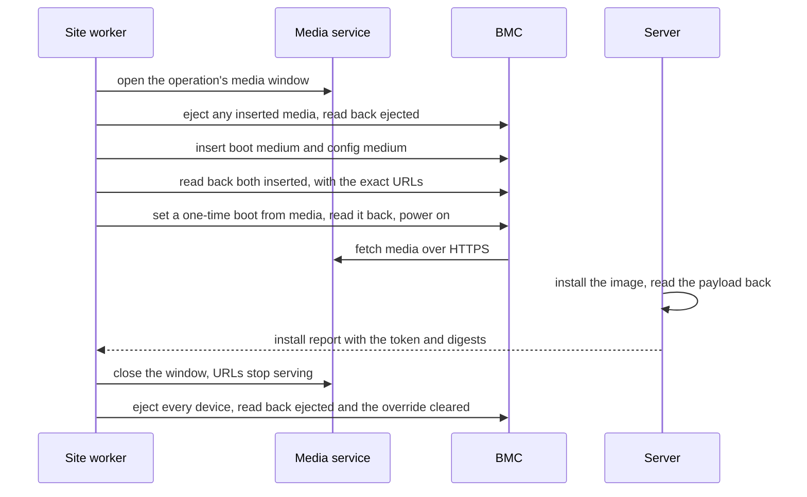

# Boot delivery methods

[Documentation overview](../../README.md) · [Functionality guide](../../functionality/README.md)

- [Summary](#summary)
- [Motivation](#motivation)
- [Proposal](#proposal)
- [Design details](#design-details)
  - [The delivery contract](#the-delivery-contract)
  - [Network boot](#network-boot)
  - [Virtual media](#virtual-media)
  - [Choosing a method](#choosing-a-method)
  - [Commissioning checks](#commissioning-checks)
  - [Addresses](#addresses)
  - [Isolation and security](#isolation-and-security)
  - [Failure modes](#failure-modes)
  - [Acceptance tests](#acceptance-tests)
- [Production readiness review questionnaire](#production-readiness-review-questionnaire)
- [Implementation history](#implementation-history)
- [Drawbacks](#drawbacks)
- [Alternatives](#alternatives)
- [Open questions](#open-questions)
- [Infrastructure needed](#infrastructure-needed)

## Summary

To install, wipe, or burn in a server, Fleet boots it from an image. A **boot
delivery method** is how that image reaches the server. This enhancement
defines two methods behind one contract:

- **Network boot.** Fleet answers the server's boot NIC over relayed DHCP and
  boots it over UEFI HTTP boot, only while the operation runs.
- **Virtual media.** Fleet tells the server's BMC, through Redfish, to mount
  boot media from a URL and boot from it once.

Each site declares the methods it offers. A provider machine class can require
one. Customers never choose a method, and the Metal API does not change.

Custody, admission, operations, power, image selection, and sealed bootstrap
data are the same for both methods. Each method only prepares delivery, proves
what the server booted, and proves that the delivery path is closed afterwards.

Network boot is built first. Virtual media is added later behind the same
contract. This enhancement is a proposal. Nothing in it is implemented.

## Motivation

The [boot network reservations][boot-network-pr] and [server
networking][server-networking-pr] proposals define network boot. Network boot
needs a provisioning VLAN at the site, relays on the site's routers, a central
DHCP service, and a WAN link between them. A site that does not have those yet
cannot install any server. That includes the servers that would run the site's
own infrastructure.

Many BMCs can mount boot media from a URL. That needs only the BMC network,
which every site has before it has anything else. Treating virtual media as a
separate install path would duplicate custody, fencing, and recovery, so it
needs to fit the same contract as network boot.

### Goals

- One install contract that every delivery method meets.
- A site declares its methods. A machine class can require one.
- Every method proves what the server booted and that the delivery path closed.
- An uncertain prepare, verify, or release never becomes success.
- Commissioning records which methods a server's BMC can use, and Fleet never
  attempts a method the server cannot use.
- Virtual media installs get their addresses from the same owner as network
  boot installs.
- Virtual media never exposes one customer's bootstrap data to another.

### Non-goals

- Letting a customer choose a method per install.
- Customer access to virtual media, through a provisioning session or any other
  path.
- Delegated customer PXE ([#59][pxe-pr]) at a site that offers only virtual
  media. Delegated PXE needs network boot.
- Building boot media. The provider's image pipeline builds them, as
  [#184][images-pr] describes for every other image artifact.
- Vendor APIs other than Redfish, including IPMI virtual media.
- Legacy BIOS boot.
- Secure Boot and measured boot.

## Proposal

The site worker that runs an operation delegates three steps to the
operation's delivery method: prepare, verify, and release. Everything before
and after those steps is the same for every method.

| Step | Network boot | Virtual media |
| --- | --- | --- |
| Prepare | Boot attachment, provisioning address, DHCP reservation served, one-time UEFI HTTP boot | Boot and config media inserted and read back, one-time boot from media |
| Verify | The install report carries the token served only to that NIC | The install report carries the token written only to that operation's config medium |
| Release | Every declared DHCP instance reports the reservation dropped | Every media device reads back ejected, and the URLs stop serving |

Both methods also read back that the one-time boot override is cleared.

### User stories

- An operator brings up a new site. Before its provisioning network and relays
  exist, Fleet installs the site's own infrastructure servers over virtual
  media, using only the BMC network.
- A provider sells many identical servers at a site with network boot. Fleet
  installs them in parallel over the host NICs, with no traffic through the
  BMCs.
- A provider offers a machine class only on virtual media. Fleet allocates a
  customer only a server whose BMC passed the virtual media check.
- A BMC accepts a mount but never reports it ejected. The operation stays
  unknown and the server stays out of use until the media are proven gone.

### Relationship to other proposals

- **[Device custody](../device-operations/README.md):** unchanged. Each
  delivery step runs inside an admitted operation, under its fence, and is
  journaled like every other step. Settlement gains one rule, described in
  [Settling a hold](#settling-a-hold).
- **Boot network reservations ([#87][boot-network-pr]) and server networking
  ([#186][server-networking-pr]):** become the network boot method. Their
  evidence gates are its verify and release steps. Two changes: a site can
  offer more than one method, and the one-time boot override is read back after
  release.
- **Central DHCP ([#197][central-dhcp-pr]):** its proof that every declared Kea
  instance dropped a reservation is the network boot release step.
- **OS images and bootstrap data ([#184][images-pr]):** unchanged for the
  customer. An image gains a boot medium artifact to be offered on virtual
  media. The sealed payload is delivered on a config medium instead of from the
  boot service.
- **Commissioning ([#185][commissioning-pr]):** commissioning gains a delivery
  check, and capacity gains one more `Available` condition.
- **PXE installation ([#59][pxe-pr]):** its customer Redfish gateway already
  refuses virtual media. That stays true.

## Design details

Names are provisional. Examples use synthetic data.

### The delivery contract

Every delivery method meets all of these rules. A method that cannot meet one
is not allowed.

1. **Exact inputs first.** The operation records its method, image digest,
   bootstrap digest, and host network configuration before any effect. A
   method adds its own inputs to that record, such as a provisioning address,
   and never reads a mutable source after admission.
2. **Prepare under the fence.** The worker prepares delivery only while the
   operation holds the Device's current fence. Each prepare step is journaled
   before it is sent, like every other step.
3. **Verify what booted.** Success needs evidence that the server booted this
   operation's input, not only that a boot happened. Both methods use a random
   token that only this operation's delivery can carry. The install report
   must return that token with the image and bootstrap digests, as
   [#184][images-pr] defines.
4. **Prove release.** Before the operation succeeds, the worker proves that the
   delivery path can no longer reach the server. Release proof covers every
   delivery that the site ever prepared for the Device, not only this
   operation's.
5. **Unknown is not ready.** A prepare, verify, or release step whose result
   the worker cannot prove ends the operation `OutcomeUnknown`, with a recovery
   hold. It never ends `Succeeded`.

A method also defines what it needs from the site, from the server's BMC, and
from the image. Commissioning checks the BMC part.

#### Settling a hold

A held installation or wipe is settled by a later operation of the same kind
that succeeds, as [device custody](../device-operations/README.md#unknown-outcomes)
defines. A settling operation proves release only for its own method. So while
a hold exists, the coordinator admits a settling operation only if it uses the
held operation's method. Otherwise it refuses with `DeliveryMethodMismatch`.

### Network boot

Network boot is the method in [#87][boot-network-pr] and
[#186][server-networking-pr], with the central DHCP service in
[#197][central-dhcp-pr]. This enhancement adds no new behavior to it except the
override check.

- **Prepare.** The requester creates the boot attachment claim and the
  provisioning address claim. The site publishes the reservation and waits for
  a DHCP report that serves it. The worker sets the UEFI HTTP boot target and a
  one-time boot, then powers the server on.
- **Verify.** The boot service serves the boot script, with the boot
  admission's token, only to that NIC while the admission is open. The install
  report returns the token.
- **Release.** Every declared DHCP instance reports a feed, issued after the
  reservation was published, that serves no address the site ever published
  for the Device. The worker reads back that no one-time boot override is set.
  The requester then deletes the claims, under the rules in
  [#186][server-networking-pr].

The site needs a provisioning network on the boot NIC, relays to the central
DHCP service, and a WAN link. The BMC needs UEFI HTTP boot.

### Virtual media

Virtual media mounts two media on the server's BMC:

- **Boot medium.** A bootable image built by the provider's image pipeline and
  listed in the image's artifact manifest by digest. It holds the installer
  and the image, and nothing specific to a customer or an operation. It can be
  cached and is served to any BMC at the site.
- **Config medium.** A small medium the worker renders for one operation. It
  holds the rendered bootstrap payload, the host network configuration, and
  the operation's token, in the format the image reads, such as a NoCloud
  volume.

An image with no boot medium in its manifest is not offered on virtual media.
Admission refuses it with `ImageIncompatible`.



- **Prepare.** The media service serves media to BMCs, at the endpoint the
  site's enrollment names. The worker opens a window for the operation on it. The window serves the
  boot medium at a URL derived from its digest and the config medium at a URL
  that carries a random 256-bit token. Before inserting, the worker ejects any
  media already inserted on the server and reads back that they are gone. It
  then inserts both media, reads back that each device reports the exact URL,
  sets a one-time boot from media, reads it back, and powers the server on.
- **Verify.** The config medium is the only place the operation's token
  exists. The install report must return it with the image and bootstrap
  digests.
- **Release.** The worker closes every window the media service holds for the
  Device, so no URL for it serves again. It ejects every virtual media device
  on the server, then reads back that every device reports no media and that
  no boot override is set. Release covers every window and every device, so it
  also covers media that an earlier, held operation inserted.

The site deletes the rendered config medium when the operation ends or a
higher fence stops the worker, as [#184][images-pr] requires for every copy of
a bootstrap payload.

Virtual media needs only the BMC network. It needs no provisioning VLAN, boot
attachment claim, provisioning address, relay, or DHCP. The switch port does
not move during an install.

#### Install report

The install report travels over one of two channels. The image's
qualification names which one it supports:

- **Network.** The installer reaches the site's report endpoint with the
  Machine's addresses. See [Addresses](#addresses).
- **Console.** The installer writes the report to the serial console, and the
  worker reads it through the BMC. Commissioning burn-in already reports this
  way. A wipe or a burn-in has no Machine addresses, so it uses the console.

#### BMCs with one media device

A BMC that can mount only one medium gets a single medium per operation that
combines boot and config. Because it carries bootstrap data, it is served only
under the rules for config media.

### Choosing a method

#### Site declaration

A site's enrollment lists the methods it offers, in order of preference, with
what each method needs:

```yaml
site: site-example-1
deliveryMethods:
  - method: NetworkBoot
    dhcp: Synchronized
  - method: VirtualMedia
    mediaEndpoint: https://media.site-example-1.example.net
    addresses: Static          # Static | DataNetwork
    reportChannels: [Console, Network]
```

Adding a method takes effect for new operations. Removing a method is refused
while any operation that used it has not ended or still holds the Device.

#### Machine class

A provider machine class definition can list the methods its servers may use.
Without a list, every method the site offers is allowed. The allocator matches
a class only to capacity that is qualified for at least one allowed method, so
a server that cannot use the class's method is never allocated to it.

#### Selecting the method for an operation

The requester selects the method when it creates the operation: the first
method in the site's order that the class allows and the server's latest
commissioning qualified. It records the method in the operation. Staff
operations have no class, so the class rule is skipped for them. A
commissioning selects its burn-in method from its own delivery phase.

Admission checks the recorded method again under the custody update and refuses
an operation whose method:

- the site does not offer, with `DeliveryMethodNotOffered`;
- the class does not allow, with `DeliveryMethodNotAllowed`;
- the server is not qualified for, with `DeliveryMethodUnqualified`; or
- does not match the operation's other inputs, for example a network boot
  without a boot network input, or a virtual media operation with one.

Each refusal sends nothing. The method never changes after admission, and a
reinstall selects again under the same rules.

### Commissioning checks

The commissioning in [#185][commissioning-pr] gains a delivery phase, after
firmware and before burn-in. It checks every method the site offers.

For virtual media, the worker reads the BMC's virtual media devices and records:

- the media types each device accepts, and how many media it can mount at once;
- whether the BMC offers the insert and eject actions;
- the transfer protocols it accepts, and whether HTTPS is one of them;
- whether it can verify the media service's certificate; and
- whether it allows a one-time boot from each media type.

Then it probes. It inserts the site's probe medium, which is small and holds
no data, from the media service over HTTPS. It reads back that the BMC
reports it inserted and that the media service saw the fetch, then ejects it and
reads back that it is gone. The probe is the only proof that the BMC can reach
the media service.

For network boot, the worker records whether the BMC accepts a UEFI HTTP boot
target and a one-time network boot.

Commissioning evidence records each method as qualified or not, with the first
check that failed. Burn-in then boots with the first qualified method. If the
server qualifies for none of the site's methods, the commissioning succeeds
with result `Failed`, in the delivery phase. If a probe cannot be proven
ejected, the commissioning ends `OutcomeUnknown`, like any other step.

The capacity projector adds one condition to `Available`: the server is
qualified for at least one method the site offers. Otherwise `Available` is
`False` with `NoDeliveryMethod`. It also keeps `Available` `False` with
`MediaInserted` while discovery reports inserted media or a set boot override
on a server with no active operation.

### Addresses

The installed operating system needs addresses with either method. The firmware
needs one only for network boot.

| Address | Network boot | Virtual media | Owner |
| --- | --- | --- | --- |
| Firmware provisioning address | Yes, for the boot window | None | IPAM, through the operation's claim |
| Machine interface addresses | Yes | Yes | IPAM, through NSO interface claims on the Machine |

[Server networking][server-networking-pr] already pins the host network
configuration, with each interface's MAC, addresses, gateway, and MTU, into
the installation by digest. Virtual media uses that configuration in one of two
ways:

- **The data network provides the addresses.** The network owner's DHCP on the
  customer's network serves the Machine's addresses. The config medium carries
  none.
- **Fleet supplies static configuration.** The worker writes the pinned host
  network configuration onto the config medium in the image's format, such as
  a NoCloud network configuration or a Talos machine configuration.

The site's enrollment chooses one per site. In both cases IPAM is the one
source of the addresses. Fleet copies them and never chooses one.

No boot attachment moves the port under virtual media, so NSO attaches the
Machine's interfaces before the install. An install that takes its addresses
from the data network, or reports over the network, waits until every
interface is `Programmed`. A wipe and a burn-in hold no Machine, so under
virtual media they run with no network.

### Isolation and security

- **No boot network.** A virtual media install never puts the switch port on a
  provisioning network, so it cannot reach another server's boot traffic.
- **One BMC, its own media.** Only the operation's worker inserts media, and it
  inserts them only on the Device it holds under custody, at the BMC endpoint
  in the operation's Device snapshot. No customer-facing session can insert
  media.
- **Reachability.** The media endpoint must be reachable from the site's BMC
  network. It accepts requests only from that network's addresses, and serves
  only media for open windows.
- **Public boot media.** A boot medium holds no customer or operation data, so
  any BMC at the site may fetch it.
- **Scoped config media.** A config medium is served only over HTTPS, only at
  its token URL, and only while its window is open. The window closes when the
  install report arrives, when its deadline passes, or when a higher fence
  stops the worker. A BMC that cannot fetch over HTTPS can use virtual media
  only for operations that carry no bootstrap data and report over the
  console, such as a wipe or a burn-in. Over plain HTTP the token can be read
  on the BMC network, so a network report could be forged.
- **No secrets in records.** Journals, evidence, and logs record media digests,
  never a token or a config medium URL.

### Failure modes

| Failure | Effect |
| --- | --- |
| The BMC accepts an insert but never reports the media inserted | Nothing is powered on. The worker ejects and reads back. If the eject cannot be proven, the operation ends unknown. |
| The BMC reports media inserted after eject, or reports stale state | Release cannot be proven. The operation ends unknown and the server stays held. |
| The BMC ignores the one-time boot and boots from disk | No install report arrives. The operation ends unknown at its deadline. |
| The transfer through the BMC is slow | The install takes longer. Virtual media deadlines are set per site, and a large image may not fit them. |
| Many installs at once | Each BMC streams its media from the media service, so the service and the BMC network carry every install. Network boot carries it on the host NICs instead. |
| A WAN outage between a site and the central cluster | Network boot stops at that site, because DHCP and boot files are central. Virtual media keeps working if the media service runs at the site with a local copy of the media. |
| The media service is down | Prepare fails before power-on. Nothing reached the server, so the operation fails, unless an insert was sent, in which case the worker reads back and ejects first. |

#### Choosing a method as an operator

| Need | Better method |
| --- | --- |
| Install a site's own servers before its provisioning network exists | Virtual media |
| A site with no relay or WAN path to the central DHCP service | Virtual media |
| Many identical servers installed in parallel | Network boot |
| Large images, or installs that must finish quickly | Network boot |
| Delegated customer PXE | Network boot |
| BMCs with unreliable virtual media | Network boot |

### Acceptance tests

These tests are required and not implemented:

- A virtual media install succeeds, and afterwards every device reads back
  ejected, the override reads back cleared, and the config URL no longer
  serves.
- The install report carries another operation's token, and the operation does
  not succeed.
- An eject cannot be proven, and the operation ends `OutcomeUnknown`. A later
  install over network boot is refused while the hold exists, and a later
  install over virtual media settles it.
- A delayed worker tries to insert media after a newer operation is admitted,
  and the site journal refuses it.
- A server whose BMC failed the virtual media check is never allocated to a
  class that requires virtual media.
- An operation records a method that the site does not offer, and admission
  refuses it without sending anything.
- A BMC without HTTPS is refused an install with bootstrap data over virtual
  media.
- A fetch from outside the BMC network, or after the window closes, gets
  nothing.
- The network boot tests in [#87][boot-network-pr] and [#197][central-dhcp-pr]
  still pass through the shared contract.

## Production readiness review questionnaire

These controls are proposed, not implemented.

### How do operators enable or disable the feature?

Per site, through the enrollment's method list. Removing a method waits until
no operation that used it holds a Device.

### Does enabling the feature change any default behavior?

No. A site with only network boot behaves as [#186][server-networking-pr]
describes.

### What must operators monitor?

Operations held on unproven release, per method. Servers reporting
`MediaInserted` or `NoDeliveryMethod`. Media service fetch latency, errors,
and requests from outside the BMC network. Virtual media installs near their
deadline.

### What does the feature depend on?

Redfish virtual media on each BMC, a media service reachable from the BMC
network, and boot media in the image catalog.

### Does the feature add API types or calls?

No new kinds. Operations gain a delivery method input. Site enrollment and the
provider machine class definition gain a method list. Each virtual media
install adds a few Redfish calls and two media fetches.

## Implementation history

- 2026-11-26: Proposed.

## Drawbacks

- Two methods mean two sets of BMC behavior to qualify, test, and monitor.
- BMC virtual media is slower and less consistent across vendors than network
  boot.
- Every virtual media image needs a boot medium artifact as well as its
  network boot artifacts.
- A site's media service is a new service on the BMC network.

## Alternatives

- **The customer chooses per install.** Rejected. The method depends on the
  site and the hardware, which the customer cannot see.
- **One combined medium per operation for every BMC.** Simpler, but the whole
  image would be served under a per-operation URL and could not be cached.
  Kept only for BMCs with one media device.
- **Bootstrap data on the boot medium.** Rejected. One customer's data would
  sit on media that any BMC at the site may fetch.
- **Virtual media as a separate install path.** Rejected. It would duplicate
  custody, fencing, and recovery.
- **Network boot with static addresses and no DHCP.** Firmware support is
  limited, and it still needs a provisioning network.

## Open questions

- **Report channel.** Whether the first virtual media images report over the
  console, over the network, or both.
- **Certificate verification.** Whether a BMC that fetches over HTTPS but
  cannot verify the media service's certificate may receive a config medium.
- **Where the media service runs.** At each site, which survives a WAN outage,
  or centrally, which serves BMCs over the management WAN.
- **Images that fetch over the network.** Some installers download the image
  during the install. Whether those are offered on virtual media when the data
  network provides addresses.
- **Deadlines.** The default virtual media deadline, and whether it depends on
  image size.

## Infrastructure needed

Testing needs a site with both methods, BMC emulators whose virtual media can
fail to mount, report stale state, and refuse to eject, and a media service on
an emulated BMC network. Hardware qualification needs servers from each BMC
vendor the provider plans to support, with reachable BMCs.

[boot-network-pr]: https://github.com/datum-cloud/fleet/pull/87
[server-networking-pr]: https://github.com/datum-cloud/fleet/pull/186
[central-dhcp-pr]: https://github.com/datum-cloud/fleet/pull/197
[images-pr]: https://github.com/datum-cloud/fleet/pull/184
[commissioning-pr]: https://github.com/datum-cloud/fleet/pull/185
[pxe-pr]: https://github.com/datum-cloud/fleet/pull/59
