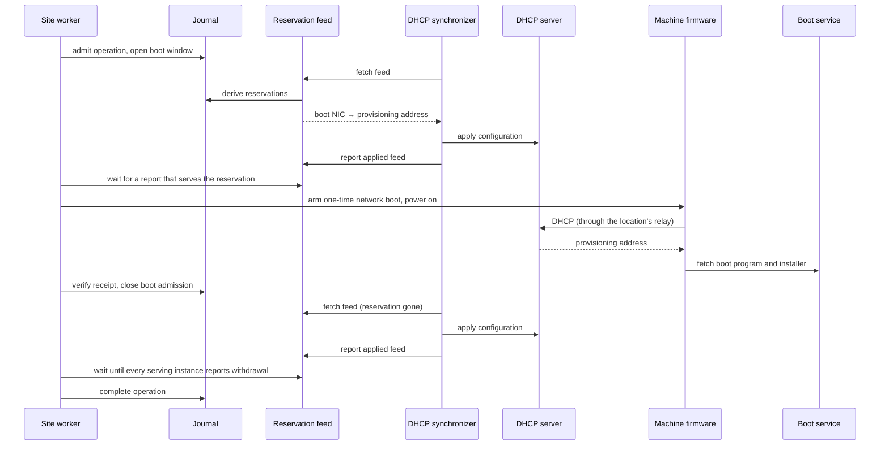

# Boot network reservations

- [Summary](#summary)
- [Motivation](#motivation)
  - [Goals](#goals)
  - [Non-goals](#non-goals)
- [Proposal](#proposal)
  - [User stories](#user-stories)
  - [Physical and consumer addresses](#physical-and-consumer-addresses)
  - [Reservation lifecycle](#reservation-lifecycle)
- [Design details](#design-details)
  - [Ownership](#ownership)
  - [Physical asset records](#physical-asset-records)
  - [Reservation feed and applied reports](#reservation-feed-and-applied-reports)
  - [Evidence gates](#evidence-gates)
  - [DHCP synchronizer](#dhcp-synchronizer)
  - [What firmware boots](#what-firmware-boots)
  - [Release and recovery](#release-and-recovery)
  - [Security boundaries](#security-boundaries)
  - [Acceptance tests](#acceptance-tests)
- [Production readiness review questionnaire](#production-readiness-review-questionnaire)
- [Drawbacks](#drawbacks)
- [Alternatives](#alternatives)
- [Open design questions](#open-design-questions)
- [Infrastructure needed](#infrastructure-needed)

## Summary

A physical machine that network-boots needs an address before Fleet can serve it
an installer. This proposal makes that address a short-lived, physical-side
reservation. Fleet publishes a reservation for a machine's boot NIC only while
that machine's network boot is admitted. The network owner's DHCP applies it and
reports what it applied. Fleet starts a network boot only after DHCP reports the
reservation served. It completes the operation only after every DHCP instance
that served it reports it withdrawn.

The [PXE installation enhancement](../pxe-installation/README.md) assumes
"provider DHCP directs eligible firmware to that service" and requires release
to fence provisioning networking. This proposal defines how both happen without
moving DHCP ownership into Fleet.

## Motivation

A DHCP server configured independently of Fleet answers a machine on every boot.
It cannot tell an admitted installation from a stray reboot, and Fleet cannot
prove that a machine's provisioning access ended. Running DHCP at every location
also adds a stateful service per site.

The opposite extreme also fails. If Fleet writes DHCP configuration directly, it
becomes a second writer of another owner's system and needs that owner's
credentials. If DHCP asks Fleet on every request, every boot depends on Fleet's
availability and latency, and a failure looks like a DHCP timeout.

The provisioning address also differs from the addresses a consumer receives.
Release must withdraw provisioning access without touching anything a tenant
uses. That is impossible when firmware and the running OS share one address.

### Goals

- Answer DHCP for a machine's boot NIC only while its network boot is admitted.
- Keep DHCP, IPAM and relay configuration with the network owner, with one
  writer for DHCP configuration.
- Treat DHCP state as evidence: a network boot requires proof the reservation is
  served, and completion requires proof it was withdrawn.
- Separate physical-side provisioning addresses from consumer Machine addresses.
- Let a location use central DHCP through relays, with no DHCP server at the site.
- Keep a location that configures DHCP independently working, explicitly marked.

### Non-goals

- Running a DHCP server as part of Fleet.
- Allocating consumer Machine addresses; Networking/IPAM does that through the
  Machine.
- Configuring relays, VLANs or switch ports.
- Authenticating firmware by MAC. A MAC routes a request; it never authorizes one.
- Permanently network-booted workloads.

## Proposal

### User stories

- A provider runs central DHCP for several locations. Site routers relay to it,
  and no location runs a DHCP server.
- An operator reboots an installed machine. DHCP does not answer its boot NIC, so
  it boots from disk and is never reinstalled by accident.
- A release completes only after the machine's provisioning access is proven
  gone, so capacity returns to supply with no lingering boot path.
- A DHCP instance restarts or a report is lost. Fleet treats the boot as not yet
  ready, or the withdrawal as unproven, and never as success.

### Physical and consumer addresses

| | Address | Belongs to | Lifetime | Owner |
| --- | --- | --- | --- | --- |
| Physical | BMC endpoint | Physical asset | The hardware's life | Networking/IPAM (out-of-band) |
| | Provisioning attachment (address and gateway) | Physical asset, during an admitted network boot | The boot window | Networking/IPAM allocates; Fleet publishes |
| | Underlay (loopback, routing peers) | Physical host on the fabric | The host's life at the location | Galactic and IPAM |
| Consumer | Machine interfaces | Allocation | Allocation to release | Networking/IPAM, through the Machine |

A location must give the install NIC a provisioning network whose addresses are
never consumer addresses. A location where firmware boots on the same untagged
network and address as the running OS does not qualify for synchronized DHCP.

### Reservation lifecycle

## Design details

### Ownership

| Surface | Single writer |
| --- | --- |
| Which boot NICs hold a reservation, and when | Fleet, derived from the site journal |
| DHCP server configuration | The network owner's synchronizer |
| Provisioning attachments (address, gateway, prefix) | Networking/IPAM |
| Relays, VLANs, switch ports | The network owner |
| Boot program and installer delivery | Fleet's boot service |

Fleet never connects to the DHCP server. The synchronizer pulls Fleet's feed and
pushes reports, so Fleet needs no credential for the network owner's systems.

### Physical asset records

The site enrollment is the retained, explicit record of each physical asset. Per
target it holds the BMC endpoint, the Redfish System (Id and UUID), the boot NIC
MAC and, for synchronized DHCP, the provisioning attachment. A Redfish System Id
is unique only within its BMC; physical BMCs commonly expose one System named
`Self`. System identity is therefore the endpoint plus Id, and the UUID.

A location declares one DHCP mode:

- **static:** DHCP is configured independently of Fleet. Targets carry no
  provisioning attachment, and no DHCP evidence is required.
- **synced:** every target carries a provisioning attachment, addresses are
  unique, and the evidence gates below apply.

The enrollment is retained once and a changed enrollment is refused for a
retained journal. In the target design, provisioning attachments are allocated
by Networking/IPAM per physical asset and referenced from inventory, and NIC MACs
and BMC endpoints are recorded as inventory observations. Until then the
enrollment carries them as explicit values.

### Reservation feed and applied reports

The site exposes an authenticated feed, separate from the firmware-facing boot
listener. It reads the journal read-only and writes only retained reports.

- **Feed.** The complete desired set of reservations: boot NIC MAC, provisioning
  address in prefix form, gateway and expiry. A reservation exists while its
  operation holds the journal's current epoch, binding and fence, is not done,
  has not closed boot admission and is inside its boot window. That starts at
  admission, before power-on, so DHCP is ready when firmware asks. Reservations
  are sorted canonically and the revision is a digest of them, so any copy of a
  feed is self-verifying.
- **Applied report.** A named DHCP instance reports the exact feed it now
  serves. The site accepts only a canonical feed with a matching revision and
  retains the report durably before acknowledging it.

### Evidence gates

1. **Before arming a network boot**, the worker waits, with no effect, for a
   report accepted after admission that serves the boot NIC at its exact
   provisioning address. A report from an earlier operation is not evidence. If
   the boot window expires first, the operation stays Unknown and effect-free.
2. **Before reporting success**, the worker requires that every instance which
   served the reservation during the operation has since reported a feed
   without it. A silent instance may still be serving, so the outcome stays
   Unknown and replay waits again.

Report and admission times come from different roles, so they must run on
synchronized clocks.

### DHCP synchronizer

The synchronizer runs beside one DHCP server instance and is owned and deployed
by the network owner. Each cycle it verifies the fetched feed, adds each
reservation to the base subnet with exactly its prefix, applies the configuration
when the revision changed or the server restarted, and reports only after the
server accepted it. A reservation with no matching base subnet fails the cycle;
it is never dropped. A restarted server loses its reservations, which fails
closed.

Instance names must survive restarts, for example StatefulSet pod names. A
restarted instance then reports under the same name, which is its withdrawal
evidence. Before scaling down, drain an instance until it reports an empty feed;
a removed instance that served a reservation never reports again and keeps that
operation Unknown.

The first synchronizer targets Kea DHCPv4 through its control socket.

### What firmware boots

A reservation supplies an address and gateway only. Firmware must also learn
what to boot. The proposed path for UEFI hardware is UEFI HTTP Boot: before
arming the one-time boot, the worker sets the System's `HttpBootUri` through
Redfish to the boot service, scoped to the operation, and arms `UefiHttp`. DHCP
then carries no boot URL. Firmware that cannot accept a Redfish boot URI needs
a DHCP boot-file option, which would extend the reservation; that is deferred.

Boot URLs and capabilities are never DHCP options in the proposed path.

### Release and recovery

Release "fences provisioning networking" by requiring withdrawal evidence for
the cleanup operation, exactly as for installation. Missing, corrupt or
conflicting evidence keeps the operation Unknown and the capacity occupied. An
unreadable retained report is corruption, never evidence in either direction.
Recovery replays the same operation, which resumes at its retained stage and
waits for evidence again; it never repeats an effect that may have happened.

### Security boundaries

- The feed and reports require a bearer credential of at least 32 characters
  and must be reached over TLS. The feed is never served on the boot listener.
- A report can only claim a canonical, self-consistent feed. The synchronizer is
  trusted to report what its server serves; a compromised synchronizer can
  falsify withdrawal, so its credential is scoped to one location's feed.
- DHCP is unauthenticated and unencrypted. The central server accepts relayed
  traffic only from the location's relay addresses and answers only reserved
  MACs, with no pool. Nothing secret is placed in DHCP.
- A MAC is routing information. Boot artifacts remain protected by the boot
  service's operation-scoped admission.
- Retained reports hold MACs, addresses, revisions and instance names, never a
  credential, receipt or capability.

### Acceptance tests

- No reservation is published without an admitted boot, and none outlives it.
- A network boot is never armed before a served report for the same operation.
- A report from before admission does not satisfy the served gate.
- Completion waits while any serving instance has not reported withdrawal, and
  proceeds once all have.
- Unauthenticated, non-canonical, mismatched or unknown-field reports are
  rejected and not retained.
- A synchronizer reports nothing the server rejected and never drops a
  reservation with no matching subnet; a server restart re-applies without a
  new report.
- Two BMCs exposing the same System Id enroll as distinct targets; a shared
  provisioning address is refused.
- End to end at a location: a relayed DHCP exchange, a UEFI HTTP Boot, release
  with withdrawal, and a reboot of an installed machine that DHCP ignores.

## Production readiness review questionnaire

### How is the feature enabled or disabled?

Per location, through the enrollment's DHCP mode. Moving a location from static
to synced changes the retained enrollment and requires an explicit migration
with no operation in flight. Rollback to static stops new reservations; retained
operations still require their withdrawal evidence.

### What must operators monitor?

Feed and report latency per instance, operations waiting on the served or
withdrawn gate, instances that served and went silent, rejected reports,
synchronizer cycle failures, and DHCP servers receiving traffic from unexpected
relays.

### How are failures recovered?

Restore the synchronizer or server and let it report; the waiting operation
resumes. An instance that is permanently gone after serving requires an operator
decision with evidence that it no longer serves; there is no automatic override.

### What must upgrades preserve?

The retained enrollment, journal and report log, feed canonicalization and
revision derivation, and stable instance names.

## Drawbacks

- Every network boot depends on the network owner's DHCP and synchronizer being
  reachable and reporting, which adds latency and a failure mode to installation.
- Withdrawal evidence can strand an operation as Unknown when an instance
  disappears, by design, and operators must resolve it.
- The location must expose an authenticated feed endpoint to the DHCP owner.

## Alternatives

- **Static reservations configured outside Fleet.** Kept as the static mode,
  but it answers every reboot and cannot prove revocation.
- **Fleet writes DHCP configuration.** Rejected: a second writer of the network
  owner's system, with its credentials held by Fleet.
- **DHCP queries Fleet per request.** Rejected: couples every boot to Fleet's
  availability and latency.
- **Fleet pushes reservations to DHCP.** Rejected: the location would need to
  reach into the network owner's environment; with a pull, the DHCP side starts
  every connection.
- **Route reservations and reports through the management plane.** Avoids a
  location endpoint and reuses existing coordination, but every gate becomes a
  management round trip and management holds evidence only the site uses.
  Remains an option if exposing the site feed is impractical.
- **A DHCP server at every location.** Possible behind the same feed, but it adds
  a stateful service per site; central DHCP through relays is preferred.

## Open design questions

- Provisioning attachments from Networking/IPAM: the claim type, per-asset
  lifetime and how inventory references it.
- NIC MACs and BMC endpoints as inventory observations instead of enrollment
  values.
- Redfish `HttpBootUri` support across qualified BMCs, and the fallback for
  firmware without it.
- Feed transport: a TLS endpoint at the location versus the management-plane
  route.
- Resolving a permanently lost instance with evidence instead of an operator
  decision alone.
- DHCPv6 reservations and an IPv6 provisioning network.
- Per-location synchronizer credentials, rotation and revocation.

## Infrastructure needed

A location with a provisioning network on the install NIC and a relay to the
central DHCP service, the network owner's DHCP service with one synchronizer per
instance and stable instance names, a TLS endpoint for the location's feed, and
disposable UEFI hardware whose BMC accepts a one-time UEFI HTTP Boot target.
