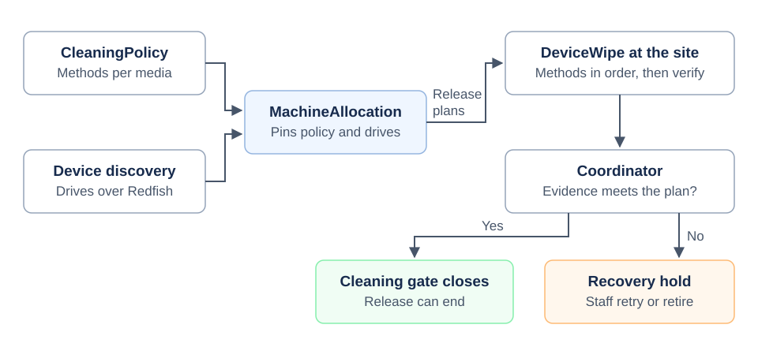

# Cleaning servers between customers

[Documentation overview](../../README.md) · [Functionality guide](../../functionality/README.md)

- [Summary](#summary)
- [Motivation](#motivation)
- [Proposal](#proposal)
- [Design details](#design-details)
  - [CleaningPolicy](#cleaningpolicy)
  - [Methods and assurance](#methods-and-assurance)
  - [Selecting drives](#selecting-drives)
  - [Pinning at allocation](#pinning-at-allocation)
  - [Planning a release](#planning-a-release)
  - [Running a wipe](#running-a-wipe)
  - [Evidence and the cleaning gate](#evidence-and-the-cleaning-gate)
  - [Capacity status](#capacity-status)
  - [What the lab proves](#what-the-lab-proves)
  - [Implementation decisions](#implementation-decisions)
  - [Acceptance tests](#acceptance-tests)
- [Production readiness review questionnaire](#production-readiness-review-questionnaire)
- [Implementation history](#implementation-history)
- [Drawbacks](#drawbacks)
- [Alternatives](#alternatives)
- [Infrastructure needed](#infrastructure-needed)

## Summary

A `CleaningPolicy` says how Fleet cleans each drive of a server before another
customer can use it, what each step must prove, and what assurance the policy
claims. Allocation pins the policy and the server's drives. Release runs a
`DeviceWipe` planned from that pin, and the server leaves release only when the
wipe's evidence meets the policy.

This enhancement is a proposal. Nothing in it is implemented.

## Motivation

MachineCapacity names a cleaning policy that no API defines. Release runs one
lab procedure that zeroes a virtual disk and reads it back. Disk names come from
site enrollment, not from the drives the server reports. Nothing ties what
Fleet erased to what the customer could write.

### Goals

- Providers state, per media type, which erase methods Fleet may use and in
  which order.
- Every drive the customer could write is cleaned, named by its identity, not
  by a guessed device path.
- Each step produces evidence that a reviewer can check against the policy.
- A policy claims only the assurance its methods can give.
- A server whose cleaning is unproven stays out of use.
- Changing a policy never weakens cleaning for servers already allocated.

### Non-goals

- Firmware, BMC settings, and credentials. Other release gates own them.
- Physical destruction and disposal. Staff retire the server instead.
- Storage that is not local to the server, such as SAN or NVMe over fabrics.
  Capacity with such storage is not offered.
- Standards certification. Assurance names follow NIST SP 800-88 and IEEE
  2883, but Fleet makes no certification claim.

## Proposal



### User stories

- A provider publishes a policy that purges NVMe drives with a cryptographic
  erase and falls back to a block erase.
- A customer deletes a Machine, and Fleet erases every drive with the methods
  pinned at allocation.
- A drive refuses its first method, and Fleet uses the next method in the
  policy.
- A wipe's verification fails, and the server stays in release until staff
  retry or retire it.
- A provider adds a drive model to a new policy after it passes hardware
  qualification.

### Relationship to other proposals

This enhancement fills a non-goal of [Device
operations](../device-operations/README.md): cleaning policy content and
assurance levels. It changes these parts of that design:

- **[Operations](../device-operations/README.md#operations):** `DeviceWipe`
  carries a [cleaning plan](#planning-a-release) instead of a policy digest
  and target disks.
- **[Capacity status](../device-operations/README.md#capacity-status):**
  `Available` adds the [cleaning check](#capacity-status).

The [machine lifecycle](../machine-lifecycle/README.md#release-and-project-lifecycle)
release gates are unchanged. This enhancement defines when the `Cleaning` gate
closes.

It takes the media manifest, the coverage rules, and the limits on
cryptographic erase from [#65][release-reuse-pr], without its relational
ledger.

## Design details

### CleaningPolicy

`CleaningPolicy` is in `fleet.datumapis.com` and lives in the provider
project, in the namespace of the MachineCapacity that references it. Provider
operators own it. Customers cannot read it. Examples use synthetic data.

```yaml
apiVersion: fleet.datumapis.com/v1alpha1
kind: CleaningPolicy
metadata:
  name: tenant-reuse-v1
  namespace: infra-ops
spec:
  # Clear or Purge. Every drive must reach it.
  assurance: Purge
  # Rules are matched in order. The first rule that matches a drive applies.
  rules:
    - name: nvme-qualified
      match:
        protocol: NVMe              # NVMe | SATA | SAS
        mediaType: SSD              # SSD | HDD
        # Required for Purge: the drive models and firmware that passed
        # hardware qualification for these methods.
        models:
          - {model: EXAMPLE-NVME-3840, firmware: [EX1.2, EX1.3]}
      # Tried in order. A method runs only if the drive supports it.
      methods: [CryptographicErase, BlockErase]
      verify: {mode: Canary, samples: 64}
    - name: sata-hdd
      match: {protocol: SATA, mediaType: HDD,
              models: [{model: EXAMPLE-HDD-8000, firmware: [EXH4]}]}
      methods: [BlockErase]
      verify: {mode: Canary, samples: 64}
```

The policy's digest is the SHA-256 of its canonical spec. The spec is immutable. To change a policy, a provider creates a new one and
points MachineCapacity at it. Allocations that pinned the old policy keep it.

Validation rejects a policy when:

- a rule lists a method that cannot reach the policy's assurance;
- a `Purge` rule lists no qualified models; or
- a method does not apply to the rule's protocol.

These checks keep a fallback method from lowering the assurance.

### Methods and assurance

Each method has a fixed assurance, from IEEE 2883:

| Method | NVMe | SATA or SAS | Assurance |
| --- | --- | --- | --- |
| `CryptographicErase` | Sanitize with crypto erase | Sanitize with crypto scramble | Purge |
| `BlockErase` | Sanitize with block erase | Sanitize with block erase | Purge |
| `Format` | Format with user data erase | Not applicable | Clear |
| `SecureErase` | Not applicable | Security erase unit | Clear |
| `Overwrite` | Host writes zeros to every block | Same | Clear |

`Overwrite` covers only the blocks the host can address. It says nothing about
remapped or spare flash, so it never reaches `Purge`.

`CryptographicErase` counts only when the drive reports that it encrypted user
data before the allocation began. Enabling encryption during release does not
count.

Each method uses one of two checks:

| Verify mode | Check | Required by |
| --- | --- | --- |
| `Full` | Read every block back and compare it with the written pattern. | `Overwrite` |
| `Canary` | Before the erase, write a random marker to sampled ranges, including the first and last. After it, read them back. No marker may remain. | Every other method |

A rule may require `Full` for any method whose result is a fixed pattern.

### Selecting drives

BMC discovery reads each server's drives over Redfish and records them in
Device status, next to the rest of its inventory. For each drive it records the
serial number, model, firmware, protocol, media type, capacity, and encryption
status. Discovery stays the only writer of Device status.

The capacity projector names drives `disk-0`, `disk-1`, and so on, ordered by
protocol and serial number, and publishes them in MachineCapacity status.
Installations target these names. Site enrollment no longer names disks.

Fleet treats the serial number as an identity claim to match, not as proof.
The wipe environment checks it again on the server itself.

### Pinning at allocation

When it creates a MachineAllocation, the allocator copies into it:

- the policy's name, UID, digest, and spec; and
- the media manifest: each drive's name, identity, capacity, encryption status,
  and the rule that matches it.

Allocation refuses a server whose policy does not resolve, or that has a drive
no rule matches. Later changes to the policy or to discovery do not change the
pin.

### Planning a release

The release controller plans the `Cleaning` gate from the pin and current
discovery:

- Every drive in the manifest gets a step, with its rule's methods and check.
- A drive that discovery reports now and the manifest lacks also gets a step,
  planned with the pinned policy. The customer could have written to it.
- A manifest drive that discovery no longer reports blocks the plan, with
  reason `DriveMissing`. Replacing a drive does not settle the missing one.
- A new drive that no rule matches blocks the plan, with reason `DriveUncovered`.

A blocked plan creates no wipe. The `Cleaning` gate stays open, and the
allocation reports why.

The `DeviceWipe` carries the plan:

```yaml
apiVersion: fleet.datumapis.com/v1alpha1
kind: DeviceWipe
metadata:
  name: alloc-3b9d61c2-wipe-1
  namespace: default
spec:
  creator: system:serviceaccount:fleet-system:release-controller
  deviceRef: {name: server-example-001, uid: 6f1c0b52-1d7e-4a35-9e0b-2c41f7a0d9e3}
  authority:
    allocationRef: {name: alloc-3b9d61c2}
  step: 1
  policy: {name: tenant-reuse-v1, uid: 0d6e3b9a-52c1-4f7e-a8d0-3c9b1e5f7a24,
           digest: "sha256:5b1e0c7d9a3f..."}
  assurance: Purge
  drives:
    - name: disk-0
      serial: EXAMPLE-SN-0001
      model: EXAMPLE-NVME-3840
      firmware: EX1.3
      protocol: NVMe
      capacityBytes: 3840755982336
      rule: nvme-qualified
      methods: [CryptographicErase, BlockErase]
      verify: {mode: Canary, samples: 64}
```

Admission adds one check of its own to the [shared
rules](../device-operations/README.md#admission): the plan must equal the plan
the allocation's pin and current discovery produce. It refuses a mismatch with
reason `PlanMismatch`.

### Running a wipe

The site worker uses Redfish to check identity, power the server off, and boot
the pinned wipe environment over the network once, as it does today. The wipe
environment runs every step on the server and prints one receipt.

Before it changes anything, the wipe environment:

1. lists every local block device and namespace;
2. matches each to a planned drive by serial number, model, and firmware;
3. checks that each in-band size equals the planned capacity, so a hidden area
   fails the plan; and
4. stops with reason `MediaMismatch` if a planned drive is missing or an
   unplanned device exists.

Then, for each drive, it tries the planned methods in order. It skips a method
that the drive reports it does not support, or that a frozen security state
blocks, and records why. It moves to the next method only when the drive
refused a command without starting it. Any other error leaves that drive's
outcome unknown.

The worker journals each step before it sends it, as every [site
worker](../device-operations/README.md#site-execution) does. Erase commands
are never sent twice. After a crash, the wipe environment reads each drive's
sanitize or erase status instead.

### Evidence and the cleaning gate

The wipe returns one entry per planned drive:

```yaml
evidence:
  policyDigest: "sha256:5b1e0c7d9a3f..."
  drives:
    - name: disk-0
      serial: EXAMPLE-SN-0001
      inBandBytes: 3840755982336
      skipped: [{method: CryptographicErase, reason: Unsupported}]
      method: BlockErase
      assurance: Purge
      completion: {status: Succeeded, deviceStatus: "sanitize completed"}
      verify: {mode: Canary, samples: 64, markersFound: 0}
      startedAt: "2026-11-24T18:31:02Z"
      completedAt: "2026-11-24T18:52:40Z"
```

Evidence never carries data read from a drive.

The coordinator checks the evidence against the admitted plan before it accepts
a `Succeeded` result. Every planned drive must have an entry with the planned
identity, a method from its list, the policy's assurance, a completed erase, and
a passed check. A result that falls short becomes `OutcomeUnknown`, and the
server gets a [recovery hold](../device-operations/README.md#unknown-outcomes).
Staff then retry the wipe or retire the server.

The `Cleaning` gate closes when a `DeviceWipe` for the allocation succeeds with
accepted evidence.

### Capacity status

MachineCapacity is `Available` only when its policy resolves and a rule matches
every drive Device discovery reports. A capacity with an uncovered drive
reports reason `CleaningUncovered`. Commissioning uses the same check before
staff enable capacity.

### What the lab proves

The lab runs virtual machines behind a Redfish emulator. It can prove:

- drive discovery over Redfish, the media manifest, and planning;
- matching drives by serial number and refusing a missing or extra drive;
- `Overwrite` with `Full` verification on a virtual disk;
- `Format` with `Canary` verification on an emulated NVMe drive;
- falling back when an emulated drive does not support a method; and
- journaling, crash recovery, and the evidence check.

It cannot prove that any method removes data from real media. Emulated drives
have no spare flash, no controller cache, and no encryption keys. The lab cannot
run `CryptographicErase`, `BlockErase`, or `SecureErase`. Each drive model and
firmware must pass hardware qualification before a policy lists it for those
methods.

### Implementation decisions

Record these decisions before implementation:

- Who approves a hardware qualification, and where its results live.
- Whether staff can release a server whose plan is blocked without retiring it.
- Which roles can create a CleaningPolicy.

### Acceptance tests

These tests are required and not implemented:

- A policy with a fallback below its assurance is rejected.
- A policy cannot change after creation, and an allocation keeps its pin after
  the policy is deleted.
- Allocation refuses a server with a drive that no rule matches.
- A drive is removed during an allocation, and release blocks with
  `DriveMissing`.
- The wipe environment finds an unplanned device and stops before erasing.
- A drive refuses its first method, and the next method's evidence closes the
  gate.
- A canary survives an erase, and the server gets a recovery hold.
- A worker crashes after sending an erase, and the resumed worker reads the
  drive's status instead of sending it again.

## Production readiness review questionnaire

These controls are proposed, not implemented.

### How do operators enable or disable the feature?

Register the kind, then create a policy and point MachineCapacity at it.
Capacity without a policy is not `Available`. Releases always use their pins.

### What must operators monitor?

Blocked plans, recovery holds from wipes, wipe duration per drive model, and
capacity that is not `Available` because a drive is uncovered.

### Does the feature add API types or calls?

It adds `CleaningPolicy` and changes `DeviceWipe`. Discovery adds reads of each
server's drives.

## Implementation history

- 2026-11-25: Proposed.

## Drawbacks

- Each drive model needs hardware qualification before it can reach `Purge`.
- Copying the policy into every allocation duplicates it.
- Running every step in one network boot makes a long wipe one long operation.

## Alternatives

- **Erase over Redfish:** Redfish offers a drive erase action, but its effect
  depends on the vendor, and Fleet cannot verify it without booting the server.
  Fleet can add it as a method once a vendor's action passes qualification.
- **A policy digest without a copy:** Release would fail if the policy were
  deleted. A finalizer would need a writer that tracks every pin.
- **A policy per allocation request:** Customers would choose their cleaning.
  Cleaning protects the next customer, so the provider owns it.
- **A relational ledger, as in [#65][release-reuse-pr]:** It adds a database.
  The allocation and the operation hold everything release needs.

## Infrastructure needed

Testing needs virtual machines with emulated NVMe and virtual disks, and a
Redfish emulator that reports drives. Hardware qualification needs each drive
model and firmware on real servers, and a way to inspect the media after an
erase.

[release-reuse-pr]: https://github.com/datum-cloud/fleet/pull/65
