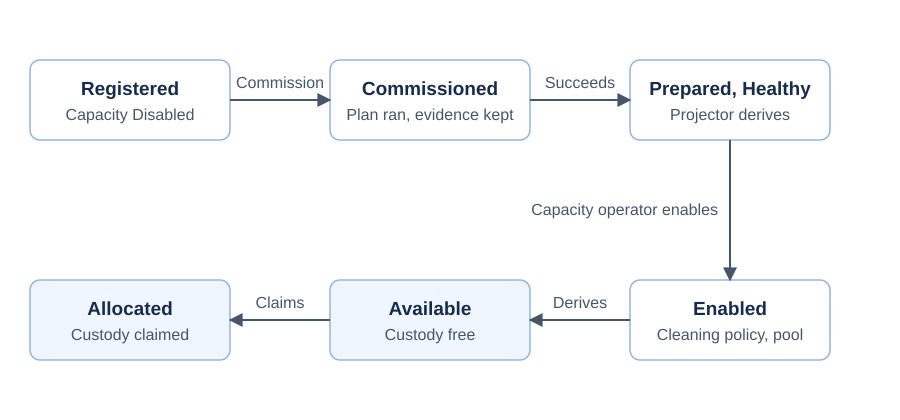

# Device commissioning and sellable capacity

[Documentation overview](../../README.md) · [Device operations](../device-operations/README.md)

- [Summary](#summary)
- [Motivation](#motivation)
- [Proposal](#proposal)
- [Design details](#design-details)
  - [Commissioning plans](#commissioning-plans)
  - [DeviceCommissioning](#devicecommissioning)
  - [Capacity status](#capacity-status)
  - [Enabling registered capacity](#enabling-registered-capacity)
  - [Duplicate identity](#duplicate-identity)
  - [Removing orphaned capacity](#removing-orphaned-capacity)
  - [Who may call the registration webhook](#who-may-call-the-registration-webhook)
  - [Changes to device operations](#changes-to-device-operations)
  - [Write order and crash recovery](#write-order-and-crash-recovery)
  - [Acceptance tests](#acceptance-tests)
- [Decisions for a person](#decisions-for-a-person)
- [Production readiness review questionnaire](#production-readiness-review-questionnaire)
- [Implementation history](#implementation-history)
- [Drawbacks](#drawbacks)
- [Alternatives](#alternatives)
- [Infrastructure needed](#infrastructure-needed)

## Summary

A registered server stays `Disabled` today, and nothing can make it
allocatable. This enhancement adds the missing path. Staff commission the
server under an approved plan, Fleet derives capacity status only from
evidence, and staff enable the capacity with a cleaning policy and a pool.

This enhancement is a proposal. Nothing in it is implemented.

## Motivation

The [device operations](../device-operations/README.md) design requires a
passed commissioning under the current plan before capacity is `Prepared`. No
commissioning kind exists, so no real server can become `Prepared`.
Registration keeps registered capacity `Disabled` until three gaps close: a
duplicate identity race, capacity orphaned by a deleted Device, and an
unauthenticated webhook caller. Test fixtures write capacity conditions
directly, so those conditions prove nothing.

### Goals

- Staff commission a server through custody, like every other physical action.
- A plan is qualified only after a second person approves its exact content.
- Capacity conditions come only from evidence. Editing status cannot make a
  server allocatable.
- Registered capacity can move from `Disabled` to `Enabled` under checks that
  hold for real hardware.
- The same rules apply in every mode, including test modes.

### Non-goals

- Updating firmware. Commissioning checks firmware and fails a server below
  the baseline.
- Inspecting GPUs. A profile that requires GPUs matches no commissioned
  capacity until inspection covers them.
- Cleaning policy content and how a cleaning policy is resolved. Another
  workstream owns the cleaning policy kind.
- Burn-in test content. The plan pins a burn-in image; what it tests is
  operator policy.
- Rack, cabling and network checks.

## Proposal



1. Staff register a Device. Its capacity is created `Disabled`, as today.
2. A plan author writes a commissioning plan. A different person approves it.
3. A commissioning operator creates a `DeviceCommissioning` for the Device
   with a copy of the approved plan. Custody admits it from holder `None`
   and sets holder `Service`.
4. The site worker inspects the server, checks firmware, runs burn-in, and
   returns a proven verdict with evidence. Custody returns to `None`.
5. If the server passed, the capacity projector sets `Prepared` and
   `Healthy` and records the inspected hardware on the capacity.
6. A capacity operator enables the capacity with a cleaning policy and a pool
   label. The projector sets `Available`, and the pool's MachineClass can
   allocate it.

### User stories

- A staff member commissions a new server, enables it, and a customer gets it.
- A hardware team qualifies a new plan for a server model, and servers of
  that model are commissioned again under it.
- Burn-in finds a faulty memory module. The server stops being offered.
- A Device is deleted while its capacity exists. A staff member removes the
  capacity.

### Relationship to other proposals

- **[Device operations](../device-operations/README.md):** adds the
  `DeviceCommissioning` row of the operations table, settles the open decision
  on what makes a commissioning plan qualified, and makes three small
  [changes](#changes-to-device-operations).
- **Inventory-backed capacity registration:** this is registration stage 2. It
  replaces each stage-2 blocker with the rule below, and decides who sets the
  pool label.
- **Cleaning policy:** this enhancement uses a cleaning policy only by name
  and digest. See [The cleaning policy](#the-cleaning-policy).

## Design details

All new kinds are in `fleet.datumapis.com` and live in the provider project.
Names are provisional. Examples use synthetic data.

### Commissioning plans

A `DeviceCommissioningPlan` says what commissioning must prove for a set of
Devices. Its spec is immutable. To change a plan, write a new one.

```yaml
apiVersion: fleet.datumapis.com/v1alpha1
kind: DeviceCommissioningPlan
metadata:
  name: example-2u-v3
  namespace: default
spec:
  creator: {username: plan-author@example.com, uid: 00000000-0000-4000-8000-000000000001}
  deviceSelector:
    matchLabels: {fleet.datumapis.com/hardware-model: example-2u}
  supersedes: [example-2u-v2]
  content:
    inspection:
      cpu: {architecture: amd64, cores: 32}
      memory: {capacity: 256Gi}
      disks: {count: 2, minCapacity: 960Gi}
      interfaces: {count: 2}
    firmware:
      - {component: BMC, version: "5.10.00"}
      - {component: BIOS, version: "2.19.1"}
    burnIn:
      image: {name: burn-in, digest: "sha256:1111111111111111111111111111111111111111111111111111111111111111"}
      duration: 4h
  evidenceLifetime: 2160h
```

| Field | Meaning |
| --- | --- |
| `deviceSelector` | The Devices the plan applies to, by Device labels. It must not be empty. Inventory editors set Device labels. |
| `supersedes` | Plans this plan replaces for the Devices it selects. |
| `content.inspection` | The CPU and memory the server must report exactly, and the minimum disks and interfaces. Every reported component must be healthy. |
| `content.firmware` | The exact version each named firmware component must report. |
| `content.burnIn` | A burn-in image pinned by digest and how long it runs, from 1 minute to 24 hours. |
| `evidenceLifetime` | How long a passed commissioning stays current, from 1 hour to 365 days. |

The creator must be the authenticated caller, as for operations.

#### Qualification

A plan is **qualified** when a `DeviceCommissioningPlanApproval` with the
plan's name exists and all of these hold:

- The approval names the plan's UID and the digest of its spec.
- The approval's creator is not the plan's creator.
- The approval's creator held the commissioning plan approver role when the
  approval was created. IAM checks this on create.

```yaml
apiVersion: fleet.datumapis.com/v1alpha1
kind: DeviceCommissioningPlanApproval
metadata:
  name: example-2u-v3          # the plan's name, so a plan has at most one approval
  namespace: default
spec:
  creator: {username: approver@example.com, uid: 00000000-0000-4000-8000-000000000002}
  planRef:
    name: example-2u-v3
    uid: 00000000-0000-4000-8000-000000000003
    digest: "sha256:2222222222222222222222222222222222222222222222222222222222222222"
```

An approval is immutable. Deleting it revokes qualification. A plan deleted
and created again has a new UID, so an old approval cannot qualify it.

#### The current plan

A plan is a Device's **current plan** when it is qualified, its selector
matches the Device, and no other qualified plan that matches the Device
supersedes it. A supersession therefore applies only to the Devices the
superseding plan selects.

- With no current plan, the capacity reports `NoCurrentPlan`.
- With more than one, including plans that supersede each other, the capacity
  reports `PlanAmbiguous`.
- Revoking a superseding plan's approval makes the plan it replaced current
  again. A passed commissioning under that plan counts again while it is
  within its evidence lifetime. This is the rollback path.

When a superseding plan is qualified, every Device it selects stops being
`Prepared` until it is commissioned under the new plan. A server that a
customer holds is not affected until it is released.

### DeviceCommissioning

| Creator | Authority | Required holder | Inputs |
| --- | --- | --- | --- |
| Staff commissioning operator | `serviceRequest` | `None`, or `Service` under a commissioning hold | The plan's name, UID and digest, and a copy of its content |

```yaml
apiVersion: fleet.datumapis.com/v1alpha1
kind: DeviceCommissioning
metadata:
  generateName: server-example-001-commission-
  namespace: default
spec:
  creator: {username: operator@example.com, uid: 00000000-0000-4000-8000-000000000004}
  deviceRef: {name: server-example-001, uid: 00000000-0000-4000-8000-000000000005}
  authority:
    serviceRequest: {reason: New server intake}
  plan:
    name: example-2u-v3
    uid: 00000000-0000-4000-8000-000000000003
    digest: "sha256:2222222222222222222222222222222222222222222222222222222222222222"
    content: {}              # an exact copy of the plan's content
```

The operation carries a copy of the plan, so the site runs exactly the plan
that admission checked, and the record keeps it after the plan is deleted.

#### Admission

The shared admission rules apply. The kind adds these checks:

| Reason | Refused when |
| --- | --- |
| `PlanNotQualified` | The named plan does not exist, has another UID, or is not qualified. |
| `PlanNotCurrent` | The plan is not the Device's current plan. |
| `PlanMismatch` | The named digest is not the plan's, or the copied content differs from the plan's. |
| `DeviceNotActive` | The Device's inventory lifecycle is not `Active`. |

Like every staff operation, a commissioning never queues.

#### Site execution

The worker uses the Redfish path and the site framework from device
operations. It runs three phases in order and stops at the first that fails:

1. **Inspect.** Read the system's identity, processors, memory, storage and
   network interfaces. The serial number and system UUID must equal the
   Device's, and the hardware must meet the plan. Nothing is sent to the
   server.
2. **Check firmware.** Read the firmware inventory. Each named component must
   report the plan's version. Nothing is sent to the server.
3. **Burn in.** Power the server off, arm a one-time network boot, and power
   it on once. The boot server serves the plan's burn-in image only while the
   operation's boot admission is open. The image runs for the plan's duration
   and reports one result on the console. The worker waits for the server to
   power off and reads its health again.

A commissioning's success test is a proven verdict, not a passing server. When
the worker proves the verdict, the operation ends `Succeeded`, and its
evidence records the result: `Passed`, or `Failed` with the phase that failed
and what it found. A failing server is a proven outcome, so it sets no recovery
hold, and burn-in leaves it powered off.

The operation ends `Failed` only as #174 defines it: admission refused it, or
the worker refused before sending anything, for example because the BMC
cannot boot from the network. It ends `OutcomeUnknown` when the worker cannot
prove the verdict, such as a missing burn-in result at the deadline.

#### Evidence

A `Succeeded` commissioning records:

- the result, and for a failure, the phase and what failed;
- the serial number and system UUID the BMC reported, and the BMC key digest;
- the inspected CPU, memory, disks and interfaces, in the shape of
  MachineCapacity hardware;
- each firmware component and its version;
- the burn-in result and its start and end times, if burn-in ran; and
- the plan's name, UID and digest.

Evidence carries no credential and no raw BMC response.

#### Holds

A commissioning that ends `OutcomeUnknown` sets a commissioning hold. A later
`DeviceCommissioning` that ends `Succeeded`, with either result, settles it,
as the device operations settlement table says. No `Retry` is needed, because staff create the
settling operation directly.

### Capacity status

The capacity projector writes the `Prepared`, `Healthy` and `Available`
conditions and the hardware of every MachineCapacity. It reads the
capacity, its Device, custody, the Device's latest succeeded commissioning,
the current plans, the resolved cleaning policy digest, and the identities of
every Device in the provider scope.

| Condition | True when |
| --- | --- |
| `Prepared` | The Device's latest succeeded commissioning used its current plan, and its result is `Passed`. |
| `Healthy` | `Prepared`, that commissioning ended within the plan's evidence lifetime, discovery is current, and discovery reports the serial number, system UUID and BMC key digest the commissioning recorded. |
| `Available` | `Healthy`, custody is `Verified` with holder `None`, no active operation and no recovery hold, the allocation policy is `Enabled`, the Device is `Active`, the cleaning policy resolves, and the Device has no [duplicate](#duplicate-identity). |

Discovery is current when it matched the Device's identity for its current
generation, read its inventory within twice the discovery interval, and
recorded the BMC key at its current endpoint.

A false condition names the first check that failed, such as
`NotCommissioned`, `CommissioningFailed`, `PlanChanged`, `NoCurrentPlan`,
`PlanAmbiguous`, `EvidenceExpired`, `DiscoveryNotCurrent`, `IdentityChanged`,
`Held`, `AllocationDisabled`, `CleaningPolicyUnresolved` or
`IdentityConflict`. If the cleaning policy owner cannot be reached,
`Available` is `Unknown`, not `False`.

The capacity's hardware is what the latest passed commissioning inspected. A
failed commissioning clears it.

**Editing status cannot make a server allocatable.** The allocator evaluates
the same projection from live inputs, for every capacity it considers, and
does not read the conditions. Custody still decides with a conditional
update. Other readers of the conditions, such as the provider portal and
location matching, display them only.

**Only the projector writes the status of registered capacity.** The
registration webhook now also receives status writes to registered capacity,
and admits them only from the projector's identity. Like its other routes, it
fails closed. If the webhook is down, the projector cannot update status, and
the conditions go stale. Because the allocator does not read them, stale
conditions never make a server allocatable. Status writes to other capacity
are governed by role permissions alone, as today.

Every mode uses the projector. Test modes commission through their simulated
sites instead of writing conditions.

### Enabling registered capacity

The registration webhook keeps registered capacity immutable except for three
fields: the allocation policy, the cleaning policy reference, and the
`fleet.datumapis.com/capacity-pool` label.

- **While the capacity is `Disabled`**, a capacity operator may change all
  three.
- **While it is `Enabled`**, the only permitted change is to `Disabled`.
- **Enabling** requires, at the time of the update, that the caller may update
  the capacity, the annotated Device exists with the annotated UID and is
  `Active`, the Device has no duplicate, the cleaning policy resolves, and the
  pool label is set.

Enabling does not require commissioning. Enabled capacity is not `Available`
until it is `Prepared` and `Healthy`.

The webhook reads Devices, MachineAllocations and the cleaning policy
resolution, and still writes nothing. Each read for a registration decision
reads the current stored state, not a cache.

#### The pool label

The capacity operator sets the pool label, at registration or while the
capacity is `Disabled`. A MachineClass selects capacity by that label.
Freezing it while the capacity is `Enabled` keeps a class from gaining or
losing capacity without the capacity being disabled first.

#### The cleaning policy

Fleet uses a cleaning policy through two values that the [device
operations](../device-operations/README.md) design already names: the
policy's name, on the capacity, and its digest, pinned on each
MachineAllocation. Fleet needs one contract from the cleaning policy owner:
given a name in the provider project, return the policy's current digest,
report that the name does not resolve, or report that the owner cannot be
reached.

Fleet resolves the digest when a capacity is enabled, when the allocator pins
it, and before each projection, which takes the result as an input. Test modes
use a fixed resolver. In production, until the owner provides the contract, no
registered capacity can be enabled.

### Duplicate identity

A Device has a **duplicate** when another Device in the provider scope shares
one of its identity aliases: the serial number, the system UUID, or the
provider host tuple. Retired Devices count until they are deleted, as in
registration stage 1.

Stage 1 cannot stop Device B from being recorded with Device A's serial after
A was registered. No object can make one Device's create and another
Device's registration atomic, and this design does not try. It makes the
duplicate harmless instead:

- **The BMC proves the serial number and system UUID.** Commissioning reads
  both from A's BMC and fails if they differ from A's record. Admission
  already refuses a BMC key that another Device records. So a `Prepared`
  server is the server A's record describes.
- **Every offer checks again.** `Available` and the allocator require that A
  has no duplicate. Once B appears, A is not offered until a person resolves
  the conflict.
- **B can never be registered** while A exists, as in stage 1.

The window that remains is between the allocator's check and its custody
claim. A duplicate recorded in that window does not change which server the
customer gets: A's BMC proved it. The provider host tuple is not proven by
the BMC. For that alias, the recheck is the only protection.

To resolve a conflict, a person corrects the wrong record's identity, or
moves it to `Decommissioning`, then `Retired`, and deletes it.

### Removing orphaned capacity

The registration webhook admits the delete of registered capacity when all of
these hold:

- the capacity is `Disabled`;
- its annotated Device is missing, has a different UID, or is `Retired`;
- no MachineAllocation that has not been released names the capacity; and
- the caller may delete the capacity.

These facts cannot change between the check and the delete. Enabling requires
an `Active` Device with the annotated UID, so the capacity stays `Disabled`.
Allocation requires `Enabled` capacity, so no new allocation can name it.

### Who may call the registration webhook

Today any holder of a certificate from the webhook's client certificate
authority can send the webhook a request and read the verdict. The
environment must give the webhook a certificate authority that issues
certificates only to the API servers that call it. As a second check, the
webhook accepts only the API server identities the environment configures,
and refuses any other caller before reading its request.

### Changes to device operations

This enhancement changes four rules of the [device
operations](../device-operations/README.md) design:

- **Outcome phases.** For a commissioning, `Succeeded` means the verdict is
  proven, whether the server passed or failed. The success test is the proof,
  not a passing server.

- **Retention.** Fleet keeps each Device's latest succeeded commissioning past
  the 30-day retention of finished operations, until a later one succeeds.
  The projector reads it.
- **Deadlines.** A commissioning's deadline is its plan's burn-in duration
  plus one hour, set at admission. Other kinds keep a fixed deadline. A
  commissioning can hold a server as `Service` for up to 25 hours.
- **Capacity status.** `Available` also requires an `Active` Device, a
  resolving cleaning policy, and no duplicate.

### Write order and crash recovery

| Change | Order | After a crash between the writes |
| --- | --- | --- |
| Qualify a plan | Plan, then approval | The plan stays unqualified until the approval exists. |
| Commission a server | Custody, then operation status | As for every operation. |
| Project capacity | Read every input, then write status | The projector derives the status again. |

Every other change in this enhancement is one write.

### Acceptance tests

- A registered server is commissioned over Redfish in the lab, becomes
  `Prepared`, `Healthy` and `Available` after it is enabled, and is allocated.
- A plan approved by its own author does not qualify, and admission refuses a
  commissioning under it.
- A commissioning whose copied plan differs from the approved plan is refused,
  and nothing is sent.
- An inspection or firmware mismatch ends with a `Failed` result, and the lab
  BMC audit shows no effectful request.
- A burn-in failure ends with a `Failed` result, sets no hold, and leaves the
  server off.
- A `Prepared` server is commissioned again and fails, and stops being
  `Available`.
- A commissioning passes its deadline and ends `OutcomeUnknown`, and a later
  commissioning settles the hold.
- A superseding plan is qualified, and only the capacity it selects stops being
  `Prepared`. Revoking it restores the old plan.
- A status edit sets `Available` on unprepared capacity, and the allocator
  still refuses it.
- A status write to registered capacity by any identity but the projector is
  denied.
- Enabling is denied without a resolving cleaning policy, without a pool
  label, with a duplicate Device, or with a Device that is not `Active`.
- An enabled capacity's pool label cannot change until it is disabled.
- A duplicate Device appears after a capacity is enabled, and the capacity
  stops being `Available`.
- Capacity whose Device was deleted is removed, and capacity with an
  unreleased allocation is not.
- A caller with a certificate from the right authority but an unlisted
  identity is refused.

## Decisions for a person

- **Who approves commissioning plans.** This design requires a second person
  with the approver role. A person must decide which team holds that role
  and confirm the two-person rule.
- **Firmware is checked, not updated.** A person must confirm that firmware
  updates stay out of commissioning.
- **Plan content per hardware model.** The burn-in image, its duration, and
  the evidence lifetime are operator policy. Fleet sets no defaults.
- **[A new plan unprepares its Devices](#the-current-plan).** A person must
  accept that free servers of a model leave service until commissioned again.
- **[The cleaning policy contract](#the-cleaning-policy).** The cleaning
  policy owner must agree to provide it.
- **[The webhook's certificate authority](#who-may-call-the-registration-webhook).**
  Each environment must provide a dedicated one.

## Production readiness review questionnaire

These controls are proposed, not implemented.

### How do operators enable or disable the feature?

Register the kinds, roles and webhook rules, then run the projector with the
coordinator. To stop new commissioning, revoke plan approvals. To stop new
allocations, disable capacity.

### Does enabling the feature change any default behavior?

Yes. Capacity conditions come from the projector. Capacity that a fixture
marked `Available` stops being `Available` until it is commissioned.

### What must operators monitor?

Commissioning results by phase, commissioning holds, capacity reporting
`PlanAmbiguous` or `IdentityConflict`, expiring evidence, stale capacity
status, and refused webhook callers.

### What does the feature depend on?

Device custody and site execution, BMC discovery, the boot server, and the
cleaning policy owner.

### Does the feature add API types or calls?

It adds `DeviceCommissioningPlan`, `DeviceCommissioningPlanApproval` and
`DeviceCommissioning`. The projector writes a capacity's status when one of
its inputs changes.

## Implementation history

- 2026-11-25: Proposed.

## Drawbacks

- Commissioning reboots the server and holds it for the burn-in duration.
- Enabling registered capacity waits on the cleaning policy owner.
- A webhook outage stops capacity status updates.

## Alternatives

- **A plan reference on each capacity:** Capacity is a Metal object, and plans
  are Fleet's. Selecting by Device labels keeps plans with the hardware.
- **Approval as a field on the plan:** The plan author and the approver would
  write one object. A separate approval keeps one writer per object.
- **A plan reference instead of a copy in the operation:** The site would need
  to read the provider project, and the record would lose the plan when it is
  deleted.
- **An identity claim object per alias:** A claim cannot make another
  Device's create fail, so it leaves the same window and adds a kind.
- **Updating firmware during commissioning:** A failed update can leave the
  server unbootable, which needs its own recovery design.

## Infrastructure needed

The Redfish lab needs a firmware inventory on the lab BMC and a burn-in mode
in the lab boot image. Hardware qualification needs a burn-in image for each
model.
