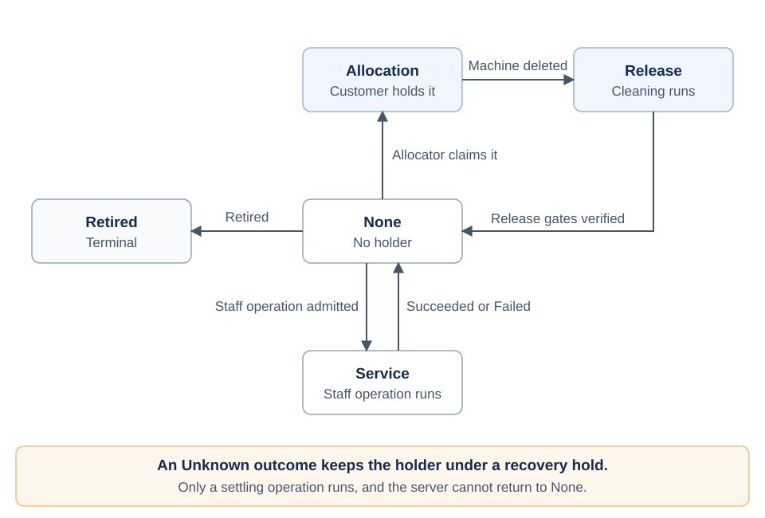
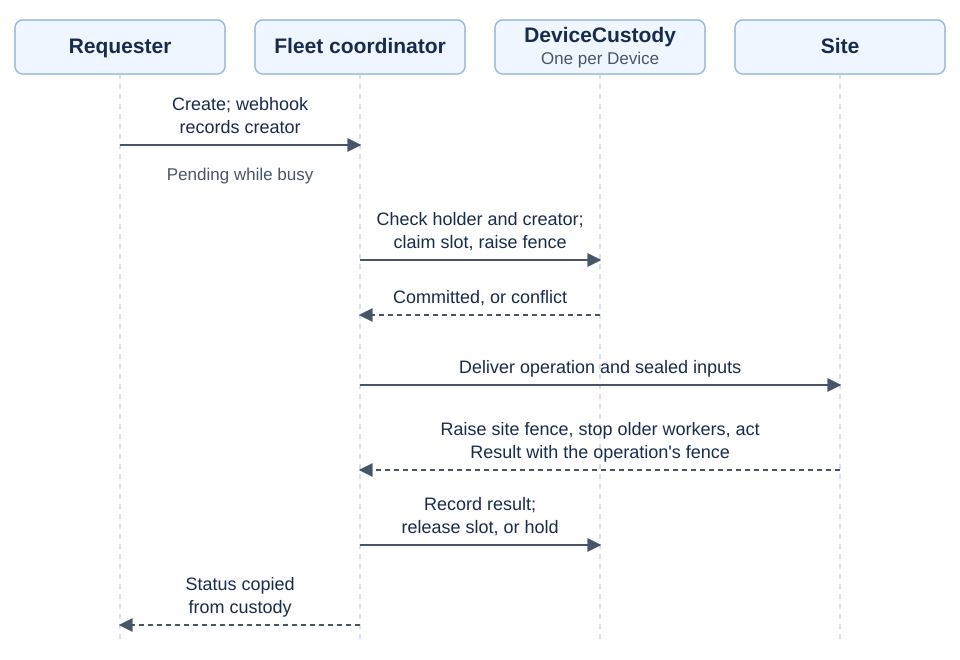

# Device custody and operations

[Documentation overview](../../README.md) · [Functionality guide](../../functionality/README.md)

- [Summary](#summary)
- [Motivation](#motivation)
- [Proposal](#proposal)
- [Design details](#design-details)
  - [API design](#api-design)
  - [Admission](#admission)
  - [Site execution](#site-execution)
  - [Unknown outcomes](#unknown-outcomes)
  - [Write order and crash recovery](#write-order-and-crash-recovery)
  - [Rebuilding custody](#rebuilding-custody)
  - [Customer data](#customer-data)
  - [Capacity status](#capacity-status)
  - [Implementation decisions](#implementation-decisions)
  - [Acceptance tests](#acceptance-tests)
- [Production readiness review questionnaire](#production-readiness-review-questionnaire)
- [Implementation history](#implementation-history)
- [Drawbacks](#drawbacks)
- [Alternatives](#alternatives)
- [Infrastructure needed](#infrastructure-needed)

## Summary

Fleet records custody for each server in one `DeviceCustody` object. Custody
names who holds the server, the one operation running on it, and a fence.
Fleet admits every physical action on the server by updating that object.

Customers keep using the Metal API. Fleet fulfills Metal requests with typed
Device operations. Staff use the same operations for servers that no customer
holds.

This enhancement is a proposal. Nothing in it is implemented.

## Motivation

Customer installs, customer power changes, cleaning between customers,
commissioning, and staff power changes all act on the same BMC, disks, and boot
path. Today each has its own lock, or none, so two actions can reach one BMC at
once. A lock per allocation cannot cover staff work, because staff work has no
allocation.

### Goals

- One record per server says who holds it and what runs on it.
- Every physical action on a server goes through that record.
- Customer and staff work share one operation contract and one executor.
- Staff cannot act on a server that a customer holds.
- A server with an unproven operation outcome stays out of use.
- Staff cannot read customer secrets.
- No new database.

### Non-goals

- Image catalog and bootstrap APIs. Metal owns them.
- Network attachment and address management.
- Cleaning policy content and assurance levels.
- Customer console access.
- How other Metal providers run their hardware.

## Proposal

Three requesters create Device operations in the provider project:

- the Fleet provider for Metal, from Machines and Installations;
- the release controller, from deleted Machines; and
- staff.

The Fleet coordinator admits each operation by updating the server's custody,
then delivers it to the site that can reach the server.


### User stories

- A customer installs an operating system, then reinstalls it.
- A staff member commissions a new server so that it can be offered.
- A staff member power-cycles an unallocated server that stopped responding.
- A customer deletes a Machine, and Fleet wipes the server before reuse.
- An operator settles an operation whose outcome is unknown.

### Relationship to other proposals

This enhancement changes these parts of the [machine
lifecycle](../machine-lifecycle/README.md):

- **[Provider execution and
  recovery](../machine-lifecycle/README.md#provider-execution-and-recovery):**
  per-Device custody and fencing replace per-allocation serialization and
  fencing. Operations add a `Pending` phase before `Admitted`.
- **[MachineAllocation
  record](../machine-lifecycle/README.md#machineallocation-record):** each
  allocation is named from its Machine's UID instead of a generated name.

The machine lifecycle's admission ordering, release gates, and status contract
are unchanged.

This enhancement also absorbs the staff power proposal in [#173][power-pr] as
one operation kind, and replaces the relational ledger in [#60][admission-pr]
and [#62][execution-pr].

## Design details

### API design

All kinds are in `fleet.datumapis.com` and live in the provider project, in the
namespace of their Device. The Fleet coordinator is the only writer of custody
and of operation status. Names are provisional. Examples use synthetic data.

#### DeviceCustody

Each Device has one `DeviceCustody` with the same name.

```yaml
apiVersion: fleet.datumapis.com/v1alpha1
kind: DeviceCustody
metadata:
  name: server-example-001
  namespace: default
  finalizers: [fleet.datumapis.com/custody]
  labels:
    fleet.datumapis.com/device-uid: 6f1c0b52-1d7e-4a35-9e0b-2c41f7a0d9e3
spec:
  deviceRef: {name: server-example-001}
  state: Verified              # Verified | Unverified
  holder:
    type: Release              # None | Allocation | Release | Service | Retired
    allocationRef: {name: alloc-3b9d61c2}
    # Release only. Each entry is a machine lifecycle release gate.
    openGates: [Cleaning, Quota]
  fence: 43
  activeOperation:
    kind: DeviceWipe
    name: alloc-3b9d61c2-wipe-1
    fence: 43
    phase: Dispatched
    deadline: "2026-11-24T19:10:00Z"
  lastResult: {name: alloc-3b9d61c2-install-1, result: Succeeded}
  # After an Unknown outcome: the held operation, its Retry count, and
  # whether a Retry is unused.
  recoveryHold: null
```

Custody keeps its fields in `spec` because it is a coordination record, like a
Kubernetes `Lease`, not desired state. The coordinator removes the finalizer
only after the holder is `Retired`.

No spec in this design holds an object UID. A record pins an object incarnation
with a deterministic name, a label, or status. The one exception is the
authenticated creator of an operation, which records the caller's username and
UID, as a Kubernetes CertificateSigningRequest does.

| Holder | Meaning |
| --- | --- |
| `None` | Nobody holds the server. |
| `Allocation` | A customer Machine holds the server. |
| `Release` | The allocation ended, and release gates are still open. |
| `Service` | A staff operation holds the server. |
| `Retired` | The server is out of service permanently. |



`Allocation` and `Release` name the same allocation. The release controller
reports evidence for each release gate, and the coordinator removes the gate
from `openGates`. The server leaves `Release` only when `openGates` is empty.

The coordinator sets holder `Retired` when inventory retires a Device whose
holder is `None`.

The fence rises only when an operation is admitted and when custody is
[rebuilt](#rebuilding-custody). A holder change does not raise it, so an
operation that is running when its Machine is deleted can still report its
result.

#### Operations

Every operation has a device, an authority, inputs, and a creator. The creator
must equal the authenticated caller. A Fleet validating webhook rejects any
other value and any change to it. Milo calls the webhook from its root API
server, because Milo does not apply admission policies stored in a project.

| Kind | Creator | Authority | Required holder | Inputs |
| --- | --- | --- | --- | --- |
| `DeviceInstallation` | Fleet provider for Metal | `allocationRef` | `Allocation` | Image digest, bootstrap reference and digest, boot interface, target disks |
| `DevicePowerOperation` | Fleet provider for Metal | `allocationRef` | `Allocation` | Power action |
| `DevicePowerOperation` | Staff power operator | `serviceRequest` | `None`, or `Service` under a power hold | Power action, reason, expected system UUID |
| `DeviceWipe` | Release controller | `allocationRef` | `Release` | Cleaning policy digest pinned at allocation, target disks |
| `DeviceCommissioning` | Staff commissioning operator | `serviceRequest` | `None`, or `Service` under a commissioning hold | Commissioning plan and digest |
| `DeviceRecovery` | Staff recovery operator | `serviceRequest` | Any with a recovery hold, or `Unverified` custody | Evidence and a decision: `Settle`, `Retry`, `Retire`, or `Resolve` |

No other creator and authority pairs are valid. Staff roles can read custody,
operations, and MachineAllocations.

For example, an installation:

```yaml
apiVersion: fleet.datumapis.com/v1alpha1
kind: DeviceInstallation
metadata:
  name: alloc-3b9d61c2-install-1
  namespace: default
spec:
  creator: system:serviceaccount:fleet-system:metal-provider   # must be the caller
  deviceRef: {name: server-example-001}
  authority:
    allocationRef: {name: alloc-3b9d61c2}
  image: {name: debian-12, digest: "sha256:9f4ad8d8b8a6..."}
  bootstrap: {ref: sealed-5e0a7d, digest: "sha256:0c2b77e1d9a4..."}
  bootInterface: primary
  targetDisks: [disk-0]
```

Provider and release operations get names from the allocation and the request:
the Installation for installs, the Machine generation for power, and the step
number for wipes. Staff operations get generated names, because each one is a
new request. An operation created after a `Retry` takes the held operation's
name plus `-retry-` and the number of `Retry` decisions for that operation,
which custody records with the hold.

The operation phases are those of the [machine lifecycle
operation](../machine-lifecycle/README.md#provider-execution-and-recovery),
plus `Pending`:

| Phase | Meaning |
| --- | --- |
| `Pending` | Not yet admitted. |
| `Admitted` | Custody names the operation. Nothing has been sent. |
| `Dispatched` | The site accepted the operation. |
| `Verifying` | The site is checking the success test. |
| `Succeeded` | The success test passed. |
| `Failed` | Admission refused it, nothing was sent, or the server refused and did not change. |
| `Cancelled` | Ended before admission: replaced, expired, or no longer matching the holder. |
| `OutcomeUnknown` | A command may have reached the server, and Fleet cannot prove the result. |

Custody holds the phase, result, and result evidence of the active operation,
and operation status copies them. The coordinator admits the next operation
only after it copies the previous result to the previous operation's status.
If that operation no longer exists, the coordinator skips the copy.

### Admission



The coordinator admits an operation with one conditional update to custody,
only if all of these hold:

1. Custody is `Verified`, or the operation is a `DeviceRecovery` with
   `Resolve`.
2. The creator, authority, and holder match a row of the operations table.
3. An `allocationRef` names the holder's allocation.
4. No operation is active.
5. The Device UID matches custody's `device-uid` label, and the Device's
   identity matches current discovery.
6. No other Device that is not retired records the same BMC key digest.
7. Every check that the operation's kind defines for its own inputs passes.

A kind can add checks of its own inputs, such as the expected system UUID, and
its own refusal reasons. Every kind uses these shared reasons:

| Reason | Refused by |
| --- | --- |
| `CustodyUnverified` | Rule 1 |
| `CreatorNotPermitted` | Rule 2 |
| `HolderMismatch` | Rule 2 or 3 |
| `OperationInProgress` | Rule 4 |
| `DeviceIdentityMismatch` | Rule 5 |
| `SharedPublicKey` | Rule 6 |
| `RecoveryHold` | A [recovery hold](#unknown-outcomes) |

The update sets the active operation, raises the fence, and sets a deadline. A
staff operation admitted from holder `None` also sets the holder to `Service`.
If another writer changed custody first, the update fails, and the coordinator
evaluates again.

Provider and release operations wait in `Pending` while another operation
runs, and are admitted oldest first. A newer power operation for the same
allocation cancels an older pending one, except an operation that settles a
hold. Other operations wait in `Pending` until the hold is settled. When the
holder changes, the coordinator cancels every pending operation that no longer
matches it.

Staff operations never wait behind another operation. Admission refuses a staff
operation that cannot run now, because a queued request could run after its
reason is gone. A staff operation not admitted within five minutes, for
example because the coordinator is down, ends as `Cancelled` with reason
`Expired`.

Metal admission, including IAM, entitlement, and quota, still follows the
[machine lifecycle admission
ordering](../machine-lifecycle/README.md#admission-ordering). Custody orders
only physical work.

### Site execution

The federation layer delivers each admitted operation, its device snapshot,
and its sealed inputs to the site. The snapshot holds the BMC endpoint, system
UUID, boot MAC address, and BMC key digest that the coordinator captured at
admission. Sites hold no credentials that can change custody, operations, or
allocations. BMC discovery runs in the site and can write only the status of
the Devices that site serves.

Each site stores the highest fence it has seen for each Device. When an
operation arrives with a higher fence, the site raises its stored fence and
stops every older worker for that Device before it starts the new one.

The site runs one worker per operation. The worker:

1. reads that Device's BMC credential from the site;
2. checks the BMC's TLS key and the system identity, and fails without sending
   anything on a mismatch;
3. records each step in the site journal before sending it, and the journal
   refuses a step whose fence is below the stored fence;
4. after a crash or lost response, queries the server instead of sending again;
   and
5. stops at its deadline.

The site returns results with the operation's fence. The coordinator accepts a
result only if its fence matches the active operation's fence.

Each kind defines the evidence its result carries, such as the power state
before and after a reset. The coordinator records the evidence in custody with
the result. The site deletes its copy after the coordinator accepts or rejects
the result.

### Unknown outcomes

An operation ends as `OutcomeUnknown` when its deadline passes without a
proven result, or when the site cannot prove what the server did. The
coordinator then moves it from `activeOperation` to `recoveryHold`. The holder
stays.

While a hold exists:

- the server cannot return to `None`;
- a held `Allocation` can still move to `Release`, and the hold moves with it;
  and
- the coordinator admits only the settling operations in this table.

Admitting a settling operation raises the fence, so the site stops the held
worker before it starts newer work. A `DeviceRecovery` sends nothing to the
server, but it is delivered the same way. The coordinator applies it only after
the site reports the raised fence.

| Held operation | Settled by |
| --- | --- |
| Power | A `DeviceRecovery` with `Settle` and fresh discovery evidence of the power state, or with `Retry`, then a later `DevicePowerOperation` that succeeds |
| Installation | A later `DeviceInstallation` that succeeds, or a `DeviceWipe` that succeeds after release |
| Wipe | A `DeviceRecovery` with `Retry`, then a later `DeviceWipe` that succeeds |
| Commissioning | A later `DeviceCommissioning` that succeeds |

`DeviceRecovery` decisions:

- `Settle` clears the hold. It returns a `Service` holder to `None` and leaves
  an `Allocation` or `Release` holder in place.
- `Retry` lets the held operation's requester create one settling operation.
  Fleet never retries an operation automatically. Admission accepts a `Retry`
  only for a hold whose row in the settlement table requires one, and only
  when no earlier `Retry` for that hold is unused. The `Retry` raises the
  hold's count and is used when its settling operation is admitted.
- `Retire` sets a `Service` or `Release` holder to `Retired`. Retiring from
  `Release` records how the disks were disposed of.
- `Resolve` names the holder of `Unverified` custody. See [Rebuilding
  custody](#rebuilding-custody).

### Write order and crash recovery

A conditional update on one object is atomic. Where one change spans two
objects, Fleet writes them in a fixed order and recovers from any crash between
them:

| Change | Order | After a crash between the writes |
| --- | --- | --- |
| Reserve quota and allocate | Quota claim, then MachineAllocation, both named from the Machine UID | The coordinator finds both by name. A claim for a deleted Machine is released. |
| Allocate a server | MachineAllocation, then custody | Creating the allocation fails if the name exists, so each Machine gets one allocation. An allocation without custody claims custody again. If another holder took the server, the coordinator deletes the allocation and selects again. No effect ran. |
| Admit or finish an operation | Custody, then operation status | Operation status is copied from custody again. |
| Deliver an operation | Custody, then site delivery | The coordinator delivers again from custody. The site ignores a fence it has already seen. |
| End a release | Custody to `None`, then MachineAllocation to `Released` | The coordinator marks the allocation `Released`. |

Fleet keeps finished operations for 30 days. Platform audit records keep the
history after that.

### Rebuilding custody

If custody is missing for an existing Device, for example after a restore, the
coordinator creates it as `Unverified`. An `Unverified` server cannot be
allocated and admits only a `DeviceRecovery` with `Resolve`. The coordinator
rebuilds custody from:

- the Device's inventory lifecycle and `Retire` recoveries, which set
  `Retired`;
- live MachineAllocations for the Device, which set `Allocation` or `Release`.
  A rebuilt `Release` reopens every release gate, and the release controller
  verifies each again;
- operations that have not ended, even if their status still says `Pending`,
  which set a recovery hold, and set `Service` for a staff operation; and
- each site's stored fence, which sets the new fence above every fence already
  used.

The coordinator marks custody `Verified` only after every site that serves the
Device reports its fence. Custody stays `Unverified` until an operator resolves
the conflict if two sources set different holders, if two live
MachineAllocations name the Device, or if the Device UID differs from
custody's `device-uid` label. If a site is lost, an operator removes it from the
Device's sites in inventory, and the rebuild continues without it.

### Customer data

Operations carry no customer secrets and no consumer project names. The Fleet
provider copies each bootstrap payload into a sealed store in the provider
project. Only the coordinator and the federation layer can read that store.
The operation carries an opaque reference and a digest.

Federation delivers the payload to the site with the operation. Only that
operation's worker can read it, and the site deletes it when the operation
ends. Fleet treats a bootstrap payload as secret as a whole, because customers
put passwords and tokens in user data.

Staff identify the customer through the MachineAllocation, which names the
consumer project and Machine.

### Capacity status

The capacity projector derives MachineCapacity conditions:

- `Prepared` needs a succeeded commissioning under the current plan.
- `Healthy` needs current evidence from commissioning and discovery.
- `Available` also needs `Verified` custody, holder `None`, no recovery hold,
  and an enabled allocation policy.

### Implementation decisions

Record these decisions before implementation:

- What makes a commissioning plan qualified, and who approves it.
- Whether a second person must confirm a `DeviceRecovery`.
- Which staff roles can read MachineAllocations, and so see customer identity.
- Where each site stores its fences and journal.

### Acceptance tests

These tests are required and not implemented:

- Two allocators race for one server, and one wins.
- An allocator retries after a lost response and does not claim a second
  server for the same Machine.
- A staff operation names a customer allocation, and admission refuses it.
- A commissioning times out, and a later commissioning settles the hold.
- A staff operation targets an allocated or releasing server, or a held
  server it cannot settle, and admission refuses it without sending anything.
- A worker passes its deadline, the operation ends as `OutcomeUnknown`, and a
  settling operation waits until the site stops that worker.
- A delayed worker tries a step after a newer operation is admitted, and the
  site journal refuses it.
- Custody is deleted and restored, and the server stays unallocatable until
  rebuilt with a higher fence.
- A Machine is deleted during installation. Release waits for the installation
  outcome or its deadline, and a wipe settles an installation hold.
- No staff role can read a bootstrap payload.

## Production readiness review questionnaire

These controls are proposed, not implemented.

### How do operators enable or disable the feature?

Register the kinds, webhook, and IAM resources, then deploy the coordinator and
site executors. To disable it, pause admission of new requests. Running
operations, settling operations, and recoveries continue.

### Does enabling the feature change any default behavior?

No. Each Device's custody is rebuilt as described above before any operation is
admitted.

### What must operators monitor?

Recovery holds, `OutcomeUnknown` operations, `Unverified` custody, long-running
releases, rejected fences, and sites that stop reporting.

### What does the feature depend on?

Milo for project APIs, IAM, and quota. Federation to reach sites. Inventory and
BMC discovery for Device facts.

### Does the feature add API types or calls?

It adds `DeviceCustody`, five operation kinds, and one admission webhook. Each
operation phase change is one custody write and one status copy.

## Implementation history

- 2026-11-24: Proposed.

## Drawbacks

- Every action depends on the coordinator and the custody object.
- Five operation kinds add resources to register and grant.
- A recovery hold can keep a server out of use while evidence is missing.
- The allocator claims one server at a time, so it cannot claim several servers
  atomically.

## Alternatives

- **One operation kind with a `type` field:** IAM grants permissions per kind,
  not per field. A staff role that can request power could also request an
  installation.
- **Desired state per Device:** Wipes and resets are one-time actions.
  Reapplying desired state can repeat them, and recovery needs the exact
  admitted operation.
- **Private records for customer work:** Customer and staff work would keep two
  admission paths and two locks.
- **A relational ledger:** It adds a database. Fixed write order and
  deterministic names give the same guarantees without one.
- **A lock per allocation:** Staff work has no allocation.

## Infrastructure needed

Testing needs one provider project, two consumer projects, one site, and BMC
emulators that can drop responses, stall, and rotate TLS keys. Hardware
qualification needs reachable BMCs and a boot network.

[power-pr]: https://github.com/datum-cloud/fleet/pull/173
[execution-pr]: https://github.com/datum-cloud/fleet/pull/62
[admission-pr]: https://github.com/datum-cloud/fleet/pull/60
