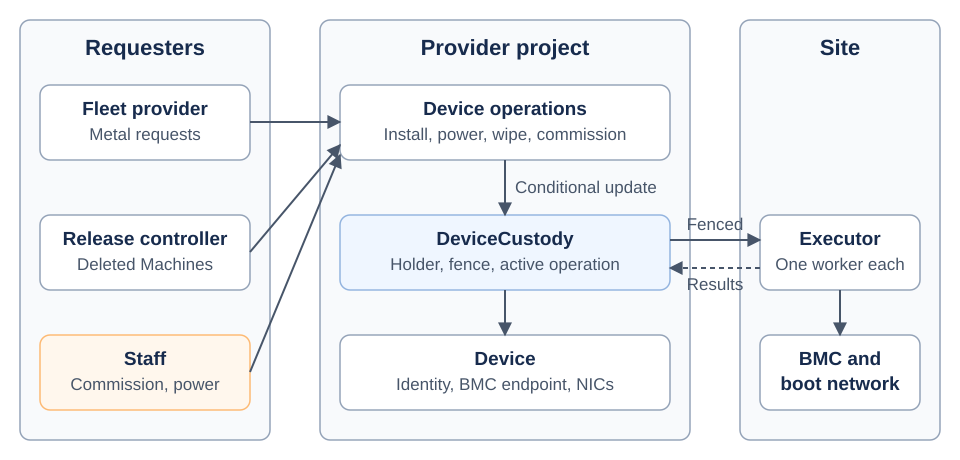

# Device custody and operations

[Documentation overview](../../README.md) · [Functionality guide](../../functionality/README.md)

- [Summary](#summary)
- [Motivation](#motivation)
- [Proposal](#proposal)
  - [How work reaches a server](#how-work-reaches-a-server)
  - [Who holds a server](#who-holds-a-server)
  - [Customer inputs and secrets](#customer-inputs-and-secrets)
- [Design details](#design-details)
  - [API design](#api-design)
    - [DeviceCustody](#devicecustody)
    - [Operation envelope](#operation-envelope)
    - [DeviceInstallation](#deviceinstallation)
    - [DevicePowerOperation](#devicepoweroperation)
    - [DeviceWipe](#devicewipe)
    - [DevicePreparation](#devicepreparation)
    - [Status contract](#status-contract)
  - [Admission](#admission)
  - [Custody transitions](#custody-transitions)
  - [Site execution](#site-execution)
  - [Unknown outcomes and recovery](#unknown-outcomes-and-recovery)
  - [Coordination without a separate database](#coordination-without-a-separate-database)
  - [Fleet as a Metal provider](#fleet-as-a-metal-provider)
  - [Capacity status](#capacity-status)
  - [Authorization](#authorization)
  - [Implementation decisions](#implementation-decisions)
  - [Acceptance tests](#acceptance-tests)
- [Production readiness review questionnaire](#production-readiness-review-questionnaire)
- [Implementation history](#implementation-history)
- [Drawbacks](#drawbacks)
- [Alternatives](#alternatives)
- [Infrastructure needed](#infrastructure-needed)

## Summary

Every physical action on a server, whether a customer install or a staff power
cycle, goes through one record for that server. That record, `DeviceCustody`,
names who holds the server, which operation is running on it, and a fence that
advances every time custody changes. Fleet admits an operation only by updating
that record, so two pieces of work can never act on the same server at once.

Operations are typed: `DeviceInstallation`, `DevicePowerOperation`,
`DeviceWipe`, and `DevicePreparation`. They share one envelope, one set of
outcomes, and one executor contract. Customers never see them. The Metal API
stays the only customer contract, and Fleet fulfills it by creating these
operations as a Metal provider. Staff create preparation and power operations
directly, but only for servers that no customer holds.

Coordination uses single-object conditional updates on the Kubernetes API. It
needs no separate database.

Nothing in this enhancement is implemented. The
[machine lifecycle](../machine-lifecycle/README.md) contract remains the
customer-facing design; this enhancement describes the physical layer beneath
it.

## Motivation

Several kinds of work act on the same server, its BMC, its disks, and its boot
path:

- installing and reinstalling a customer's operating system;
- changing power for a customer;
- cleaning a server between customers;
- commissioning, burn-in, and firmware work before a server is offered; and
- staff power actions on servers that nobody has allocated.

Each of these has been designed separately. The allocator keeps its own record
of who occupies a server, installation execution serializes work per
allocation, and the staff power proposal ([#173][power-pr]) adds its own check
for running work. Three locks reconciled by checks leave windows where two
actions reach one BMC. A per-allocation lock also cannot cover staff work,
because staff work has no allocation.

Some inputs have no home at all. Nothing produces the preparation and health
evidence that makes capacity available, cleaning policy has no resource, and
executors find their targets through static configuration rather than the
Device record.

### Goals

- Keep one authoritative record of who holds each server and what is running
  on it.
- Serialize installation, power, cleaning, preparation, and maintenance on a
  server through that record.
- Keep the Metal API as the only customer contract, and let Fleet fulfill it
  through the same operations staff use.
- Let staff prepare and power servers without any path to an allocated server.
- Keep a server out of use while any operation on it has an unproven outcome.
- Resolve the executor's target, BMC credential, and trust from inventory.
- Keep customer secrets out of every record staff can read.
- Coordinate without adding a database.

### Non-goals

This enhancement excludes the image catalog and bootstrap configuration APIs,
which belong to Metal; network attachment and IPAM; the content and assurance
levels of cleaning policies; BMC console sessions for customers; firmware
qualification; and how other Metal providers run their hardware. Managed
clusters reuse the same Metal contracts and add nothing here.

## Proposal

Fleet will record custody for every Device and admit every physical operation
through that record. Customers keep using Machines and Installations. Staff
gain typed operations for preparation and power on servers that no customer
holds.

### User stories

- A customer installs an operating system on an allocated Machine and later
  reinstalls it. Staff cannot start any operation on that server meanwhile.
- A staff member commissions a newly racked server. The results mark its
  capacity prepared and healthy, and the server becomes allocatable once
  policy allows.
- A staff member power-cycles an unallocated server that stopped responding.
- A customer deletes a Machine. Fleet wipes the server under the retained
  cleaning policy, and the server returns to the pool only after the wipe is
  verified.
- An operator finds a server whose last power command has an unknown outcome,
  checks fresh discovery evidence, and records a recovery decision before any
  other work runs.

### How work reaches a server

Customers act through Metal resources in their own project. The Fleet provider
turns those requests into Device operations in the provider project. Staff
create their operations there too. The Fleet coordinator admits each operation
by updating the Device's custody record, then delivers it to the site that can
reach the server:



The site executor holds the BMC credential for one operation at a time. It
returns results to management, which validates them and updates status. Sites
hold no credentials for project APIs.

### Who holds a server

Each Device has exactly one custody record, and that record has at most one
holder:

| Holder | Meaning | Who may start operations |
| --- | --- | --- |
| `None` | Nobody holds the server. | Only the allocator, to claim it, or staff, to start a service operation. |
| `Allocation` | A customer Machine holds the server through its MachineAllocation. | The Fleet provider, for that allocation's installation and power work. |
| `Release` | The allocation has ended and release obligations remain. | The release controller, for wipes under the retained cleaning policy. |
| `Service` | A staff operation holds the server for its duration. | Nobody else until it finishes. |
| `Retired` | The server is permanently out of service. | Nobody. |


The holder decides which operations Fleet can admit. Permissions decide who may
ask. An operation needs both: a staff member allowed to create power
operations still cannot power off a server that a customer holds.

### Customer inputs and secrets

Operations carry the customer inputs that staff need to diagnose a server,
such as which Machine holds it, the image digest, and the requested power
action. They never carry secret content:

| Input | On an operation |
| --- | --- |
| Consumer project and Machine name | Yes |
| Image name and digest, boot interface, target disks | Yes |
| Power action and reason | Yes |
| Bootstrap data, user data, and SSH keys | A reference and a digest only |
| Credentials for a customer-supplied boot endpoint | A reference and a digest only |
| BMC credentials | Never; the site resolves them |

Fleet treats a bootstrap payload as secret as a whole, because customers place
passwords and tokens in user data and Fleet cannot tell which parts are
sensitive. Only the worker running the operation reads the content, and it
verifies the digest before use.

### Notes, constraints, and caveats

This enhancement replaces the per-allocation serialization in the machine
lifecycle contract with per-Device custody. MachineAllocation remains the
allocation record; custody refers to it. The staff power proposal
([#173][power-pr]) becomes one operation kind here. The execution and admission
proposals ([#62][execution-pr], [#60][admission-pr]) rely on a relational
ledger; this design replaces that ledger with the custody record. API names are
provisional.

### Risks and mitigations

- **Two actions on one server:** [Admission](#admission) commits through one
  conditional update on the custody record, so a second writer gets a conflict.
- **Bypassing customer admission:** Customer-held servers accept operations
  only from the Fleet provider and only for the holding allocation.
- **Reusing a server after an uncertain wipe:** [Unknown
  outcomes](#unknown-outcomes-and-recovery) keep the holder in place until a
  verified recovery.
- **Stale workers:** Executors reject any operation or result whose fence
  differs from the current custody fence.
- **Customer secret exposure:** Operations carry references and digests, never
  secret content.

Fleet, Metal, Milo IAM, and site operations maintainers must review custody,
admission, and recovery before implementation.

## Design details

### API design

All kinds belong to `fleet.datumapis.com` and live in the provider project,
in the same namespace as their Device. Operation specs are immutable. The Fleet
coordinator alone writes custody and operation status.

Examples show selected fields. Identifiers, names, and timestamps are synthetic.

#### DeviceCustody

```yaml
apiVersion: fleet.datumapis.com/v1alpha1
kind: DeviceCustody
# One record per Device, named after it. The coordinator creates it with the
# Device and is its only writer. Staff can read it; nobody else can change it.
metadata:
  name: server-example-001
  namespace: default
spec:
  deviceRef: {name: server-example-001}

  # The holder decides which operations can be admitted.
  holder:
    type: Allocation          # None | Allocation | Release | Service | Retired
    allocationRef: {name: alloc-7f3c2}

  # Advances on every change of holder or active operation. Executors reject
  # work and results that carry any other value.
  fence: 42

  # At most one operation runs on a server at a time.
  activeOperation:
    kind: DeviceInstallation
    name: alloc-7f3c2-install-01
    inputDigest: "sha256:5d1e9c4a7b2f..."

  # Present only after an Unknown outcome. Only an operation that can settle
  # it is admitted, and the server cannot return to None while it remains.
  recoveryHold: null

status:
  conditions:
    - {type: Held, status: "True", reason: Allocation}
    - {type: Busy, status: "True", reason: OperationActive}
```

The record keeps its fields in `spec` because it is a coordination record, like
a Kubernetes `Lease`, rather than desired state. The coordinator writes it with
a conditional update that names the version it read.

#### Operation envelope

Every operation kind shares these fields:

```yaml
spec:
  deviceRef: {name: server-example-001}

  # Exactly one source of authority. Admission checks it against the holder.
  authority:
    allocationRef: {name: alloc-7f3c2}     # Fleet provider and release controller
    # serviceRequest: {reason: "..."}      # staff operations

  # Each kind adds its own immutable inputs below.

status:
  # Set by the coordinator at admission. Executors act only under this fence.
  admission:
    fence: 43
    admittedAt: "2026-11-24T18:02:11Z"
  phase: Executing       # Pending | Admitted | Executing | Succeeded | Failed | Unknown
  result:
    reason: ""
    message: ""
  conditions: []
```

A requester cannot set the fence, the phase, or the result. The coordinator
refuses an operation by setting `phase: Failed` with a reason, and sends nothing
to the server.

#### DeviceInstallation

The Fleet provider creates one for each admitted Metal Installation. Staff
cannot create it.

```yaml
apiVersion: fleet.datumapis.com/v1alpha1
kind: DeviceInstallation
metadata:
  name: alloc-7f3c2-install-01
  namespace: default
spec:
  deviceRef: {name: server-example-001}
  authority:
    allocationRef: {name: alloc-7f3c2}

  # Names the customer request it fulfills, for diagnosis. It grants nothing.
  installationRef: {project: consumer-a, namespace: default, name: debian-12}

  # Exact inputs resolved at Metal admission. Retries reuse them unchanged.
  image:
    name: debian-12
    digest: "sha256:9f4ad8d8b8a6..."
  bootstrap:
    secretRef: {project: consumer-a, namespace: default, name: debian-12-bootstrap}
    digest: "sha256:0c2b77e1d9a4..."
  bootInterface: primary
  targetDisks: [disk-0]
```

#### DevicePowerOperation

The Fleet provider creates one when a Machine's `powerState` changes. Staff
create one for a server with no holder.

```yaml
apiVersion: fleet.datumapis.com/v1alpha1
kind: DevicePowerOperation
metadata:
  name: server-example-001-power-7
  namespace: default
spec:
  deviceRef: {name: server-example-001}
  authority:
    serviceRequest: {reason: "BMC reports the host hung during inspection"}
  action: PowerCycle    # On | ForceOff | ForceRestart | PowerCycle
```

Each action has a success test that the executor checks against the BMC, such
as observing the requested power state within a time limit. An action the
executor cannot confirm ends as `Unknown`, never as success.

#### DeviceWipe

The release controller creates wipes from the cleaning policy retained with the
allocation. Staff never create wipes; they own the policy, not the effect.

```yaml
apiVersion: fleet.datumapis.com/v1alpha1
kind: DeviceWipe
metadata:
  name: alloc-7f3c2-wipe-01
  namespace: default
spec:
  deviceRef: {name: server-example-001}
  authority:
    allocationRef: {name: alloc-7f3c2}
  # The policy and digest pinned when the allocation was made, not the
  # current policy.
  cleaningPolicy:
    name: tenant-reuse-v1
    digest: "sha256:3a7c0f9e2b18..."
  targets: [disk-0, disk-1]
```

#### DevicePreparation

Staff create preparation operations to commission a server before it is
offered: inspection, burn-in, and a firmware baseline. A preparation runs a
pinned plan; it never accepts arbitrary commands.

```yaml
apiVersion: fleet.datumapis.com/v1alpha1
kind: DevicePreparation
metadata:
  name: server-example-001-prepare-1
  namespace: default
spec:
  deviceRef: {name: server-example-001}
  authority:
    serviceRequest: {reason: "Commission after racking"}
  plan:
    name: standard-commissioning-v2
    digest: "sha256:b81f4d0a6c93..."
```

A succeeded preparation produces the evidence that the capacity projector uses
for `Prepared` and `Healthy`. It does not make the server allocatable by itself.

#### Status contract

Operation conditions follow the [machine lifecycle status
contract](../machine-lifecycle/README.md#status-contract). An absent condition
means `Unknown`, and nothing infers success from absence.

| Phase | Meaning |
| --- | --- |
| `Pending` | Created and not yet admitted. |
| `Admitted` | Custody names this operation under a new fence. Nothing has been sent. |
| `Executing` | The site has started the operation. |
| `Succeeded` | The kind's success test passed. |
| `Failed` | Fleet knows the operation sent nothing, or the server refused it and its state did not change. |
| `Unknown` | A command may have reached the server and Fleet cannot prove the result. |

`Succeeded`, `Failed`, and `Unknown` are final for the operation. They are not
final for custody: `Unknown` places a [recovery
hold](#unknown-outcomes-and-recovery).

Refusal reasons include `HolderMismatch`, `CreatorNotPermitted`,
`OperationInProgress`, `RecoveryHold`, `DeviceRetired`, `DeviceIdentityMismatch`,
`DiscoveryNotCurrent`, and `Expired`.

### Admission

The coordinator admits an operation in one conditional update to the custody
record:


Admission requires all of the following:

1. The operation's authority matches the holder. An `allocationRef` must name
   the current `Allocation` or `Release` holder. A `serviceRequest` requires
   holder `None`.
2. The creator's identity is allowed for that kind and holder: the Fleet
   provider for installation and allocation power, the release controller for
   wipes, and staff for service operations.
3. No operation is active. Under a recovery hold, only an operation that can
   settle the hold is admitted.
4. The Device is not retired, and its identity matches current discovery
   evidence.

The update sets the active operation, advances the fence, and, for a staff
operation, moves the holder from `None` to `Service`. If another writer changed
custody first, the update fails with a conflict and the coordinator evaluates
again from the new state.

Operations for the current holder wait in `Pending` while another operation
runs, so a reinstall can follow a power change. Staff operations are refused
rather than queued, because a queued staff request could run long after its
reason has passed. Pending operations expire after a limit set per kind.

### Custody transitions

| From | To | Trigger | Written by |
| --- | --- | --- | --- |
| `None` | `Allocation` | The allocator selects the server for a Machine after Metal admission and quota. | Allocator, through the coordinator |
| `Allocation` | `Release` | The Machine is deleted or its allocation ends. | Coordinator |
| `Release` | `None` | Every release gate is verified, including the wipes the cleaning policy requires. | Coordinator |
| `None` | `Service` | A staff operation is admitted. | Coordinator |
| `Service` | `None` | That operation ends as `Succeeded` or `Failed`. | Coordinator |
| `None` | `Retired` | The Device is retired. | Coordinator |

Allocation is the same conditional update as admission. Two allocators racing
for one server cannot both win; the loser selects another server or stays
pending. Release follows the [machine lifecycle release
gates](../machine-lifecycle/README.md#release-and-project-lifecycle). The server
returns to `None` only when all of them close.

### Site execution

The coordinator delivers each admitted operation to the site that serves its
Device. The site runs one short-lived worker per operation:

- The worker resolves its target from the inputs captured at admission: BMC
  endpoint, system UUID, boot MAC address, and the digest of the approved BMC
  TLS key.
- It reads only that Device's BMC credential, which the site stores, and
  checks the live TLS key and system identity before sending the credential.
  A mismatch ends the operation as `Failed` with nothing sent.
- It records every step before sending it. After a crash or a lost response it
  queries the server; it never resends a step whose result it cannot prove.
- It returns a local result that carries the admission fence. Management
  rejects a result with any other fence.

Sites write only local results. Management validates them and writes operation
status and custody. Sites hold no credentials for the provider or consumer
project APIs.

### Unknown outcomes and recovery

An `Unknown` outcome keeps the current holder and places a recovery hold on
custody. While the hold exists, Fleet admits only an operation that can settle
it, and the server cannot return to `None`. A held allocation can still move to
`Release`; the hold moves with it.

Recovery depends on the kind:

- **Power:** Fresh discovery evidence that shows the server's power state,
  plus a recovery record from staff, settles the hold.
- **Installation:** A new installation, or a wipe during release, must succeed.
  Evidence alone cannot prove what a partial installation left on disk.
- **Wipe:** Only a new wipe that succeeds settles the hold. An acknowledgment
  never stands in for verified cleaning.
- **Preparation:** A new preparation that succeeds, or retirement.

Each recovery is its own audited record that names the held operation, the
evidence, and the decision. Fleet never clears a hold by retrying the original
operation automatically.

### Coordination without a separate database

Fleet keeps every value that must change together on one Kubernetes object.
A conditional update on a single object is atomic, so the design needs no
transactions across objects:

| Need | How Fleet meets it |
| --- | --- |
| Allocation and execution never overlap | Holder and active operation share the custody record. |
| An admitted operation is never lost | The custody update is the commit point. After a crash the coordinator rebuilds delivery from custody. |
| A request is never admitted twice | Operations have deterministic names, and custody names the admitted one. |
| Release state survives Machine deletion | The `Release` holder and its remaining obligations live on custody, in the provider project. |
| Quota stays consistent | Milo holds quota. Metal obtains the quota claim, named from the Machine, before allocation and releases it if no server can be claimed. |
| Long-term history | Fleet keeps finished operations for a bounded period, then relies on the platform audit and activity records. |

Each server gets one write per change. The allocator tries candidate servers
one at a time instead of choosing among them in one transaction.

### Fleet as a Metal provider

Metal defines what customers ask for. Fleet is one provider that fulfills it:

| Metal request | Fleet effect |
| --- | --- |
| Machine admitted | The allocator moves a server from `None` to `Allocation`. |
| Installation created | The Fleet provider creates a `DeviceInstallation`. |
| `Machine.spec.powerState` changed | The Fleet provider creates a `DevicePowerOperation`. |
| Machine deleted | Custody moves to `Release`, and the release controller creates `DeviceWipe` operations. |
| Status | The Metal projector reports results from the Fleet operations, without operation names or inventory details. |

Other providers implement the Metal contract their own way and need none of
these resources.

### Capacity status

The capacity projector derives MachineCapacity conditions from custody and
operation evidence:

- `Prepared` requires a succeeded preparation under the current plan.
- `Healthy` requires current health evidence from preparation and discovery.
- `Available` also requires holder `None`, no recovery hold, and an enabled
  allocation policy.

Nobody can make capacity available by editing its status.

### Authorization

| Identity | Create | Read |
| --- | --- | --- |
| Staff power operator | `DevicePowerOperation` | Custody and operations |
| Staff preparation operator | `DevicePreparation` | Custody and operations |
| Staff viewer | None | Custody and operations |
| Fleet provider for Metal | `DeviceInstallation`, `DevicePowerOperation` | Custody and operations |
| Release controller | `DeviceWipe` | Custody and operations |
| Fleet coordinator | Custody records | Everything it admits |

Only the coordinator writes custody and operation status. Admission checks
each operation's creator in addition to these grants, so a grant alone never
authorizes work on a held server. No staff role can read bootstrap secrets.

### Implementation decisions

Before this enhancement becomes implementable, Fleet and integration owners
must record these decisions:

- **Custody placement:** Confirm that the provider project API supports the
  conditional updates custody needs, with the availability the allocator
  requires.
- **Preparation plans:** Decide what makes a plan qualified, who approves it,
  and which evidence sets `Prepared` and `Healthy`.
- **Recovery evidence:** Define, for each kind, the evidence a recovery needs
  and whether a second person must confirm it.
- **Retention:** Decide how long finished operations stay before collection.
- **Customer identity for staff:** Decide whether every staff role can see
  which customer holds a server, or only support roles.

### Acceptance tests

These tests are required and not yet implemented:

- Two allocators race for one server; exactly one wins.
- A staff operation races an allocation; exactly one is admitted.
- A staff operation targets an allocated server, a releasing server, and a
  server under a recovery hold; each is refused with nothing sent.
- A BMC response is lost during each operation kind; the operation ends as
  `Unknown` and custody holds.
- A worker restarts with a stale fence; the site and management reject its
  result.
- The coordinator restarts between admission and delivery; the operation is
  delivered once.
- A BMC credential or TLS key rotates; workers use the new values, and a key
  mismatch sends nothing.
- A Machine is deleted during installation; release waits for the installation
  outcome before wiping.
- No staff role can read a bootstrap secret through any operation.

## Production readiness review questionnaire

These controls and tests are proposed, not implemented or qualified.

### Feature enablement and rollback

#### How do operators enable or disable the feature in a live cluster?

Register the kinds and their IAM resources, and deploy the coordinator and site
executors. Pausing admission stops new operations while running operations
finish and recoveries continue.

#### Does enabling the feature change any default behavior?

No. Custody starts at `None` for every Device. Creating custody records causes
no effect on any server.

#### Can operators disable the feature after enabling it?

Yes, by pausing admission. Custody records, holds, and site executors must stay
available while any server has a holder other than `None` or `Retired`.

### Monitoring requirements

#### What must operators monitor?

Servers under a recovery hold, operations in `Unknown`, servers in `Release`
for longer than expected, pending operations near expiry, rejected stale
fences, and site executors that stop reporting.

#### How are failures recovered?

An `Unknown` outcome needs a recovery record with evidence. Nothing retries
automatically.

### Dependencies

#### Does the feature depend on specific services?

Milo for project APIs, IAM, and quota; the federation layer that delivers
operations to sites; inventory and BMC discovery for Device facts; and the Metal
service for customer requests.

### Scalability

#### Does the feature add API calls?

One conditional update per custody change and a few status writes per
operation.

#### Does the feature introduce API types?

Yes: `DeviceCustody` and four operation kinds.

## Implementation history

- 2026-11-24: Proposed.

## Drawbacks

Every effect on a server now depends on the custody record and the coordinator
that writes it. Typed kinds add more resources to register and grant. A
recovery hold can keep a server out of use for a long time when evidence is
hard to get. Allocation picks servers one at a time, which rules out choosing
several servers atomically.

## Alternatives

- **One generic operation kind with a `type` field:** IAM grants permissions
  per kind, not per field value. Staff allowed to request power could also
  request an installation, and one large schema would have to cover every
  type.
- **Declarative desired state per Device:** Steady-state power fits, but wipes
  and resets do not. Reapplying desired state can repeat a destructive action,
  and recovery needs the exact admitted operation rather than the current
  desired state.
- **No Fleet operation kinds for customer work:** Customer work could stay in
  private records while staff get separate resources. That keeps two
  admission paths and two locks, the problem this design removes.
- **A relational ledger:** A database would allow transactions across many
  records, but it adds a stateful dependency the platform does not otherwise
  need. One record per server gives the same guarantee for the conflicts that
  matter.
- **Lock per allocation:** Staff work has no allocation, so a per-allocation
  lock cannot serialize it with customer work.

Other systems use similar boundaries. OpenStack keeps tenant instances separate
from Ironic's hardware nodes. Ironic records the holding instance on the node
and runs manual cleaning only in a state that no tenant can hold. Metal3 records
the holder on its `BareMetalHost`, and moved firmware work into typed resources
after one-shot actions proved awkward in desired state. Kubernetes binds a
`PersistentVolumeClaim` to a `PersistentVolume` with one conditional update and
applies a reclaim policy on release.

## Infrastructure needed

The test environment needs one provider project, two consumer projects, one
site, and BMC emulators that can drop responses and rotate TLS keys. Physical
qualification needs servers whose BMCs the site can reach and a boot network.

Fleet owns the design records in this repository. Environment configuration
lives outside this repository.

[power-pr]: https://github.com/datum-cloud/fleet/pull/173
[execution-pr]: https://github.com/datum-cloud/fleet/pull/62
[admission-pr]: https://github.com/datum-cloud/fleet/pull/60
