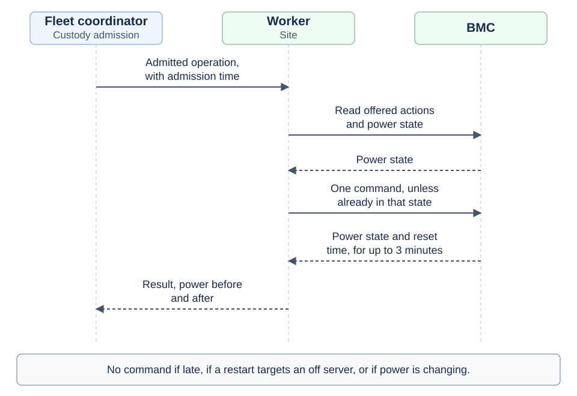
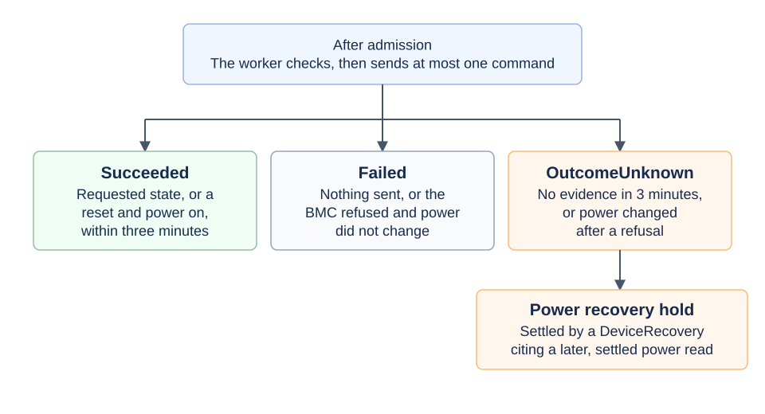

# Device power operations

[Documentation overview](../../README.md) · [Architecture guide](../../architecture/README.md)

- [Summary](#summary)
- [Motivation](#motivation)
  - [Goals](#goals)
  - [Non-goals](#non-goals)
- [Proposal](#proposal)
  - [User stories](#user-stories)
  - [Requesting staff power](#requesting-staff-power)
  - [Customer power](#customer-power)
  - [Who takes part](#who-takes-part)
- [Design details](#design-details)
  - [API design](#api-design)
  - [Admission](#admission)
  - [Execution and outcomes](#execution-and-outcomes)
  - [Recovery](#recovery)
  - [Delivery phases](#delivery-phases)
  - [Acceptance tests](#acceptance-tests)
- [Production readiness review questionnaire](#production-readiness-review-questionnaire)
- [Implementation history](#implementation-history)
- [Drawbacks](#drawbacks)
- [Alternatives](#alternatives)
- [Open design questions](#open-design-questions)
- [Infrastructure needed](#infrastructure-needed)

## Summary

`DevicePowerOperation` powers a server on or off, or resets it, with one
command. Staff use it on servers that no customer holds. Fleet's Metal provider
uses it when a customer changes `Machine.spec.powerState`.

This document specifies the power kind only. The [device custody and
operations proposal][ops] defines custody, the operation envelope, admission,
site execution, recovery and authorization. Both documents are proposals, and
the device operations proposal is not yet merged. Nothing in either is
implemented.

## Motivation

Staff need basic power control to rack, qualify and move servers. Today they
use each server's baseboard management controller (BMC) by hand. Fleet keeps no
record of the action, and nothing stops a reset of a server a customer is using.
Customer power intent on a Machine has no executor yet.

### Goals

- Staff and customer power changes use one kind, one executor and one set of
  outcome rules.
- Each operation sends at most one command, to the exact server named.
- Each staff operation records why it ran and the power state before and after.

### Non-goals

- Graceful shutdown and restart, which need the operating system to cooperate.
- A customer restart. The Machine API has only on and off intent.
- Boot settings, virtual media, BMC settings, firmware and power distribution
  units.

## Proposal

### User stories

- A technician racks a new server and powers it on, so Fleet can read its
  hardware inventory.
- Staff reset a server that hangs during qualification, then see who reset it,
  when, and the power state afterwards.
- A customer sets a Machine's power to off, and the server powers off.
- A server's BMC is replaced and reports a different system. A staff request
  made against the old record is refused before anything reaches the server.

### Requesting staff power

Staff use a power button on the Device page, next to the observed power state.
Its menu lists only the actions the server offers. An unavailable action shows
why in a tooltip, for example that a customer holds the server. Confirming asks
for a reason and creates the operation. A badge shows progress and the result.
An **Operations** tab lists past operations with their time, action, creator,
result, and power before and after. Users without the power operator role do
not see the button.

### Customer power

The Fleet provider for Metal maps a Machine's `powerState` to an action:

| `powerState` | Action |
| --- | --- |
| `On` | `On` |
| `Off` | `ForceOff` |

The provider creates an operation only when `powerState` differs from the
server's observed power. Its name comes from the Machine generation, so a
refused operation is not retried until the Machine generation changes. The
provider reports the refusal reason on the Machine.

### Who takes part


BMC discovery is read-only. It reports which power actions each server offers
and the server's current power state. Admission uses both, and recovery uses
the power state as evidence.

## Design details

### API design

`DevicePowerOperation` uses the [operation envelope][operations]. This document
adds the power fields. Identifiers and timestamps are synthetic.

```yaml
apiVersion: fleet.datumapis.com/v1alpha1
kind: DevicePowerOperation
metadata:
  name: device-a-restart-1
  namespace: default
# Envelope fields other than the device and authority are omitted.
spec:
  deviceRef: {name: device-a, uid: 4b8e2f10-0000-4000-8000-0000000000a1}
  # Staff use a service request, and the reason is required. The Metal
  # provider uses allocationRef instead.
  authority:
    serviceRequest: {reason: "Hung in firmware during qualification"}
  # On, ForceOff, ForceRestart or PowerCycle.
  action: ForceRestart
  # Staff only: the server staff expect behind the BMC.
  expectedSystemUUID: 00000000-0000-4000-8000-0000000000a1
status:
  # Power result evidence, copied from the site's result.
  requestSentAt: "2026-01-02T03:04:06Z"
  power:
    before: {state: "On", observedAt: "2026-01-02T03:04:05Z"}
    after: {state: "On", observedAt: "2026-01-02T03:04:41Z"}
  resetEvidence: LastResetTime
```

A power result carries this evidence, which the coordinator copies to status as
[site execution][site] describes:

| Field | Meaning |
| --- | --- |
| `requestSentAt` | When the one command was sent. Absent if none was sent. |
| `power.before`, `power.after` | The power state the worker read before the command and at the end. |
| `resetEvidence` | For a restart or power cycle: `LastResetTime` if the BMC reported a reset after the request, or `ObservedOff` if the worker saw the server off. |

The evidence never carries a credential or BMC response content.

### Admission

[Custody admission][admission] decides which creator, authority and holder may
run a power operation. A staff operation needs holder `None`, so disabled
capacity on the Device does not block it. A customer operation runs under the
Machine's allocation.

Power adds these refusals. Each ends the operation with nothing sent:
`Expired` as `Cancelled`, and the others as `Failed`.

| Reason | Refused by | When |
| --- | --- | --- |
| `SystemUUIDNotRecorded` | Coordinator | A staff operation targets a Device with no system UUID on record. |
| `SystemUUIDMismatch` | Coordinator or worker | `expectedSystemUUID` differs from the Device record, discovery or the BMC. |
| `DiscoveryNotCurrent` | Coordinator | Discovery has not read the BMC within twice its interval. |
| `SharedPublicKey` | Worker | The [site execution][site] shared-key check fails. |
| `ResetTypeNotOffered` | Coordinator or worker | Discovery or the BMC does not offer the action. |
| `Expired` | Coordinator | A staff operation was not admitted within five minutes. |
| `Stale` | Worker | The worker started more than two minutes after admission. |
| `NotPoweredOn` | Worker | A restart or power cycle targets a server that is off. |
| `PowerStateNotSettled` | Worker | The power state is still changing. |

### Execution and outcomes



The [site worker][site] re-checks that the action is offered, then reads the
power state. If the server is already in the requested state, it sends nothing
and reports success. Otherwise it sends one command.

HTTP success from the BMC is not proof. The result depends on what the worker
observes after the command, including after a lost response:

| Action | `Succeeded` when | Otherwise |
| --- | --- | --- |
| `On`, `ForceOff` | The requested power state appears within three minutes. | `OutcomeUnknown` |
| `ForceRestart`, `PowerCycle` | `resetEvidence` is set within three minutes, and the server is on again. | `OutcomeUnknown` |

A BMC that refuses the command gives `Failed`, unless the power state changed
anyway, which gives `OutcomeUnknown`.

### Recovery



A power [recovery hold][unknown] settles with a `DeviceRecovery` whose evidence
is a power state that discovery read after the operation ended. The Machine of
a held allocated server reports power as `Unknown` until then.

### Delivery phases

1. **Discovery records offered actions.** No new effect.
2. **Staff power.** The kind and the staff role, on the custody and site
   execution from the device operations proposal. Tested against an emulated
   BMC.
3. **Staff UI and one real server** with holder `None`. Restart and power cycle
   stay disabled on real hardware until this test shows a restart can be
   proven.
4. **Customer power.** The Metal provider creates operations from `powerState`.

### Acceptance tests

These tests are required and not written. Each checks the result and the
number of commands at the BMC:

- Each refusal reason in the [admission](#admission) table, with no command.
- On, off, restart and power cycle against the outcome table, including a lost
  response.
- A server already in the requested state, with no command.
- A staff operation on a Device with disabled capacity and holder `None`.
- A refused customer operation is not retried until the Machine generation
  changes.
- A power hold settles only with discovery evidence read after the operation
  ended.

## Production readiness review questionnaire

These controls are proposed, not implemented.

### How do operators enable or disable the feature?

Grant or revoke the staff power operator role. Customer power follows the Fleet
provider for Metal. Pausing admission is covered in the [device operations
proposal][ops].

### What must operators monitor?

Power recovery holds, most urgently on allocated servers, `Expired` and `Stale`
refusals, and restarts that end `OutcomeUnknown` on each BMC model.

### How are failures recovered?

See [Recovery](#recovery).

## Implementation history

- 2026-11-24: Proposed as a standalone staff feature.
- 2026-11-24: Revised as the power kind of the device custody and operations
  proposal, covering customer power.

## Drawbacks

- Restarts can end `OutcomeUnknown` on BMCs that do not report when a reset
  happened.
- An unproven customer power change keeps the customer's server held until
  staff record a recovery.

## Alternatives

- **Separate kinds for staff and customer power.** Rejected. Both need the same
  executor and outcome rules.
- **Machine power intent for unallocated Devices.** Rejected. A Machine is a
  customer allocation, and creating one for staff would expose capacity.

## Open design questions

- **Lost response, then the right state.** This proposal reports `Succeeded`
  when the worker sees the requested state after a lost response. Should power
  report `OutcomeUnknown` instead?
- **Restart evidence.** A restart can be proven only when the BMC reports that a
  reset happened. Should restart and power cycle wait for the real-hardware
  test, or ship earlier on test hardware only?
- **Customer power off.** `Off` maps to `ForceOff`, which cuts power without
  warning the operating system. Should Metal offer a graceful power off?

## Infrastructure needed

An emulated BMC that supports TLS and reports when a reset happened, and one
real server with holder `None`, an approved TLS key and a credential.

[ops]: ../device-operations/README.md
[operations]: ../device-operations/README.md#operations
[admission]: ../device-operations/README.md#admission
[site]: ../device-operations/README.md#site-execution
[unknown]: ../device-operations/README.md#unknown-outcomes
