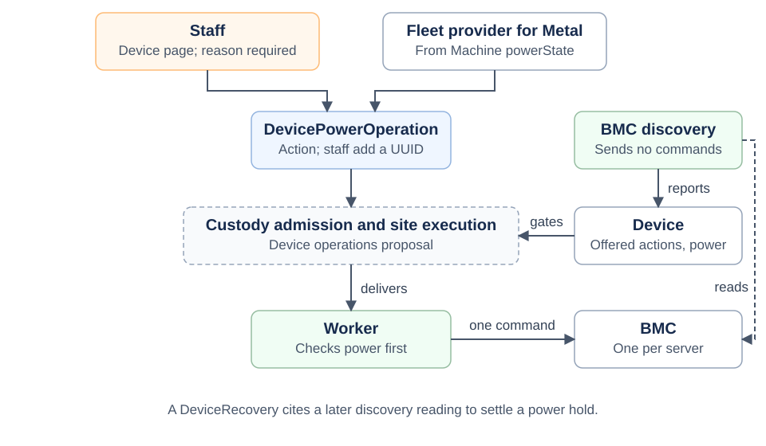
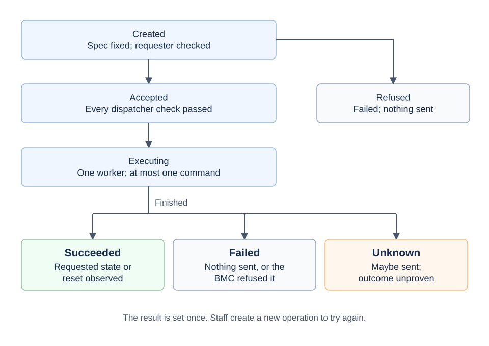
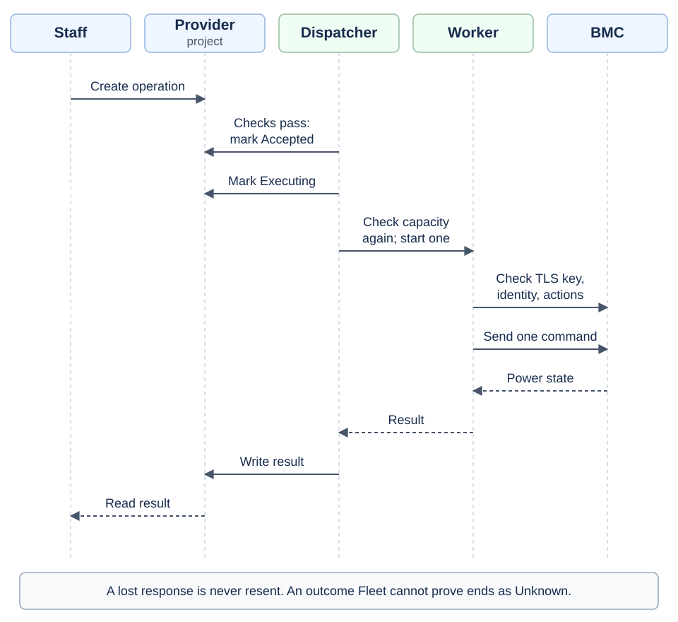

# Staff power operations on physical Devices

[Documentation overview](../../README.md) · [Architecture guide](../../architecture/README.md)

- [Summary](#summary)
- [Motivation](#motivation)
  - [Goals](#goals)
  - [Non-goals](#non-goals)
- [Proposal](#proposal)
  - [User stories](#user-stories)
  - [Requesting a power operation](#requesting-a-power-operation)
  - [Who takes part](#who-takes-part)
  - [Risks and mitigations](#risks-and-mitigations)
- [Design details](#design-details)
  - [API design](#api-design)
  - [Status contract](#status-contract)
  - [Acceptance checks](#acceptance-checks)
  - [Execution and outcomes](#execution-and-outcomes)
  - [Authorization](#authorization)
  - [Relationship to Machine power](#relationship-to-machine-power)
  - [Delivery phases](#delivery-phases)
  - [Acceptance tests](#acceptance-tests)
- [Production readiness review questionnaire](#production-readiness-review-questionnaire)
- [Implementation history](#implementation-history)
- [Drawbacks](#drawbacks)
- [Alternatives](#alternatives)
- [Open design questions](#open-design-questions)
- [Infrastructure needed](#infrastructure-needed)

## Summary

Staff will be able to power an unallocated server on or off, or reset it, from
Fleet. One new resource defines the contract: `DevicePowerOperation`. Each
operation asks for a single action on one Device. Fleet checks the request,
sends at most one command to the exact server named, and reports whether the
action succeeded, failed, or has an unknown outcome.

This is a proposal. Nothing in it is implemented.

## Motivation

Staff who build and maintain hardware need basic power control. Today they use
each server's baseboard management controller (BMC) by hand. Fleet keeps no
record of who did it, the action bypasses the per-Device credentials and TLS
checks that BMC discovery uses, and nothing stops a reset of a server a
customer is using.

### Goals

- Let staff power on, power off, restart and power cycle an unallocated Device,
  and see the result.
- Send at most one command per request, to the exact server staff named.
- Report an outcome Fleet cannot prove as unknown, never as success, and never
  retry it automatically.
- Record who asked, why, and the power state before and after.

### Non-goals

This enhancement excludes power control of allocated servers, which stays with
the customer's Machine. It also excludes a desired power state for Devices,
graceful shutdown and restart, boot settings, virtual media, BMC settings,
firmware, and power distribution units.

## Proposal

Fleet will let staff request one power action at a time on a Device that offers
no customer capacity. The Device keeps its identity; only its power changes.
Each request becomes a permanent record of the action and its result.

### User stories

- A technician racks a new server and powers it on, so Fleet can read its
  hardware inventory.
- Staff reset a server that hangs during qualification, and see who reset it,
  when, and the power state afterwards.
- Staff power off a server before moving it to another rack.
- A server's BMC is replaced and now reports a different system. A request made
  against the old record is refused before anything reaches the server.
- Staff try to reset a server that backs customer capacity. Fleet refuses, and
  nothing reaches the server.

### Requesting a power operation

Staff use a power button on the Device page, next to the observed power state.
Its menu lists only the actions the server offers. An unavailable action shows
its refusal reason in a tooltip. Confirming asks for a reason and creates the
operation. A badge then shows progress and the result. An **Operations** tab
lists past operations with their time, action, requester, result, and power
before and after. Users without the power operator role do not see the button.

Staff can also create the resource directly through the API.

### Who takes part

The request lives in the provider project. The work happens in the site that can
reach the server's BMC:



- **The dispatcher** runs in the site, next to the existing BMC discovery
  process. It accepts or refuses each request, starts a worker, and is the only
  writer of the operation's status. It holds no BMC credential.
- **The worker** is a short-lived process started for one operation. It can read
  only the target Device's BMC credential, and it cannot reach the provider
  project.
- **BMC discovery** reads each BMC and records what it reports on the Device.
  It is built but not yet on `main`. It stays read-only, and will also record
  which power actions each server offers.

Every connection to a BMC checks the BMC's approved TLS key before it sends a
credential, the same check discovery makes.

### Risks and mitigations

- **Resetting a customer's server:** [Acceptance checks](#acceptance-checks)
  refuse any Device with capacity defined on it.
- **Resetting the wrong server:** The request names the server's UUID, and the
  worker re-checks it against the BMC before it acts.
- **Repeating a reset:** Each operation sends at most one command, and nothing
  retries it. See [execution and outcomes](#execution-and-outcomes).
- **Credential exposure:** Each worker reads one credential, and the dispatcher
  reads none. See [authorization](#authorization).

## Design details

### API design

`DevicePowerOperation` belongs to `fleet.datumapis.com`. It lives in the
provider project, in the same namespace as its Device. Identifiers and
timestamps in the example are synthetic.

```yaml
apiVersion: fleet.datumapis.com/v1alpha1
kind: DevicePowerOperation
metadata:
  name: device-a-restart-1
  namespace: default
# The whole spec is fixed at creation. A changed request is a new operation.
spec:
  # The Device to act on, in the same namespace.
  deviceRef: {name: device-a}
  # One of On, ForceOff, ForceRestart or PowerCycle.
  action: ForceRestart
  # The server staff expect behind the BMC. The operation fails if the Device
  # record or the BMC reports another.
  expectedSystemUUID: 00000000-0000-4000-8000-0000000000a1
  # Admission requires this to equal the user who creates the operation.
  requester: staff@example.com
  # Required free text for the audit record.
  reason: Hung in firmware during qualification

# The site dispatcher alone writes status. It never carries a credential or
# any BMC response content.
status:
  conditions:
    - {type: Accepted, status: "True", reason: Accepted}
    - {type: Executing, status: "False", reason: Finished}
    - {type: Finished, status: "True", reason: ResetObserved}
  # Succeeded, Failed or Unknown. Set once and never changed.
  result: Succeeded
  # When the one command was sent. Absent if none was sent.
  requestSentAt: "2026-01-02T03:04:06Z"
  # The power state seen before and after the command.
  power:
    before: {state: "On", observedAt: "2026-01-02T03:04:05Z"}
    after: {state: "On", observedAt: "2026-01-02T03:04:41Z"}
  finishedAt: "2026-01-02T03:04:42Z"
```

A separate resource fits better than a field on the Device. A reset is an event,
not a state, and each operation needs its own audit record. See
[alternatives](#alternatives).

### Status contract

An operation moves through `Accepted` and `Executing` to `Finished`, or is
refused before it is accepted:



- **`Failed`** means Fleet knows nothing was sent, or the BMC refused the
  command and the power did not change.
- **`Unknown`** means a command may have been sent and Fleet cannot prove the
  outcome. It ends the operation. Staff check the next discovery result and
  create a new operation if they still need one.
- **`Succeeded`** means Fleet observed the requested state, or observed the
  reset.

Deleting an operation does not cancel a command already sent.

### Acceptance checks

The dispatcher refuses an operation with `result: Failed`, and sends nothing,
when any of these holds:

| Reason | When |
| --- | --- |
| `CapacityBacked` | Customer capacity is defined on the Device. |
| `OperationInProgress` | Another operation on the Device is still running. |
| `DeviceNotFound` | The Device does not exist in the namespace. |
| `DeviceRetired` | The Device is retired. |
| `SystemUUIDNotRecorded` | The Device has no system UUID on record. |
| `SystemUUIDMismatch` | The expected UUID differs from the Device record. |
| `DiscoveryNotCurrent` | Discovery has not recently read the BMC and matched its identity. |
| `SystemNotObserved` | Discovery did not see exactly one server with the expected UUID. |
| `SharedPublicKey` | The BMC shares its TLS key with another BMC, so the key cannot tell them apart. |
| `ResetTypeNotOffered` | The server does not offer the requested action. |
| `Expired` | The operation waited more than five minutes to be accepted. |

A second request while one is running is refused, not queued. A queued request
could run minutes later, after its reason is gone.

### Execution and outcomes

One operation runs from request to result like this:



Just before it starts the worker, the dispatcher checks again that no capacity
is defined on the Device. A worker that starts more than two minutes after that
check, for example because its image was slow to pull, refuses with reason
`Stale` and sends nothing.

The worker re-checks the server's identity and offered actions, reads the power
state, and sends one command. If the server is already in the requested state,
the worker sends nothing and reports success. It refuses a restart or power
cycle of a server that is off, and any action while the power state is still
changing.

HTTP success from the BMC is not proof. The result depends on what the worker
observes afterwards:

| Action | `Succeeded` when | Otherwise |
| --- | --- | --- |
| `On`, `ForceOff` | The requested power state appears within three minutes. | `Unknown` |
| `ForceRestart`, `PowerCycle` | The BMC shows that a reset happened after the request, and the server is on again. | `Unknown` |

A BMC that refuses the command gives `Failed`, unless the power state has
changed anyway, which gives `Unknown`. A command whose response is lost is never
resent, and its result follows the table above.

The same rule covers failures inside Fleet. If a worker crashes, a site process
restarts, or a BMC stops answering after a command may have been sent, the
result is `Unknown`. A second worker started by mistake stops before it contacts
the BMC and leaves the first worker's result in place.

### Authorization

| Who | Can |
| --- | --- |
| Staff with the power operator role | Create and read operations, and read Devices. They cannot edit or delete operations or write their status. |
| The dispatcher | Read operations, Devices and capacity, write operation status, and start workers in its site. |
| A worker | Read one Device's BMC credential and record its own progress in the site. |
| BMC discovery | Unchanged: read BMCs and write Device status. |

The dispatcher could, in principle, start a worker with any credential in its
site. Admission policies in the site limit every worker to the approved image,
one credential, and no extra privileges. A worker pointed at the wrong BMC fails
the TLS key check before it sends the credential. Fleet refuses Devices whose
BMCs share a TLS key, because the check cannot tell those BMCs apart. A worker
given the wrong credential fails the identity check before it sends a command.

### Relationship to Machine power

`Machine.spec.powerState` in the
[machine lifecycle enhancement](../machine-lifecycle/README.md) is the
customer's ongoing on or off intent for an allocated machine. A
`DevicePowerOperation` is a one-time staff action on an unallocated Device. The
two never act on the same server at once. A Device with capacity refuses power
operations, and a later phase makes the allocator refuse a Device with a running
operation.

The Machine path will reuse the worker and its outcome rules, not the resource.
Its authority comes from the allocation, as the
[bare-metal hardware proposal](../../proposals/fleet-management/bare-metal-hardware.md)
requires for resets: "a bounded, idempotent operation with MachineAllocation
preconditions."

### Delivery phases

1. **Discovery records offered actions.** No new effect.
2. **API and roles.** Operations can be created but stay unaccepted, so they
   have no effect.
3. **Dispatcher and worker.** Tested against an emulated BMC.
4. **Staff UI and one real server** that backs no capacity. Restart and power
   cycle stay disabled on real hardware until this test shows a restart can be
   proven.
5. **Allocator gate.** The allocator refuses capacity whose Device has a running
   operation. This closes the window of up to two minutes between the
   dispatcher's last capacity check and the command. New capacity is disabled
   for allocation by default, so using that window would also take a second
   operator action.

### Acceptance tests

Tests against an emulated BMC must show, for each case, the result staff see
and how many commands reached the BMC:

- a lost response after power on, power off, and restart;
- a replaced server behind the same BMC address;
- an action the server does not offer, and a wrong TLS key or credential;
- a second worker for one operation, and a worker lost after its command;
- two requests at once for one Device, and a Device with capacity defined.

One staged test on a real server follows before restarts are enabled on real
hardware. These tests are required and have not been written.

## Production readiness review questionnaire

These controls are proposed, not implemented.

### How do operators enable or disable the feature?

Per site, by deploying the dispatcher. Without a dispatcher, operations stay
unaccepted and have no effect. Removing it stops new work. A running worker
finishes, and its result waits in the site until a dispatcher publishes it.

### What must operators monitor?

Operations that stay unaccepted, `Unknown` results, duplicate workers, and
dispatcher restarts.

### How are failures recovered?

An `Unknown` operation needs a person. Check the next discovery result, then
create a new operation if one is still needed. Nothing retries automatically.

## Implementation history

- 2026-11-24: Proposed. The design builds on BMC discovery, TLS key pinning
  and per-operation workers from the installation work, which exist on an
  integration branch and are not yet on `main`.

## Drawbacks

- A site process and a worker per action add seconds of delay over a direct
  BMC call.
- Restarts can end as `Unknown` on BMCs that do not report when a reset
  happened.
- Staff cannot power-control a capacity-backed Device without first removing
  its capacity.

## Alternatives

- **A power field on the Device.** Rejected. A field would need a controller to
  tell an old value from a new request, and re-applying a manifest would reset
  the server again. It would also add a second writer to the Device.
- **A staff override for capacity-backed Devices.** Not proposed. Every power
  action on such a server must be ordered with allocation, installation and
  cleaning, and an override would skip that ordering.
- **Automatic retries.** Rejected. Repeating a restart is a second restart. A
  new operation leaves a new audit record and passes the checks again.
- **Let discovery or the dispatcher send commands.** Rejected. A long-lived
  process that could send commands to every BMC would be the most valuable
  target in the site.
- **Machine power intent for unallocated Devices.** Rejected. A Machine is a
  customer allocation, and creating one for staff would expose capacity.

## Open design questions

- **Override for capacity-backed Devices.** This proposal has none. Is a future
  audited maintenance step on the capacity enough for incidents?
- **Lost response, then the right state.** The proposal reports `Succeeded`
  when the requested power state appears after a lost response. The stricter
  option reports `Unknown`.
- **Restart evidence.** A restart can be proven only when the BMC reports that
  a reset happened. Should restart and power cycle wait for the real-hardware
  test, or ship earlier for test hardware only?
- **Graceful actions.** They are excluded because an unallocated server often
  has no trusted operating system. Does anyone need them?
- **Retention.** How long are finished operations kept, and who may delete
  them?
- **Unserved operations.** An operation for a Device that no site serves is
  never accepted. Should something expire it?
- **Credential naming.** Workers find their credential by a name derived from
  the Device, which changes how discovery credentials are named. The
  alternatives are a dispatcher that can read credentials, or a credential
  broker. Which should Fleet use?
- **Installation server list.** The installation system keeps its own list of
  servers. Should it derive that list from Devices, so the capacity check
  covers it?
- **Requester source.** Should the requester come from Milo's audit record
  instead of a spec field checked at admission?

## Infrastructure needed

An emulated BMC that supports TLS and reports when a reset happened, and one
real server that backs no capacity, with an approved TLS key and a credential.
