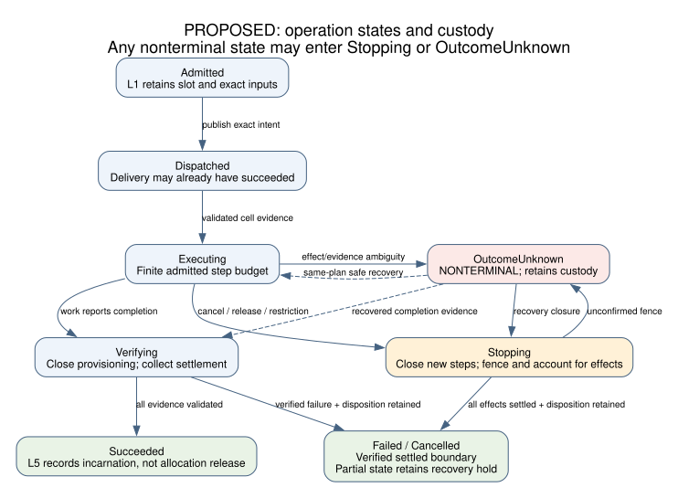
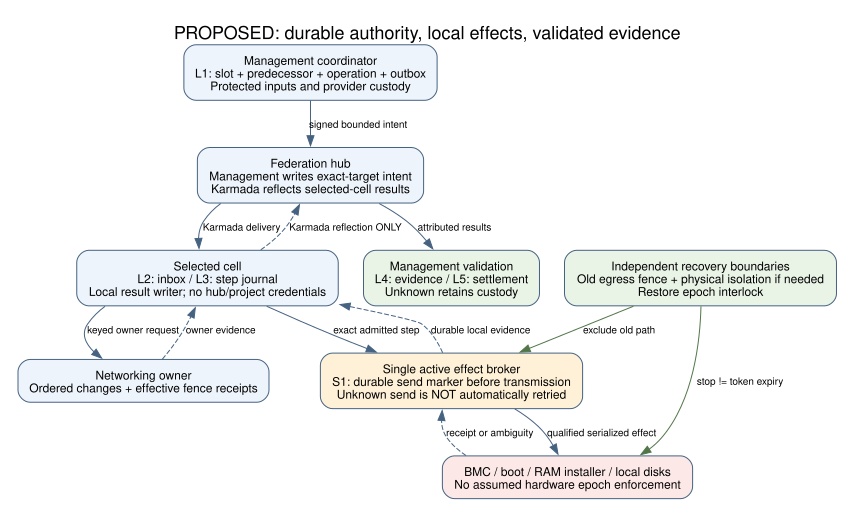

# Concrete operation execution, fencing, and recovery

- [Summary and pinned dependencies](#summary)
- [Design decisions](#design-decisions)
- [Records and writers](#records-and-authoritative-writers)
- [Operation state machine](#operation-state-machine)
- [Admission and linearization](#admission-delivery-and-linearization)
- [One driver and conflict domain](#one-driver-and-one-conflict-domain)
- [Step journal and submission](#step-journal-and-physical-submission)
- [Effect boundaries](#concrete-effect-boundaries-and-qualification-limits)
- [Cancellation and takeover](#cancellation-expiry-and-executor-takeover)
- [Completion and recovery](#completion-evidence-and-operator-recovery)
- [Storage and restore](#storage-failure-and-restore-epochs)
- [Owner interfaces](#minimal-interfaces-to-adjacent-proposals)
- [Failure matrix](#failure-matrix-and-adversarial-acceptance-tests)
- [Qualification and operations](#qualification-rollout-and-operations)

## Summary

This proposal selects an execution protocol for standalone Fleet/Metal: a
transactional management journal, a durable selected-cell step journal, and one
credential-holding effect broker per physical target. It deliberately trades
availability for retained custody when a non-transactional hardware effect cannot
be disambiguated. It does not promise exactly-once hardware execution.

**Everything specified here is proposed, not implemented or hardware-qualified.**
Existing libraries, synthetic tests, and API examples do not establish these
guarantees. Logical record and message names below are design vocabulary, not
newly available APIs. There is no compatibility machinery for earlier drafts.

Read the [repository design context](../../architecture/design.md), historical
[provisioning contract](../../proposals/fleet-management/bare-metal-provisioning.md),
and [OS configuration contract](../../proposals/fleet-management/os-configuration.md).
The historical sources are pinned by the
[migration record](../../proposals/fleet-management/MIGRATION.md). This proposal
specializes their execution requirements, not their allocation or OS interfaces.

### Pinned design dependencies

Review baseline: 2026-11-14. These are source contracts, not merged dependencies
or approvals. In particular, this branch contains none of the companion diffs.

| Companion | Exact reviewed head | Contract consumed |
| --- | --- | --- |
| [BMC #41][bmc] | `f04e63ddd9d10cbf306daf3a0232961debd85e7f` | Virtual Redfish profile, session binding, journal-before-mutation, common conflict domain. |
| [Management #51][management] | `fa07c2236801a33a58efc914b555586c8e146cc6` | Provider custody, management admission, selected-cell execution, Karmada reflection. |
| [Offering access #58][access] | `a922ff1eb3275e26af6ae750a7515ddde245a754` | Retained allocation capabilities; current action/input rights; independent restrictions and cleanup authority. |
| [PXE #59][pxe] and its [lifecycle revision][lifecycle] | `d7ff793b03711203dbfc9fac87d43922cc649b6f` | Installation source union, immutable driver, predecessor consumption, RAM-installer settlement and assurance. |

Their own older companion references remain historical. The exact heads above
are the integration baseline here; this proposal does not rewrite those files.

## Motivation and scope

An admission transaction can be atomic; a database commit and a BMC reset cannot.
A lease may expire while the old process owns a socket, while the BMC queues a
command, or while an installer writes disks without network access. Recovery
must distinguish these three cases rather than increment a token and retry.

Own here: durable operation and step states; identity, replay, dispatch,
cancellation, takeover, evidence, restore, and the execution-side fencing
contract. Include runtime power and gateway BMC mutations because they contend
with Installation and release on the same allocation and physical asset.

Exclude: nodes, clusters, allocation/quota policy, networking/IPAM/routing policy,
inventory trust, external fulfillment, release/reuse policy, deployment topology,
and a new public operation API. Read-only observation is not an effect and does
not acquire the effect reservation, prove settlement, or grant write authority.
Inventory import/adoption remains observational; no record creation schedules
preparation or frees occupied capacity.

## Design decisions

1. Use PostgreSQL transactions for protected management records and, separately,
   the cell journal. Require synchronous durable replication for acknowledged
   effect-authorizing writes, one fenced writable primary, and no asynchronous
   failover that loses acknowledged writes. Unavailable durability means stop.
2. Co-locate the operation slot and predecessor compare-and-set with the
   allocator's authoritative binding transaction boundary. Do not implement a
   second allocation lock in another API server. Allocation/quota owners must
   expose this transaction extension before integration; this does not choose
   their quota algorithm or move their public APIs.
3. Use a transactional outbox and a cell transactional inbox, not a cross-plane
   distributed transaction. Delivery is repeatable; physical command submission
   is not automatically repeatable.
4. All BMC/provisioning clients submit through one cell effect broker. Only that
   broker holds upstream credentials and an allowed BMC network path. Workers,
   customer gateways, and Jobs cannot open upstream mutation connections.
5. No automatic effect-broker failover on a lease timeout. Takeover requires
   external path/process fencing and settlement of commands already accepted
   downstream. A stopped broker is not necessarily a stopped BMC task.
6. Prefer explicit unavailable/unknown outcomes over a false successful reboot,
   cancellation, installer completion, or capacity release.

The PostgreSQL choice is a proposed durability requirement, not a claim that a
particular HA operator supplies fencing. For implementation review, consult
[PostgreSQL synchronous replication][postgres-sync] and
[transaction isolation][postgres-isolation]; qualify the actual WAL flush,
replica promotion and split-brain behavior. A configuration flag alone is not a
qualification result. Redfish behavior must be tested against the applicable
[DMTF specification][redfish-spec], [schema resources][redfish], firmware and
adapter combination.

## Records and authoritative writers

All private records are provider-project-scoped service custody, protected from
consumer deletion and outside public object garbage-collection chains. Physical
asset, allocation, Installation and request identities remain distinct. Names
resolve to immutable incarnations; namespace equality proves nothing.

| Logical record | Sole writer and required contents |
| --- | --- |
| Asset execution slot | Shared lifecycle coordinator, in #60's ledger transaction: exact asset/enrollment lineage, tagged current subject and custody epoch, active operation, monotonic operation sequence across subjects, closed-admission marker, subject-specific predecessor, terminal receipt and unresolved obligations. Occupancy and quota stay with their owners. |
| Operation | Lifecycle coordinator: tagged subject, caller and policy decisions, accepted allocation capabilities or explicit service-custody authority, immutable executor/plan, Installation or runtime power generation only when applicable, selected cell incarnation, asset mapping, plan/input digest, validity and finite step budget, lifecycle phase, recovery/cancellation decisions. |
| Input manifest | Admission resolver seals immutable versions; coordinator pins their references: exact artifact/configuration bytes, digests, target disks/interfaces, endpoint and trust policy, secret version handles, recipe and adapter binary/schema digests. No mutable-name-only references. |
| Outbox/hub intent | Coordinator commits outbox with Operation; handoff publisher writes hub spec and exact-target policy from it. Same operation/revision/digest on every retry. |
| Cell inbox and step journal | Cell execution service: admitted envelope, highest accepted revisions, stable step keys, normalized request and translation bytes/digests, attempt ownership, write-ahead marker, remote task identifiers, evidence and stop barriers. Broker alone advances physical-send state. |
| Local execution result | Cell result publisher, from journal: monotonically sequenced immutable evidence summaries. Karmada alone reflects selected-cell status onto the hub; management validates and retains it before public projection. |
| Boundary fence receipt | Each owning boundary service signs its own observed cutoff: broker egress, boot service, credential broker, networking owner, independent power isolation. Coordinator assembles, never invents, a settlement certificate. |
| Recovery custody | Lifecycle coordinator: unresolved sends/tasks/installers, all old route identities, revoked capabilities, retained inputs, operator decisions, obligations and custody transfer. Survives project/API removal. |
| Restore epoch | Independent recovery authority: durable monotonically increasing domain epoch, active journal lineage and enabled boundary identities. Not restored from the journal snapshot it protects. |

Use serializable transactions with row locking on the exact shared asset slot,
unique operation idempotency keys, and unique step keys. Retry serialization
aborts only before an external effect; transaction retries never wrap a network
send. An asset guard prevents two allocation incarnations from targeting the
same physical machine; it consumes #60's authoritative unique subject occupancy,
not discovery lists. Keep tombstones for retired allocation/operation identities
for the lifetime of the asset enrollment and its restore horizon.

### Identities and immutable inputs

An operation key is `(providerProjectUID, subjectKind, subjectUID, callerRequestKey)`.
Admission returns the existing operation for an identical canonical request
digest, or a conflict for different contents. Project/Installation recreation
cannot reuse authority. Power intent uses the retained Machine UID and desired
generation; a reset uses a fresh explicit request key, never a reconcile count.

A step key is `(operationUID, planDigest, stepOrdinal)`. Its definition includes
exact target, action, normalized input, prerequisites and completion predicate.
An attempt UID identifies a particular worker delivery, not a new step. Fence
identity is `(restoreEpoch, canonicalAssetKey, enrollmentEpoch, custodyEpoch,
subjectKind, subjectUID, operationSequence, executorGeneration)`.
It is an anti-staleness value at participating services, **not** a token magically
understood by commodity BMCs, disks or already-running code.

Retain both the public normalized action and its exact upstream translation
before sending, including adapter version and physical route. Reject ambiguous
JSON keys, unsupported fields, alternate resource links and unlisted OEM actions.
Do not retranslate an old send through a newly deployed adapter. A changed recipe,
driver, disk mapping or source requires settlement and a new Installation for
Installation work, or an explicitly admitted successor service plan otherwise; an
executor generation may change only the authorized worker, not these inputs.

Artifacts and rendered secret-bearing configuration live in encrypted,
versioned, retention-protected object storage. Envelope keys and credential
versions live in protected recovery-capable custody, never Git or public status.
Admission verifies that bytes and decryption dependencies are durably available
before committing their digests. Pin before publication; garbage collection uses
committed references and never removes unsettled-operation inputs. An orphaned
pre-admission blob has no effect authority and may be collected later.

For delegated PXE, retain the exact endpoint, TLS/origin policy and initial
response content/digest before serving it. Customer-hosted subsequent content
may be mutable; record observed digests without claiming reproducibility or
QualifiedImage assurance. Recovery never refetches changed bytes to replay an
uncertain boot. If the admitted source cannot reproduce a required input, only
settlement/cleanup is available, not an invented replacement plan.

### Asset-custody subjects and initial service execution

The proposed `custody-subjects-v1` contract extends L1–L5 and S1 in place. The
tagged subject is exactly one of `Allocation(allocationUID)`,
`Preparation(custodyUID)`, `AdoptedCustody(custodyUID)` or
`PhysicalMaintenance(custodyUID)`. All use #60's same
Occupancy, persistent asset execution slot, ProviderGuard, gate validation and
total lock order, including physical-resource rows before slot/operation/release
children. Do not allocate one slot per tag. Allocation/Installation-specific
text below applies only to that branch; common journal, effect and restoration
rules apply to all four. No backwards-compatible null allocation encoding.

This explicit service path specializes older source shorthand that every PXE
boot requires an Installation: customer provisioning still always does, including
CustomerRedfish. Qualified service commissioning/cleanup instead requires the
typed service plan below, with no customer session or provisioning authority.
It is not permission to run a customer installer without an Installation.

Preparation binds provider Project UID, custody UID/epoch, exact canonical asset,
enrollment UID/epoch, Device/supply incarnations, accepted placement/component
revisions and chosen cell. Admission requires allocation Disabled, no conflicting
allocation/adopted-domain/maintenance/release hold, trusted pre-boot identity and
physical safety, and current service-principal action/input rights. A qualified
commissioning capability is separate from not-yet-established boot qualification
and consumer eligibility. Resolve these states explicitly; do not close/bypass
identity or safety gates merely because consumer allocation is Disabled.

Retain the provider-approved commissioning purpose and any exact destructive disk
permissions, policy/recipe/image/adapter digests, disk/NIC/BMC/outlet targets,
network/origin inputs, secret versions, finite steps and validity before L1.
At L1, #60 atomically acquires Preparation occupancy and guard obligation while
this owner advances the slot sequence and inserts operation, input pins and
outbox. Validate current service, ownership, trust, commissioning qualification,
network/input-use, safety and restore gates. No Machine, consumer project, quota
hold, Installation, offering acquisition or synthetic predecessor is needed.
The prior-state CAS is a settled custody receipt, or a verified first-use
quiescence manifest; absence of an Installation alone proves neither blank media
nor absence of prior effects. Preparation uses one pinned service executor, not
CustomerRedfish or an implicitly created customer provisioning session.

Its finite plan is: establish exact quiescent target and queue baseline; request
#61 Commissioning materialization; wait for the exact isolated path receipt;
serve one bounded bootstrap; run pinned inspection/authorized preparation; close
new steps; stop verifier/RAM code and all accepted BMC/storage work; revoke/drain
boot, proxy and credentials; disconnect/dispose commissioning bindings; collect
independent evidence. Network preparation happens after L1 and before boot, so
requiring its receipt creates no pre-admission bootstrap dependency. Service work
does not require a customer local-disk OS boot to manufacture success. Each effect
uses the same L2/L3/S1 and broker boundary. A lost boot/disk response stays Unknown;
no auto-retry, callback-only settlement or expiry-based occupancy clearance.

AdoptedCustody can be stored while identity is unresolved, but **no effectful L1**
is permitted until #63 resolves trusted enrollment/mapping and #65 records explicit
prior-custodian/provider approvals, destructive scope, policy provenance and
active-use obligations. R1 closure is not proof of old execution settlement.
Read-only observation may precede resolution; a boot, reset, credential rotation
or network mutation may not be smuggled in as discovery. The operation envelope
binds the original custody UID, resolution revision, release case, approved
transition, exact obligation and component coverage. #65 service cleanup on this
subject uses the same slot, first stopping/fencing prior authority (including
non-Fleet senders), then a new service-only cleanup path and pinned plan. Unknown
original targets or prior senders block cleaning, not just final release.

Normal service admission/renewal uses current Open service/safety gates. Closing
ProviderGuard or customer gates permits only the explicitly retained settlement
lane: validate expected closure revisions and surviving cleanup authority plus
current issuer/identity/target/qualification/recovery gates. This lane cannot
create a new ownership approval, expand a recipe, or turn observation into wipe
authority. Missing inputs may permit separately authorized independent isolation,
never replacement installer bytes or a guessed target.

L5 binds tagged subject, custody/resolution/enrollment epochs, full fence, exact
plan and all send/stop/network evidence. Success means that service plan's measured
postconditions and no-late-effect proof; it is not consumer Installation assurance.
The slot clears only with atomic transfer of residual obligations/recovery hold.
Preparation custody stays occupied until #65's clearance decision; adopted
custody stays occupied until #65 R2. Neither L5 nor an empty slot publishes
eligibility. Inventory later evaluates new evidence, and allocation separately
checks the cleared conflict domain. Physical reservations remain with inventory.

Restore reconciles these subjects even without any consumer record: custody and
resolution history, slot sequence, old/new broker routes, outboxes, cell sends,
boot/network grants, retained bytes/keys and release barriers. A backup preceding
L1 cannot erase a remote preparation send; a backup preceding adopted resolution
cannot authorize cleanup from a serial/IP match. Retain Unknown domain custody,
fence old paths, establish the independent new lineage and reauthorize only an
exact reconciled checkpoint. Lost identity or input keys blocks effects and
reuse. Old subject tombstones survive an eventual consumer allocation.

### Physical maintenance and the field-work boundary

The proposed `physical-maintenance-v1` tag uses #60's exact admission contract:
trusted canonical Device/enrollment, optional supply, no conflicting target
custody, current scoped custodian/service/technician authority, dependency-owner
barriers and atomic inventory closure/reservations/occupancy/slot/operation/outbox.
This is a typed finite field procedure, **not** Preparation's commissioning boot
plan. A passive panel has no BMC, Machine, quota, Installation or boot prerequisite.
The selected cell remains the sole local journal/result path. An authorized
technician is the operation's physical actuator, not a second admission service
or an independent executor with its own asset lock.

Seal the transition/custody UID, exact old/candidate plans and resource interests,
component and port map, impact graph and owner-fence receipts, permitted actions,
qualified procedure digest, assigned technician identities and independent witness,
finite ordered steps, deadlines and stop/recovery procedure before L1. Field-work
authority cannot include implicit boot, wipe, power or network-configuration steps.
Necessary dependent active-device actions use their owners' separately admitted
operations and custody, with effective barriers already retained before L1.
An idle server's own field repair does not borrow commissioning disk authority.

The finite sequence is: revalidate exact identity and owner barriers; issue and
consume the bounded field permit; perform only its enumerated move/repair/removal;
close work and reconcile all starts; obtain independent placement/component,
vacancy/termination/load and worker-cessation evidence; commit L5. Only #65 R2
clears custody. No local-disk boot is needed to manufacture passive-work success.

For this actuator, S1 is the cell broker's durable **permit delivery marker**,
before releasing the one-use permit to the named technician. The permit binds
operation/step, full fence, transition/custody, old/new plans, exact resources,
technician, deadline and budget. Lost delivery after S1 is Unknown; never issue
a replacement permit identity or treat no start receipt as no work. Same-key
queries recover the original marker/permit status, not another right to start.
Before touching equipment, the technician authenticates to the same journaled
boundary and obtains its durable, once-only start acceptance. This L3/S1 step
substate checks the current finite envelope, field-access qualification, barriers
and closed bit. No offline start or self-renewal is supported. A lost start reply
is reconciled by that same identity before any action, never consumed twice.
The technician records completion with exact action/evidence and timestamps;
an independent authorized witness verifies identity, physical result and cessation.
The cell publishes attributable LOCAL evidence via Karmada; only management
accepts it. A technician cannot write successful management status.

Central cancellation closes delivery/start admission but does not recall a printed
permit, stop hands already working or prove physical rollback. The broker's stop
inventory includes every delivered/unacknowledged permit and accepted start.
Qualified site access control and the field supervisor must independently stop
and exclude the old crew, secure the work area, and reconcile permits, tools and
actual equipment state before a successor crew is enabled. Receipt binds site,
old crew/permit identities, cutoff and observation time. A message asking someone
to stop, credential revocation, deadline or a new executor generation is not this
barrier. If that physical enforcement cannot be established, retain Unknown and
both reservation sets indefinitely. Already-started work may reach only the
preapproved safe stop boundary; emergency work needs separate exact recovery
authority, not an expanded maintenance budget.

L5 requires the complete permit/start/completion/stop inventory, no possible late
field work, independent physical postconditions and exact dependent owner receipts
or positive scoped non-applicability. Failed/cancelled work may settle into a
recovery hold only after cessation; it does not establish original placement.
Returning a panel to its old rack or reconnecting a changed cable is a separately
authorized successor plan after old work settles, not an automatic rollback.
R1 prevents further ordinary field steps; #65 owns clearance/accounting, #63 owns
physical reservation disposition and subsequent evaluation. Dependent owners
alone authorize resumption under fresh mappings and current active-custody rights.

Renewal checks this operation's exact inventory closure mutation/epoch, remaining
Open maintenance safety/issuer gates and held owner barriers under #60's total
order. No general Closed-gate exception is introduced. A changed plan, new
dependency, revocation or lost owner fence blocks progression; reconcile and
settle before a freshly admitted successor. Retain permit histories and physical
site barriers in restore/retirement custody, even without Machine/boot records.
Pre-L1 snapshots or lost field journals require independent union reconciliation,
old-crew exclusion and the new recovery lineage; never automatically redeliver a
permit. Missing exact work inputs or unknown physical state blocks clearance.

## Operation state machine

| State | Meaning and allowed transition |
| --- | --- |
| `Admitted` | Slot, subject-specific predecessor/first-use check, exact inputs and outbox committed. Dispatch or cancel before delivery; no physical effect yet established. |
| `Dispatched` | Hub handoff published; cell may have accepted it even if acknowledgement is missing. Recover delivery under the same identity. |
| `Executing` | Matching cell acceptance/evidence retained. Progress only inside the finite admitted plan. |
| `Verifying` | Required work reports completion; new provisioning steps are closed and settlement/evidence checks are pending. Not readiness. |
| `Stopping` | Cancel, release, expiry or safety restriction has requested closure. Retain reservation while fences and in-flight effects settle. |
| `OutcomeUnknown` | Missing or conflicting evidence about any possible effect. Nonterminal; reservation and recovery custody remain. May resume the same plan only after explicit recovery checks, or enter Stopping/Verifying. |
| `Succeeded` | Required outcome and settlement certificate validated; management atomically records subject outcome and slot disposition. Does not clear subject occupancy or publish eligibility. |
| `Failed` / `Cancelled` | All possible effects settled, obligations transferred/retained, and disposition recorded. No implication of rollback or usable predecessor. |

An operation can be terminal with `PartialStateRequiresRecovery` only after all
writers/tasks have stopped and the allocation remains blocked in retained
recovery custody. Clearing the active slot in that case atomically installs a
recovery hold: only release or explicit service recovery may acquire it. A
successor Installation is allowed only from successful settlement or verified
no-effect/prior-state-intact failure under the lifecycle predecessor contract.
Unknown cannot be made terminal merely to allow another operation.

All transitions use expected record version and evidence sequence. Late results
are appended to history, not used to regress a stop or terminal decision. There
is no direct transition from callback, Job success, or session closure to Ready.

## Admission, delivery, and linearization

1. Resolve current actor/action/input rights against the subject's retained
   capabilities or explicit service-custody authority above. For allocations,
   offering/assignment withdrawal is not a new runtime acquisition
   check. Explicit allocation suspension, provider retirement, target safety,
   artifact rights and network prerequisites still apply. An authorization
   outage is unknown, never allow. Retain the decision revision, time and bounded
   validity; do not substitute the service principal for the original caller.
   Consume the [allocation admission protocol][admission] authority contract:
   retain the authenticated caller/action/input digest, complete dependency gate
   vector, exact Open epochs and committed revisions, validity deadline, and
   ledger recovery lineage. Missing dependencies or unregistered gate writers
   block admission; watches and an unexpired permission receipt are insufficient.
2. Seal exact inputs. L1 participates in the same SERIALIZABLE ledger transaction
   and complete total lock order as [allocation admission][admission], including
   physical-resource/reservation and custody rows before the asset slot,
   operation and release children. Gate closure, retirement and runtime admission
   use this shared order. Under those locks revalidate every gate is Open at the
   retained epoch/revision, decision digest/caller and current recovery lineage
   match, and the deadline has not expired under trusted ledger time. Revalidate
   ProviderGuard permits new operation admission. No remote calls run under locks.
   In that same management transaction compare exact subject occupancy/incarnation,
   admission-closed state, usable subject-specific prior-state proof and free slot;
   allocate operation sequence; consume Installation predecessor only when
   applicable; insert Operation, input pins and dispatch
   outbox. **L1: this commit admits the operation.** Losing concurrent requests
   have no dispatch authority. There is no multi-resource Kubernetes write
   sequence pretending to provide this atomicity.
3. Publish signed intent and target policy from the outbox to exactly one cell.
   Verify the ResourceBinding's selected member matches the retained cell UID.
   Federation failure retries publication, never operation admission. The cell
   validates management signature, identity, digest, epoch, clock validity,
   prerequisites and budget, then inserts its inbox plus plan transactionally.
   **L2: inbox commit accepts delivery, not a hardware outcome.** A duplicate
   returns existing state; a different digest with the same key is rejected.
4. The selected driver requests the next permitted step. The cell transaction
   checks the closed bit, exact driver/session, predecessor steps, local fence,
   step budget and current unexpired authorization envelope; inserts the step
   and evidence dependencies. **L3: step commit consumes that budget position.**
   A broker validates these records again immediately before its send marker.
5. Results are journaled locally before publication. The cell has local result
   credentials only, no hub or project API credentials. Karmada reflects status;
   management verifies cell/asset/allocation/operation identity, revision,
   epoch, sequence, freshness and evidence provenance. **L4: management evidence
   commit** may advance operation state, not simply copy a Ready field.
6. After settlement, management commits the terminal receipt and incarnation,
   slot disposition and retained obligations atomically. **L5: settlement
   commit** permits the next eligible operation. The release owner separately
   decides whether cleanup/reuse requirements allow allocator occupancy changes.

Public objects, hub handoffs and local Kubernetes objects are projections of
these journals, not replacement authority. Local Jobs can disappear without
losing custody. If L1 succeeded but the API response was lost, the caller's key
recovers it; if publication succeeded but its receipt was lost, the outbox
replays the identical intent. Retain hub/local evidence until management has
acknowledged its durable sequence, or transfer the unresolved handoff and inputs
to recovery custody before deleting delivery objects.

Cancellation before apparent dispatch is not automatically no-effect: an outbox
publisher may have sent intent before recording its receipt. Either prove that
publication was never possible and fence every claimed publisher, or retain a
stop tombstone and obtain the selected-cell closure/settlement receipt. A delayed
older intent must lose to that tombstone even when it is the first work message
the cell receives. Keep revision high-water marks outside disposable inbox objects.

### Authorization freshness and partitions

Management issues a signed, finite authorization envelope covering the exact
operation and allowed normalized steps, with action/input decision revisions,
restriction revision, validity and maximum clock uncertainty. Admission of an
uncovered customer body requires another management decision before delivery;
the gateway cannot broaden a profile into new authority. Runtime power is a
separate admitted operation, not an unused provisioning budget entry.

Each customer step additionally checks current session use and authenticated
caller binding against the locally delivered unexpired decision. Qualification
sets the maximum decision age and clock-skew bound per location; no default
unbounded cache. If that freshness cannot be established, no new step starts.
This is bounded authorization, not instantaneous revocation across a partition.
Management renewal obtains a fresh complete decision for current action/input
rights and safety restrictions on the same exact inputs. Its new validity/revision
and delivery outbox commit together under the same L1 authority-gate validation,
ProviderGuard ordering, operation version and recovery-lineage checks. A closure
that wins prevents renewal from committing; stale decisions cannot reopen authority.
Reevaluation never reacquires withdrawn offering/assignment grants. Cells cannot
renew themselves. Service-authorized cleanup uses the dedicated recovery lane
and retained obligations, not consumer gate bypass for new customer effects. Already-valid authority
may reach its admitted boundary before a newer restriction arrives. A product
requiring immediate revocation must require synchronous authority at that boundary
or disable disconnected effects; it cannot claim immediate revocation from TTL.

## One driver and one conflict domain

An Installation immutably chooses `ProviderAutomatic` or `CustomerRedfish`.
ProviderAutomatic supports qualified ManagedImage or DelegatedPXE; CustomerRedfish
initially supports DelegatedPXE only. The latter gateway maps a bounded virtual
Redfish profile to the Installation's finite steps, never directly to arbitrary
upstream HTTP. Fleet's automatic installer controller cannot compete with it.
Service-owned stopping/fencing remains available in either mode; it cannot use
recovery permission to complete an unrequested new installation.

| Request | Serialization decision |
| --- | --- |
| Observation/session health | Current read authorization; no slot, no readiness inference; methods with side effects are not classified as reads. |
| Initial/reinstall Installation | Acquire shared asset slot under allocation occupancy and consume exact predecessor at L1. `None` only for verified blank, never-installed allocation. |
| Preparation or adopted cleanup | Exact custody subject and service authority; same persistent asset slot, no Installation predecessor or consumer session; #60/#65 occupancy remains held through settlement. |
| Unallocated physical maintenance | PhysicalMaintenance subject, exact field procedure and owner prerequisites; same asset slot and journaled permit boundary; no commissioning/boot prerequisites or authority over dependent active custody. |
| Provisioning-session mutation | Attach to admitted CustomerRedfish Installation; same step key across sessions, no independent boot reservation. |
| Runtime power intent or reset | Acquire same slot; reject `OperationConflict` during Installation, stopping or unknown custody. Intent controller retries admission only after settlement, never sends around the slot. |
| Second install, rescue, media or raw BMC write | Conflict or unsupported; no boot-change escape hatch. Virtual media and persistent override excluded initially. |
| Release, suspension, operator safety stop | Atomically close new central admission and record a priority stop request; settle current work through its journal. Release acquires next slot only after a verified barrier or an explicit fenced recovery transfer. |

CustomerRedfish exposes one virtual task identity per admitted mutating step.
Identical normalized requests for a consumed step return its existing task;
different inputs conflict. A second genuine reset requires a separately admitted
ordinal, never HTTP retry detection by elapsed time. A step waiting on authority
or conflicting state returns an explicit non-success response. Unknown upstream
execution remains a nonterminal/exception task, not successful Redfish completion.
This requires qualifying the client/profile behavior, not claiming arbitrary
Redfish clients provide idempotency keys.

### Initial finite installation sequence

Admission resolves this template into exact step ordinals, targets and predicates;
it is not an open-ended workflow interpreter. The networking owner performs its
own changes; the selected driver advances normal boot/power work through the
broker. CustomerRedfish submits those normal transitions; service settlement may
revoke or stop but may not silently perform the customer's final boot for it.

| Order | Required boundary before proceeding |
| --- | --- |
| 1. Establish quiescent target | Exclude predecessor senders/tasks/installers; verify target identity and powered-off host or equivalent qualified initial barrier. Unknown blocks the sequence. |
| 2. Prepare provisioning | Obtain networking-owner prepared revision, seal required bootstrap inputs and create the exact boot session. No tenant handoff yet. |
| 3. Arm and start PXE | Journal/read back one-time override, then journal one permitted start/reset. Track the resulting boot instance; a second boot attempt needs explicit recovery, not an unbounded reset loop. |
| 4. Install or delegate | Managed installer executes one pinned disk-write step, or delegated endpoint controls opaque installation. Record progress and callback; neither permits a competing writer. |
| 5. Close provisioning | Deny new installer steps/fetches, drain serving paths and revoke temporary authority. Account for outstanding BMC requests. |
| 6. Stop old execution | Establish host-off/no-late-effect and storage settlement evidence. A customer stop request is still journaled; service recovery may independently isolate if it cannot settle. |
| 7. Select and start local boot | Clear PXE/alternate override, verify readback, obtain required network handoff evidence, then permit the selected driver's single local boot step. |
| 8. Verify and settle | Observe new boot instance, required source-specific assurance and all fence receipts; L5 records the terminal outcome. |

Each step may include only a predeclared bounded set of substeps, each with its
own journal identity wherever it crosses an external effect boundary. Polling
is observation, not another mutation. Customer abandonment between steps enters
expiry/Stopping and cannot leave provisioning authority indefinitely enabled.

## Step journal and physical submission

Step phases are `Prepared -> SendMarked -> Accepted -> Observing -> Settled`.
`SendMarked` without a conclusive receipt becomes `Unknown`; acceptance may also
remain unknown if the remote operation cannot be tracked. `ProvenNotSent` is a
separate evidence-bearing outcome, never a synonym for timeout.

The broker serializes all mutations for the target, including boot setting,
power, credential/session teardown and recovery steps. Immediately before send
it commits `SendMarked` with exact upstream bytes, route, attempt and fence in
the durable cell journal. **S1: this commit is the conservative uncertainty
boundary.** After S1, a crash may mean either zero sends or one accepted send.
The broker disables library/proxy automatic retries and mutation redirects.
There is no database transaction held open around an HTTP call.

Only the attempt that created S1 may transmit, once, while its broker identity
remains active. The broker uses a per-target execution mutex and a durable
single-sender assignment; a restarted process cannot retransmit a SendMarked
step. On process loss, external fencing closes its egress before any replacement
gets a mutation path. This prevents a paused old sender from waking after takeover.
Database row locks alone do not close the interval between validation and send.

The broker records response/task URI and observations durably before returning
success to its caller. Stable remote task handles, when available, are polled
under their pinned BMC identity and task incarnation. Task disappearance or URI
reuse is not completion. If no task handle was retained, use qualified physical
observations and queue-drain evidence; a current power state alone cannot prove
that an earlier delayed reset will not execute later.

Automatic replay is permitted only when (a) the journal proves no S1 and the old
sender is excluded, (b) positive transport evidence proves no bytes escaped and
the old path is fenced, or (c) a specifically qualified downstream protocol
durably deduplicates the same key across restart/restore. Case (c) is **not** a
default property of Redfish. Otherwise retain Unknown and settle or physically
isolate; do not resend an uncertain reset, disk action or erase. Even a repeated
"set power On" must account for queued old commands before being judged safe.

## Concrete effect boundaries and qualification limits

### Broker and provider egress

The first qualified integration uses a dedicated broker security identity and
network enforcement point for each target's active path. The networking owner
allows upstream BMC access only from that identity; general cell workloads and
customer gateways have no bypass route. Do not share an unrevocable NAT identity
between old and replacement brokers. The credential service releases a scoped
BMC credential only to the enabled broker generation. Provider automatic adapters
use this same path; a remote execution backend with independent queues must
provide equivalent cancellation/drain/fence evidence or is not qualified.

Takeover first freezes dispatch, then independently disables the old broker's
egress at the enforcement point, flushes established flows, and stops or isolates
its compute execution. Receive a receipt identifying target, old identity,
installed deny revision and observation time. Rotate/revoke credentials and BMC
sessions where supported, but do not treat rotation as cancellation of accepted
tasks. A firewall receipt excludes new packets, not requests already delivered.
Only then can a new broker receive observation/recovery access. Ordinary
execution access stays disabled until downstream settlement is proven.

The independent fencing authority is an explicit prerequisite owned by the
network/deployment integrations. If the only available controller is the stale
broker itself, there is no qualified takeover. Do not retarget federation to
another cell as a substitute for fencing the old cell and its external workers.

### Boot and delegated fetch

The platform boot service and allocation-scoped proxy use a transactional session
ledger keyed by full fence and asset binding. Serving a bootstrap capability
requires the current open session, exact digest/origin and unexpired authority.
Revocation commits a tombstone, drains active responses, denies new fetches and
revokes temporary credentials; all replicas must acknowledge the cutoff or be
removed from the serving path. No fail-open stale caches. With no live session,
respond with local boot; do not recreate a session from an old handoff.

Firmware one-time boot overrides are BMC effects and use S1, serialization and
readback like any other mutation. Clear the override and remove authorized
alternate boot paths before final local boot. A served script, cached kernel or
downloaded image cannot be recalled. The revocation receipt covers future fetches
only; it is not proof that the installer stopped. Boot identity requires an
inventory-approved asset/port binding and authenticated bootstrap mechanism;
MAC address alone is insufficient. The trust mechanism is an inventory/boot
qualification input, not invented by this operation protocol.

### Power and BMC response loss

For an uncertain reset/override, first retain the S1 ambiguity and prevent later
consumer steps. Query task/state/event evidence without effects. To declare a
command settled, require correlated terminal task evidence plus a qualified
no-late-effect predicate, or a tested firmware-specific queue-drain/reset
procedure that establishes no accepted command can execute afterward. A timer
is sufficient only where the firmware qualification proves a hard bound; a
chosen timeout or empty task collection is not such proof.

The fallback is independent physical isolation: an operator-approved PDU or
contactor removes **all** host and BMC power feeds, with outlet-to-asset mapping
and measured de-energization evidence. Qualification must establish which
pending effects survive BMC power loss. On restoration, keep the host electrically
inhibited while the BMC is inspected and pending/persistent actions and boot
state are cleared through a tested procedure. Only then authorize host power.
If hardware cannot hold the host off independently, or persistent queues cannot
be accounted for, require onsite isolation/service or quarantine. Do not use an
ordinary BMC reset as proof of this barrier.

Emergency isolation is a service recovery step in the same journal, permitted
to interrupt an unknown normal step but not to claim it never happened. It first
closes dispatch and records the intended disruptive boundary. Independent power
cut can stop a hung host even when BMC outcomes remain unknown; custody stays
held until both host and future BMC effects are accounted for. No lock-free
customer or operator reset bypass exists.

If the normal cell journal is unavailable, management may transfer only the
isolation obligation to an independently durable recovery executor. Record the
exact PDU target, request identity, authority and old-writer inventory before
dispatch; that executor also journals before sending and treats response loss as
unknown. This is an explicit recovery-custody transfer, not an extra normal driver
or an exception to journal-before-effect. Restoring host power requires separate
verified authorization; it is never the automatic inverse of a successful cut.

### Disk writes and an installer in RAM

Disk controllers do not enforce Fleet fencing numbers. The managed installer
receives one bounded installation step with pinned disk serial/WWN mapping,
image/configuration digests and signed recipe. Its progress/stop acknowledgement
is evidence, not a physical fence. Cooperative checkpoints can avoid unnecessary
restarts but cannot authorize a competing installer after contact is lost.

Closing PXE, revoking a token, changing boot override, killing a Job, or cutting
network access does not stop a RAM-resident installer. To hand over or allow a
successor, require a qualified host execution stop: settled BMC power-off with
independent host-off observation and no pending future commands, or independent
physical isolation as above. Account for storage-controller writes and persistent
jobs under the qualified device procedure before subsequent disk work. Initial
qualification is local attached disks only; SAN/NVMe-oF or autonomous external
storage tasks require their owners' equivalent fence receipts and are disabled
until then. Missing/replaced disks invalidate the retained target proof.

After the stop, revoke provisioning paths and credentials, enforce local-disk
boot, then perform a new controlled boot and observe its new boot instance and
required handoff evidence. This intentionally requires a power-stop boundary
even for a customer installer that reports success. It proves termination of
the prior volatile execution under the hardware trust model, not that opaque
customer code or compromised firmware is safe. Persistent firmware trust and
reuse sanitization stay with inventory and release owners. Failed evidence
leaves custody unknown; disk readback cannot prove no stale writer remains.

### Networking

Fleet never writes switches, IPAM, routes or tenant policy directly. It sends
the networking owner an exact request key, allocation/asset identity, admitted
network revision and ordered operation fence. The owner must durably deduplicate
requests, reject stale revisions at its actual configuration writer, order
revocation after prior changes, and return a receipt for effective data-plane
isolation, including existing flows and alternate provisioning paths. A desired
object update or controller acknowledgement alone is insufficient.

If the networking owner cannot exclude its stale workers at switches, the Fleet
barrier remains unknown. It must not be papered over by a Fleet epoch. Tenant
network handoff and cleanup policy remain owner decisions; Fleet consumes exact
revision/effect evidence. Network isolation can protect other tenants without
proving that local disk writes or queued BMC commands have stopped.

## Cancellation, expiry, and executor takeover

Cancellation commits a stop intent and closes central admission. Cell delivery
commits a local closed bit, prevents new S1 transitions, and records all existing
SendMarked/Accepted steps. A broker already between S1 and send remains in the
in-flight set; barrier completion waits for it or externally fences it. A
disconnected cell may start still-valid admitted steps until expiry or receipt
of closure, so the central commit is not the physical stop linearization point.

Expiry denies new S1 transitions and new bootstrap grants. It never retracts an
accepted hardware action. Step or session TTL does not release the slot. A
bounded running step can finish under retained settlement authority; expiration
does not authorize its next provisioning step. Cleanup has separately retained
service authority that survives grant withdrawal and consumer deletion. New
recovery capabilities are short-lived and bound to the same custody record,
issued only after epoch/target validation; cleanup is not perpetual bearer access.

Takeover sequence:

1. Coordinator records recovery decision, same driver/plan, and proposed next
   executor generation; closes old admission and obtains cell stop inventory.
2. Fence old broker/worker paths and boot/provisioning sessions, including any
   external provider workers. Unreachable does not mean fenced.
3. Account for all S1 steps, remote tasks, RAM installers and networking effects.
   Gather receipts for each boundary; physically isolate where qualified and
   necessary. Unknown stays held rather than permitting blind redispatch.
4. Validate retained inputs and restore epoch, then activate the replacement's
   generation at each participating boundary. Commit a recovery envelope for
   the same operation, with no added normal effect budget. Resume only at a
   proven safe checkpoint; otherwise finish settlement/release.
5. Reflect attributable evidence through Karmada and let management validate it.

A replacement gateway may serve observation or return an existing virtual task
without becoming an effect executor. CustomerRedfish recovery never silently
becomes ProviderAutomatic. Changing driver requires a settled new successor
Installation under the predecessor rules. Partially written or uncertain media
cannot be declared an intact predecessor simply to enable that switch.

The initial qualification permits recovery between settled steps, not replay or
resumption inside a partially completed disk-writing step. If that step cannot
be verified complete, retain the partial-state hold and settle toward release.
Future resumable recipes require their own persistent checkpoint and write-range
proof; an installer progress percentage is not such a protocol. An unsent later
step can proceed under renewed exact authority after all earlier steps and old
writers have been accounted for.

## Completion evidence and operator recovery

A settlement certificate binds operation/plan/asset/tagged subject/cell/restore epoch,
step outcomes and their journal sequence, evidence-producing identities, observed
times, clock uncertainty, fence receipts and remaining obligations. It includes:

- No unresolved S1 send, remote queue or independent provider writer.
- Broker/gateway session cutoff; boot/proxy and temporary credential revocation.
- Networking-owner effective fencing/handoff receipts for exact revisions.
- Installer execution-stop proof and subsequent boot instance evidence when
  installation ran; exact disk/image/recipe verification for ManagedImage.
- Customer result and exact delegation observation for DelegatedPXE, without
  pretending to inspect the opaque OS; requested local boot evidence in both.

Immutable causal evidence (for example, an observed power-cut event) can arrive
after authority expiry; validate that it occurred within its authorized or
service-recovery scope. Current-state claims require newly fresh observations
after the final fence. An old power-off observation cannot establish current
quiescence. Reject wrong-cell, stale-fence, reordered, conflicting or unproven
claims; preserve them for investigation, not for public readiness.

Management alone projects success/assurance. ManagedImage needs QualifiedImage
evidence; DelegatedPXE reports only DelegatedContract. No node/cluster readiness
contract is defined here. A callback, task success, disk override or session close
alone satisfies neither assurance nor settlement.

Operator recovery uses an audited decision with incident ID, actor, reason,
expected journal version, affected identities, exact permitted recovery steps
and evidence attachments. Two authorized operators must approve epoch reset,
physical isolation/restore, or a custody transfer. Available decisions are
observe, fence/isolate, resume the same verified checkpoint, or transfer to
release/quarantine. There is no force-success, delete-journal, skip-fence or
"mark free" recovery action. Manual physical receipts need independently
verified asset/outlet identity and timestamps; a free-text assertion is not a
replacement for the missing boundary proof. Irrecoverable evidence leaves an
unavailable asset with explicit custody, not an optimistic terminal status.

## Storage failure and restore epochs

Routine failover that proves preservation of all acknowledged commits remains
in the same storage lineage; fence the previous database primary before promotion.
If commit preservation is uncertain, treat it as restore, not routine failover.
Journals and retained blobs/keys are backed up and restore-tested together, but a
backup is never assumed to contain every accepted hardware send.

Storage administration must enforce the restore interlock before exposing a
snapshot as writable. Every broker process restart starts observation-only and
requires a recovery-authority activation receipt for the verified journal
lineage; a copied database or Kubernetes lease cannot activate it. Undetected
in-place storage rollback outside this interlock violates the qualification
assumptions: there is no claim that a hardware token can repair lost knowledge.

The independent recovery authority holds a monotonic epoch and enabled journal
lineage in a separate quorum/failure domain, with operator-controlled restore
interlock. Broker and boundary activation requires its current signed epoch.
An old snapshot cannot mint current authority. Epoch checks reject new work at
participating services, but cannot stop an already-admitted hardware action.
If the epoch authority itself is lost/restored, all affected domains remain
disabled until external fencing and a separately verified new lineage are
established. Generating a random epoch in a restored database is not sufficient.

Restore procedure, including rollback of only one cell journal:

1. Disable admission and boundary activation for the affected failure domain.
   Enumerate all possibly targeted assets from management, cell, provider,
   inventory and independent enforcement records, not just the restored snapshot.
   If the set is incomplete, fence/quarantine the whole enclosing domain.
2. Fence old management/database writers and all old cell broker paths. Revoke
   old boot/capability service paths and account for BMC tasks/installers using
   physical procedures where necessary. Partitioned boundaries remain disabled;
   expiry alone does not establish their quiescence.
3. Recovery authority advances epoch only after these barriers are recorded.
   Restore journals, append-only evidence archives, input objects and key
   versions. Reconcile operation identities and tombstones with surviving cell
   journals and remote tasks; unexplained sends become Unknown. Never convert
   absence in the backup to ProvenNotSent, blank predecessor, or free capacity.
4. Verify every referenced blob and decryptability against its manifest. A
   missing exact input blocks execution. A rotated credential may be replaced
   only by a recorded recovery amendment proving the same physical target and
   scope; it cannot silently replace installer bytes, secrets used as content,
   driver or endpoint trust. Missing old credentials may require independent
   operator isolation rather than recovery through that BMC.
5. Reissue only explicit reconciled recovery envelopes in the new epoch. Each
   boundary acknowledges the new lineage before enabling effects. Reject old
   hub deliveries, callbacks and cached worker envelopes. Reconstruct public
   projections from reconciled custody, never use their status to fill gaps.

RPO for acknowledged authorizing journal writes is zero within the qualified
synchronous failure envelope. Disaster recovery outside it may lose knowledge;
the safety response is domain fencing and unavailable capacity, not a promise of
zero data loss. Recovery time is unbounded when hardware or evidence is missing.
Do not expire unresolved input/evidence retention to meet a storage budget;
backpressure new admission before filling storage. Terminal payload retention
can follow owner policy only after all cleanup and restore obligations are met.

## Minimal interfaces to adjacent proposals

These are required semantic exchanges, not invented endpoints or new owners.

| Owner | Input to this protocol | Output from this protocol / limit |
| --- | --- | --- |
| Allocation/custody | Immutable tagged binding/capabilities or approved service authority, authoritative transaction extension for asset slot/prior-state/closure, total lock order and retirement guard. | Durable operation receipt/hold; no independent quota acquisition, allocation selection or occupancy release. |
| Networking | Exact prepared revision, owner-executed keyed change and effective fence evidence. | Ordered effect/revoke request; no direct switch writer or IPAM/routing policy. |
| Inventory/trust | Verified physical identity/mapping and trust evidence, approved fencing paths and current safety eligibility. | Attributed observations and incidents; never self-enroll or declare trusted hardware. |
| External fulfillment | Exact provider route and contract capability, if separately qualified. | Operation identity, inputs, evidence and settlement requirements; no procurement or provider-specific fallback in this proposal. |
| Release/reuse | Service-owned cleanup recipe and required assurance; priority closure request. | Settled operation inventory, boundary receipts and unresolved obligations. Release owner verifies sanitization/restoration and authorizes allocator reuse. |
| Deployment | Independent management recovery, fenced storage, network/physical isolation services, clocks/keys and durable artifact custody. | Explicit prerequisites and failure tests, not cluster placement or rollout manifests. |
| OS/PXE and BMC | Immutable Installation/driver/source and bounded session profile. | Correlated execution and assurance evidence; no duplicate source union or public session schema. |

## Failure matrix and adversarial acceptance tests

These are required tests, **not executed tests**. Harnesses must assert durable
records, physical send counts, boundary receipts and custody, not just conditions.
Run each crash point both before and after durable commit and with duplicate,
delayed and reordered federation delivery.

| Injection / adversarial action | Required observable result |
| --- | --- |
| Permission evaluation succeeds, worker pauses, image/action authority gate closes, then L1 or renewal resumes. | Gate epoch/Open-state validation rejects the stale decision inside the commit transaction; no new operation or renewed outbox authority. Reopening requires fresh evaluation. |
| ProviderGuard closes or recovery lineage changes after evaluation but before L1/renewal. | Shared lock order/lineage checks reject admission; existing obligations remain recoverable under the service cleanup lane. |
| Two replicas admit different successors against the same predecessor. | Exactly one L1/slot/outbox; loser has no local inbox or effect. |
| L1 succeeds, response and publisher die; caller retries same key with same/different bytes. | Same operation for identical input; changed input conflicts; one predecessor consumption. |
| Cancel races an unacknowledged outbox send; stop arrives before original intent. | Retained tombstone rejects older delivery; no no-effect certificate without publisher exclusion or cell settlement. |
| Cell commits inbox then loses acknowledgement; replay plus wrong-cell copy. | One local plan; wrong cell cannot activate broker or contribute accepted result. |
| Two customer sessions race reset; automatic controller also tries. | One ordinal/S1; duplicate returns same virtual task; wrong driver rejected. |
| Runtime power, reinstall and release race. | Same slot orders all; release closes central admission, settles prior in-flight set before cleanup; no runtime bypass. |
| Crash before S1 versus immediately after S1 but before socket write. | First may send after fencing/recovery; second becomes Unknown even if hardware actually saw zero requests. |
| BMC accepts reset, response disappears; task URI is missing or later reused. | No blind retry and no false success from power state; retain Unknown until qualified drain/isolation. |
| Old broker pauses after S1, new worker wins lease, old broker resumes. | No new broker mutation path until old egress/compute fenced; pending old send accounted for, never just token rollover. |
| HTTP library retries or follows a mutation redirect. | Qualification fails; capture shows no silent duplicate upstream mutation allowed. |
| Session/operation TTL expires while RAM installer writes; customer closes callback stream. | New steps denied, ongoing writes not declared stopped, slot retained until physical execution-stop evidence. |
| Old PXE replica serves stale scripts after revoke; previously downloaded installer continues. | Serving path fenced; downloaded code requires independent host stop, not boot receipt alone. |
| BMC command persists through cold power loss or host auto-starts on power restore. | Qualification blocks automatic recovery unless tested persistent-queue clearance and independent host inhibit exist; otherwise onsite quarantine. |
| Networking controller acknowledges desired isolation but stale switch worker reopens a port. | No settlement receipt accepted; owner fencing defect fails capability qualification. |
| Customer callback succeeds but power-stop/local boot evidence is absent. | No successful Installation; no restoration of predecessor; retain custody. |
| Offering withdrawn; actor still has install/source rights; then source permission revoked. | First reinstall uses retained capabilities; second denied/unknown as applicable; cleanup survives both changes. |
| Hub partition plus suspension and clock jump. | Only finite still-valid scoped work may start; uncertain clock closes boundary; restriction not falsely reported as immediately enforced. |
| Delete consumer project or public request during Unknown. | Provider-side journal, input pins, cleanup principal and recovery handoff survive. |
| Restore management before L1 but cell previously sent; restore cell before S1 but BMC acted. | New epoch interlock; reconcile/Unknown or domain quarantine; no automatic re-admission/replay. |
| Restore epoch authority together with old journal; old broker still reachable. | Global/domain disable until independent fencing and verified new lineage, no reused epoch activation. |
| Lose encrypted config/key version while artifact name now points elsewhere. | No re-render/refetch substitution; block execution, retain cleanup/isolation option. |
| Swap disk or BMC endpoint under unchanged friendly name. | Identity/digest mismatch, no send; inventory re-verification and explicit recovery required. |
| Forged late success, stale initial Ready, or wrong-cell status arrives first. | Management rejects attribution/revision; late causal evidence only appends or supports validated settlement, never overwrites stop. |
| Terminal partial failure clears slot, then another driver requests install. | Recovery hold prevents successor; release/recovery only until lifecycle establishes a usable predecessor. |
| Ledger unavailable/full during gateway mutation or result persistence. | No new S1 without durability; possible already-sent effect stays Unknown, never successful client response from memory alone. |
| Cell journal is lost while emergency isolation is required. | Explicit retained recovery-custody transfer to durable isolation executor; no ad hoc unjournaled PDU command or automatic power restoration. |
| New enrolled server needs first commissioning; no consumer objects exist. | Preparation L1/L2/L3/S1 executes only after trusted pre-boot mapping and exact network receipt; L5 stop/disconnect evidence feeds release clearance, not immediate eligibility. |
| Preparation L1 races allocation, adoption, maintenance or release. | One asset exclusion/slot under #60 total order; no independent commissioning lock or synthetic Installation. Unknown retains custody. |
| Adopted cleanup approved but resolution, original disk coverage or prior-writer fence is missing. | No destructive L1; retain original domain/custody. A later verified exact resolution can proceed only with #65 policy/authority and all predecessor settlement. |
| Restore before preparation L1 or adopted R1 while cell sent a wipe; lose retained key. | Union reconciliation retains Unknown even without Machine/Allocation; block replay and reuse, fence old writers, no substitute key/content or fabricated predecessor. |
| Passive move: lose permit/start reply, cancel, then reconnect an old technician client. | One PhysicalMaintenance L1/slot and S1 marker; no second start, no timeout clearance. Reconcile and independently exclude the old crew before replacement; no BMC or bootstrap prerequisite. |
| Restore before field-work L1; old crew has a permit and destination inspection is missing. | Hold both plans/resources and Unknown custody; independently secure the site, reconcile journals and revalidate lineage. L5/R2 cannot infer no work from the restored empty journal. |
| Dependent active connection gains a new user or its fence is revoked. | Shared dependency gate blocks progression; no use of panel maintenance authority to disconnect/reset the dependent. Owner must separately authorize and fence its own effects. |

## Qualification, rollout, and operations

No production effects until all external prerequisites have named owners and
passing evidence for a specific hardware/firmware/adapter/location combination:

The following BMC/boot/disk items apply to procedures using those boundaries.
PhysicalMaintenance instead qualifies its exact field procedure, online permit
and start enforcement, independent crew/site exclusion and physical witnesses
under #66 QP, plus the common ledger, inputs, gates, restore and owner barriers.
It must not require a passive target to acquire a BMC or boot an OS to qualify.

1. Transaction-extension agreement with allocation owner and synchronous storage
   failover/restore tests; durable blob/key retention and independent epoch service.
2. Exclusive broker egress and upstream credential custody, demonstrable stale
   sender exclusion, no automatic POST retries, task correlation and bounded
   firmware queue behavior or tested independent physical isolation procedure.
3. Boot identity and revocation, networking-owner effective fencing, clock bounds,
   host power-stop evidence, local-disk mapping and first-boot observation.
4. ManagedImage and delegated tests on disposable hardware, including a qualified
   non-Talos standalone OS; CustomerRedfish/DelegatedPXE profile/client tests.
5. Restore/cancel/release exercises with management and federation partitions,
   installer still in RAM, response loss and source rights withdrawal. Independent
   adversarial design review and later hardware test review remain required.

Advertise only proven capability tuples; a failed fencing boundary disables that
capability at that location, not merely emits a warning. Initial exclusion of
remote autonomous storage, persistent overrides, virtual media and untracked
external execution is intentional. Adding one requires new boundary qualification,
not a generic adapter success flag. Rollback disables new admission/effects but
keeps journals, evidence, recovery and cleanup running. Never roll back schemas
by deleting unsettled records; no older draft API compatibility is promised.

Telemetry must expose phase age, oldest Unknown and recovery hold, outbox/inbox
lag, S1-without-receipt count, stale-fence rejection, duplicate suppression,
authorization expiry/skew failures, active boot grants after closure, outstanding
BMC tasks, boundary-fence latency, settlement/evidence rejection, storage durability
failures and missing retained inputs. Alert immediately on conflicting senders,
epoch rollback or a revoked serving path still usable; age-based alerts must not
trigger automatic reset/release. Use operation IDs in protected traces/audit, not
unbounded metric labels. Keep secrets, raw Redfish bodies, bootstrap content and
private network maps out of public telemetry.

Public status distinguishes waiting for authority, conflict, boundary unavailable,
OutcomeUnknown and operator recovery required, with safe operation correlation.
Do not publish a cleanup deadline as a guarantee that capacity will become free.
Operators inspect the retained plan, S1 inventory, boundary receipts and exact
missing proof before any action. SLOs can measure admission/delivery and observed
settlement latency; there is no bounded completion SLO for ambiguous hardware.

## Drawbacks and alternatives

- A single active broker and conservative S1 uncertainty reduce availability.
  Automatic lease takeover was rejected because it cannot exclude a paused socket
  sender or a queued BMC action.
- PostgreSQL plus protected object/key storage and an independent restore epoch
  add operational dependencies. Kubernetes status/leases alone were rejected as
  the authority journal; resource reconciliation cannot atomically settle hardware.
- Requiring a host stop before handoff adds downtime and may exclude hardware.
  Cooperative installer callbacks alone were rejected because RAM execution can
  continue after session expiry, especially with customer-controlled installers.
- Universal "idempotent Redfish" and exactly-once external effects were rejected.
  The attainable guarantee is durable intent, serialized qualified submission,
  bounded authority, stale-path exclusion, and custody until proven settlement.
- Blanket transactionality across quota, federation, BMC and networking was
  rejected. Use narrow owner interfaces, local commit points and explicit unknown
  recovery instead of pretending there is a global atomic hardware transaction.

## Implementation history and remaining blockers

2026-11-14: initial standalone execution design against the four pinned companion
heads. No runtime code, CRD, hardware qualification, deployment, or review sign-off
is included. Concrete protocol decisions are selected here; shipping remains
blocked on the transaction-extension interface, independently fenced storage and
epoch authority, physical power/queue behavior qualification, boot trust, owner
network fence receipts, protected input recovery and the adversarial tests above.
These are explicit integration prerequisites, not permission to substitute a
weaker mechanism at runtime.

See [diagram maintenance](diagrams/README.md) for editable sources and validation.

[bmc]: https://github.com/datum-cloud/fleet/blob/f04e63ddd9d10cbf306daf3a0232961debd85e7f/docs/enhancements/secure-bmc-access.md
[management]: https://github.com/datum-cloud/fleet/blob/fa07c2236801a33a58efc914b555586c8e146cc6/docs/enhancements/fleet-management/README.md
[access]: https://github.com/datum-cloud/fleet/blob/a922ff1eb3275e26af6ae750a7515ddde245a754/docs/enhancements/profile-access/README.md
[pxe]: https://github.com/datum-cloud/fleet/blob/d7ff793b03711203dbfc9fac87d43922cc649b6f/docs/enhancements/pxe-installation/README.md
[lifecycle]: https://github.com/datum-cloud/fleet/blob/d7ff793b03711203dbfc9fac87d43922cc649b6f/docs/enhancements/machine-lifecycle/README.md
[postgres-sync]: https://www.postgresql.org/docs/current/warm-standby.html#SYNCHRONOUS-REPLICATION
[postgres-isolation]: https://www.postgresql.org/docs/current/transaction-iso.html
[redfish]: https://redfish.dmtf.org/essentials
[redfish-spec]: https://www.dmtf.org/sites/default/files/standards/documents/DSP0266_1.22.1.pdf

[admission]: https://github.com/datum-cloud/fleet/blob/d072f3b5ded5d212e59ecc511c9282037d48c9f1/docs/enhancements/allocation-admission/README.md

## Alignment revision provenance

On 2026-11-14 the [complete-set integration review][custody-review] identified
missing commissioning and adopted-settlement joins. This `custody-subjects-v1`
alignment is proposed documentation, not runtime qualification or sign-off.
This proposal's contract-bearing revision is `6a886b415edb5ba9c1295e4d88db9cd86bd51f0e`.
The companion revisions below are immutable **contract-bearing snapshots**, not
claims about final PR heads or merge dependencies. Subsequent commits only refresh
pins and provenance. Read this aligned set together: older embedded companion
pins inside those snapshots describe their drafting baseline, not permission to
substitute an older contract for a join defined here. #66 records the final-head
complete-set review manifest. No circular exact-final-head dependency is required.
Any later normative change requires a new manifest and fresh complete-set review.

| Companion | Exact dependency revision |
| --- | --- |
| [#60 allocation-admission][custody-60] | `d072f3b5ded5d212e59ecc511c9282037d48c9f1` |
| [#61 network-handoff][custody-61] | `04adf7013de42c40086502918dbfe05302ec00e8` |
| [#63 inventory-trust][custody-63] | `d79495be33d7c0ab126b497dac6a5874924eee81` |
| [#64 provider-fulfillment][custody-64] | `8e21b043bc853d9d81f5aa54b0dc3c52465fc4a5` |
| [#65 release-reuse][custody-65] | `96ca49da7d0753be47ea164b7008e90d3a81d2aa` |

[custody-review]: https://github.com/datum-cloud/fleet/pull/66#issuecomment-6883007682
[custody-60]: https://github.com/datum-cloud/fleet/blob/d072f3b5ded5d212e59ecc511c9282037d48c9f1/docs/enhancements/allocation-admission/README.md
[custody-61]: https://github.com/datum-cloud/fleet/blob/04adf7013de42c40086502918dbfe05302ec00e8/docs/enhancements/network-handoff/README.md
[custody-63]: https://github.com/datum-cloud/fleet/blob/d79495be33d7c0ab126b497dac6a5874924eee81/docs/enhancements/inventory-trust/README.md
[custody-64]: https://github.com/datum-cloud/fleet/blob/8e21b043bc853d9d81f5aa54b0dc3c52465fc4a5/docs/enhancements/provider-fulfillment/README.md
[custody-65]: https://github.com/datum-cloud/fleet/blob/96ca49da7d0753be47ea164b7008e90d3a81d2aa/docs/enhancements/release-reuse/README.md
