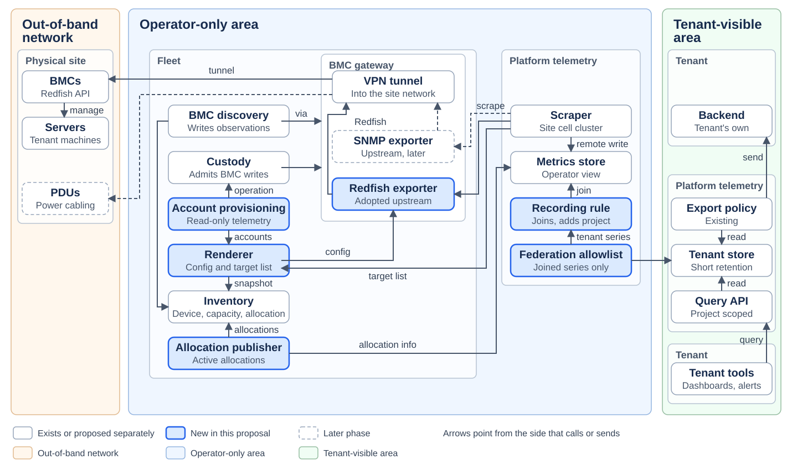
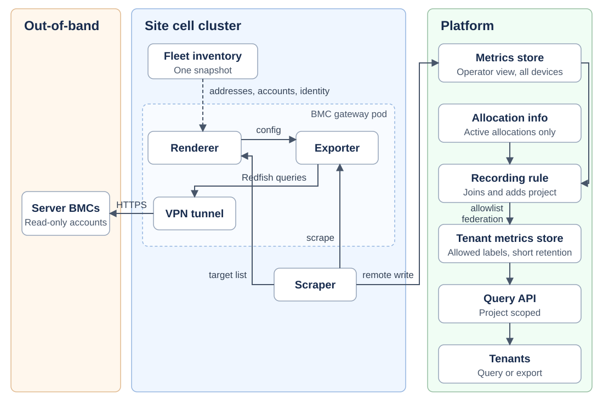

# BMC hardware telemetry

[Documentation overview](../../README.md) · [Architecture guide](../../architecture/README.md)

Everything in this document is proposed. Nothing described here is implemented
or verified. Metric names, labels, intervals, and timings are provisional.

- [Summary](#summary)
- [Motivation](#motivation)
- [Proposal](#proposal)
  - [User stories](#user-stories)
  - [What tenants get](#what-tenants-get)
  - [Relationship to other proposals](#relationship-to-other-proposals)
  - [Risks and mitigations](#risks-and-mitigations)
- [Design details](#design-details)
  - [Architecture and data flow](#architecture-and-data-flow)
  - [Target and credential lifecycle](#target-and-credential-lifecycle)
  - [Telemetry account operation](#telemetry-account-operation)
  - [Tenant attribution](#tenant-attribution)
  - [Power data](#power-data)
  - [Failure behavior](#failure-behavior)
  - [Security](#security)
  - [Upstream work](#upstream-work)
  - [Implementation phases](#implementation-phases)
  - [Open questions](#open-questions)
- [Production readiness review questionnaire](#production-readiness-review-questionnaire)
- [Implementation history](#implementation-history)
- [Drawbacks](#drawbacks)
- [Alternatives](#alternatives)

## Summary

Fleet will collect hardware health and power data from each server's
management controller (BMC). Operators see it for every server at every site.
Tenants see it in their project's metrics for the servers they hold.

## Motivation

Tenants on dedicated servers cannot see their hardware's health. They cannot
size a workload against real power draw, report on power use for
sustainability, or catch a failing fan or power supply before it causes an
outage. The management network that reports this data is private by design, so
they cannot reach it themselves.

Operators have the same gap. Without a fleet-wide view, they log in to
individual servers to find a hardware fault, and they learn about a failing
part from the tenant's outage.

### Goals

- Deliver the [user stories](#user-stories) at every site.
- Reading the data never changes a server or any Fleet record, and never makes
  a device available. Setup adds a read-only credential only while a server is
  idle and unallocated.
- Tenants use the platform's existing metrics store, query API, and export
  policy.

### Non-goals

- Data from inside the tenant's operating system.
- Prebuilt dashboards and alert rules beyond collection failures.

## Proposal

### User stories

- **Tenant sees hardware health.** A tenant with `server-a` in `<project>`
  charts its hardware health and power use in their project's metrics.
- **Tenant alerts on a failing part.** A tenant sets an alert on a power supply
  fault on `server-a` and is notified before the server fails.
- **Tenant exports metrics.** A tenant sends their hardware metrics to their own
  monitoring stack with the platform's export policy.
- **Tenant releases a server.** After a tenant releases `server-a`, neither
  they nor the next tenant of `server-a` sees the other's data.
- **Operator sees health across sites.** An operator opens one view of hardware
  health for every server at every site, allocated or not.
- **Operator learns collection stopped.** When Fleet cannot read a server or a
  whole site, the operator gets an alert and the tenant sees a gap.

### What tenants get

For each server they hold:

- **Metrics:** temperatures, fan speeds, power supply status, power use, memory
  and storage health, overall system health, and firmware versions. The final
  list is an [open question](#open-questions).
- **Only theirs.** Data is scoped to their project while they hold the server.
  Each server is shown by its stable name only, with no address, serial number,
  or MAC.
- **Timing.** Data starts a few minutes after handover and stops a few minutes
  after release begins. Readings are a few minutes old.
- **Gaps are gaps.** An unavailable reading is missing, never a zero or a cached
  value.
- **Retention.** A short period, still an [open question](#open-questions).

### Relationship to other proposals

- **[Device operations](../device-operations/README.md).** Telemetry account
  changes are a device operation, coordinated with every other change to a
  server's management controller.
- **[Machine allocation and installation](../machine-lifecycle/README.md).**
  Handover and the start of release decide when a tenant's data starts and
  stops.
- **Server discovery and per-site management access.** Telemetry builds on
  them. They are proposed separately and are not yet in this repository.

### Risks and mitigations

- **Data is only as precise as the hardware reports.** Mitigated by the
  [coverage check](#coverage-check) and a later [power](#power-data)
  cross-check.
- **Data could reach the wrong tenant.** Mitigated by
  [tenant attribution](#tenant-attribution), which shows nothing when ownership
  is unknown.
- **Collection could disturb a server.** Mitigated by a separate
  [telemetry account](#telemetry-account-operation) and by
  [session limits](#target-and-credential-lifecycle).

## Design details

### Architecture and data flow

Fleet uses the open-source `idrac_exporter` and contributes the changes it
needs [upstream](#upstream-work). Each metric family has one writer: the
exporter for BMC data, Fleet for the allocation info series, and the recording
rule for tenant series. Time series live only in the platform metrics store,
never in resource status. Labels never carry serial numbers or MAC addresses.
The BMC address appears only in the exporter's instance label,
which tenants never see.

The first diagram shows the systems involved, grouped by owner and trust
boundary. The second shows how data flows through them.

1. **Source.** Each BMC exposes health and power data over Redfish (HTTPS). BMCs
   are reachable only on the site's out-of-band network.
2. **Access.** The per-site BMC gateway holds a VPN tunnel into that network,
   where Fleet's Redfish discovery already runs. The exporter runs in the
   gateway and reuses the tunnel, so no new network path is opened.
3. **Collector.** The exporter reads one BMC per scrape, live, when the scraper
   asks. A scrape takes several seconds per BMC, so intervals are minutes.
4. **Targets.** The renderer turns Fleet inventory into the exporter's
   configuration and the scraper's labeled target list. See
   [target and credential lifecycle](#target-and-credential-lifecycle).
5. **Operator view.** The scraper, in the site's cell cluster, attaches
   physical identity (device and site) and remote-writes to the platform
   metrics store.
6. **Tenant view.** The recording rule joins hardware series to the allocation
   info series and adds the tenant's project label. An allowlist federation
   copies only those series into the platform's tenant-facing metrics store.
   Tenants reach it through the query API, which enforces project scoping.

#### What Fleet adds

| Piece | Owner |
| --- | --- |
| Renderer and scraper target list | Fleet |
| Telemetry account provisioning, as a custody operation | Fleet |
| Network policy for the exporter and target list | Fleet, with the site deployment |
| Allocation info publisher | Fleet |
| Recording rule, federation allowlist, tenant label allowlist | Platform configuration |
| Tenant store, query API, export policy | Existing platform, unchanged |

### Target and credential lifecycle

Fleet inventory is the source of truth. A BMC becomes a target when its device
has a BMC address and an active telemetry account.

**Snapshot.** The renderer builds one snapshot from inventory and validates it.
From that snapshot it writes the exporter's configuration, replacing the file
atomically (write, then rename), and serves the scraper's target list with
device labels. Because targets, credentials, and identity come from one
snapshot, a series is labeled by device from its first scrape and needs no
address join. The exporter must be set to reload on file change, which is off
by default.

| Event | Behavior |
| --- | --- |
| Add | The device gains an address and an active telemetry account. The next snapshot includes it, and it is scraped within about a minute. |
| Rotate | Order-safe. Fleet creates the new account and verifies that it can log in. Only then does the renderer publish it. Fleet deletes the old account after a scrape succeeds with the new one, so a live scrape is never locked out. |
| Remove | The device leaves the scraper's list at once. The exporter keeps the entry, and its credential in memory, until it restarts ([upstream item 1](#upstream-work)). The renderer restarts the exporter when removed devices' credentials are still held, at most once a day. Scrapes interrupted by a restart read as unknown. |

**Session limits.** BMCs allow few concurrent sessions, and discovery uses them
too. The exporter's concurrency is set explicitly to fit each BMC's session
budget after discovery's share. Rotation stays disabled until
[upstream item 4](#upstream-work) lands.

### Telemetry account operation

Reading telemetry is not a custody operation; only account changes are.

Each BMC gets a dedicated read-only account. It cannot change power state or
settings, and telemetry never reads data with the operations credential. Fleet
creates the account through the BMC's account service, using the operations
credential. Creating, rotating, and deleting it are writes to the BMC, so they
are a new custody operation kind, `DeviceTelemetryAccount` (name provisional),
following the [device operations](../device-operations/README.md#operations)
model:

| Kind | Creator | Authority | Required holder | Inputs |
| --- | --- | --- | --- | --- |
| `DeviceTelemetryAccount` | Fleet telemetry controller | `serviceRequest` | `None`, which becomes `Service` while it runs | Action (create, rotate, or delete), account name, sealed password reference and digest, expected system UUID |

**Password.** Fleet generates it and stores it in the renderer's Secret, the
one durable copy for the account's lifetime. The telemetry controller passes it
to the operation through the sealed-store path that device operations defines
for bootstrap payloads, as an opaque reference plus a digest. This proposal
extends that path to the telemetry controller. The site deletes its copy when
the operation ends, and the password never appears in the operation object.

**When it runs.** Only from holder `None`: never on an allocated device or
during release, so it needs no authority over a tenant's machine. A device
returned to `None` by release cleaning qualifies. Scheduled rotation of an
allocated device waits until it is idle again.

**Hold.** While the `Service` hold lasts, the allocator is refused with
`HolderMismatch` and retries. The operation is short, and that brief
unavailability is accepted. The hold ends on any terminal result except
`OutcomeUnknown`, which places a recovery hold. A later successful telemetry
account operation, or a recovery operation that retries it, settles the hold.
The controller runs at most one telemetry account operation per device per day,
so a device cannot be starved of allocation.

If custody refuses the request, the controller gets the shared reason
(`CustodyUnverified`, `RecoveryHold`, `OperationInProgress`, or
`HolderMismatch` for an allocated device) and retries later with back-off.

**Compromised credential.** The response needs no BMC write. The renderer drops
the device from the target list and the configuration immediately. Fleet
deletes or rotates the account when the device is next idle, or through the
existing operator recovery path.

**Changes to device operations.** This proposal adds one kind, so that
proposal's count of operation kinds changes from five to six when this lands.
It extends the `Service` hold, which that proposal calls a staff hold, to a
Fleet controller under the same admission rules, and adds a row for this kind
to its recovery table.

### Tenant attribution

Fleet resolves a tenant from this chain of identities: Device (the physical
asset), MachineCapacity (provider supply), MachineAllocation (the allocation),
and the customer Machine in the tenant's project. The allocation info series
maps a device to the tenant that the Machine's typed project reference names.
It is a view of allocation records, not a second source of truth. Only Project
tenants get series in this proposal.

**Activation time.** This proposal adds a write-once activation time to the
allocation record. Machine-lifecycle gives allocation records one writer, the
coordinator, and public Machine status another, the projector. The coordinator
alone writes the activation time when it hands the machine to the customer:
for allocate and install, when the first initial installation succeeds and
passes the activation gate; for allocate only, when it has verified network
and power handoff for the prepared machine. It uses its own evidence, not
projected Ready status, so a later reinstall or Ready drop never changes it.

**When the info series exists.** The allocation publisher publishes it while
the allocation has an activation time, the device's custody holder is that
allocation, and the Machine's `Releasing` condition is not true. Other Machine
conditions do not affect it.

**Guard window.** The info series carries the activation time as its value.
The recording rule starts tenant series one full scrape interval after that
time and drops samples inside the window.

**Fail closed.** If the info series is missing or stale, or two exist for one
device, the join produces no tenant series. Unknown or conflicting ownership is
never a default tenant.

**Latency.** Series appear roughly two scrape intervals plus a minute after
activation, about five minutes at a two-minute interval. When release begins,
the info series is withdrawn within about a minute, or at worst after the
metrics store's staleness window. Samples taken early in release can still be
attributed to the outgoing tenant. That is acceptable: it is their own data,
and the next tenant needs cleaning and a new activation first. The operator
view is not delayed.

### Power data

These are assumptions the [coverage check](#coverage-check) confirms for each
vendor and firmware family:

- A chassis power reading can be absent or stale on some firmware.
- PSU input readings are coarse, because the sensors have low resolution.
- In-band readings are more accurate but are not available remotely.

So Fleet does not rely on a single chassis reading. The primary remote signal
is the sum of PSU input power, averaged over time. PDU readings, added later
through a standard SNMP exporter with the PDU's REST API as a fallback, give an
independent cross-check. When the BMC and PDU disagree, both are shown. Remote
IPMI is not assumed to be available.

#### Coverage check

Before Fleet enables a BMC vendor or firmware family, operators confirm what
the exporter covers on it and record the metric families supported. A family
that is not recorded is not enabled.

### Failure behavior

Target behavior, which the exporter does not yet meet:

| Condition | Result |
| --- | --- |
| BMC unreachable | The scrape fails and the device's series go stale. |
| Field missing from a BMC response | The series is absent, not zero. |
| Exporter or tunnel down | Targets at the site stop, series go stale, and an operator alert fires. |

**Today's exporter.** Missing fields read as 0. Power output can fall back to a
cached last value. A failure in one section of a BMC response still returns a
successful scrape and only increments an error counter. Each of these would be
a false value for a tenant. Unknown is never read as ready or healthy.

### Security

- **Secrets.** Credentials exist only in Secrets and in the exporter's
  configuration, which is on memory-backed storage in the gateway, readable
  only by the exporter, and never on durable storage. They never appear in
  labels, records, metrics, logs, or Git.
- **Tenant labels.** The tenant label allowlist passes only the project, the
  device name described in [what tenants get](#what-tenants-get), and metric
  labels such as sensor name. Only joined, allowlisted series reach the tenant
  store, and tenants cannot read the operator store.
- **Exporter surface.** A network policy admits only the scraper to the
  exporter and to the target list, which carries BMC addresses. Management
  endpoints are not admitted, and no default or fallback BMC is configured.
- **TLS verification is skipped in phases 1 and 2.** This is an accepted risk.
  Until [fleet#234][pin-issue] lands, a host that answers at a BMC's address
  would receive the telemetry credential. Because the
  [telemetry account](#telemetry-account-operation) is read-only, the damage is
  limited to read access to that BMC's telemetry. The recorded key pin does
  not gate scraping until it is enforced.

### Upstream work

Fleet will contribute these changes to the exporter rather than fork it:

1. Drop hosts removed from the configuration on reload.
2. Report missing fields as absent rather than 0, and remove the stale-value
   fallback for power.
3. Report configuration reload success or failure as a metric, so a rejected
   reload alerts instead of silently keeping the old configuration.
4. Back off after failed authentication. Today it falls back to basic
   authentication and retries on every scrape, which can lock out an account.
5. Add a per-host public-key pin. A pin change must reset the BMC session.
6. Allow optional per-host labels in the discovery output.

### Implementation phases

1. **Operator-only scraping.** Renderer, target list, telemetry accounts, and
   exporter at one site. Series appear in the operator view only.
2. **Tenant view.** Allocation info publisher, recording rule, label
   allowlist, and federation. Requires upstream item 2.
3. **Cross-check and pin enforcement.** PDU collection as an independent power
   signal, and enforcement of the key pin once upstream item 5 lands.

Each phase is accepted only with verification.

### Open questions

- Do metrics from a site's cell cluster reach the platform store through an
  existing path, or do off-cluster sources need authenticated ingest? The
  platform lacks the latter today.
- Which metrics belong in the tenant allowlist, and which is the tenant-facing
  power signal?
- Can sites reach their PDUs for collection?
- What retention should the tenant store use?
- Should Namespace tenants get series, and how are they attributed?
- How should metric family names and identity labels align with Fleet's
  telemetry naming once it is defined? The exporter's metric prefix is
  configurable.

## Production readiness review questionnaire

### How do operators enable or disable the feature?

Enable collection per site, and per hardware family once it passes the
[coverage check](#coverage-check). Tenant visibility is enabled separately, in
phase 2. To disable it, stop publishing allocation info; tenant series then
stop because the join fails closed. To stop collection for one server, remove
it from the target list (see Remove in the
[lifecycle table](#target-and-credential-lifecycle)).

### Does enabling the feature change any default behavior?

No allocation or inventory behavior changes, apart from the short
[allocator hold](#telemetry-account-operation) while a telemetry account
changes.

### What must operators monitor?

Scrape failures and the exporter's error counter, collection loss per site,
failed configuration reloads, authentication failures per server, servers with
conflicting or missing allocation info, and telemetry account operations in
recovery.

### What does the feature depend on?

Fleet inventory and allocation records, the
[related proposals](#relationship-to-other-proposals), the platform's
metrics store, query API, and export policy, and the upstream exporter.

### Does the feature add API types or calls?

No new public API types. The additions are the
[custody operation kind](#telemetry-account-operation) and the
[activation time](#tenant-attribution) on the allocation record. Each server is
read once per scrape interval.

## Implementation history

- 2026-11-27: Proposed.

## Drawbacks

- It depends on an upstream exporter that Fleet does not control. The
  [changes it needs](#upstream-work) wait on upstream review.
- Fleet must create, rotate, and delete an account on every BMC.
- It [changes the device operations proposal](#telemetry-account-operation).

## Alternatives

| Alternative | Why not |
| --- | --- |
| Write a Fleet exporter on a Redfish library | Duplicates a maintained project. |
| Telegraf Redfish input | Covers only power and thermal, with a heavy dependency tree. |
| `ipmi_exporter` | Needs remote IPMI, which is not assumed reachable. |
| `redfish_exporter` | Unmaintained. |
| Embed an exporter as a library | The chosen exporter is not importable, and it is not needed. |
| Use the exporter's own discovery output | It has no device labels today, so series would be joined by address. Revisit if upstream item 6 lands. |

[pin-issue]: https://github.com/datum-cloud/fleet/issues/234
