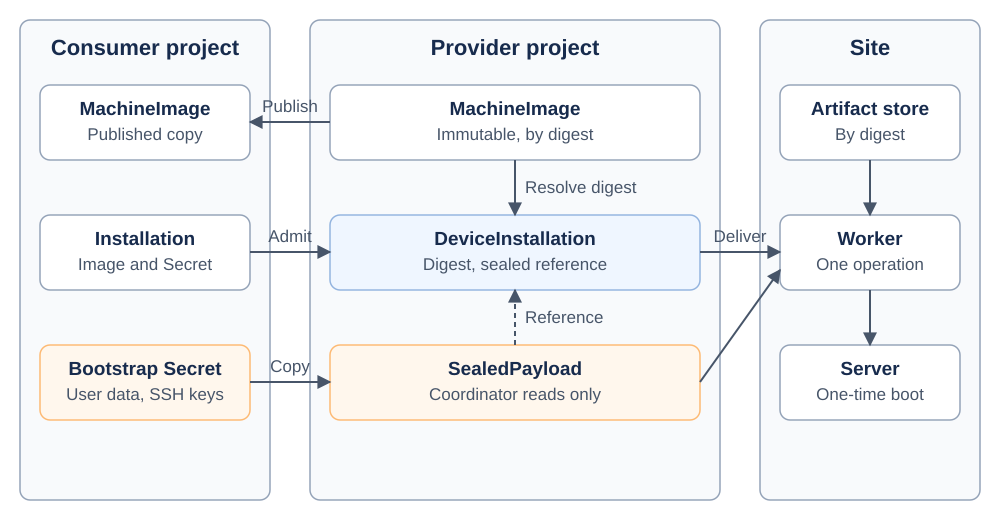

# OS images and bootstrap data

[Documentation overview](../../README.md) · [Functionality guide](../../functionality/README.md)

- [Summary](#summary)
- [Motivation](#motivation)
- [Proposal](#proposal)
- [Design details](#design-details)
  - [API design](#api-design)
  - [Publication and entitlement](#publication-and-entitlement)
  - [Admission](#admission)
  - [Artifact distribution](#artifact-distribution)
  - [Sealed bootstrap store](#sealed-bootstrap-store)
  - [Site delivery](#site-delivery)
  - [Implementation decisions](#implementation-decisions)
  - [Acceptance tests](#acceptance-tests)
- [Production readiness review questionnaire](#production-readiness-review-questionnaire)
- [Implementation history](#implementation-history)
- [Drawbacks](#drawbacks)
- [Alternatives](#alternatives)
- [Infrastructure needed](#infrastructure-needed)

## Summary

A customer chooses an OS image from a catalog that the provider publishes, and
supplies bootstrap data such as user data and SSH keys. Both are inputs to an
`Installation`.

The provider publishes each image as an immutable `MachineImage` that names its
artifacts by digest. Fleet resolves the customer's choice to that digest when
it admits the Installation. Fleet copies the bootstrap data into a sealed store
that staff cannot read, and delivers it only to the site that runs the install.

This enhancement is a proposal. Nothing in it is implemented.

## Motivation

The [machine lifecycle](../machine-lifecycle/README.md#installation) defines
the Installation, but not where images come from or how bootstrap data reaches
the server. [Device custody](../device-operations/README.md#customer-data)
requires a sealed store for bootstrap data and leaves the image catalog and
bootstrap APIs to Metal. Without them, a customer cannot choose an OS or
configure the installed system.

### Goals

- The provider publishes images that cannot change after publication.
- A customer can install only the images published to their project.
- Later catalog changes never change an admitted install.
- Fleet refuses an image that does not match the server's architecture or
  firmware mode.
- No staff role can read bootstrap data.
- Sites fetch image artifacts only by digest, from a source the site
  configures, never from a URL in the API.
- No new database.

### Non-goals

- Building images, or which OS families to offer.
- Managed configuration policy for clusters, which the [OS configuration
  proposal](../../proposals/fleet-management/os-configuration.md) covers.
- Delegated customer PXE, which the PXE installation proposal in
  [#59][pxe-pr] covers.
- Secure Boot signing and measured boot.
- Guest health after the installed OS boots.

## Proposal

The provider publishes a `MachineImage` in its project and publishes it to the
consumer projects that may use it. A customer creates an Installation that
names a published image and, optionally, a bootstrap Secret in their own
project.

The Fleet provider for Metal admits the Installation. It resolves the image to
its digest, checks it against the allocated server, copies the bootstrap data
into the sealed store, and creates a `DeviceInstallation` that carries the
digest and an opaque reference to the sealed copy. Custody admits and delivers
it as for any [Device operation](../device-operations/README.md#admission).



### User stories

- A customer installs a published Linux image with their SSH key, then logs in.
- A customer reinstalls with new user data. The first install's data is not
  reused.
- A provider publishes a fixed release of an image and withdraws an old one.
  Machines installed from the old one keep running.
- A staff member investigates a failed install without seeing the customer's
  user data.

### Relationship to other proposals

This enhancement changes two parts of [Device
custody](../device-operations/README.md):

- **[Customer data](../device-operations/README.md#customer-data):** the
  site's boot service can also read a payload, only while that operation's
  boot is open. The site controller that creates every worker can also get a
  site payload by name, with no list, watch, or write; it grants no new
  access, because that controller can already run a worker as any operation's
  identity. See [Site delivery](#site-delivery).
- **[Admission](../device-operations/README.md#admission):** DeviceInstallation
  adds one check of its own inputs.

It changes the machine lifecycle's [predecessor
rule](../machine-lifecycle/README.md#installation): an Installation that
settles a held installation names the held Installation as its predecessor,
although uncertain work otherwise offers no usable predecessor. It also
replaces the machine lifecycle's operator-installed image fixtures with the
published catalog.

## Design details

### API design

Names are provisional. Examples use synthetic data.

#### MachineImage in the provider project

The provider defines each image release in its project:

```yaml
apiVersion: metal.datumapis.com/v1alpha1
kind: MachineImage
metadata:
  name: example-linux-1-2
  namespace: default
spec:
  definition:
    family: example-linux
    version: "1.2"
    architecture: amd64
    firmwareModes: [UEFI]         # UEFI | BIOS
    bootstrapFormats: [NoCloud]   # empty when the image takes no bootstrap data
    digest: "sha256:4f2a9c..."    # digest of the artifact manifest
  availability: Available         # Available | Withdrawn
```

The provider can change only `availability`, and a new release is a new
MachineImage. A withdrawn image admits no new Installations.

The digest identifies the image's artifact manifest, which lists the digest of
every file the installer writes or boots.

#### MachineImage in a consumer project

Publication creates a MachineImage in the consumer project that names its
provider source, the same way a [MachineClass](../machine-lifecycle/README.md#machineclass)
does:

```yaml
apiVersion: metal.datumapis.com/v1alpha1
kind: MachineImage
metadata:
  name: example-linux-1-2
  namespace: default
spec:
  source: {project: example-provider, name: example-linux-1-2}   # immutable
status:
  resolved:
    family: example-linux
    version: "1.2"
    architecture: amd64
    firmwareModes: [UEFI]
    bootstrapFormats: [NoCloud]
    digest: "sha256:4f2a9c..."
  conditions:
    - {type: Available, status: "True"}
```

A MachineImage has exactly one of `definition` or `source`. Status is for
display; admission reads the [publication record](#publication-and-entitlement).

#### Bootstrap Secret

The customer stores bootstrap data in a Secret of type
`metal.datumapis.com/bootstrap` in the Installation's namespace:

```yaml
apiVersion: v1
kind: Secret
metadata:
  name: example-bootstrap
  namespace: default
type: metal.datumapis.com/bootstrap
stringData:
  userData: |
    #cloud-config
    hostname: example
  sshAuthorizedKeys: |
    ssh-ed25519 AAAAC3NzaC1lZDI1NTE5AAAAIExampleOnly example@example.com
```

Both keys are optional, but at least one is required, and together they hold
at most 64 KiB. Fleet passes user data to the image unchanged and installs the
keys for the image's default user.

#### Installation

The Installation keeps its shape. `imageRef` names a MachineImage in the same
project and namespace, and `bootstrapConfigRef` names a bootstrap Secret there:

```yaml
apiVersion: metal.datumapis.com/v1alpha1
kind: Installation
metadata:
  name: example-os-1
  namespace: default
spec:
  machineRef: {name: example}
  expectedPredecessor: {type: None}
  imageRef: {name: example-linux-1-2}
  bootstrapConfigRef: {name: example-bootstrap}
status:
  resolvedImage: {name: example-linux-1-2, digest: "sha256:4f2a9c..."}
  conditions:
    - {type: Accepted, status: "True"}
```

`status.resolvedImage` reports the digest Fleet admitted. Status never shows
bootstrap data or its digest.

#### DeviceInstallation inputs

The [DeviceInstallation](../device-operations/README.md#operations) carries
the provider image's name and digest, and the sealed copy's opaque reference
and digest. It carries no consumer project name and no bootstrap bytes.

### Publication and entitlement

The provider's publisher creates a consumer project's MachineImage, as it does
for MachineClass. Fleet records each publication in a protected record in the
provider project. The record names the consumer MachineImage and the provider
MachineImage, and holds the provider image's digest. Its name derives from the
identities of the consumer project, the consumer MachineImage, and the
provider MachineImage. Each identity is new each time the object is created, so
a record matches only the objects it was written for. Publishing a recreated
image again writes a new record; a record never changes.

Customers cannot write MachineImages. IAM gives customer roles no write
permission on the kind, and a Fleet validating webhook, called from Milo's root
API server, rejects:

- a write by anyone but the provider's publisher in a consumer project;
- a `definition` outside a project that Fleet registers as a provider; and
- any change to `definition` or `source`.

A project is entitled to an image only while all of these hold:

- Fleet finds the publication record under the name derived from the current
  consumer project, consumer MachineImage, and provider MachineImage, and the
  names it records match those images;
- the provider MachineImage is in the provider project that holds the
  Machine's allocation, and its digest matches the record; and
- the provider MachineImage is `Available`.

The caller also needs `machineimages.use` on both the consumer and provider
MachineImages, as for [classes and
profiles](../machine-lifecycle/README.md#request-authority), and `get` on the
bootstrap Secret. Fleet checks these for the principal that created the
Installation.

### Admission

The Fleet provider admits an Installation in this order. Each step must pass
before the next one runs:

1. The Machine has an active allocation, and the predecessor check passes.
2. The image is entitled and the caller may use it. Fleet takes the digest from
   the publication record.
3. The image matches the allocation's hardware:
   - its architecture equals the CPU architecture;
   - it lists the server's firmware mode; and
   - if the Installation has bootstrap data, it lists a bootstrap format.
4. If a DeviceInstallation already exists for this Installation, Fleet stops
   here: the install is admitted.
5. The caller can read the bootstrap Secret, and its contents are valid.
6. The sealed copy is written. See [Retention and crash recovery](#retention-and-crash-recovery).
7. The DeviceInstallation is created.

The allocation's hardware snapshot would gain the server's firmware mode. This
field is proposed, and its source is an [open
decision](#implementation-decisions). A server with no recorded firmware mode
installs no image. Because firmware settings can change after allocation, the
site worker also reads the server's firmware mode before it sends anything,
and refuses with `ImageIncompatible` if the image does not list it.

Each refusal sets `Accepted=False` on the Installation with one of these
reasons:

| Reason | Refused by |
| --- | --- |
| `ImageNotFound` | No MachineImage of that name in the namespace |
| `ImageNotEntitled` | Publication record, provider project, a recreated image, digest, or `machineimages.use` |
| `ImageWithdrawn` | The provider image is `Withdrawn` |
| `ImageIncompatible` | Architecture, firmware mode, or bootstrap format |
| `BootstrapNotFound` | No readable bootstrap Secret of that name |
| `BootstrapInvalid` | Wrong Secret type, no keys, unknown keys, or over 64 KiB |
| `AuthorizationUnavailable` | An authorization check could not complete |

Fleet evaluates a refused Installation again while it exists, because a missing
publication or Secret can appear later. Admission is final once the
DeviceInstallation exists.

The coordinator adds one check of DeviceInstallation inputs. It passes when the
operation has no bootstrap data. Otherwise the referenced SealedPayload must
exist and match the operation's digest, or the coordinator refuses with
`BootstrapUnavailable`, and nothing is sent. Like every kind check, it holds at
the moment of the custody update. [Retention](#retention-and-crash-recovery)
keeps the payload after that.

A refused or failed DeviceInstallation reports its reason on the Installation.
The Installation is immutable, so the customer creates a new one.

### Artifact distribution

The provider builds an image and pushes its artifacts and manifest to its
artifact registry, then creates the MachineImage with the manifest digest. The
registry is site configuration, not an API field. Customers cannot name a
registry, a URL, or an artifact.

Each site keeps a content-addressed store. The coordinator sends each site,
through federation, the digests of every `Available` provider MachineImage.
Sites cannot read the catalog. A site mirrors each digest from its configured
registry, and checks every artifact against the manifest before it keeps any.
It keeps an image's artifacts while the digest list or an operation that has
not ended names the digest.

If an install's digest is not in the store, the worker fetches it by digest
from the configured registry before it sends anything. If that fails, it
refuses with `ImageUnavailable`.

### Sealed bootstrap store

The sealed store is a dedicated kind, `SealedPayload`, in
`fleet.datumapis.com`, in the provider project. A Kubernetes Secret would not
work there: [Milo PolicyBindings][milo-policybinding] grant a role on one kind
or one object, not on a namespace, so every role that reads Secrets in the
provider project would read every payload.

```yaml
apiVersion: fleet.datumapis.com/v1alpha1
kind: SealedPayload
metadata:
  name: sealed-5e0a7d
  namespace: default
spec:                          # immutable
  operationName: alloc-3b9d61c2-install-1
  allocationName: alloc-3b9d61c2
  digest: "sha256:0c2b77e1d9a4..."
  salt: <base64>               # 32 random bytes
  data: <base64>               # the bootstrap Secret's two values, exactly
```

The digest covers the salt and the data. A reader of the DeviceInstallation
cannot confirm a guessed SSH key against it. The name derives from the
operation name and the digest.

| Identity | Can do on SealedPayload |
| --- | --- |
| Fleet provider for Metal | `create` only |
| Fleet coordinator, which includes the federation courier | `get`, `list`, `watch`, `delete` |
| Every staff role | Nothing |

The provider never reads a payload back. Production must encrypt this kind at
rest, and the audit policy must omit request and response bodies for it.

#### Retention and crash recovery

| Change | Order | After a crash between the writes |
| --- | --- | --- |
| Admit an Installation | SealedPayload, then DeviceInstallation | The retry re-reads the Secret and writes a new payload, because the salt is new. The operation names that payload. |
| End an install | Custody result, then operation status, then delete SealedPayload | The coordinator deletes it on its next pass. |

The coordinator deletes a SealedPayload, with its UID as a precondition, only
when one of these holds:

- its operation has ended as `Succeeded`, `Failed`, `Cancelled`, or
  `OutcomeUnknown`;
- its operation exists and references another payload; or
- no operation has its name, and its allocation is no longer `Active`.

An allocation that is not `Active` cannot admit an install, so the last rule
never removes a payload that admission still needs. Fleet does not retry an
install: a [held installation](../device-operations/README.md#unknown-outcomes)
is settled by a later DeviceInstallation from a new Installation, which reads
the Secret again.

### Site delivery

Federation delivers the payload to the site with the operation, as a separate
object, never inside the operation's handoff. That object is a dedicated
kind, not a Secret, like the sealed store, so permission on it reaches nothing
else. The handoff names that object, and the site grants that operation's
worker `get` on exactly that object. No site identity can list or watch
payloads.

The worker checks the payload against the operation's digest, and refuses with
`InputMismatch` before it sends anything if they differ. It renders the payload
in the image's bootstrap format and attaches it to the operation's boot
admission. A boot admission is the site record that lets one server network
boot once:

- it names the operation, the fence, and the boot interface's MAC address;
- it carries a random 256-bit token, which appears only in the boot script the
  site serves to that MAC address;
- it closes when the installer finishes, when its 10-minute window ends, or
  when a higher fence stops the worker.

While the admission is open, the boot service serves the rendered payload to
requests that carry the token, so a firmware retry within the window works.
Production serves it over HTTPS with a site-issued certificate that the
installer trusts. The installer writes it where the image's bootstrap format
reads it on first boot. The payload also carries the salt and the admitted
data, so the installer reads them back from the target disk, recomputes the
salted digest, and reports it. The worker reports success only when that
digest matches the operation's digest. Success never depends on what the
installed OS does or prints, because Fleet does not own the guest. The boot
service drops its copy when the admission closes.

The site deletes every copy it made when the operation ends or a higher fence
stops its worker. When the coordinator answers the result, federation deletes
the delivered object at the site.

### Implementation decisions

Record these before production:

- **Production OS.** Proposed: Debian 13 generic cloud image, amd64, UEFI,
  with cloud-init NoCloud. A person must choose and qualify it.
- **Encryption at rest.** Which key protects `SealedPayload` in Milo storage.
- **Firmware mode source.** BMC discovery reports it, or staff record it in
  inventory.
- **Artifact registry.** Which registry holds provider artifacts, and how
  sites authenticate to it.

### Acceptance tests

These tests are required and not implemented:

- A customer installs a published image, and the installer verifies exactly
  its user data and SSH keys on the target disk before the install succeeds.
  In the lab, the booted guest also reports on first boot that it found the
  same data where its bootstrap format reads it. That report is lab evidence,
  not a condition of success. It does not prove that a production image's
  bootstrap agent consumed the data; qualifying the production OS must.
- The installer reads back a wrong or truncated payload, and the install fails
  without reporting `Succeeded`.
- A customer names an image that is not published to their project, or writes
  their own MachineImage, and Fleet refuses it.
- A withdrawn image admits no new install, and a running install of it
  completes.
- The provider deletes and recreates a MachineImage with other artifacts under
  the same name. An admitted install keeps the first digest, and a new install
  is refused until the image is published again.
- A consumer project or its MachineImage is deleted and recreated under the
  same name, and the old publication record entitles neither.
- An image's architecture or firmware mode does not match the server, and
  admission or the worker refuses it before anything is sent.
- The customer edits the bootstrap Secret after admission, and the install uses
  the admitted data.
- The provider crashes between the sealed write and the operation, then
  retries. One operation exists, and the unused payload
  is deleted.
- No staff role can get, list, or watch a SealedPayload, and no site identity
  other than the operation's worker and the site controller that creates
  workers can read its delivered payload.
- After the operation ends, no copy of the payload remains in the provider
  project, the federation layer, or the site.

## Production readiness review questionnaire

These controls are proposed, not implemented.

### How do operators enable or disable the feature?

Register MachineImage, SealedPayload, their webhook, and their IAM resources,
then publish images. To stop new installs of an image, withdraw it.

### Does enabling the feature change any default behavior?

A consumer project needs a published MachineImage to install.

### What must operators monitor?

Refused Installations by reason, images a site has not mirrored, and
SealedPayloads older than their operation's deadline.

### What does the feature depend on?

Milo for project APIs and IAM, Device custody for execution, federation to
reach sites, and the provider's artifact registry.

### Does the feature add API types or calls?

It adds MachineImage to Metal and SealedPayload to Fleet. Each install adds
one SealedPayload write and one delete.

## Implementation history

- 2026-11-25: Proposed.

## Drawbacks

- Each site stores every available image.
- A customer can change bootstrap data only by creating a new Installation.

## Alternatives

- **Images listed on the MachineClass:** Every image release would edit the
  offering, and IAM could not grant one image without the others.
- **A URL in the MachineImage:** Sites would fetch from wherever the API
  points, which allows server-side request forgery.
- **Carrying the payload in the operation:** Staff can read operations.

## Infrastructure needed

Testing needs one provider project, two consumer projects, one site with a
boot service, and an artifact registry. The local VM and Redfish lab modes can
prove the install path without hardware.

[pxe-pr]: https://github.com/datum-cloud/fleet/pull/59
[milo-policybinding]: https://github.com/milo-os/milo/blob/cd469ff4235c0847d9863a132bdb58f3ff8d3845/pkg/apis/iam/v1alpha1/policybinding_types.go
