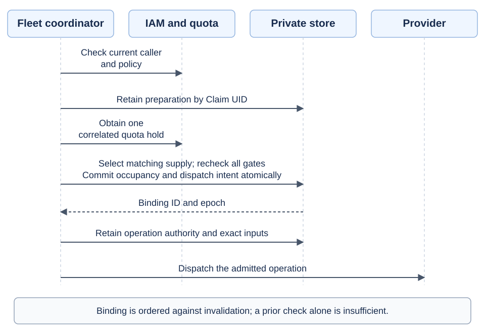
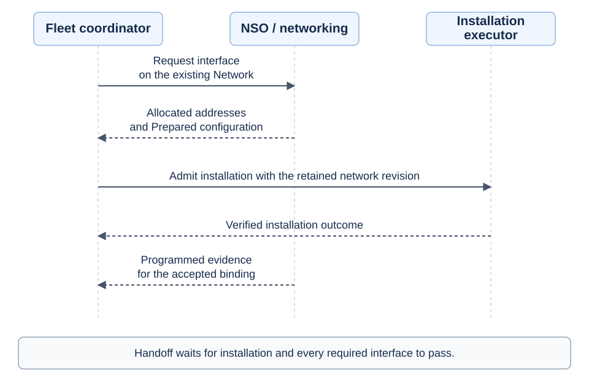
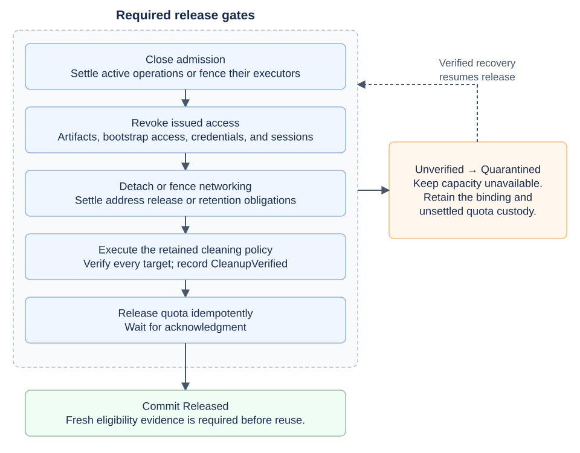
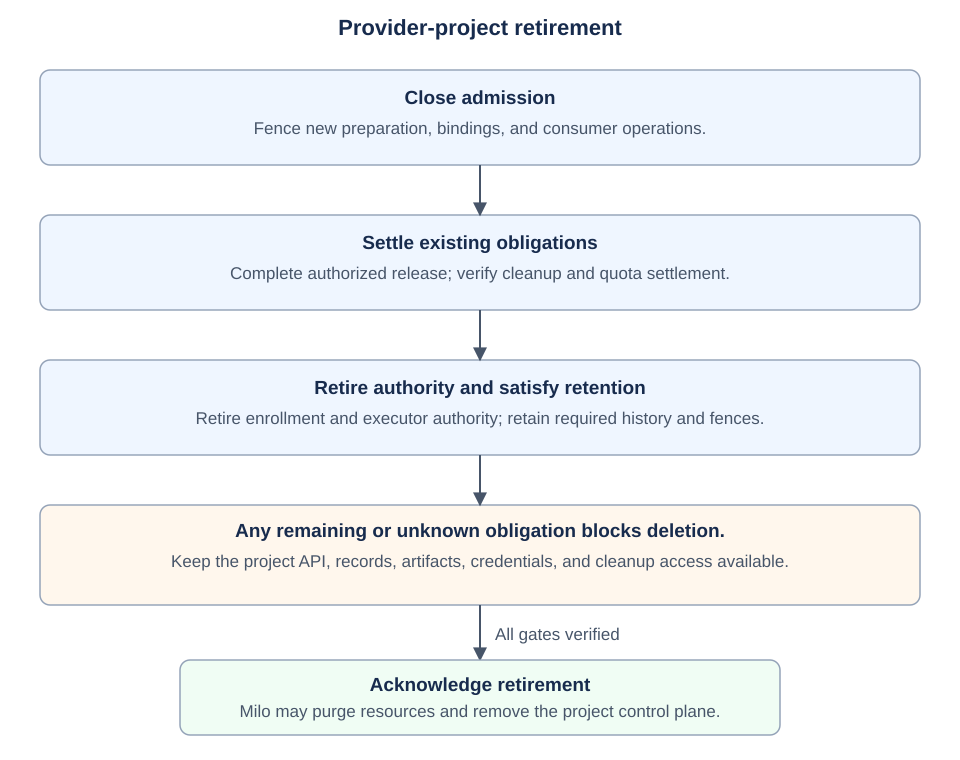

# Machine allocation and installation

- [Summary](#summary)
- [Motivation](#motivation)
- [Proposal](#proposal)
  - [Managing allocated machines](#managing-allocated-machines)
  - [Resource relationships across projects](#resource-relationships-across-projects)
- [Design details](#design-details)
  - [API design](#api-design)
    - [MachineClass](#machineclass)
    - [MachineProfile](#machineprofile)
    - [Machine](#machine)
    - [MachineClaim](#machineclaim)
    - [Installation](#installation)
    - [Status contract](#status-contract)
  - [Milo project integration](#milo-project-integration)
  - [Authorization and publication](#authorization-and-publication)
  - [Durable coordination](#durable-coordination)
  - [Allocation and quota integration](#allocation-and-quota-integration)
  - [Provider configuration resolution](#provider-configuration-resolution)
  - [Galactic VPC API integration](#galactic-vpc-api-integration)
  - [Provider execution and recovery](#provider-execution-and-recovery)
  - [Release and project lifecycle](#release-and-project-lifecycle)
  - [Implementation decisions](#implementation-decisions)
  - [Acceptance tests](#acceptance-tests)
- [Production readiness review questionnaire](#production-readiness-review-questionnaire)
- [Implementation history](#implementation-history)
- [Drawbacks](#drawbacks)
- [Alternatives](#alternatives)
- [Infrastructure needed](#infrastructure-needed)

## Summary

Fleet will let consumers allocate and install machines in their project.
Five public resources define the contract: `MachineClass`, `MachineProfile`,
`Machine`, `MachineClaim`, and `Installation`. Fleet keeps reservation and
operation records in the provider project. These internal records retain
ownership, execution authority, exact inputs, and cleanup obligations.

The first implementation will use a persistent simulated provider with real Milo
tenancy, IAM, entitlement, and quota integrations. This document proposes the
contract; Fleet has no implemented APIs or controllers yet.

## Motivation

The [Fleet proposal][fleet-proposal] describes a broad infrastructure platform.
Implementation needs a smaller contract that standalone customers and managed
platforms can share. That contract must keep one consumer's actions within its
project and prevent Fleet from assigning occupied or unclean capacity to another
consumer.

### Goals

- Separate reusable hardware requirements from provider offerings and observed
  hardware.
- Allocate each machine to at most one claim through one shared allocator.
- Preserve distinct asset, allocation, installation, and managed-node identities.
- Retain authorized inputs before execution and recover work after failures.
- Complete release even when a consumer deletes its namespace or project.
- Block provider-project deletion while allocations or cleanup obligations remain.
- Verify these guarantees through real Milo integrations and a durable simulator.

### Non-goals

This enhancement excludes procurement, full physical inventory, real BMC and
console access, network implementation, image-catalog management, OS policy
composition, managed clusters, `NodeClaim`, rollouts, and node services.

The later bare-metal release must qualify real hardware, network handoff,
cleaning, and a supported non-Talos OS. Simulated results do not satisfy that gate.

## Proposal

Fleet will let providers offer machine capacity to authorized projects.
Consumers will discover that capacity, request exclusive use, optionally install
an OS, control power, and release the machine in their own project. Providers
will retain ownership of the machines throughout that lifecycle.

### User stories

- A provider operator publishes a machine class and controls which capacity Fleet
  can allocate without exposing management credentials or other consumers.
- A consumer selects a local class and hardware profile. Fleet allocates matching
  capacity within the consumer's permissions, entitlement, and quota, or reports
  why the request cannot proceed.
- A consumer defines a custom profile when the class permits it. Fleet checks
  whether the provider supports the complete configuration before allocation.
- A consumer attaches named machine interfaces to existing project networks.
  The machine joins those networks through Galactic VPC and uses their network
  policy. Attachment does not create a new network or grant Internet access.
- A consumer inspects the assigned hardware, IP addresses, routes, DNS resolvers,
  and network readiness through the claim without accessing provider inventory.
- A consumer installs or reinstalls an approved OS and controls power without
  creating a managed cluster.
- A consumer releases a machine or deletes its project. Fleet completes cleanup
  before another consumer can use that capacity.
- A provider retires its project after Fleet settles allocations, operations,
  and cleanup. Pending or unknown obligations keep the project and its records
  available for recovery.
- A service operator recovers interrupted work without repeating an unknown
  destructive action or losing cleanup obligations.

### Managing allocated machines

Consumers list MachineClaims in their project to see requested and allocated
machines. A pending claim represents a request; a bound claim represents an
exclusive allocation. The claim is the management handle throughout that
allocation. It exposes assigned hardware, location, network addresses, power,
readiness, and the current installation. The physical Machine belongs to the
provider project; consumers do not need access to provider inventory.

An Installation requests one OS installation with an image and optional bootstrap
configuration. It is separate from the allocation and reports the progress and
result of that work. Consumers can choose either handoff:

- **Allocate only:** Omit the claim's `initialInstallationRef`. Fleet hands over
  a prepared machine powered off, without promising an installed, bootable OS.
  A later Installation can install the first OS on that same allocation.
- **Allocate and install:** Set `initialInstallationRef` to the initial
  Installation. Fleet waits for that request to succeed, along with the other
  handoff requirements, before reporting the claim ready.

Reinstalling creates a new Installation against the same claim and physical
machine. The new request supplies the claim's current installation revision as a
precondition, along with its own image and bootstrap inputs. The consumer leaves
the claim's `initialInstallationRef` unchanged. Fleet retains the allocation while the
reinstallation runs and reports progress on the new request.

Deleting a claim starts release and cleanup. Deleting a completed Installation
does not uninstall the OS or release the machine. Installation history records
past outcomes; it does not continuously manage the running OS.

### Resource relationships across projects

The first diagram shows how consumers discover and request provider capacity.
Solid arrows show references or supply selection; the dashed arrow shows
profile publication. Each project owns its resources and namespaces.


A MachineClass defines an offering and its allocation policy. A MachineProfile
specifies hardware requirements independently of that offering. Each MachineClaim
selects both through local names. A class can support several profiles, and a
profile can work with several classes or providers.

The publication service creates protected local copies of provider profiles.
Consumers can also create custom profiles in their own projects when a class
permits them. Custom profiles have no provider source. Each Installation requests
an OS installation for a claim. Each requested machine interface references an
existing `networking.datumapis.com` Network in the consumer project. Networking
owns its Galactic VPC realization. The physical Machine remains in the provider
project; attaching it does not move the consumer's network there.

Other projects can use the same offering and compete for its supply without
sharing networks. A network reference grants no access to another project.

The second diagram shows how Fleet preserves exclusive allocation and recovery
across project boundaries.


The provider project owns the Machine, its reservation, and its operation
records. The reservation binds the consumer claim to that Machine; operation
records retain the work Fleet authorizes. Consumers see results through their
MachineClaims and Installations, without access to these internal records.

Consumer-project deletion leaves the provider records intact. Fleet blocks
provider-project deletion while allocations, operations, or cleanup obligations
remain. Requesting provider retirement does not itself authorize wiping an
allocated machine.

### Notes, constraints, and caveats

This proposal narrows the existing [allocation][allocation],
[publication][publication], and [installation][installation] contracts. API names
and field shapes remain provisional. The first implementation validates these
capabilities with simulated capacity; production hardware support requires the
qualification described in [Non-goals](#non-goals).

### Risks and mitigations

- **A privileged controller acts for an unauthorized consumer:** Check the
  initiating principal in both project scopes; retain the decision privately.
- **Concurrent workers allocate the same asset:** Enforce uniqueness in the
  reservation store and reject stale execution authority at the provider.
- **Project deletion destroys cleanup inputs:** Retain coordination records and
  required artifacts in the provider project, outside consumer garbage
  collection. Protect provider retirement and quota custody until obligations end.
- **A timeout hides a completed destructive action:** Recover the existing
  operation by its stable identity before retrying.

Fleet and Milo maintainers must review authorization and lifecycle integration
before the enhancement becomes implementable. Provider maintainers must review
execution fencing and cleanup evidence. Consumer-facing API review must cover
pending, cancellation, and recovery behavior. Review assignments remain open.

## Design details

### API design

The server applies defaults before capturing the request digest and rejects
unknown behavioral fields or unsupported required capabilities. The projector
alone writes status.
Examples show selected fields; [complete responses](api-examples.md) include all
condition fields and hardware details. Identifiers and timestamps are synthetic.

Public references use scoped names. Fleet resolves them under current permissions
and retains project, namespace, and resource UIDs internally. Deleting or reusing
a name cannot replace an accepted dependency. Standard Kubernetes metadata remains
available, but no Fleet reference requires a caller-supplied UID.

Installation revisions guard replacement of an allocation's installation state.
They are separate from resource identity, generation, and Kubernetes resource
version. Public status never grants permission to perform effects.

#### MachineClass

Provider operators own definitions; the publication service owns consumer
references. The example uses provider types from the [bare-metal proposal][allocation].

```yaml
apiVersion: fleet.datumapis.com/v1alpha1
kind: MachineClass
# Classes span the provider project so namespaces can share an offering.
metadata:
  name: standard-metal
# The definition owns offering policy; profiles own hardware requirements.
# Its mode cannot change after creation.
spec:
  # Named profiles select provider-local contracts by name.
  # Fleet retains their resolved identities internally.
  # Custom profiles default to disabled and require provider validation.
  profilePolicy:
    allowedProfiles:
      - name: accelerated-16c-64g
    customProfiles:
      enabled: false

  # Access describes supported operations, not permission to perform them.
  # The first implementation supports power control but no console sessions.
  access:
    consoleModes: []
    powerControl: true

  # Capacity limits selection to existing supply in one provider namespace.
  # Labels identify candidates; they confer no eligibility or purchase authority.
  capacity:
    machines:
      namespace: infra-ops
      selector:
        matchLabels:
          fleet.datumapis.com/capacity-pool: general-metal

    # This provider-local contract adds backend compatibility requirements.
    # Retained identity and revision keep later edits from changing accepted work.
    providerClassRef:
      apiGroup: baremetal.fleet.datumapis.com
      kind: BareMetalMachineClass
      namespace: infra-ops
      name: qualified-server-v1

# The projector reports the definition that the class evaluator accepted.
# Acceptance validates the offering; it does not reserve or promise capacity.
status:
  evaluatedRevision: class-revision-example
  conditions:
    - {type: Accepted, status: "True"}
```

An offering must allow named profiles, custom profiles, or both. Enabling custom
profiles still requires provider validation of the complete configuration at the
requested location.

Approval applies to a profile's lifetime. A missing or recreated profile blocks
its entry. The provider must select a new name or remove and re-add the entry in
separate accepted class revisions to approve a replacement.

Publication, quota, image, and network policy remain separate from the definition.
The publication service creates the consumer reference:

```yaml
apiVersion: fleet.datumapis.com/v1alpha1
kind: MachineClass
# Project-wide references give every namespace a local name for an offering.
metadata:
  name: standard
# The immutable source keeps the provider definition authoritative.
# Fleet resolves the provider project and definition internally; a reference
# cannot become a definition or override its policy.
spec:
  source:
    project: provider
    name: standard-metal

# The projector exposes only the authorized public offering. Private source
# mappings, selectors, provider configuration, and other consumers stay private.
status:
  # The revision identifies the evaluated offering independently of this
  # reference object's generation. It does not grant source-use permission.
  evaluatedRevision: class-revision-example
  resolvedClass:
    # Publication maps allowed provider profiles to protected local copies.
    # These local names do not expose provider inventory or grant use.
    profilePolicy:
      allowedProfiles:
        - name: accelerated-16c-64g
      customProfiles:
        enabled: false
    access:
      consoleModes: []
      powerControl: true
  conditions:
    - {type: SourceResolved, status: "True"}
```

Resolution follows one hop to a definition and rejects cycles, chains, and mixed
modes. Fleet checks current offering policy and authorization at claim admission;
accepted claims retain the source identities, revision, and requirements through
later edits. [Publication and access rules](#authorization-and-publication)
control who receives and may use an offering.

#### MachineProfile

Providers publish named profiles into consumer projects. Consumers can create
custom profiles with the same schema; Fleet retains publication provenance
internally to distinguish the two paths.

```yaml
apiVersion: fleet.datumapis.com/v1alpha1
kind: MachineProfile
metadata:
  name: accelerated-16c-64g
# Immutable requirements can serve several offerings without coupling hardware
# choices to capacity ownership, price, location, or provisioning credentials.
spec:
  # Cores count physical cores across sockets. Memory describes installed RAM,
  # not memory left available after the OS starts.
  cpu:
    architecture: amd64
    cores: {min: 16}
  memory:
    capacity: {min: "64Gi"}

  # GPU memory applies to each matching device, not their combined memory.
  gpus:
    count: {min: 1}
    vendor: Example
    models:
      - example-gpu
    memoryPerDevice: {min: "24Gi"}

  # Each group requires distinct devices. Capacity is per disk; the group name
  # describes a hardware role without prescribing RAID or filesystem layout.
  disks:
    - name: boot
      count: {min: 2}
      capacity: {min: "480Gi"}
      media: SSD
      interface: NVMe

  # Interfaces describe physical ports. Network attachments and IP addresses
  # remain separate inputs owned by the networking APIs.
  interfaces:
    - name: primary
      type: Ethernet
      speed: {min: "10G"}
status:
  conditions:
    - {type: Accepted, status: "True"}
```

Admission requires CPU architecture and memory capacity. Numeric constraints use
inclusive `min` and optional `max`, or `exact` alone. Counts are integers,
capacities are byte quantities, and speeds are bits per second (`10G` means
10 billion bits per second). Negative values, empty constraints, inverted bounds,
duplicate group names, and unknown units or required capabilities are invalid.
An omitted constraint imposes no requirement; GPU count `exact: 0` excludes GPUs.

Counts apply to matching devices. Each interface entry requires one port; disk
groups and interface entries cannot share a device. Missing observations cannot
satisfy a requirement. The provider must validate the complete combination at
the requested location. A profile does not resize an existing machine.

Changing requirements requires a new profile, including for published copies.
Deleting a profile blocks new admissions while preserving retained allocation
and release contracts.

#### Machine

Provider operators own Machine policy and enrollment references.

```yaml
apiVersion: fleet.datumapis.com/v1alpha1
kind: Machine
# Machine identity is independent of consumer allocations. Replacement hardware
# gets a new resource lifetime; labels only group capacity for selection.
metadata:
  name: lab-server-01
  namespace: infra-ops
  labels:
    fleet.datumapis.com/capacity-pool: general-metal
spec:
  # This required reference keeps provider details in the provider namespace.
  # Enrollment fixes the provider and asset identities to prevent retargeting.
  providerRef:
    apiGroup: baremetal.fleet.datumapis.com
    kind: BareMetalMachine
    name: lab-server-01

  # Qualified owned hardware requires a link to its physical inventory identity.
  # Supply without a physical Device needs no invented inventory record.
  deviceRef: {name: server-example-001}

  # Disabled is the default so registration cannot expose occupied capacity.
  # Eligible still depends on preparation, health, readiness, and placement.
  allocationPolicy: Disabled

  # Each reservation pins this required cleanup policy, preserving its
  # release obligations even if the operator later weakens the policy.
  cleaningPolicyRef: {name: tenant-reuse-v1}
  # Retain separates consumer release from asset disposal; it is the only
  # supported value in the first implementation.
  reclaimPolicy: Retain

# The projector derives these observations from executor evidence and private
# reservations. Operators cannot make capacity available by editing status.
status:
  # Fleet normalizes discovery observations and checks their evidence internally.
  # Logical device names keep serial numbers and management IDs private.
  hardware:
    cpu:
      architecture: amd64
      model: example-cpu
      sockets: 2
      cores: 24
      threads: 48
    memory:
      capacity: "128Gi"
    gpus:
      - name: accelerator-0
        vendor: Example
        model: example-gpu
        memory: "32Gi"
    disks:
      - name: disk-0
        capacity: "960Gi"
        media: SSD
        interface: NVMe
      - name: disk-1
        capacity: "960Gi"
        media: SSD
        interface: NVMe
    interfaces:
      - name: primary
        type: Ethernet
        speed: "25G"
  conditions:
    - {type: Prepared, status: "True"}
    - {type: Healthy, status: "True"}
    - {type: Available, status: "False"}
```

References resolve within the provider project and namespace. Enrollment enforces
one canonical asset identity across all Machines and provider projects. Importing
records grants no provisioning authority or allocation eligibility.

Discovery owns hardware observations. Fleet retains their sources, revisions,
and verification results internally, distinguishing simulation from qualified
hardware verification. Unknown values remain absent; an unknown device list is
different from a verified empty list. Hardware changes require new evidence and
compatibility evaluation without weakening an active claim's requirements.

Reservations determine occupancy. Machine deletion must settle enrollment,
allocation, and operation obligations through the [release
protocol](#release-and-project-lifecycle).

#### MachineClaim

The consumer creates and lists claims in its own project. The claim remains the
management handle after binding; its status describes the allocated machine.

```yaml
apiVersion: fleet.datumapis.com/v1alpha1
kind: MachineClaim
# Claim identity belongs to the consumer project, separately from the Machine.
# A new name creates a distinct request rather than retrying an existing one.
metadata:
  name: example
  namespace: default
# Only powerState can change after creation, preserving the placement contract.
# The local class, profile, and permitted location are required. Fleet retains
# their identities and exact contracts for allocation and recovery.
spec:
  machineClassRef: {name: standard}
  machineProfileRef: {name: accelerated-16c-64g}
  locationRef: {name: lab}

  # This optional gate delays activation until the initial installation succeeds.
  # A reciprocal claim reference in the same project and namespace ties the
  # Installation to this allocation.
  initialInstallationRef: {name: example-os-1}

  # Immutable entries connect profile slots to project Networks. Omission
  # requests no attachment; a Network namespace defaults to the claim namespace.
  networkInterfaces:
    - name: primary
      network:
        namespace: default
        name: production
      # IPv6 is the default; the first family is primary. Every requested family
      # must be supported. The current Network API admits new networks as IPv6-only.
      ipFamilies:
        - IPv6
      # Extra addresses select NSO classes; every requested class must be satisfied.
      # Omission requests none. Delete is the default and requires verified release.
      addresses: []
      reclaimPolicy: Delete
  # Off is the default so creating a claim does not request runtime power-on.
  # On expresses intent; authorization and activation gates still control effects.
  powerState: "On"

# The projector reports allocation progress without exposing the provider
# Machine identity. These fields describe the binding; they cannot authorize it.
status:
  # These are the accepted local profile and hardware snapshot at binding.
  # They survive profile deletion and do not claim to be live health evidence.
  acceptedProfileRef:
    name: accelerated-16c-64g
  # The snapshot retains its observation time and does not expire.
  allocatedHardware:
    observedAt: "2026-10-27T12:00:00Z"
    # Selected fields from the same hardware shape shown on Machine.
    # The complete response includes GPUs, disks, and interfaces.
    hardware:
      cpu:
        architecture: amd64
        cores: 24
      memory:
        capacity: "128Gi"
  # This name identifies the successful request for display, not replacement authority.
  currentInstallationRef:
    name: example-os-1
  # The opaque revision guards replacement of the current installation state.
  # It belongs to this allocation and remains independent of request names.
  installationRevision: installation-revision-example-1
  placement:
    locationRef: {name: lab}
  # Networking supplies the assignment view and interface conditions.
  # The revision identifies exact configuration inputs; it does not prove guest setup.
  network:
    revision: network-revision-example
    interfaces:
      - name: primary
        # Status shows the accepted Network by name. Fleet pins its lifetime
        # internally; name reuse cannot redirect this allocation.
        network:
          apiGroup: networking.datumapis.com
          kind: Network
          namespace: default
          name: production
        macAddress: "02:00:00:00:00:10"
        mtu: 1440
        # Addresses retain networking's CIDR and primary-address semantics.
        # For external addresses, [] means verified none; absence means unknown.
        addresses:
          - family: IPv6
            address: "2001:db8::10/64"
            gateway: "2001:db8::1"
            primary: true
        externalAddresses: []
        routes:
          - destination: "::/0"
            gateway: "2001:db8::1"
        dns:
          servers:
            - "2001:db8::53"
          searchDomains: []
        # NSO separates address allocation, preparation, and programming.
        # The claim aggregates these facts without asserting guest health.
        conditions:
          - {type: Allocated, status: "True"}
          - {type: Prepared, status: "True"}
          - {type: Programmed, status: "True"}
  # Observed power is On, Off, or Unknown, independently of spec.powerState intent.
  # Fleet reports Unknown when it cannot verify the state from current evidence.
  power:
    state: "On"
  conditions:
    - {type: Accepted, status: "True"}
    - {type: Bound, status: "True"}
    - {type: Ready, status: "True"}
    - {type: NetworkReady, status: "True"}
    - {type: Releasing, status: "False"}
```

Claim creation captures caller identity without reserving capacity. Missing
dependencies leave the claim pending. Superseded power intent generations cannot
dispatch new work.

A named profile must be the provider-approved profile or its protected published
copy. Matching names or requirements do not establish that relationship. Other
profiles take the custom path, including profiles from another provider. The
class must permit custom profiles, the adapter must accept the complete
configuration, and published sources still require use permission.

A binding retains its accepted requirements and hardware snapshot through source
changes or deletion. Later observations can change readiness, but a bound claim
never moves to another Machine. Owner references cannot replace Fleet's release
protocol.

An allocation-only claim can accept a later first Installation without changing
its initial handoff gate. [Allocation ordering](#allocation-and-quota-integration)
keeps network preparation and installation from waiting on each other's results.

##### Network interfaces

Interface names map to MachineProfile slots, not OS devices. Fleet rejects
unknown slots and duplicate names.

Network references stay within the consumer project. Fleet checks network-use
permission in the selected namespace. Claim read permission exposes the network
summary; following the [Network reference][nso-network] requires permission on
the Network itself.

Fleet requires every requested interface to satisfy `Allocated`, `Prepared`, and
`Programmed` before reporting `NetworkReady`. These conditions observe the claim's
generation and follow the [status contract](#status-contract). Networking owns
assignments, attachment, and release; the [Galactic integration
contract](#galactic-vpc-api-integration) defines how Fleet uses those results.

#### Installation

Consumers change an OS by creating a new Installation against the same claim.
The first request uses the following precondition:

```yaml
apiVersion: fleet.datumapis.com/v1alpha1
kind: Installation
# Installation shares its claim's project and namespace. The claim's
# initialInstallationRef identifies the request that satisfies its initial gate.
metadata:
  name: example-os-1
  namespace: default
# The entire spec is immutable so recovery uses the same authorized inputs.
# Claim and approved image are required. Fleet checks install and image-use
# permissions and internally pins the claim lifetime, image artifacts, and digests.
spec:
  claimRef: {name: example}
  # This required precondition prevents competing installs from replacing
  # an unexpected OS. None identifies a blank allocation with no admitted install.
  expectedPredecessor:
    type: None
  imageRef: {name: qualified-linux}

  # Optional bootstrap data comes from a Secret in this namespace under
  # explicit caller authority. Protected copies of its identity, digest, and bytes
  # preserve the accepted input through Secret changes or deletion.
  bootstrapConfigRef: {name: example-bootstrap}

# The projector reports the retained installation outcome, not guest health.
status:
  # This is the historical result revision. The claim reports the current one.
  installationRevision: installation-revision-example-1
  completedAt: "2026-10-27T12:00:00Z"
  conditions:
    - {type: Accepted, status: "True"}
    - {type: Executing, status: "False"}
    - {type: Ready, status: "True"}
```

A reinstall uses the claim's current `status.installationRevision` in
`spec.expectedPredecessor`:

```yaml
# The claim's current installation revision guards this replacement.
# It cannot authorize work on another allocation or an older installation state.
expectedPredecessor:
  type: Revision
  revision: installation-revision-example-1
```

The required precondition is `None` with no additional fields, or `Revision` with
one nonempty opaque revision. `None` is valid only for a verified blank allocation
that has never admitted an installation. Fleet binds revisions to the exact claim
lifetime, allocation, and verified state; it never reuses them after deletion,
recreation, or restore. Revisions do not replace install or image-use permission.

Admission atomically consumes the precondition and retains the operation before
effects. Only one request can win. A retry of that request recovers its retained
operation; another request with a stale, foreign, or consumed revision reports
`Accepted=False` with `InstallationRevisionConflict` and causes no effects.
Retained records decide admission even when public status lags.

Disruptive work makes the claim unready while preserving its allocation. Active
or uncertain work withholds a usable revision. Verified success atomically
records the current installation, a fresh revision, and initial-gate completion
when applicable. The completed Installation retains that historical result;
only the claim reports the currently usable revision. An Installation grants
Fleet no continuing authority over a standalone OS.

After a failure or cancellation, Fleet can issue a fresh revision only after
fencing the operation and verifying that no effects occurred and the prior state
is intact. This includes a still-blank machine; Fleet never restores a consumed
revision or resets to `None`. Partial or uncertain effects require recovery of
the retained operation or release, and an unknown incarnation has no current
Installation reference.

Only the retained initial request can run until the initial gate succeeds.
Reinstalls leave that gate unchanged. Deleting an unfinished request requests
cancellation at a safe boundary; deleting a completed request does not uninstall the OS, release
capacity, or reset the gate. Provider records preserve identities and revision
history through deletion and name reuse.

#### Status contract

Every condition uses this structure; resource examples abbreviate it:

```yaml
conditions:
  - type: Ready
    status: "Unknown"
    # Generation ties the observation to desired state; transition time records
    # a change in value. Neither proves that external evidence remains fresh.
    observedGeneration: 1
    lastTransitionTime: "2026-10-27T12:00:00Z"
    reason: OutcomeUnknown
    message: "Fleet cannot yet verify the operation outcome."
```

Conditions report `True`, `False`, or `Unknown`. Empty status or an absent
condition means `Unknown`; reconciliation must not infer success from absence.

Conditions report Fleet's last assessment of readiness. Fleet retains observation
times and freshness limits internally and schedules reevaluation when evidence
expires, even if the spec does not change. Missing, stale, or unverifiable
evidence yields `Unknown` for facts that require current evidence; stale evidence
uses reason `EvidenceStale`. A known blocking fact still yields `False`.

If the projector stops, public conditions can remain stale. Clients cannot infer
freshness from a transition time or matching generation. Fleet independently
checks the required internal evidence before allocation, installation, power
changes, and release.

Readiness depends on the resource's role:

- **MachineProfile:** `Accepted` validates structure without promising class
  compatibility, authorization, or supply.
- **MachineClass:** `Accepted` requires a resolved profile policy and provider
  contract. `SourceResolved` requires an authorized, resolved definition. Neither
  condition promises capacity or grants every reader source-use permission.
- **Machine:** `Prepared` requires preparation evidence; `Healthy` requires health
  evidence. `Available` also requires eligible policy and no live reservation or
  cleanup obligation.
- **MachineClaim:** `Accepted` requires retained identity and validated inputs;
  `Bound` requires a committed reservation. `Ready` requires network and power
  handoff, plus verified installation when required. An allocation-only claim
  can become ready powered off without promising a bootable OS. `Releasing`
  remains true until cleanup and quota release finish.
- **Installation:** `Accepted` requires an admitted operation with exact inputs.
  `Executing=False` alone cannot establish success. `Ready=True` and `completedAt`
  require verified installation and platform handoff, not guest health. Verified
  failure or cancellation yields `Ready=False`; an uncertain outcome yields
  `Unknown`.

Status omits unresolved results: a claim has no placement or hardware snapshot
before binding, no accepted profile before admission, and no current Installation
before verified success. An Installation publishes its result revision only on
success. The claim omits a usable revision before its first admitted installation
or while work or recovery blocks replacement.

Power intent cannot establish observed power state. Missing or stale power
evidence yields `Unknown` and blocks readiness when required. Network status
appears after the resolver evaluates the binding; unassigned addresses remain
absent. Stale required network evidence yields `NetworkReady=Unknown` unless a
known block establishes `False`. Retained addresses do not prove current
assignment. An empty interface list yields `NetworkReady=True` with
`NoAttachmentsRequired`, without implying guest connectivity.

Allocation and completed installation results remain durable while runtime
health, power, and claim readiness change. Later work cannot rewrite a completed
Installation's result.

The projector publishes `DependenciesPending`, `AuthorizationUnavailable`,
`SourceUnavailable`, `ProfileUnsupported`, `ProviderUnavailable`, `QuotaPending`,
`QuotaDenied`, `InsufficientCapacity`, `InstallationRevisionConflict`,
`OutcomeUnknown`, `EvidenceStale`, `NetworkPending`,
`NetworkConfigurationChanged`, or `CleanupBlocked` where applicable.
A status write, absent condition, or stale `Ready=True` cannot authorize effects
or free capacity. Recovery reads private records, never a reconstructed public
binding. Consumer-visible status excludes binding and operation IDs, inventory
mappings, BMC endpoints, credentials, bootstrap bytes, and bearer capabilities.

### Milo project integration

Milo supplies project context through its authenticated API-server path. The
[source review](source-review.md#milo-integration-evidence) records the routing
and identity fields.

Fleet rejects missing, conflicting, or organization-only context. Client headers,
annotations, and request fields cannot select a tenant; public APIs offer no
unscoped global list.

The project name selects the route. Fleet resolves the root ResourceManager
Project UID to identify its lifetime. `user.Info.UID` identifies the caller, not
the project. The [IPAM tenancy implementation][ipam-tenancy] follows this
separation. Fleet uses these internal keys:

```text
ProjectKey = (Milo authority ID, root Project UID)
ObjectKey  = (ProjectKey, API group/resource, namespace, name)
ObjectID   = (ProjectKey, resource UID)
```

Fleet initially supports one operator-configured Milo authority. Namespaced
records also retain the Namespace UID. Every query, cache key, list/watch filter,
continuation token, and work item includes `ProjectKey`. Recreating a project,
namespace, or object cannot inherit the previous lifetime's authority.

Classes and profiles span their project; Machines, claims, and Installations
are namespaced. An Installation shares its claim's project and namespace.
Reservation and operation records belong to the Machine's provider project.
Fleet retains preparation records there before acquiring quota or authorizing
effects. Their lifecycle is independent of consumer objects and Machine
garbage collection. [Authorization and publication](#authorization-and-publication)
defines the writers; [provider-project retirement](#provider-project-retirement)
defines deletion protection.

Provider projects follow the same tenancy rules as consumer projects. Authorized
consumers may also claim a definition in their own project. A namespace named
`default` in one project has no relationship to `default` in another.

Before admission or status writes, Fleet verifies the root UID and control-plane
lifetime; a changed UID invalidates cached clients and work. API unavailability
does not prove deletion. Consumer API loss does not erase provider-held recovery
state; provider API loss blocks work that requires unavailable records or
authority. Resource versions from separate project APIs do not provide a global
transaction order.

### Authorization and publication

Register separate Milo IAM permissions for CRUD, source `use`, claim `install`,
status, and private coordination. [ProtectedResource][milo-protected] supports
subresource permissions only when the authorization provider enables them.
Verify that deployment setting. Admission must also protect immutable fields,
reserved metadata, and service finalizers; labels and field managers confer no
permission.

Provider operators write class definitions, named profiles, Machine policy, and
trusted enrollment mappings. The publication service writes consumer class
references, protected profile copies, and private provenance. Consumers write
custom profiles, authorized claims, installation requests, power intent, and
deletion requests. Admission protects publisher-owned profiles from consumer
replacement; a copied label cannot establish publisher ownership.

The coordinator writes accepted inputs, reservations, operation authority, and
release progress in the provider project. Provider ownership does not grant
ordinary provider operators permission to edit or delete these records, remove
Fleet's lifecycle guards, or access consumer bootstrap secrets. Scoped service
permissions and admission enforce those restrictions. Executors write
authenticated observations and completion evidence for admitted operations. The
status projector writes sanitized status from retained records and observations.

Each surface has one authoritative writer. A process that implements multiple
roles must preserve these boundaries. The initial deployment limits supply
enrollment to operator-controlled provider projects.

#### Request authority

For a claim, the coordinator checks the initiating principal's local create
permission and provider-project `machineclasses.use` permission. The provider
check retains the caller's identity and changes the target scope, as the
[IPClass checker][ipam-class-use] does. Controller credentials cannot substitute
for consumer permission.

Admission also requires local `machineprofiles.use`. A published profile requires
`machineprofiles.use` on its canonical provider source; a custom profile requires
no provider profile grant. Provider-class permission and custom-profile policy
still apply. Class and profile permissions grant no inventory access or purchase
authority. Reads, lists, and watches of published profile content enforce current
source-use permission, including revocation. The same rule protects class
summaries: cached status never grants every project principal source access.
Selectors, provider configuration, Machine IDs, and other consumers stay private.

Fleet retains the initiating User or ServiceAccount UID privately. Milo's
[PolicyBinding schema][milo-policybinding] supports User, Group, and
ServiceAccount subjects; it does not support Project subjects. This proposal
uses explicit source-use grants to request principals. Publication grants no
such authority.

Asynchronous admission must resolve current identity and group membership.
Fleet retains no bearer token and cannot replay stale groups. If that check is
unavailable, the claim stays pending with `AuthorizationUnavailable`. A principal
that loses access before binding must submit a new request after regaining it.
After binding, subsequent actions use current claim permissions and the retained
allocation contract; the creator's departure does not reclaim the machine.

An Installation also requires `install` permission on its exact claim, image-use
permission, and access to its bootstrap input. Power changes capture their own
caller and generation. Each action requires separate operation admission.

Network resolution checks the initiating principal's use permission on each
selected Network in its actual namespace and the required address authority.
These are proposed Fleet admission checks; a namespace field grants no access.
A network reference cannot grant cross-project access. The projector exposes
consumer assignment data under claim-read permission; private IPAM and provider
mappings remain with their owners.

#### Entitlement and publication

Admission requires an Active consumer service entitlement and no applicable
suspension. [ServiceEntitlement][catalog-entitlement] tracks suspension separately
from phase. The [provisioner][catalog-provisioner] checks existing-object ownership
before applying references but does not grant source-use permission.

Fleet retains this publication mapping privately:

```text
(consumer ProjectKey, local class UID)
  -> (provider ProjectKey, definition UID, revision)
(consumer ProjectKey, local published profile UID)
  -> (provider ProjectKey, source profile UID, immutable requirements)
```

Copied fields, labels, and status cannot establish provenance. Fleet rejects
name collisions and unauthorized sources without disclosing foreign inventory.
Same-project definition and named-profile use skip publication but still require
authorization. Profile publication preserves requirements exactly. It neither
confers class support nor converts consumer-created profiles into named profiles.
Profiles outside the class's named allowlist follow the custom path; unresolved
publication stays pending.

### Durable coordination

Fleet coordination state consists of provider-project reservation and operation
records, retained inputs, and release evidence. "Private" means service-controlled
and excluded from the consumer API contract; it does not imply a separate
service project or database. The physical storage and internal encoding remain
implementation choices. Any backend must enforce provider-project ownership,
access controls, and the retirement contract below.

The provider's private records retain binding and operation IDs for coordination,
retries, fencing, recovery, and diagnostic correlation. Fleet maps claims and
Installations to those records internally. Public status exposes the installation
revision that consumers need for reinstall preconditions.

Public status projects this state; it grants no execution authority. Missing
records block effects and quarantine uncertain capacity. Records and protected
artifacts survive consumer-project deletion. Fleet retains the provider project
and its required resources until obligations end. Retained cross-project
identities are not Kubernetes owner references; cascading deletion cannot remove
unsettled records or their inputs.

#### Reservation record

The record retains these field groups:

- **Identity:** record ID/revision/state, binding ID/epoch, consumer ProjectKey,
  Namespace UID, Claim UID/request digest, provider ProjectKey, Machine UID, and
  canonical asset identity.
- **Accepted contract:** class UIDs/revision, local/source profile UIDs, exact
  requirements, dependency identities/content, provider configuration/catalog
  revision, hardware snapshot, and logical-to-physical device mapping.
- **Authority:** principal UID, authorization decision, entitlement/admission
  revisions, quota-hold UID/state, and release authority.
- **Lifecycle:** current incarnation, installation revision and consumed tokens,
  initial gate, active operation ID, network Namespace/UIDs, interface and assignment identities, network revision, cleaning
  policy, remaining obligations, evidence, and retired identities.

Provider-project placement does not supply transaction or fencing guarantees.
The coordinator must enforce one live binding per Claim and Machine and one
allocatable enrollment per canonical asset. A transaction commits occupancy,
claim uniqueness, and dispatch intent together. Lists and process-local locks cannot enforce this
across workers. Each effect and callback carries the monotonically increasing
binding epoch; retirement advances the fence before another consumer can act.

#### Operation record

Each operation retains its stable ID/idempotency key, binding ID, Installation UID
or power generation, internally resolved predecessor identity, consumed and
resulting installation revisions, exact inputs, permitted effects and targets,
executor/fencing token, dispatch correlation, cancellation boundary, outcome
evidence, and remaining obligations.

Before dispatch, the provider's private operation record retains the resolved
network configuration revision and image artifact digest with the exact inputs.
Fleet uses them for verification, reproducibility, and recovery. Later network or
image changes cannot rewrite those inputs. Installation status exposes only the
resulting installation revision, completion time, and conditions.

### Allocation and quota integration

The coordinator resolves exact lifetimes and dependencies and validates the
class/profile/location combination before requesting quota. Initial installation
requirements and network feasibility must resolve before hardware selection.
After binding, the coordinator materializes machine-specific inputs from assigned
addresses and network preparation. Attachment completion gates handoff rather
than the work needed to create the attachment.

The diagram shows the successful admission path; policy checks remain subject
to the ordering contract below.



Preparation uses Claim UID for recovery and authorizes no provider effects.
Fleet resolves the provider project from the accepted class and establishes its
retirement guard before retaining preparation or acquiring quota. Preparation,
binding, and operation admission must participate in that guard's ordering.
A lost quota response recovers the same correlated hold. With no eligible supply,
report `InsufficientCapacity` and settle that hold before another attempt.
`Aborted` requires confirmed release or proof that no hold exists. A binding
contender that loses retries selection or remains pending.

#### Quota custody

Milo owns quota. Fleet initially requests one machine-count dimension, amount one
per binding. Its [ResourceClaim][milo-quota-claim] and
[references][milo-quota-refs] use names rather than UIDs for consumers/resources.
Fleet must separately retain the ProjectKey and exact quota-claim UID to prevent
name reuse from inheriting or charging an old hold.

The quota adapter must preserve the hold outside consumer garbage collection or
provide a protected transfer. It must define its service-owned anchor, claiming
resource, authorization, and release acknowledgment. The existing schema alone
does not establish these guarantees. A lost or revoked hold blocks new work;
remembered `Granted=True` cannot replace current authority.

#### Admission ordering

An authorization check followed by a database commit cannot order a concurrent
revocation. Fleet needs an admission fence: a protocol that orders binding
against relevant IAM, entitlement, project/namespace lifecycle, quota, class,
profile, eligibility, and provider-retirement changes.

If invalidation wins, the pending claim cannot bind. If binding wins, later
changes follow the active-allocation rules. Authorities must acknowledge
invalidation only when older admission authority can no longer commit.

This protocol is a new integration requirement, not an existing Milo API.
Implementation must define participating authorities and test their ordering.
Cached reads, stale tokens, and simulator-only policy tests do not satisfy it.

### Provider configuration resolution

The provider adapter resolves the class, profile, and location into a supported
configuration. It checks the complete combination, including CPU model, memory,
GPU options, disk slots, and physical interfaces. Independent minimum checks
cannot prove that a provider supports those options together.

Resolution distinguishes three outcomes:

- **Unsupported:** `Accepted=False` with `ProfileUnsupported` explains the
  incompatible requirement without exposing private catalog details.
- **Unverified:** `Accepted=Unknown` with `ProviderUnavailable` blocks admission
  when Fleet cannot establish compatibility.
- **Supported:** Fleet retains the accepted inputs. A lack of eligible supply
  leaves the claim unbound with `InsufficientCapacity`.

Before binding or effects, Fleet retains the exact provider configuration,
catalog identity and revision, observed hardware, and logical-to-physical device
mapping. Backend device, model, and configuration IDs stay in private records.
Changed catalogs require revalidation before binding; retries of admitted work
use retained inputs. If the backend cannot honor them, Fleet stops or recovers
the operation without silently selecting a substitute.

Hardware requirements do not define an OS layout. The installation resolver
retains the image fixture's RAID, partition, and filesystem plan;
networking owns logical attachments, IPAM, and routing. A backend may combine
hardware selection and OS deployment in one request. Fleet must still retain
the separate allocation and installation authority before sending it.

The [provider comparison](source-review.md#provider-comparison) explains how
NetActuate and Servers.com inform this boundary. Each adapter still needs
qualification. The first implementation matches existing simulated supply;
profile validation grants no purchasing authority. Consumer release retains
the asset and does not cancel a supplier subscription.

### Galactic VPC API integration

Fleet supplies immutable requirements through NSO's NetworkInterfaceClaim
contract. NSO binds a [NetworkInterface][nso-interface] and allocates its addresses; the network
realization owner reports Galactic programming. Consumers select the existing
project Network through [the claim API](#network-interfaces), not backing VPC
objects or a new Fleet attachment resource.

Fleet pins the selected Network and namespace lifetimes internally; deletion or
name reuse cannot redirect an accepted claim. It never substitutes another
network. NSO's [interface contract][nso-interface-design] places backing claims
and interfaces in location control planes. Their scoped identities, provider
management addresses, provisioning networks, and credentials remain private.

NSO supplies MTU and address facts. MAC addresses, routes, and DNS are optional
normalized facts from verified configuration; the reviewed NSO schema does not
expose them all. Missing values remain unknown. Networking owns policy, route
eligibility, public exposure, and evidence that the interface belongs to the
selected Network and allocation. A provider-assigned IP cannot establish that
membership.



The [NSO claim][nso-interface-claim] and [Galactic attachment][cloud-vpc-attachment]
contracts distinguish preparation from programming. The diagram shows readiness
dependencies; programming may complete before installation. Fleet waits for both
required results before handoff. One failed interface blocks network readiness.
Missing location support reports `NetworkNotAvailableInLocation`; unsupported
families report `AddressFamilyNotCarried`. Assignment drift reports
`NetworkConfigurationChanged` and cannot rewrite an admitted installation plan.

Release preserves the shared Network and VPC. `Delete` returns assignments only
after verified release. Under `Retain`, NSO keeps the interface and addresses
after verified detachment. Reusing a Fleet claim name
grants no authority over them; future adoption requires exact identity and current
permission. This contract exposes no `networkInterfaceName` adoption selector.

NSO's current attachment modes describe containers and hypervisors, not physical
machines. Fleet maps profile slots to OS interfaces in retained installation
inputs. Physical attachment mechanics remain a separate design decision; the
first implementation exercises this API contract with persistent fixtures.

### Provider execution and recovery

Typed resolvers supply image inputs, network evidence, and provider access.
Fixtures implement those interfaces for simulation. Missing required evidence
blocks progress.

Operator-installed, project-scoped image fixtures provide immutable artifacts,
permissions, hardware compatibility, and bootstrap behavior. They accept no
arbitrary URLs. A future image catalog can implement this resolver contract.
Private fixtures also resolve provider and cleaning records without adding
public provider APIs to this enhancement.

Only the coordinator authorizes a plan. The executor reports evidence for that
plan. Retries reuse the operation ID and inputs; a changed plan with the same
key conflicts. Fleet persists dispatch intent before sending a command and
queries the backend after a lost response.

Operations progress through `Admitted`, `Dispatched`, and `Verifying` to
`Succeeded` or a verified `Failed`/`Cancelled` boundary. `OutcomeUnknown` remains
nonterminal. Command acceptance does not prove completion.

Each binding permits one active effectful operation. The provider must reject
stale executor tokens, epochs, and callbacks, including after restart. A
Kubernetes controller lease alone cannot fence a remote worker.

### Release and project lifecycle

Failed activation retains its binding. Every release must pass these gates:



Use retained credential, network, address, and cleaning obligations even after
public inputs disappear. Preserve protected cleanup access while detaching
consumer connectivity. Unknown outcomes keep capacity unavailable and retain
unsettled quota custody. Only verified recovery can resume release. The simulator
issues no real console sessions; real adapters must account for every capability
they issue.

- **Claim or namespace deletion:** At claim creation, atomically capture private
  provenance and install a protected finalizer. Deletion closes admission;
  finalization waits for release.
- **Consumer project termination:** Close admission by Project UID and release
  every reservation. Participate in Milo's resource purge; continue private
  cleanup after forced API loss.
- **Provider project retirement:** Close new admission and apply the
  [retirement gates](#provider-project-retirement). Preserve the project API and
  cleanup dependencies while any obligation remains.
- **Project or entitlement suspension:** Deny new bindings, installations, and
  consumer power actions. Bring committed work to a safe boundary. Permit
  authorized deletion and release without automatically wiping active machines.
- **Class/profile withdrawal or Machine disablement:** Block future bindings; retain
  active contracts. Admit reclaim separately.

Milo's [project controller][milo-cleanup] waits for resource cleanup before
reclaiming the control plane. Its [suspension admission][milo-suspension] allows
deletes and updates to terminating objects. Fleet must enforce the effect rules
even when its service principal bypasses ordinary admission.

#### Provider-project retirement

Fleet must establish a lifecycle guard before the provider project can hold
preparation, quota custody, allocations, or admitted operations. Retirement
closes admission for that exact Project UID and waits for already admitted work
to reach a safe boundary. Binding and retirement must have one defined order:
retirement wins and the request cannot commit, or admission wins and retirement
must account for the resulting obligation. A list of visible Machines or claims
is not proof that the provider project is empty.



Milo must consult Fleet's guard before purging provider resources, deleting
required namespaces, revoking cleanup service access, or removing the project
control plane. A finalizer on the root Project alone is insufficient if dependent
resources disappear first. Fleet also protects individual coordination records,
execution credentials, retained artifacts, and quota anchors from deletion while
work depends on them. Ordinary project administrators cannot bypass these guards
or remove service finalizers. Recovery and cleanup remain available during
termination; new consumer operations do not.

Fleet acknowledges retirement only after all of the following hold:

- Preparation has aborted with quota settled, and every allocation has completed
  its release protocol. Provider retirement alone grants no destructive release
  authority; active allocations require an authorized release transition.
- Every executor is settled or fenced, and every permitted effect has a verified
  outcome or completed cleanup. `OutcomeUnknown` and quarantine block retirement.
- Issued access is revoked, network and address obligations are settled, required
  cleaning is verified, and quota release is acknowledged.
- Machine enrollment and execution authority are retired. Required history and
  replay fences have met their retention obligations before records are deleted.

Fleet reports blocking obligations to authorized provider operators. Unavailable
evidence keeps retirement pending. These gates also apply when the
provider and consumer are the same project. The Milo integration must implement
and verify the required purge ordering; the existing project-cleanup API alone
does not establish it.

Forced destruction of the provider API or its storage bypasses this contract;
it is not a supported release path. Backups and a recovery procedure must restore
the provider's records and authority before work resumes. Fleet must not infer
that capacity is free from missing records or recreate authority under a new
Project UID. External protection for such a disaster is a recovery concern, not
the normal owner or location of reservations and operations.

Retain records while operations, cleanup, predecessor checks, or replay risks
need them. Before replaying work after a database restore, reconcile executor
fences, installation revision consumption, and quota state. Unresolved divergence
blocks effects; restored status cannot make an old revision usable again.

### Implementation decisions

Before marking this enhancement implementable, Fleet and integration owners must:

- Select storage for provider-owned coordination records and define atomic caller
  capture, uniqueness, lifecycle guards, and dispatch persistence. An orphaned
  public request must gain no authority.
- Specify admission ordering and current-principal reevaluation with Milo.
- Define durable quota custody, UID correlation, and grant/release recovery.
- Verify project-lifetime routing, status/finalizer protection, and provider
  retirement protection, including purge ordering, protected service access, and
  races between retirement and preparation, binding, or operation admission.

Record these decisions in Fleet. Storage, packaging, and internal encoding remain
open; the public contract must also support a future managed-node consumer.

### Acceptance tests

The [acceptance test inventory](acceptance-tests.md) is required validation,
not implemented behavior. Test through real Milo tenancy, IAM, entitlement, and
quota integrations with a persistent simulator.

The primary scenario has two projects compete for one Machine. One claim binds,
installs, reinstalls, and releases; the other waits until cleanup completes.
Restart components, lose responses, and delay old workers throughout the scenario.
The tests must prove tenant isolation, exclusive allocation, retained inputs,
ordered revocation, safe network handoff, and cleanup before reuse.

[Source review](source-review.md) records the pinned integration evidence and
provider comparisons. Those sources establish neither deployed versions nor
qualified Fleet behavior.

## Production readiness review questionnaire

These answers describe proposed controls. Fleet has not implemented or qualified
them. Reviewers must approve this questionnaire before the enhancement becomes
implementable.

### Feature enablement and rollback

#### How do operators enable or disable the feature in a live cluster?

Operators deploy Fleet, register its APIs and IAM resources, and enable consumer
entitlements. An operator control must pause new bindings and consumer operations
while allowing recovery and release. Implementation must define this control and
verify that it needs no Milo downtime or machine reprovisioning.

#### Does enabling the feature change any default behavior?

No. Imported Machines default to `Disabled`, and claims default to power `Off`.
Creating or importing a record cannot trigger provisioning.

#### Can operators disable the feature after enabling it?

Yes, by pausing admission. They must retain Fleet's APIs, provider-project
coordination records, required artifacts, and recovery workers until outstanding
obligations end. Removing the service while allocations remain is not a
supported rollback.

#### What happens if operators reenable the feature after rollback?

Fleet reconciles retained operations, quota, and executor fences before admitting
new work. It does not create replacement bindings from public status.

#### Are there tests for feature enablement and disablement?

Not yet. Add tests that pause during preparation, installation, and release,
restart components, and resume without duplicate effects or lost obligations.

### Rollout, upgrade and rollback planning

#### How can a rollout or rollback fail? Can it impact running workloads?

Incompatible record formats or fencing protocols could strand work or authorize
stale workers. Version private records and executor protocols before rollout.
Block downgrade when the older version cannot recover retained work. Pausing
admission must not power off active machines.

#### What specific metrics should inform a rollback?

Pause admission on any duplicate binding, unauthorized effect, or stale-worker
acceptance. Investigate rising unknown-operation counts, cleanup age, quota
mismatches, and reconciliation failures before choosing rollback.

#### Have upgrade, rollback, and upgrade-downgrade-upgrade tests passed?

No implementation exists. Add compatibility tests before the first version
change that affects persisted state or executor behavior.

#### Does rollout deprecate or remove any features, APIs, fields, or flags?

No. This enhancement introduces a new service contract.

### Monitoring requirements

#### How can an operator determine whether workloads use the feature?

Expose counts of live reservations, active operations, quota holds, and
quarantined machines from private state. Public object counts cannot establish
ongoing obligations after deletion.

#### How can a consumer tell whether the feature works for its instance?

Consumers read the conditions, progress, and observations defined in the
[API status contract](#status-contract). Status distinguishes pending inputs,
committed capacity, installation completion, current readiness, and release.
Operator audit records retain principals, ProjectKeys, decisions, transitions,
and evidence references without secret content.

#### What service-level objectives are reasonable?

Fleet has no measured latency or availability baseline. Establish targets after
simulator load tests and before production rollout. Exclusive allocation and
verified release are correctness requirements, not error-budget allowances.

#### Which service-level indicators show service health?

Measure admission latency, reconciliation success, operation completion latency,
unknown outcomes, cleanup age, quota reconciliation failures, and dependency
availability. Separate waiting for capacity from controller failure. Define
metric names and aggregation during implementation; avoid object UIDs as labels.

#### Which useful metrics are missing?

All proposed metrics await implementation. Real-adapter provisioning, boot, and
cleaning timings also require hardware qualification.

### Dependencies

#### Does the feature depend on specific services?

- **Project APIs and IAM** resolve identity, lifecycle, and permissions.
  During an outage, Fleet pauses affected admissions and status projection while
  retaining provider-held recovery authority. Provider-project API loss blocks
  work that needs unavailable records; it cannot establish release or deletion
  readiness.
- **Service catalog and quota** establish entitlement and quota custody. When
  either service cannot confirm the required authority, Fleet blocks admission
  and retains bindings through unknown quota release.
- **Provider-project coordination state and artifact storage** retain authority,
  dispatch, and exact inputs under Fleet's lifecycle guards. During an outage,
  Fleet blocks new effects. Admitted executors follow their retained plans and
  cancellation boundaries.
- **Provider executors** execute and verify operations. When an executor becomes
  unavailable, Fleet retains unknown outcomes and queries the same operation
  after service returns.
- **Location, image, and network resolvers** validate placement and execution
  prerequisites. If evidence is unavailable, Fleet waits rather than
  substituting defaults. Initial image and network fixtures model these
  interfaces.

Dependency delays increase pending time. Retries must use backoff and preserve
operation identity.

### Scalability

#### Does the feature add API calls?

Yes. Controllers watch project lifecycles and Fleet resources, resolve inputs,
check authorization/entitlement, manage quota claims, and write status. Measure
throughput and per-project watch cost before setting supported limits.

#### Does the feature introduce API types?

Yes: the five kinds in [API design](#api-design). Load tests must set
project and namespace limits; this proposal claims no supported object count.

#### Does the feature add cloud-provider calls?

The initial implementation calls only the simulator. Real adapters must document
API operations, rate limits, and retry costs during qualification.

#### Does the feature increase existing object sizes or counts?

Quota consumption adds one hold per preparation or live binding. Fleet also adds
IAM registrations and publication references. Measure total object sizes,
including bounded status and evidence references, during implementation.

#### Does the feature increase latency for operations with existing objectives?

Authorization, quota, and project-purge traffic can affect Milo. Project deletion
also waits for Fleet cleanup. Measure these effects with Milo maintainers before
production rollout.

#### Does the feature significantly increase component resource usage?

Private records, retained artifacts, project watches, and reconciliation queues
consume storage, memory, and connections. Establish retention and per-project
concurrency limits through load tests without deleting active obligations.

#### Can the feature exhaust node resources?

Yes. Unbounded watches, retries, artifact downloads, or pending operations could
exhaust connections, memory, or disk. Bound queues, transfer concurrency, and
artifact sizes. Test overload and dependency outages before setting limits.

### Troubleshooting

#### How does the feature react when an API server becomes unavailable?

Fleet stops admissions that need that API's evidence and delays status writes.
It continues recovery from retained authority where dependencies permit. See
[Dependencies](#dependencies) for the outage boundaries.

#### What other failure modes should operators investigate?

- **Unknown executor outcome:** Detect through `OutcomeUnknown` and operation
  age. Query the retained operation; fence the old worker before takeover.
- **Incomplete cleanup:** Detect through `CleanupBlocked` and quarantine count.
  Restore management access or missing evidence, then resume release.
- **Quota divergence:** Detect through quota reconciliation failures. Recover
  the exact hold and acknowledgment; keep capacity unavailable.
- **Restored state conflicts with executor state:** Detect through fence or
  epoch mismatch. Keep effects paused until reconciliation establishes current
  authority.

Audit logs must include operation/binding IDs, transitions, and evidence
references. Implementation must define log levels and verify these paths through
[Acceptance tests](#acceptance-tests); none have run yet.

#### How should operators investigate missed service-level objectives?

Identify the affected phase and dependency from conditions and metrics. Locate
the provider records through the retained claim or Installation identity, then
follow internal operation IDs into audit logs. Check quota and executor state
before retrying. Pause admission if evidence suggests a correctness violation.

## Implementation history

- 2026-10-27: Drafted the machine lifecycle contract and reviewed pinned Milo,
  IPAM, and service-catalog source.
- 2026-10-27: Adopted the [Datum enhancement template][template]. The proposal
  remains provisional; implementation has not started.

## Drawbacks

Durable coordination adds storage, recovery, and operational work before Fleet
can provision hardware. The admission-ordering requirement also needs changes or
explicit contracts across several services. Profile publication adds provenance
and permission checks to discovery. Strict cleanup can leave capacity unavailable
for an extended period when evidence or management access fails.

## Alternatives

- **Embed hardware requirements in each class:** This couples a reusable hardware
  contract to an offering's policy and duplicates it across providers. Separate
  profiles let claims select both responsibilities explicitly.
- **Let profiles select provider configuration IDs:** Provider IDs vary by catalog
  and location. Private resolution keeps profiles portable while retaining exact
  execution inputs.
- **Store allocation authority only in public status:** Project deletion and
  delayed status writes cannot preserve exclusive ownership or cleanup
  authority.
- **Allocate separately for standalone and managed consumers:** Separate
  allocators could assign the same supply and diverge on release rules.
- **Start with a real provisioning backend:** Hardware integration would obscure
  control-plane recovery failures; qualify it after the shared contract works.
- **Add the full inventory, image, and cluster APIs now:** Those APIs do not
  establish the allocation boundary and expand the first implementation.
- **Treat publication as project-wide source-use delegation:** Milo has no
  Project IAM subject. A future delegated principal needs a protected Project
  UID mapping and revocation contract.

## Infrastructure needed

The integration environment needs one provider project, two consumer projects,
Milo IAM, service catalog, quota, durable provider-project storage,
protected artifact storage, and an independently restartable simulator. Test tooling must inject
lost responses, stale workers, API outages, and restore events.

Fleet owns implementation and design records in this repository. `infra` will
own environment-specific deployment configuration. Implementation decisions will
select the storage backend and deployment layout.

[fleet-proposal]: ../../proposals/fleet-management/README.md
[allocation]: ../../proposals/fleet-management/bare-metal-hardware.md
[publication]: ../../proposals/fleet-management/capacity-publication.md
[installation]: ../../proposals/fleet-management/os-configuration.md
[milo-policybinding]: https://github.com/milo-os/milo/blob/cd469ff4235c0847d9863a132bdb58f3ff8d3845/pkg/apis/iam/v1alpha1/policybinding_types.go
[milo-protected]: https://github.com/milo-os/milo/blob/cd469ff4235c0847d9863a132bdb58f3ff8d3845/pkg/apis/iam/v1alpha1/protectedresource_types.go
[milo-cleanup]: https://github.com/milo-os/milo/blob/cd469ff4235c0847d9863a132bdb58f3ff8d3845/internal/controllers/resourcemanager/project_controller.go
[milo-suspension]: https://github.com/milo-os/milo/blob/cd469ff4235c0847d9863a132bdb58f3ff8d3845/internal/apiserver/admission/plugin/projectsuspension/admission.go
[milo-quota-claim]: https://github.com/milo-os/milo/blob/cd469ff4235c0847d9863a132bdb58f3ff8d3845/pkg/apis/quota/v1alpha1/resourceclaim_types.go
[milo-quota-refs]: https://github.com/milo-os/milo/blob/cd469ff4235c0847d9863a132bdb58f3ff8d3845/pkg/apis/quota/v1alpha1/shared_types.go
[ipam-tenancy]: https://github.com/milo-os/ipam/blob/ed3f54151a3f0a08014caec150567ed1012007f2/internal/tenant/tenant.go
[ipam-class-use]: https://github.com/milo-os/ipam/blob/ed3f54151a3f0a08014caec150567ed1012007f2/internal/access/class.go
[catalog-provisioner]: https://github.com/milo-os/service-catalog/blob/de3cc40518254f832ad4db4aa104e37bf4ddfe2c/internal/controller/provisioning_controller.go
[catalog-entitlement]: https://github.com/milo-os/service-catalog/blob/de3cc40518254f832ad4db4aa104e37bf4ddfe2c/api/v1alpha1/serviceentitlement_types.go
[template]: https://github.com/datum-cloud/enhancements/blob/370f8eb8a6b09890d829505ad6e5b7b6c5fa8356/enhancements/template/README.md

[nso-network]: https://github.com/datum-cloud/network-services-operator/blob/d7fdc43f852450c447d4b7bb44b564c970582b1a/api/v1alpha/network_types.go
[nso-interface]: https://github.com/datum-cloud/network-services-operator/blob/d7fdc43f852450c447d4b7bb44b564c970582b1a/api/v1alpha/networkinterface_types.go
[nso-interface-claim]: https://github.com/datum-cloud/network-services-operator/blob/d7fdc43f852450c447d4b7bb44b564c970582b1a/api/v1alpha/networkinterfaceclaim_types.go
[cloud-vpc-attachment]: https://github.com/datum-cloud/cloud/blob/cf31b2b71ded321ae95b411cd97765568aa05cde/api/v1alpha1/vpcattachment_types.go
[nso-interface-design]: https://github.com/datum-cloud/network-services-operator/blob/d7fdc43f852450c447d4b7bb44b564c970582b1a/docs/enhancements/network-interfaces.md
