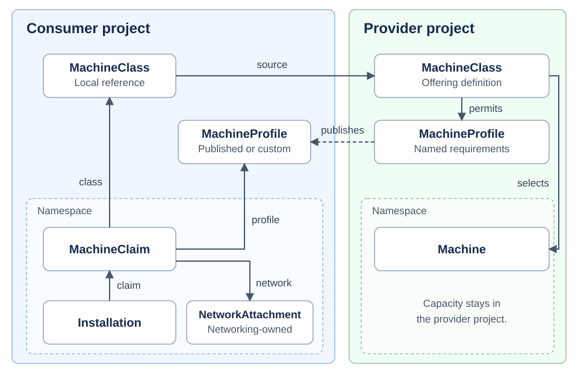
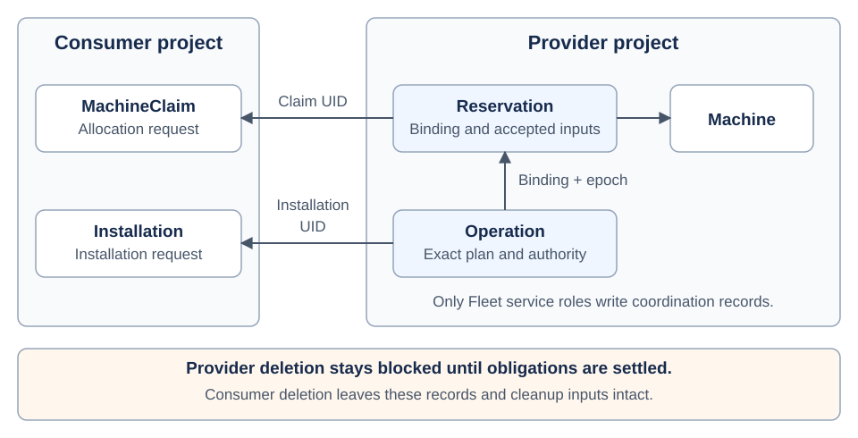
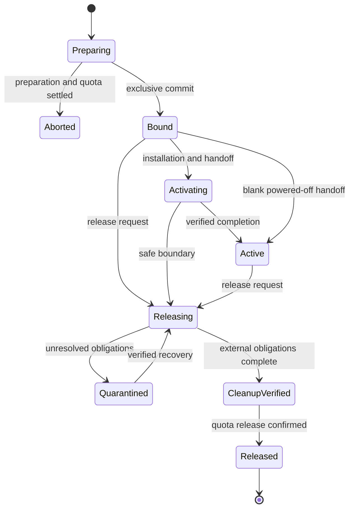

# Machine allocation and installation

- [Summary](#summary)
- [Motivation](#motivation)
- [Proposal](#proposal)
  - [Resource relationships across projects](#resource-relationships-across-projects)
- [Design details](#design-details)
  - [API design](#api-design)
    - [Status contract](#status-contract)
  - [Milo project integration](#milo-project-integration)
  - [Authorization and publication](#authorization-and-publication)
  - [Durable coordination](#durable-coordination)
  - [Allocation and quota integration](#allocation-and-quota-integration)
  - [Provider execution and recovery](#provider-execution-and-recovery)
  - [Release and project lifecycle](#release-and-project-lifecycle)
  - [Implementation decisions](#implementation-decisions)
  - [Acceptance tests](#acceptance-tests)
- [Production readiness review questionnaire](#production-readiness-review-questionnaire)
- [Implementation history](#implementation-history)
- [Drawbacks](#drawbacks)
- [Alternatives](#alternatives)
- [Infrastructure needed](#infrastructure-needed)

## Summary

Fleet will let consumers allocate and install machines through their Milo project
APIs. Four public resources define the contract: `MachineClass`, `Machine`,
`MachineClaim`, and `Installation`. Private reservation and operation records
retain ownership, execution authority, exact inputs, and cleanup obligations.

The first implementation will use a persistent simulated provider with real Milo
tenancy, IAM, entitlement, and quota integrations. This document proposes the
contract; Fleet has no implemented APIs or controllers yet.

## Motivation

The [Fleet proposal][fleet-proposal] describes a broad infrastructure platform.
Implementation needs a smaller contract that standalone customers and managed
platforms can share. That contract must keep one consumer's actions within its
project and prevent Fleet from assigning occupied or unclean capacity to another
consumer.

### Goals

- Allocate each machine to at most one claim through one shared allocator.
- Preserve distinct asset, allocation, installation, and managed-node identities.
- Retain authorized inputs before execution and recover work after failures.
- Complete release even when a consumer deletes its namespace or project.
- Verify these guarantees through real Milo integrations and a durable simulator.

### Non-goals

This enhancement excludes procurement, full physical inventory, real BMC and
console access, network implementation, image-catalog management, OS policy
composition, managed clusters, `NodeClaim`, rollouts, and node services.

The later bare-metal release must qualify real hardware, network handoff,
cleaning, and a supported non-Talos OS. Simulated results do not satisfy that gate.

## Proposal

Fleet will let providers offer machine capacity to authorized Milo projects.
Consumers will discover that capacity, request exclusive use, install an OS,
control power, and release the machine through their own project APIs. Providers
will retain ownership of the machines throughout that lifecycle.

### User stories

- A provider operator publishes a machine class and controls which capacity Fleet
  can allocate without exposing management credentials or other consumers.
- A consumer selects a local class and requests a machine. Fleet allocates
  available capacity within the consumer's permissions, entitlement, and quota,
  or reports why the request remains pending.
- A consumer installs or reinstalls an approved OS and controls power without
  creating a managed cluster.
- A consumer releases a machine or deletes its project. Fleet completes cleanup
  before another consumer can use that capacity.
- A service operator recovers interrupted work without repeating an unknown
  destructive action or losing cleanup obligations.

### Resource relationships across projects

The first diagram shows how consumers discover and request provider capacity.
Arrows show references or supply selection. Each project owns its resources and
namespaces.



A consumer discovers offerings through local MachineClass references. Each
MachineClaim requests capacity from a class, and each Installation requests an
OS installation for a claim. Other projects can reference the same offering and
compete for its supply.

The second diagram shows how Fleet preserves exclusive allocation and recovery
across project boundaries.



A reservation binds one consumer claim to one provider Machine. Operation records
retain the work Fleet authorizes for that allocation. These private records
survive project deletion so Fleet can finish cleanup. The Machine stays in the
provider project.

### Notes, constraints, and caveats

This proposal narrows the existing [allocation][allocation],
[publication][publication], and [installation][installation] contracts. API names
and field shapes remain provisional. The first implementation validates these
capabilities with simulated capacity; production hardware support requires the
qualification described in [Non-goals](#non-goals).

### Risks and mitigations

- **A privileged controller acts for an unauthorized consumer:** Check the
  initiating principal in both project scopes; retain the decision privately.
- **Concurrent workers allocate the same asset:** Enforce uniqueness in the
  reservation store and reject stale execution authority at the provider.
- **Project deletion destroys cleanup inputs:** Keep private authority,
  artifacts, and quota custody outside both project deletion domains.
- **A timeout hides a completed destructive action:** Recover the existing
  operation by its stable identity before retrying.

Fleet and Milo maintainers must review authorization and lifecycle integration
before the enhancement becomes implementable. Provider maintainers must review
execution fencing and cleanup evidence. Consumer-facing API review must cover
pending, cancellation, and recovery behavior. Review assignments remain open.

## Design details

### API design

All four kinds use the proposed `fleet.datumapis.com/v1alpha1` API and a status
subresource. The server applies defaults before capturing a request digest and
rejects unknown behavioral fields or unsupported required capabilities.

The examples show proposed API responses at different lifecycle points. The
server assigns `metadata.uid` and `metadata.generation`; the status projector
alone writes `/status`. Names, identifiers, digests, and timestamps are synthetic.
The example validity windows do not establish production freshness limits.

#### MachineClass

The provider operator writes the definition in the provider project. This
example describes an owned bare-metal offering. Provider type names come from
the [bare-metal proposal][allocation]; the simulator resolves private fixtures
without adding those provider APIs to this enhancement.

```yaml
apiVersion: fleet.datumapis.com/v1alpha1
kind: MachineClass
# Classes span the provider project so namespaces can share an offering.
metadata:
  generation: 1
  name: standard-metal
# The definition separates hardware requirements from provider details.
# Its mode cannot change after creation.
spec:
  arch: amd64
  capabilities:
    - baremetal
  interfaces:
    - name: primary
      type: Ethernet

  # Access describes supported operations, not permission to perform them.
  # The first implementation supports power control but no console sessions.
  access:
    consoleModes: []
    powerControl: true

  # Capacity limits selection to existing supply in one provider namespace.
  # Labels identify candidates; they confer no eligibility or purchase authority.
  capacity:
    machines:
      namespace: infra-ops
      selector:
        matchLabels:
          fleet.datumapis.com/capacity-pool: general-metal

    # This provider-local contract adds backend compatibility requirements.
    # Retained identity and revision keep later edits from changing accepted work.
    providerClassRef:
      apiGroup: baremetal.fleet.datumapis.com
      kind: BareMetalMachineClass
      namespace: infra-ops
      name: qualified-server-v1

# The projector reports the definition that the class evaluator accepted.
# Acceptance validates the offering; it does not reserve or promise capacity.
status:
  evaluatedRevision: class-revision-example
  observedAt: "2026-10-27T12:00:00Z"
  validUntil: "2026-10-27T12:05:00Z"
  conditions:
    - type: Accepted
      status: "True"
      observedGeneration: 1
      lastTransitionTime: "2026-10-27T12:00:00Z"
      reason: DefinitionValid
      message: "Hardware requirements and provider contract resolved."
```

Definitions contain no audience grant, quota, image, or network policy. The
publication service writes the consumer's local reference:

```yaml
apiVersion: fleet.datumapis.com/v1alpha1
kind: MachineClass
# Project-wide references give every namespace a local name for an offering.
metadata:
  generation: 1
  name: standard
# The immutable source keeps the provider definition authoritative.
# Fleet resolves the provider Project UID and one definition; a reference
# cannot become a definition or override its requirements.
spec:
  source:
    project: provider
    name: standard-metal

# The projector exposes only the authorized public offering. Private source
# mappings, selectors, provider configuration, and other consumers stay private.
status:
  # Revision and validity identify the evaluated offering, independently of
  # this reference object's generation. They do not grant source-use permission.
  evaluatedRevision: class-revision-example
  observedAt: "2026-10-27T12:00:00Z"
  validUntil: "2026-10-27T12:05:00Z"
  resolvedClass:
    arch: amd64
    capabilities:
      - baremetal
    interfaces:
      - name: primary
        type: Ethernet
    access:
      consoleModes: []
      powerControl: true
  conditions:
    - type: SourceResolved
      status: "True"
      observedGeneration: 1
      lastTransitionTime: "2026-10-27T12:00:00Z"
      reason: AuthorizedSource
      message: "The source offering resolved under current authorization."
```

Resolution follows one hop to a definition and rejects cycles, chains, and mixed
modes. Definition edits create revisions for future admissions; accepted claims
retain the exact source UIDs and requirements.

Reference status exposes authorized capabilities, revision, freshness, and
`SourceResolved`. Fleet checks source-use permission for capability-bearing GET,
list, and watch results, including watch revocation. A publisher's cached status
cannot disclose source details to every principal in the consumer project.
Selectors, provider configuration, machine IDs, and other consumers stay private.
Availability reports an observation, not a reservation.

#### Machine

The provider operator writes Machine policy and enrollment references. This
example identifies an owned physical asset in the provider project.

```yaml
apiVersion: fleet.datumapis.com/v1alpha1
kind: Machine
# The Machine UID identifies provider capacity independently of consumer claims.
# Replacement hardware gets a new UID; labels only group capacity for selection.
metadata:
  generation: 1
  name: lab-server-01
  namespace: infra-ops
  labels:
    fleet.datumapis.com/capacity-pool: general-metal
spec:
  # This required reference keeps provider details in the provider namespace.
  # Enrollment fixes the provider and asset identities to prevent retargeting.
  providerRef:
    apiGroup: baremetal.fleet.datumapis.com
    kind: BareMetalMachine
    name: lab-server-01

  # Qualified owned hardware requires a link to its physical inventory identity.
  # Supply without a physical Device needs no invented inventory record.
  deviceRef:
    name: server-example-001

  # Disabled is the default so registration cannot expose occupied capacity.
  # Eligible still depends on preparation, health, readiness, and placement.
  allocationPolicy: Disabled

  # Each reservation pins this required cleanup policy, preserving its
  # release obligations even if the operator later weakens the policy.
  cleaningPolicyRef:
    name: tenant-reuse-v1
  # Retain separates consumer release from asset disposal; it is the only
  # supported value in the first implementation.
  reclaimPolicy: Retain

# The projector derives these observations from executor evidence and private
# reservations. Operators cannot make capacity available by editing status.
status:
  # Evidence validity bounds preparation and health observations. Simulator
  # evidence remains distinguishable from qualified hardware verification.
  evidence:
    source: Simulator
    revision: evidence-example
    observedAt: "2026-10-27T12:00:00Z"
    validUntil: "2026-10-27T12:05:00Z"
  conditions:
    - type: Prepared
      status: "True"
      observedGeneration: 1
      lastTransitionTime: "2026-10-27T12:00:00Z"
      reason: PreparationVerified
      message: "The simulator verified preparation for this asset."
    - type: Healthy
      status: "True"
      observedGeneration: 1
      lastTransitionTime: "2026-10-27T12:00:00Z"
      reason: HealthVerified
      message: "The simulator reported healthy capacity."
    - type: Available
      status: "False"
      observedGeneration: 1
      lastTransitionTime: "2026-10-27T12:00:00Z"
      reason: AllocationDisabled
      message: "Operator policy excludes this Machine from new allocations."
```

References resolve within the Machine's provider project and namespace. Private
adapter fixtures supply provider and cleaning records without adding public
kinds. Provider-assigned addresses remain observations; networking owns IPAM
intent. Importing records grants no provisioning authority or eligibility.

Enrollment enforces one canonical asset identity across Machine records and
provider projects. Operators cannot manufacture preparation evidence by editing
status; simulator observations identify themselves as such.

The reservation determines occupancy. `Available=True` alone cannot authorize a
binding. Retirement must settle enrollment, reservation, and operation
obligations before Machine deletion.

#### MachineClaim

The consumer creates the claim in its own project.

```yaml
apiVersion: fleet.datumapis.com/v1alpha1
kind: MachineClaim
# Claim identity belongs to the consumer project, separately from the Machine.
# A new name creates a distinct request rather than retrying an existing one.
metadata:
  generation: 1
  name: example
  namespace: default
# Only powerState can change after creation, preserving the placement contract.
# The local class and permitted location are required; Fleet retains their
# identities and policies for allocation and recovery.
spec:
  machineClassRef:
    name: standard
  locationRef:
    name: lab

  # This optional gate delays activation until the initial installation succeeds.
  # A reciprocal claim reference in the same project and namespace ties the
  # Installation to this allocation.
  initialInstallationRef:
    name: example-os-1

  # The complete initial attachment set fixes the allocation's network needs.
  # References stay in this project and namespace; an empty list means none.
  networkAttachmentRefs: []
  # Off is the default so creating a claim does not request runtime power-on.
  # On expresses intent; authorization and activation gates still control effects.
  powerState: "On"

# The projector reports allocation progress without exposing the provider
# Machine identity. These fields describe the binding; they cannot authorize it.
status:
  bindingID: binding-example
  # The retained incarnation survives deletion of its public Installation.
  currentInstallationRef:
    name: example-os-1
    uid: 00000000-0000-4000-8000-000000000001
  placement:
    locationRef:
      name: lab
  # Power is an observation, separate from spec.powerState intent. Its validity
  # prevents a stale successful power action from implying current readiness.
  power:
    state: "On"
    observedAt: "2026-10-27T12:00:00Z"
    validUntil: "2026-10-27T12:05:00Z"
  conditions:
    - type: Accepted
      status: "True"
      observedGeneration: 1
      lastTransitionTime: "2026-10-27T12:00:00Z"
      reason: InputsAccepted
      message: "Request identity and initial inputs are retained."
    - type: Bound
      status: "True"
      observedGeneration: 1
      lastTransitionTime: "2026-10-27T12:00:00Z"
      reason: ReservationCommitted
      message: "The private reservation holds exclusive capacity."
    - type: Ready
      status: "True"
      observedGeneration: 1
      lastTransitionTime: "2026-10-27T12:00:00Z"
      reason: PlatformHandoffComplete
      message: "Initial installation and required handoff checks passed."
    - type: Releasing
      status: "False"
      observedGeneration: 1
      lastTransitionTime: "2026-10-27T12:00:00Z"
      reason: AllocationActive
      message: "The allocation has no release request."
```

A superseded power intent generation cannot dispatch new work. Creating a claim
captures protected caller identity but reserves no capacity. Resolution pins
dependency UIDs and content; missing dependencies leave the claim pending.
Later name reuse cannot replace a pinned UID.

Before selecting hardware, the coordinator resolves initial installation
requirements and network feasibility. After binding, it materializes
machine-specific inputs and waits for attachment readiness. This order avoids a
claim/installation dependency cycle.

A blank claim starts powered off and omits the initial Installation. A later
Installation uses predecessor `None`. A bound claim never moves to another
Machine. Owner references cannot replace Fleet's release protocol.

#### Installation

The consumer creates an Installation for its claim.

```yaml
apiVersion: fleet.datumapis.com/v1alpha1
kind: Installation
# Installation shares its claim's project and namespace. The claim's
# initialInstallationRef identifies the request that satisfies its initial gate.
metadata:
  generation: 1
  name: example-os-1
  uid: 00000000-0000-4000-8000-000000000001
  namespace: default
# The entire spec is immutable so recovery uses the same authorized inputs.
# Claim and approved image are required. Fleet checks install and image-use
# permissions and pins the Claim UID, image artifacts, and digests.
spec:
  claimRef:
    name: example
  # This required precondition prevents competing installs from replacing
  # an unexpected OS. None means the allocation has no installed incarnation.
  expectedPredecessor:
    type: None
  imageRef:
    name: qualified-linux

  # Optional bootstrap data comes from a Secret in this namespace under
  # explicit caller authority. Protected copies of its UID, digest, and bytes
  # preserve the accepted input through Secret changes or deletion.
  bootstrapConfigRef:
    name: example-bootstrap

# The projector reports the retained installation outcome, not guest health.
# Opaque correlation IDs support diagnosis without exposing execution authority.
status:
  bindingID: binding-example
  operationID: operation-example
  resolvedImageDigest: sha256:aaaaaaaaaaaaaaaaaaaaaaaaaaaaaaaaaaaaaaaaaaaaaaaaaaaaaaaaaaaaaaaa
  completedAt: "2026-10-27T12:00:00Z"
  conditions:
    - type: Accepted
      status: "True"
      observedGeneration: 1
      lastTransitionTime: "2026-10-27T12:00:00Z"
      reason: OperationAdmitted
      message: "The immutable plan and operation authority are retained."
    - type: Executing
      status: "False"
      observedGeneration: 1
      lastTransitionTime: "2026-10-27T12:00:00Z"
      reason: OperationComplete
      message: "The executor has no remaining work for this installation."
    - type: Ready
      status: "True"
      observedGeneration: 1
      lastTransitionTime: "2026-10-27T12:00:00Z"
      reason: PlatformHandoffComplete
      message: "The installation and platform handoff completed with verified evidence."
```

A reinstall identifies the prior incarnation in its predecessor condition:

```yaml
# Name and UID identify the predecessor even after public deletion.
# The UID prevents name reuse from substituting another incarnation.
# This example uses a synthetic UID.
expectedPredecessor:
  type: Installation
  name: example-os-1
  uid: 00000000-0000-4000-8000-000000000001
```

Two requests with the same predecessor cannot both execute. Only the claim's
named initial Installation can satisfy its initial gate.

Operator-installed, project-scoped image fixtures supply immutable artifacts,
permissions, hardware compatibility, and bootstrap behavior. They accept no
arbitrary URLs. A future image catalog can implement this resolver contract.

Before dispatch, the coordinator pins the binding, predecessor, image, bootstrap
content, disk/interface targets, network prerequisites, and executor. On success,
it atomically records the current incarnation and initial-gate completion.
Partial destructive failure makes the incarnation dirty or unknown. Recovery
resumes that operation or releases the claim; it cannot assume the old OS remains
intact. Reinstallation can make an active claim unready without releasing its
binding. Platform handoff makes no claim about guest or application health and
grants no continuing ownership of a standalone OS.

Deleting an unfinished Installation requests cancellation at a safe boundary.
Deleting a completed one does not uninstall the OS, release capacity, or reset
the initial gate. Private history preserves predecessor identity in both cases.

#### Status contract

Each condition describes one fact. Its `status` is `True`, `False`, or `Unknown`;
its `reason` identifies the outcome, and its bounded `message` explains it.
`observedGeneration` identifies the spec generation the controller evaluated.
`lastTransitionTime` records a change in the condition's value, not a heartbeat.
Status can be empty before reconciliation; an absent condition means `Unknown`.

An unchanged spec can acquire new dependency revisions or stale evidence.
`observedAt` records an observation, and `validUntil` bounds its validity under
the relevant evidence policy. A matching generation alone does not prove
freshness. Missing, expired, or unverifiable evidence yields `Unknown` for the
facts that depend on it. Readers also check validity when the projector cannot
refresh status.

The resources report different aspects of the lifecycle:

- **MachineClass:** `Accepted` applies to a definition whose requirements and
  provider contract resolve. `SourceResolved` applies to a reference with an
  authorized, resolved source. The opaque `evaluatedRevision` identifies the
  evaluated contract; `resolvedClass` contains only its public capabilities. Neither
  condition promises free capacity or grants every reader source-use permission.
- **Machine:** `Prepared` reports preparation evidence, and `Healthy` reports
  observed health. `Available` requires eligible policy, fresh evidence, and no
  live reservation or cleanup obligation. A known policy block can keep
  `Available=False` even when health evidence becomes unknown.
- **MachineClaim:** `Accepted` means Fleet retained the request identity and
  initial inputs. `Bound` means a private reservation committed, not that the
  machine is ready. `Ready` requires the current installation, required network
  handoff, and power prerequisites to pass. A blank powered-off claim can also
  become ready. `Releasing` remains true until cleanup and quota release finish.
- **Installation:** `Accepted` means Fleet admitted an operation with exact
  inputs. `Executing` describes work in progress; `False` alone does not mean
  success. `Ready=True` records verified installation and platform handoff.
  `completedAt` appears only after verified success. Failure and cancellation
  use `Ready=False` with a specific reason; an uncertain outcome uses `Unknown`.

A claim omits `bindingID` and `placement` before binding and omits
`currentInstallationRef` before an installation succeeds. An Installation omits
operation correlation and the resolved digest until admission retains them.
`power.state` is `On`, `Off`, or `Unknown`; intent changes do not change the
observation until fresh executor evidence arrives.

Binding identity and completed installation results are durable facts. Runtime
health, power, and claim readiness can change independently. A later reinstall
does not rewrite a prior Installation's successful result. The claim reports the
current incarnation, becomes unready during disruptive work, and withholds a
current Installation reference if partial effects leave the incarnation unknown.
Private history still preserves earlier identities for recovery.

The projector publishes `DependenciesPending`, `AuthorizationUnavailable`,
`SourceUnavailable`, `QuotaPending`, `QuotaDenied`, `InsufficientCapacity`,
`PredecessorMismatch`, `OutcomeUnknown`, or `CleanupBlocked` where applicable.
A status write, absent condition, or stale `Ready=True` cannot authorize effects
or free capacity. Recovery reads private records, never a reconstructed public
binding. Consumer-visible status excludes inventory mappings, BMC endpoints,
credentials, bootstrap bytes, and bearer capabilities.

### Milo project integration

Milo routes project requests through:

```text
/apis/resourcemanager.miloapis.com/v1alpha1/projects/{project-name}/control-plane
```

The [project filter][milo-routing] supplies authenticated parent context:

```text
iam.miloapis.com/parent-api-group=resourcemanager.miloapis.com
iam.miloapis.com/parent-type=Project
iam.miloapis.com/parent-name={project-name}
```

Fleet accepts that context only through its authenticated API-server path. It
rejects missing, conflicting, or organization-only context. Client headers,
annotations, and request fields cannot select a tenant. Public APIs offer no
unscoped global list.

The project name selects the route. Fleet resolves the root ResourceManager
Project UID to identify its lifetime. `user.Info.UID` identifies the caller, not
the project. The [IPAM tenancy implementation][ipam-tenancy] follows this
separation. Fleet uses these keys:

```text
ProjectKey = (Milo authority ID, root Project UID)
ObjectKey  = (ProjectKey, API group/resource, namespace, name)
ObjectID   = (ProjectKey, resource UID)
```

Fleet initially supports one operator-configured Milo authority. Namespaced
records also retain the Namespace UID. Every query, cache key, list/watch filter,
continuation token, and work item includes `ProjectKey`. Recreating a project,
namespace, or object cannot inherit the previous lifetime's authority.

Provider operators write project-wide MachineClass definitions and namespaced
Machines. The publication service writes project-wide references in consumer
projects. Consumers write namespaced MachineClaims and Installations; each
Installation shares its claim's project and namespace. Fleet stores private
reservation and operation records outside both project deletion domains.

Provider projects follow the same tenancy rules as consumer projects. Authorized
consumers may also claim a definition in their own project. A namespace named
`default` in one project has no relationship to `default` in another.

Milo's [multicluster provider][milo-multicluster] indexes clients by project name
and can disengage unready projects. Fleet must verify the root UID and connected
control-plane lifetime before admission or status writes. A changed UID
invalidates cached clients and work. An unavailable API does not prove deletion.
Private recovery continues without an engaged project client. Resource versions
from separate project APIs do not provide a global transaction order.

### Authorization and publication

Register separate Milo IAM permissions for CRUD, source `use`, claim `install`,
status, and private coordination. [ProtectedResource][milo-protected] supports
subresource permissions only when the authorization provider enables them.
Verify that deployment setting. Admission must also protect immutable fields,
reserved metadata, and service finalizers; labels and field managers confer no
permission.

Provider operators write class definitions, Machine policy, and trusted
enrollment mappings. The publication service writes consumer references and
private provenance. Consumers write authorized claims, installation requests,
power intent, and deletion requests.

The coordinator writes accepted inputs, reservations, operation authority, and
release progress. Executors write authenticated observations and completion
evidence for admitted operations. The status projector writes sanitized status
from retained records and observations.

Each surface has one authoritative writer. A process that implements multiple
roles must preserve these boundaries. The initial deployment limits supply
enrollment to operator-controlled provider projects.

#### Request authority

For a claim, the coordinator checks the initiating principal's local create
permission and provider-project `machineclasses.use` permission. The provider
check retains the caller's identity and changes the target scope, as the
[IPClass checker][ipam-class-use] does. Controller credentials cannot substitute
for consumer permission.

Fleet retains the initiating User or ServiceAccount UID privately. Milo's
[PolicyBinding schema][milo-policybinding] supports User, Group, and
ServiceAccount subjects; it does not support Project subjects. This proposal
uses explicit source-use grants to request principals. Publication grants no
such authority.

Asynchronous admission must resolve current identity and group membership.
Fleet retains no bearer token and cannot replay stale groups. If that check is
unavailable, the claim stays pending with `AuthorizationUnavailable`. A principal
that loses access before binding must submit a new request after regaining it.
After binding, subsequent actions use current claim permissions and the retained
allocation contract; the creator's departure does not reclaim the machine.

An Installation also requires `install` permission on its exact claim, image-use
permission, and access to its bootstrap input. Power changes capture their own
caller and generation. Each action requires separate operation admission.

#### Entitlement and publication

Admission requires an Active consumer service entitlement and no applicable
suspension. [ServiceEntitlement][catalog-entitlement] tracks suspension separately
from phase. The [provisioner][catalog-provisioner] checks existing-object ownership
before applying references but does not grant source-use permission.

Fleet retains this publication mapping privately:

```text
(consumer ProjectKey, local class UID)
  -> (provider ProjectKey, definition UID, revision)
```

Copied fields, labels, and status cannot establish provenance. Fleet rejects
name collisions and unauthorized sources without disclosing foreign inventory.
Same-project definition use skips publication but still requires authorization.

### Durable coordination

Public status projects private state; it grants no execution authority. Missing
private records block effects and quarantine uncertain capacity. Private storage
and protected artifacts must survive either project's API removal. Retained
cross-project identities are not Kubernetes owner references.

#### Reservation record

- **Record ID, revision, state, binding ID, and epoch:** Identify the allocation
  and order conditional transitions.
- **Consumer ProjectKey, Namespace UID, Claim UID, request digest:** Bind
  authority to the exact consumer lifetime.
- **Provider ProjectKey, Machine UID, canonical asset identity:** Identify
  exclusive capacity across classes and enrollment aliases.
- **Class UIDs, revision, requirements, dependency identities/content:**
  Preserve the accepted contract after source changes or deletion.
- **Principal UID, authorization decision, entitlement, admission revisions:**
  Record the authority for binding.
- **Quota hold UID and state:** Recover quota custody through release.
- **Current incarnation, initial gate, active operation ID:** Serialize
  installation, power, and release.
- **Cleaning policy, obligations, evidence, retired identities:** Complete
  cleanup and reject stale work.

Fleet persists preparation before requesting quota. Preparation need not select
a machine. The binding transaction commits machine occupancy, claim uniqueness,
and dispatch intent together. The store enforces one live binding per Machine
and per Claim, plus one allocatable enrollment per canonical asset. Lists and
process-local locks cannot enforce these constraints across workers.

An epoch is a monotonically increasing allocation generation. Every effect and
callback carries it. Retirement advances the machine's fence so an old binding
cannot act for the next consumer.

#### Operation record

Each operation retains its stable ID, idempotency key, binding, Installation UID
or power generation, predecessor, exact inputs, permitted effects, target
components, executor, fencing token, dispatch correlation, cancellation boundary,
outcome evidence, and remaining obligations.

### Allocation and quota integration

The coordinator follows this sequence:

1. Resolve project, namespace, and request lifetimes. Check deletion state,
   provenance, current principal permissions, entitlement, and initial inputs.
2. Create or resume preparation by Claim UID. Obtain one correlated quota hold
   and retain its UID. Query a lost grant response using the same correlation.
3. Select eligible supply and recheck lifecycle, policy, source compatibility,
   authorization, entitlement, and quota.
4. Commit the exclusive binding and activation intent under the admission
   ordering below. A losing contender retries selection or remains pending.
5. Dispatch admitted operations and project their results to public status.

When no eligible machine exists, Fleet reports `InsufficientCapacity` and aborts
the unused preparation hold before starting another attempt. `Aborted` requires
confirmed hold release or proof that no hold exists. Preparation authorizes no
provider effects.

#### Quota custody

Milo owns quota. Fleet initially requests one machine-count dimension, amount one
per binding. Its [ResourceClaim][milo-quota-claim] and
[references][milo-quota-refs] use names rather than UIDs for consumers/resources.
Fleet must separately retain the ProjectKey and exact quota-claim UID to prevent
name reuse from inheriting or charging an old hold.

The quota adapter must preserve the hold outside consumer garbage collection or
provide a protected transfer. It must define its service-owned anchor, claiming
resource, authorization, and release acknowledgment. The existing schema alone
does not establish these guarantees. A lost or revoked hold blocks new work;
remembered `Granted=True` cannot replace current authority.

#### Admission ordering

An authorization check followed by a database commit cannot order a concurrent
revocation. Fleet needs an admission fence: a protocol that orders binding
against relevant IAM, entitlement, project/namespace lifecycle, quota, class,
and eligibility changes.

If invalidation wins, the pending claim cannot bind. If binding wins, later
changes follow the active-allocation rules. Authorities must acknowledge
invalidation only when older admission authority can no longer commit.

This protocol is a new integration requirement, not an existing Milo API.
Implementation must define participating authorities and test their ordering.
Cached reads, stale tokens, and simulator-only policy tests do not satisfy it.

### Provider execution and recovery

Typed resolvers supply image inputs, network evidence, and provider access.
Fixtures implement those interfaces for simulation. Missing required evidence
blocks progress.

Only the coordinator authorizes a plan. The executor reports evidence for that
plan. Retries reuse the operation ID and inputs; a changed plan with the same
key conflicts. Fleet persists dispatch intent before sending a command and
queries the backend after a lost response.

Operations progress through `Admitted`, `Dispatched`, and `Verifying` to
`Succeeded` or a verified `Failed`/`Cancelled` boundary. `OutcomeUnknown` remains
nonterminal. Command acceptance does not prove completion.

Each binding permits one active effectful operation. The provider must reject
stale executor tokens, epochs, and callbacks, including after restart. A
Kubernetes controller lease alone cannot fence a remote worker.

### Release and project lifecycle



Failed activation retains the binding. Release proceeds in this order:

1. Close consumer admission. Settle active operations or fence their executors.
2. Revoke artifact/bootstrap access, credentials, and sessions. Adapters account
   for every issued capability; the simulator provides no real console sessions.
3. Detach or fence networking while preserving cleanup access. Use the retained
   attachment plan, even when the consumer's network objects no longer exist.
4. Execute the retained cleaning policy and verify every target. Uncertain
   results quarantine capacity and retain its quota hold.
5. Record `CleanupVerified`, release quota idempotently, and await acknowledgment.
   Commit `Released` and require fresh eligibility evidence before reuse.

- **Claim or namespace deletion:** At claim creation, atomically capture private
  provenance and install a protected finalizer. Deletion closes admission;
  finalization waits for release.
- **Consumer project termination:** Close admission by Project UID and release
  every reservation. Participate in Milo's resource purge; continue private
  cleanup after forced API loss.
- **Provider project retirement:** Block retirement while it would discard
  required execution identity, credentials, artifacts, quota linkage, or release
  authority. Forced loss quarantines capacity.
- **Project or entitlement suspension:** Deny new bindings, installations, and
  consumer power actions. Bring committed work to a safe boundary. Permit
  authorized deletion and release without automatically wiping active machines.
- **Class withdrawal or Machine disablement:** Block future bindings; retain
  active contracts. Admit reclaim separately.

Milo's [project controller][milo-cleanup] waits for resource cleanup before
reclaiming the control plane. Its [suspension admission][milo-suspension] allows
deletes and updates to terminating objects. Fleet must enforce the effect rules
even when its service principal bypasses ordinary admission.

Retain records while operations, cleanup, predecessor checks, or replay risks
need them. Before replaying work after a database restore, reconcile executor
fences and quota state. Unresolved divergence blocks effects.

### Implementation decisions

Before marking this enhancement implementable, Fleet and integration owners must:

- Select storage and define atomic caller capture, uniqueness, lifecycle guards,
  and dispatch persistence. An orphaned public request must gain no authority.
- Specify admission ordering and current-principal reevaluation with Milo.
- Define durable quota custody, UID correlation, and grant/release recovery.
- Verify project-lifetime routing, status/finalizer protection, and provider
  retirement protection.

Record these decisions in Fleet. Storage, packaging, and internal encoding remain
open; the public contract must also support a future managed-node consumer.

### Acceptance tests

Implement the following tests through Milo tenancy, IAM, entitlement, and quota.
No implementation tests exist yet.

The end-to-end scenario uses two consumer projects competing for one provider
machine. One claim binds while the other remains pending. The winner installs,
reinstalls, and releases; the waiting consumer acquires the machine only after
cleanup. The simulator persists state independently of Fleet. Tests restart each
component, lose responses, and delay old workers to verify recovery.

- **Projects reuse object names in `default`; clients forge context or recreate
  projects/namespaces:** Isolate CRUD, list/watch, caches, and status; reject
  forged context and stale UID work.
- **Consumer admin lacks source use; two local principals have different
  grants:** Deny unauthorized effects and source disclosure, including cached
  summaries and watches.
- **Inactive entitlement or suspension:** Block new work while preserving
  authorized cleanup.
- **Two projects, overlapping classes, or duplicate enrollment target one
  asset:** Commit one binding; reject duplicate supply.
- **Replicas reconcile one claim after lost quota/binding responses:** Recover
  one hold and one machine; repair status from private state.
- **Revocation, deletion, suspension, quota loss, or policy withdrawal races
  binding:** Enforce the defined admission order through real integrations.
- **Quota denial or interrupted preparation:** Produce no effects; settle the
  same hold before aborting.
- **Initial Installation or network input arrives after the claim:** Resolve
  dependencies without deadlock or premature activation.
- **Reinstalls share a predecessor; inputs change or names recur:** Admit one
  operation and execute only retained identities/content.
- **Executor response disappears or a retired worker returns after reuse:**
  Recover the existing operation; reject stale effects and callbacks.
- **Installation fails after partial effects:** Retain a dirty/unknown
  incarnation; resume recovery or release.
- **Claim, namespace, class, or project disappears during work:** Retain
  authority and obligations; complete cleanup or quarantine.
- **Cleanup or quota-release acknowledgment remains unknown:** Keep the machine
  unavailable.
- **Consumer deletes a completed Installation:** Preserve the OS, binding,
  initial gate, and predecessor identity.
- **Fleet, project API, simulator, or backing store restarts/restores:** Recover
  the same identities; verify fences before resuming effects.

### Source evidence

The review checked these source revisions on 2026-10-27. Source behavior does not
establish which versions Datum deploys.

- **`milo-os/milo`:** `cd469ff4235c0847d9863a132bdb58f3ff8d3845`
- **`milo-os/ipam`:** `ed3f54151a3f0a08014caec150567ed1012007f2`
- **`milo-os/service-catalog`:** `de3cc40518254f832ad4db4aa104e37bf4ddfe2c`

The catalog provisioner's ownership check postdates the imported publication
proposal. This enhancement uses that newer behavior and retains Fleet's separate
provenance and source-use checks.

## Production readiness review questionnaire

These answers describe proposed controls. Fleet has not implemented or qualified
them. Reviewers must approve this questionnaire before the enhancement becomes
implementable.

### Feature enablement and rollback

#### How do operators enable or disable the feature in a live cluster?

Operators deploy Fleet, register its APIs and IAM resources, and enable consumer
entitlements. An operator control must pause new bindings and consumer operations
while allowing recovery and release. Implementation must define this control and
verify that it needs no Milo downtime or machine reprovisioning.

#### Does enabling the feature change any default behavior?

No. Imported Machines default to `Disabled`, and claims default to power `Off`.
Creating or importing a record cannot trigger provisioning.

#### Can operators disable the feature after enabling it?

Yes, by pausing admission. They must retain Fleet's APIs, private storage, and
recovery workers until outstanding obligations end. Removing the service while
allocations remain is not a supported rollback.

#### What happens if operators reenable the feature after rollback?

Fleet reconciles retained operations, quota, and executor fences before admitting
new work. It does not create replacement bindings from public status.

#### Are there tests for feature enablement and disablement?

Not yet. Add tests that pause during preparation, installation, and release,
restart components, and resume without duplicate effects or lost obligations.

### Rollout, upgrade and rollback planning

#### How can a rollout or rollback fail? Can it impact running workloads?

Incompatible record formats or fencing protocols could strand work or authorize
stale workers. Version private records and executor protocols before rollout.
Block downgrade when the older version cannot recover retained work. Pausing
admission must not power off active machines.

#### What specific metrics should inform a rollback?

Pause admission on any duplicate binding, unauthorized effect, or stale-worker
acceptance. Investigate rising unknown-operation counts, cleanup age, quota
mismatches, and reconciliation failures before choosing rollback.

#### Have upgrade, rollback, and upgrade-downgrade-upgrade tests passed?

No implementation exists. Add compatibility tests before the first version
change that affects persisted state or executor behavior.

#### Does rollout deprecate or remove any features, APIs, fields, or flags?

No. This enhancement introduces a new service contract.

### Monitoring requirements

#### How can an operator determine whether workloads use the feature?

Expose counts of live reservations, active operations, quota holds, and
quarantined machines from private state. Public object counts cannot establish
ongoing obligations after deletion.

#### How can a consumer tell whether the feature works for its instance?

Consumers read the conditions, progress, and observations defined in the
[API status contract](#status-contract). Status distinguishes pending inputs,
committed capacity, installation completion, current readiness, and release.
Operator audit records retain principals, ProjectKeys, decisions, transitions,
and evidence references without secret content.

#### What service-level objectives are reasonable?

Fleet has no measured latency or availability baseline. Establish targets after
simulator load tests and before production rollout. Exclusive allocation and
verified release are correctness requirements, not error-budget allowances.

#### Which service-level indicators show service health?

Measure admission latency, reconciliation success, operation completion latency,
unknown outcomes, cleanup age, quota reconciliation failures, and dependency
availability. Separate waiting for capacity from controller failure. Define
metric names and aggregation during implementation; avoid object UIDs as labels.

#### Which useful metrics are missing?

All proposed metrics await implementation. Real-adapter provisioning, boot, and
cleaning timings also require hardware qualification.

### Dependencies

#### Does the feature depend on specific services?

- **Milo project APIs and IAM** resolve identity, lifecycle, and permissions.
  During an outage, Fleet pauses affected admissions and status projection while
  retaining private recovery authority.
- **Service catalog and quota** establish entitlement and quota custody. When
  either service cannot confirm the required authority, Fleet blocks admission
  and retains bindings through unknown quota release.
- **Private store and artifact storage** retain authority, dispatch, and exact
  inputs. During an outage, Fleet blocks new effects. Admitted executors follow
  their retained plans and cancellation boundaries.
- **Provider executors** execute and verify operations. When an executor becomes
  unavailable, Fleet retains unknown outcomes and queries the same operation
  after service returns.
- **Location, image, and network resolvers** validate placement and execution
  prerequisites. If evidence is unavailable, Fleet waits rather than
  substituting defaults. Initial image and network fixtures model these
  interfaces.

Dependency delays increase pending time. Retries must use backoff and preserve
operation identity.

### Scalability

#### Does the feature add API calls?

Yes. Controllers watch project lifecycles and Fleet resources, resolve inputs,
check authorization/entitlement, manage quota claims, and write status. Measure
throughput and per-project watch cost before setting supported limits.

#### Does the feature introduce API types?

Yes: the four kinds in [API design](#api-design). Load tests must set
project and namespace limits; this proposal claims no supported object count.

#### Does the feature add cloud-provider calls?

The initial implementation calls only the simulator. Real adapters must document
API operations, rate limits, and retry costs during qualification.

#### Does the feature increase existing object sizes or counts?

Quota consumption adds one hold per preparation or live binding. Fleet also adds
IAM registrations and publication references. Measure total object sizes,
including bounded status and evidence references, during implementation.

#### Does the feature increase latency for operations with existing objectives?

Authorization, quota, and project-purge traffic can affect Milo. Project deletion
also waits for Fleet cleanup. Measure these effects with Milo maintainers before
production rollout.

#### Does the feature significantly increase component resource usage?

Private records, retained artifacts, project watches, and reconciliation queues
consume storage, memory, and connections. Establish retention and per-project
concurrency limits through load tests without deleting active obligations.

#### Can the feature exhaust node resources?

Yes. Unbounded watches, retries, artifact downloads, or pending operations could
exhaust connections, memory, or disk. Bound queues, transfer concurrency, and
artifact sizes. Test overload and dependency outages before setting limits.

### Troubleshooting

#### How does the feature react when an API server becomes unavailable?

Fleet stops admissions that need that API's evidence and delays status writes.
It continues recovery from retained authority where dependencies permit. See
[Dependencies](#dependencies) for the outage boundaries.

#### What other failure modes should operators investigate?

- **Unknown executor outcome:** Detect through `OutcomeUnknown` and operation
  age. Query the retained operation; fence the old worker before takeover.
- **Incomplete cleanup:** Detect through `CleanupBlocked` and quarantine count.
  Restore management access or missing evidence, then resume release.
- **Quota divergence:** Detect through quota reconciliation failures. Recover
  the exact hold and acknowledgment; keep capacity unavailable.
- **Restored state conflicts with executor state:** Detect through fence or
  epoch mismatch. Keep effects paused until reconciliation establishes current
  authority.

Audit logs must include operation/binding IDs, transitions, and evidence
references. Implementation must define log levels and verify these paths through
[Acceptance tests](#acceptance-tests); none have run yet.

#### How should operators investigate missed service-level objectives?

Identify the affected phase and dependency from conditions and metrics. Use the
operation correlation to inspect audit records. Check quota and executor state
before retrying. Pause admission if evidence suggests a correctness violation.

## Implementation history

- 2026-10-27: Drafted the machine lifecycle contract and reviewed pinned Milo,
  IPAM, and service-catalog source.
- 2026-10-27: Adopted the [Datum enhancement template][template]. The proposal
  remains provisional; implementation has not started.

## Drawbacks

Durable coordination adds storage, recovery, and operational work before Fleet
can provision hardware. The admission-ordering requirement also needs changes or
explicit contracts across several services. Strict cleanup can leave capacity
unavailable for an extended period when evidence or management access fails.

## Alternatives

- **Store allocation authority only in public status:** Project deletion and
  delayed status writes cannot preserve exclusive ownership or cleanup
  authority.
- **Allocate separately for standalone and managed consumers:** Separate
  allocators could assign the same supply and diverge on release rules.
- **Start with a real provisioning backend:** Hardware integration would obscure
  control-plane recovery failures; qualify it after the shared contract works.
- **Add the full inventory, image, and cluster APIs now:** Those APIs do not
  establish the allocation boundary and expand the first implementation.
- **Treat publication as project-wide source-use delegation:** Milo has no
  Project IAM subject. A future delegated principal needs a protected Project
  UID mapping and revocation contract.

## Infrastructure needed

The integration environment needs one provider project, two consumer projects,
Milo IAM, service catalog, quota, durable private storage, protected artifact
storage, and an independently restartable simulator. Test tooling must inject
lost responses, stale workers, API outages, and restore events.

Fleet owns implementation and design records in this repository. `infra` will
own environment-specific deployment configuration. Implementation decisions will
select the storage backend and deployment layout.

[fleet-proposal]: ../../proposals/fleet-management/README.md
[allocation]: ../../proposals/fleet-management/bare-metal-hardware.md
[publication]: ../../proposals/fleet-management/capacity-publication.md
[installation]: ../../proposals/fleet-management/os-configuration.md
[milo-routing]: https://github.com/milo-os/milo/blob/cd469ff4235c0847d9863a132bdb58f3ff8d3845/pkg/server/filters/projects.go
[milo-multicluster]: https://github.com/milo-os/milo/blob/cd469ff4235c0847d9863a132bdb58f3ff8d3845/pkg/multicluster-runtime/milo/provider.go
[milo-policybinding]: https://github.com/milo-os/milo/blob/cd469ff4235c0847d9863a132bdb58f3ff8d3845/pkg/apis/iam/v1alpha1/policybinding_types.go
[milo-protected]: https://github.com/milo-os/milo/blob/cd469ff4235c0847d9863a132bdb58f3ff8d3845/pkg/apis/iam/v1alpha1/protectedresource_types.go
[milo-cleanup]: https://github.com/milo-os/milo/blob/cd469ff4235c0847d9863a132bdb58f3ff8d3845/internal/controllers/resourcemanager/project_controller.go
[milo-suspension]: https://github.com/milo-os/milo/blob/cd469ff4235c0847d9863a132bdb58f3ff8d3845/internal/apiserver/admission/plugin/projectsuspension/admission.go
[milo-quota-claim]: https://github.com/milo-os/milo/blob/cd469ff4235c0847d9863a132bdb58f3ff8d3845/pkg/apis/quota/v1alpha1/resourceclaim_types.go
[milo-quota-refs]: https://github.com/milo-os/milo/blob/cd469ff4235c0847d9863a132bdb58f3ff8d3845/pkg/apis/quota/v1alpha1/shared_types.go
[ipam-tenancy]: https://github.com/milo-os/ipam/blob/ed3f54151a3f0a08014caec150567ed1012007f2/internal/tenant/tenant.go
[ipam-class-use]: https://github.com/milo-os/ipam/blob/ed3f54151a3f0a08014caec150567ed1012007f2/internal/access/class.go
[catalog-provisioner]: https://github.com/milo-os/service-catalog/blob/de3cc40518254f832ad4db4aa104e37bf4ddfe2c/internal/controller/provisioning_controller.go
[catalog-entitlement]: https://github.com/milo-os/service-catalog/blob/de3cc40518254f832ad4db4aa104e37bf4ddfe2c/api/v1alpha1/serviceentitlement_types.go
[template]: https://github.com/datum-cloud/enhancements/blob/370f8eb8a6b09890d829505ad6e5b7b6c5fa8356/enhancements/template/README.md
