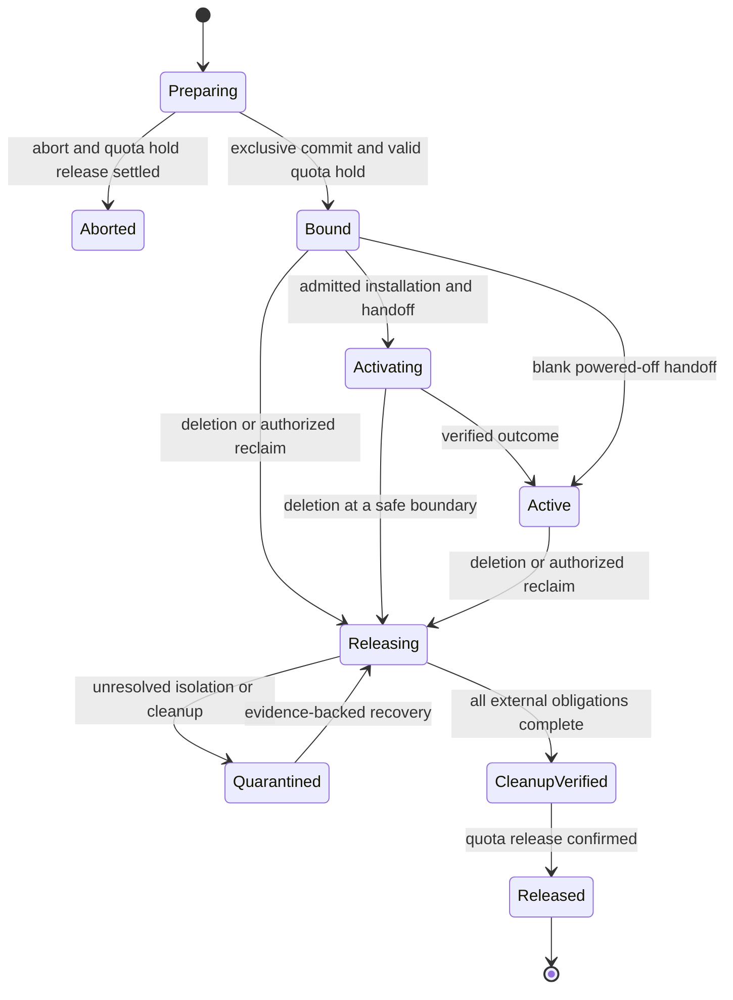

# M1: Durable machine allocation and installation

## Summary

Implement the smallest shared machine lifecycle: `MachineClass`, `Machine`,
`MachineClaim`, and `Installation`, backed by private reservation and operation
records. Consumers use their own Milo project APIs to request capacity held in a
provider project. Fleet admits one exclusive allocation, executes only its retained
installation inputs, and preserves release obligations until reuse is safe.

The first functional milestone runs against a durable simulated provider through
real Milo project contexts. It demonstrates one provider project and two consumer
projects competing for the same machine, including restart and failure recovery.
It does not claim physical provisioning support. Qualification of a real adapter
and a supported non-Talos OS remains a later gate for the first bare-metal release.

This enhancement narrows the [Fleet service proposal][fleet-proposal],
[allocation contract][allocation], [capacity publication contract][publication],
and [installation contract][installation]. All fields and internal record shapes
below are proposed. No Fleet API or controller is implemented by this document.

## Outcome and scope

An operator publishes one class over prepared capacity. Two independently
authorized consumers create claims and initial installations. Exactly one claim
binds the machine; the other remains pending. The winner can install, request a
reinstall, and release. Restarting Fleet or losing an executor response never
changes the selected machine or repeats an unknown destructive operation. The
waiting consumer can acquire the machine only after release completes.

Included in M1:

- Project-isolated CRUD, list/watch, admission, status, and finalization for the
  four public kinds, with a single shared allocation coordinator.
- Provider definitions and consumer references for MachineClass; service-owned
  publication provenance, explicit authorization, and quota integration.
- Immutable accepted inputs, exclusive bindings, installation serialization,
  recoverable dispatch, simulated power/handoff, and verified simulated cleanup.
- Project suspension, namespace deletion, project termination, and name reuse.
- A persistent simulator with independently restartable execution and controllable
  failure points. In-memory state alone cannot satisfy the recovery tests.

Deferred: procurement, full physical inventory/enrollment, real BMC/console
sessions, networking implementation, public image-catalog management, managed OS
policy composition, clusters, NodeClaims, rollout waves, and node services.
Interfaces for image resolution, network evidence, and provider execution are
required; test fixtures supply their results. Missing required evidence blocks
progress. Fixtures are not represented as deployed platform capabilities.

## Milo tenancy is the API boundary

### Project context and durable identity

Milo routes a project API through:

```text
/apis/resourcemanager.miloapis.com/v1alpha1/projects/{project-name}/control-plane
```

Its project filter supplies authenticated parent context using
`iam.miloapis.com/parent-api-group=resourcemanager.miloapis.com`,
`iam.miloapis.com/parent-type=Project`, and
`iam.miloapis.com/parent-name={project-name}`. These identify the authorization
scope, not an immutable Project UID. Fleet must resolve the root ResourceManager
Project and retain its `metadata.uid`; `user.Info.UID` identifies the caller,
not the project. See [Milo request routing][milo-routing] and the existing
[aggregated-service tenancy implementation][ipam-tenancy].

Fleet requires an authenticated, unambiguous Project parent for public resource
requests. Missing, conflicting, or organization-only context is rejected. Trust
forwarded identity only through the configured authenticated API-server path;
arbitrary client headers, annotations, and `spec.project` cannot select a tenant.
There is no public global list or an implicit provider project for root requests.

The storage and reference identity is:

```text
ProjectKey = (Milo authority ID, root Project UID)
ObjectKey  = (ProjectKey, API group/resource, namespace, name)
ObjectID   = (ProjectKey, resource UID)
```

M1 supports one configured Milo authority. Its identifier is service-owned, not a
customer field. Names route requests; UIDs bind lifetimes. Namespace is empty for
project-wide kinds. Namespaced objects also retain Namespace UID when admitted.
Deleting and recreating a project or namespace cannot inherit old objects,
publication mappings, delegated authority, callbacks, or reservations.

Every storage query, list/watch filter, cache key, continuation token, and work
item includes ProjectKey. A request for namespace `default` in project `alpha`
cannot see namespace `default` in `beta`. Resource versions from different project
APIs are not a globally ordered transaction clock. Authorization of a GET does
not authorize a later provider effect.

### Resource placement

| Resource | Scope within a project's API | Owner and visibility |
| --- | --- | --- |
| MachineClass definition | Cluster-scoped, no namespace | Provider project; provider operators author the offering. |
| MachineClass reference | Cluster-scoped, no namespace | Consumer project; publication service writes `spec.source`; consumers read sanitized status. |
| Machine | Namespaced | Provider project; operator policy and provider observations. Consumers cannot read the backing inventory. |
| MachineClaim | Namespaced | Consumer project; authorized consumers request capacity and read their allocation's public results. |
| Installation | Namespaced | Same project and namespace as its MachineClaim; authorized consumers request installation. |
| Reservation and operation records | Private service storage | Fleet control plane, outside both project deletion domains. Never served through consumer APIs. |

Projects can have independent API servers. Cross-project binding is a Fleet
protocol, not an owner reference or a namespace lookup. A provider project uses
the same tenancy rules as a consumer project; its name confers no privilege.
M1 permits authorized claims against a definition in the same project too.

### Controllers and project lifecycle

Use Milo's project discovery and multicluster client pattern. The existing
[provider][milo-multicluster] indexes clusters by project name and can disengage a
project when it ceases to be ready. Fleet must independently track the root
Project UID and lifecycle, reject work from an old incarnation, and keep private
reservation/operation recovery running even when no project client is engaged.
An API outage or a missing cache entry is not proof of deletion.

Resolve current project identity before admission and before writing results.
If name-to-UID resolution changes, invalidate the cached client/work association;
never project the old reservation's status into a recreated object. Fleet must
also validate that the connected project control plane belongs to that incarnation.
If the existing discovery path cannot establish this, admission stays blocked.

## Authorization and writer ownership

Register Fleet resources and permissions with Milo IAM. Separate CRUD, source
`use`, installation authority, status writes, and private coordination access.
The [ProtectedResource schema][milo-protected] supports subresource permissions
only when the authorization provider enables that feature. M1 must verify that
deployment contract; declaring `/status` is not sufficient isolation by itself.
Admission additionally protects immutable fields and service-owned finalizers.

| Actor | May write | Must not write |
| --- | --- | --- |
| Provider operator | Definition-mode classes; Machine allocation/reclaim policy; trusted enrollment mappings | Consumer intent, reservation commits, executor completion evidence |
| Publication service | Consumer reference classes and protected provenance | Capacity bindings or consumer source-use grants through copied fields |
| Consumer principal | Its authorized claims; immutable installation requests; supported power intent; deletion requests | Provider Machines, class definitions/references, status, reserved metadata, private records |
| Admission/reservation coordinator | Accepted identity/input records, binding decisions, operation authorization, release progression | Provider evidence or arbitrary changes to consumer spec |
| Provider executor | Authenticated observations and results for its admitted operation | Binding ownership, broader effect plans, or making capacity reusable independently |
| Status projector | Sanitized `/status` derived from retained records and observations | New operation authority or a replacement for missing private records |

One process may implement several roles, but its write paths and credentials must
preserve these boundaries. Field-manager names and labels are not authorization.
M1 provider projects are administratively controlled; offering an arbitrary
customer project permission to enroll supply is outside this milestone.

### Two authorization scopes, one initiating principal

For a claim, verify the initiating principal's permission to create the request
in the consumer project and to `use` the canonical MachineClass in the provider
project. The provider check retains the principal's identity and changes the
authorization target's parent scope. The existing [IPClass checker][ipam-class-use]
illustrates this distinction. A check against the consumer project can incorrectly
let its administrator authorize access to someone else's class.

Use Milo-supported User or ServiceAccount identities, pinned by UID; Group grants
are evaluated through IAM. A Project is a resource scope, not an invented IAM
subject kind. The current [PolicyBinding schema][milo-policybinding] supports User,
Group, and ServiceAccount subjects, not `kind: Project`. M1 records the initiating
principal and consumer ProjectKey in protected admission data, never in
consumer-editable annotations. Do not retain bearer tokens as execution authority.

This chooses explicit source-use grants to the request principals for M1. A
provider-authorized, per-project service principal could later represent delegated
project access, but it would need a protected Project UID-to-principal UID mapping
and its own revocation contract. Neither a bare Project name nor the publication
controller's platform credentials provide that delegation today.

Asynchronous admission re-evaluates that principal using current IAM identity and
membership. Replaying stored group claims or the controller's own broad identity
is insufficient. Until that integration is supported, leave requests pending with
`AuthorizationUnavailable`. If the principal is deleted or loses permission before
admission, the pending request cannot acquire capacity. Another principal must
submit a new request; existing admitted allocations remain governed by their
retained contract and current authorization for each subsequent consumer action.

Creating an Installation also requires a proposed `install` permission on its
exact MachineClaim, plus permission to use the resolved image and read the named
bootstrap input. Merely granting `installations.create` cannot provide indirect
access to another namespace's claim or Secret. Reinstallation records the new
initiating principal. Power changes receive their own authorization and private
operation admission; changing a field does not execute a provider call inline.

### Entitlement and publication

Use the consumer project's service entitlement and publication flow. Check current
Active entitlement **and** project/entitlement suspension state; the
[entitlement schema][catalog-entitlement] treats suspension as orthogonal to phase.
Publication installs references, not permission to use the
source. The current [provisioner][catalog-provisioner] explicitly reports this
authorization gap. It now checks existing-object ownership before forced apply;
Fleet still validates service-owned provenance and rejects conflicting class names.

Retain `(consumer ProjectKey, local class UID) -> (provider ProjectKey, definition
UID, revision)` privately. Customer-created lookalikes, copied status, and labels
do not establish that mapping. Reject unauthorized or unavailable sources without
revealing whether foreign inventory exists. Publication withdrawal stops discovery;
source-use/entitlement revocation stops new admission. Neither silently reclaims an
active machine. Same-project definition use skips publication, not authorization.

## The four public resources

All four use proposed `fleet.datumapis.com/v1alpha1` kinds and status subresources.
Server defaults are applied before the request digest is captured. Reject unknown
behavioral fields and unsupported required capabilities rather than ignoring them.

### MachineClass: an offering or a local reference

Definition mode contains public hardware/access requirements, a provider-local
Machine selector with an explicit namespace, and a typed private provider-class
reference. It contains no project audience, quota grant, customer network, image
selection, or routing policy. Reference mode contains only:

```yaml
# Written by publication in consumer project alpha; not a namespace called alpha.
apiVersion: fleet.datumapis.com/v1alpha1
kind: MachineClass
metadata:
  name: standard
spec:
  source:
    project: provider
    name: standard-metal
```

The definition's minimum fields are `arch`, `capabilities`, `interfaces`, `access`,
and `capacity`. `capacity.machines.namespace` is explicit, and its label selector
can select only Machines in that provider project and namespace.
`capacity.providerClassRef` is a typed reference with an explicit provider-local
namespace. The selected Machines must match that provider contract as well as
the declared public requirements. These use the umbrella proposal's field names;
the simulator implements the same selection contract over fixture supply.

Mode and source are immutable. Resolve exactly one hop to a definition; reject
cycles, reference chains, mixed modes, and source retargeting. Definition updates
create new evaluated revisions for future admissions. An accepted claim retains
its requirements and exact source identities; it cannot silently adopt a replacement
class with the same name or a newly weakened requirement.

Public reference status reports only authorized resolved capabilities, revision,
freshness, and `SourceResolved`. Availability is an observation, not a reservation.
Do not expose selectors, provider configuration, machine IDs, or other consumers.
Deleting either class form does not destroy a retained allocation contract.
With M1's principal-scoped grants, local class read permission alone cannot expose
resolved source details to another principal. Apply source-use authorization to
reference resolution and capability-bearing GET/list/watch results, including
revocation during a watch. Cached status written under the publisher's identity
is not disclosure authority for every user in the consumer project.

### Machine: capacity, not consumer ownership

| Input | M1 contract |
| --- | --- |
| `providerRef` | Required typed operator reference. Resolve to a retained provider/asset identity; immutable once enrolled. |
| `deviceRef` | Optional for simulated/opaque supply; required for qualified owned physical supply. Never fabricate a physical Device for a VM. |
| `allocationPolicy` | Defaults to `Disabled`; `Eligible` only permits selection when all required evidence passes. |
| `cleaningPolicyRef` | Required operator policy; pin exact content at reservation admission. Edits cannot weaken an active release obligation. |
| `reclaimPolicy` | M1 supports `Retain` only. Delete/release at an external supplier is deferred. |

Machine references resolve within its provider project and, for namespaced
targets, its namespace. No customer-supplied cross-project management reference
is accepted. M1 adapter fixtures supply private provider and cleaning policy
records without introducing public provider CRDs.

Normalize provider placement, capabilities, and eligibility evidence through the
adapter. Provider-assigned addresses remain observations; they are not editable
IPAM intent. The operator cannot mark a machine prepared by editing public status.
Seeded M1 simulator evidence is explicitly identified as simulated.

Enforce a canonical enrolled asset identity across Machine records and provider
projects. Creating another Machine for the same provider asset cannot duplicate
supply. Hardware replacement requires a new Machine UID; changing a reference
cannot turn an existing allocation into a different asset.

Machine status reports `Prepared`, `Available`, and observed health with evidence
revisions/freshness. The private reservation is authoritative for occupancy.
`Available=True`, a matching label, or `allocationPolicy=Eligible` alone is never
permission to allocate. Disabling allocation affects future bindings, not the
current consumer. Machine deletion is blocked while enrollment, reservations, or
operations require it; explicit retirement must settle those obligations first.

### MachineClaim: one immutable allocation request

| Input | M1 contract |
| --- | --- |
| `machineClassRef.name` | Required local project-wide class. |
| `locationRef.name` | Required permitted location; resolved identity and policy retained. |
| `initialInstallationRef.name` | Optional initial gate; same project/namespace, with reciprocal claim reference. |
| `networkAttachmentRefs[]` | Complete initial required attachment set; same project/namespace. Empty means no requested tenant attachment, not an implicit network. |
| `powerState` | Defaults to `Off`; `On` is admitted only through serialized activation/power operations. |

For M1, all claim inputs except power intent are immutable from creation. This
is deliberately stricter than allowing placement edits until binding. To change
class, location, initial installation, or attachments, replace the unbound claim.
Power changes after creation carry their own authenticated request identity and
generation; a superseded generation cannot dispatch a new power operation.

Creating the claim does not reserve a machine. The server records protected caller
identity at request admission. Semantic acceptance pins references, their UIDs,
input content, and permissions before binding. A referenced object missing at this
stage leaves the claim pending; after resolution, deletion/recreation under its
name never substitutes for the pinned UID. API request retries use ordinary object
identity; a different name is a different request, not automatically a retry.

```yaml
# Consumer project alpha's API; beta may use these same names independently.
apiVersion: fleet.datumapis.com/v1alpha1
kind: MachineClaim
metadata:
  name: example
  namespace: default
spec:
  machineClassRef: {name: standard}
  locationRef: {name: lab}
  initialInstallationRef: {name: example-os-1}
  powerState: "On"
```

The binder waits for the named Installation's requirements to resolve before
selecting hardware. The Installation waits for binding only before materializing
machine-specific execution inputs. This separates dependency resolution from
execution and avoids a claim/installation readiness cycle. Network feasibility
is checked before binding; realized attachment readiness is checked afterward.

A blank claim omits the initial Installation and starts powered off. Installing
later uses `expectedPredecessor: {type: None}` against its durable empty-incarnation
state; it does not edit `initialInstallationRef`. A committed claim never rebinds
to another Machine. Deletion starts release, including for a failed installation.
There is no Kubernetes owner reference from MachineClaim to Machine or from
Installation to a foreign provider object. Same-project owner references cannot
replace Fleet's finalization and retained-record protocol either.

### Installation: one requested OS incarnation

| Input | M1 contract |
| --- | --- |
| `claimRef.name` | Required same-project, same-namespace MachineClaim. Resolve and retain Claim UID. |
| `expectedPredecessor` | Required `None`, or `Installation` with name and UID. Compare with the reservation's durable current-incarnation record. |
| `imageRef.name` | Required approved image input; retain exact resolved artifacts and digests. |
| `bootstrapConfigRef.name` | Optional same-namespace Secret under explicit read/use authority; retain UID and exact protected bytes/digest. |

All Installation spec fields are immutable from creation. Defaults, labels,
mutable image tags, or a later Secret revision cannot change accepted work.
Changing inputs requires a new Installation. Two requests naming the same
predecessor cannot both enter execution.

```yaml
apiVersion: fleet.datumapis.com/v1alpha1
kind: Installation
metadata:
  name: example-os-1
  namespace: default
spec:
  claimRef: {name: example}
  expectedPredecessor: {type: None}
  imageRef: {name: qualified-linux}
```

M1 adds no fifth public image kind: its image resolver uses operator-installed,
project-scoped fixtures for the proposed image reference contract. Each fixture
has immutable content, an exact digest, permission policy, and declared supported
hardware/bootstrap behavior. It is not an arbitrary URL-fetch facility. A future
MachineImage catalog can implement that interface without changing accepted
Installation inputs. Network fixtures follow the same explicit evidence boundary.

Before dispatch, pin claim/binding identities, predecessor, image/bootstrap bytes,
resolved disk/interface targets, network prerequisites, and selected executor.
Install, reinstall, power, and release serialize on that binding. An initial
installation referenced by the claim is the only installation permitted to pass
its initial gate; another request cannot race it through `None`.

On success, atomically record the new current incarnation and completion of the
one-time initial gate. Public history deletion does not reopen that gate.
On a failure after possible effects, record a dirty/unknown incarnation and block
ordinary reinstall until recovery establishes a supported predecessor state.
Do not continue treating the old installed OS as intact merely because the new
operation failed. M1 supports resume/recovery of that operation or claim release;
arbitrary repair workflows are deferred.

After binding, installation and runtime authorization use the retained allocation
contract and the caller's current claim permissions. They do not depend on a
source class remaining published or the original creator retaining membership.
Source-use withdrawal prevents new bindings; it is not implicit revocation of an
existing allocation's retained capabilities.

Deleting an unfinished Installation requests cancellation at its supported safe
boundary; private work and finalization survive until effects are accounted for.
Deleting a completed Installation neither uninstalls the OS nor releases the
claim. Retain enough incarnation history to validate later predecessor requests
even after the public object is removed. Platform handoff does not assert guest
or application health, and implies no continuing ownership of a standalone OS.

## Private durable records

These are service-internal records, not new customer-facing kinds. Their storage
must survive either project's API removal and controller replacement. Public
status is a projection; missing status never justifies reconstructing a second
allocation. Missing private authority blocks execution and quarantines uncertain
capacity rather than trusting copied status.

### Reservation record

| Retained data | Purpose |
| --- | --- |
| Record ID, revision, state, binding ID/epoch | Stable allocation identity and conditional transitions. |
| Consumer ProjectKey, Namespace UID, Claim UID and request digest | Exact consumer incarnation; one live attempt/allocation per claim. |
| Provider ProjectKey, Machine UID, enrolled asset identity | Exact capacity; global uniqueness across overlapping classes and duplicate enrollment. |
| Local/source class UIDs, source revision, retained public requirements | Recoverable contract even if discovery objects disappear. |
| Initiating principal UID, admission decision, entitlement identity, policy/fence revisions | Explain and validate the authority under which binding occurred. |
| Exact quota hold identity and state | Recover the same hold; retain charges through cleanup. |
| Accepted image/network dependencies and immutable artifact references | Complete activation prerequisites and permitted access. |
| Current incarnation, initial-gate completion, active operation ID | Serialize installation, power, and release. |
| Release policy content, outstanding obligations, tombstones and evidence | Finish cleanup without the consumer API or original source class. |

Persist a preparation record before any external quota request. Preparation may
have no machine yet. One transaction commits the live binding, machine occupancy,
claim uniqueness, and durable dispatch intent in Fleet's authoritative store.
Required constraints are one live reservation per `(provider ProjectKey, Machine
UID)`, one per `(consumer ProjectKey, Claim UID)`, and one allocatable enrollment
per canonical asset. Uniqueness applies across all classes and workers, not to an
admission-time list or a controller-local mutex.

The selected physical binding is immutable. Its epoch is carried by all effects
and callbacks; retirement advances the machine's allocation fence so an old
binding cannot operate on the next consumer. Public objects have no authority
to decrement epochs or remove uniqueness constraints.

### Operation record

Retain operation ID and idempotency key; reservation/binding identity; Installation
UID or power-intent generation; expected predecessor; exact admitted inputs and
artifact digests; permitted effects and target components; executor identity and
fencing token; dispatch attempts and backend correlation; cancellation boundary;
observed outcome/evidence; and pending compensation or release obligations.

Only the admission coordinator can establish the permitted plan. Executors can
append validated evidence for that plan, not authorize the next action. A retry
reuses the operation ID and immutable plan. Reusing an idempotency key with
different inputs is a conflict. Retrying a status write cannot enqueue a new
installation, reboot, or cleanup job.

An operation advances through `Admitted`, `Dispatched`, and `Verifying` to
`Succeeded` or a verified `Failed`/`Cancelled` boundary. `OutcomeUnknown` is a
recoverable nonterminal state, not proof of failure. Backend acceptance and a
command acknowledgment are not completion evidence. Persist dispatch intent
before sending and correlate/query afterward; there is no atomic transaction
between Fleet's store and a remote executor.

Exactly one effectful operation may be active per binding. Release first closes
consumer admission and settles/cancels any active operation before admitting
cleanup. Takeover must exclude the old executor at the effect boundary, not merely
expire a Kubernetes lease. The M1 simulator must actually reject stale executor
tokens, binding epochs, and late callbacks, including after its own restart.

## Allocation commit and quota

The coordinator follows this recoverable sequence:

1. Resolve ProjectKeys and request UIDs; ensure both projects are usable, the
   consumer namespace is live, and the request is not deleting. Validate class
   provenance, initiating principal, entitlement, and all initial requirements.
2. Create/reuse the preparation record keyed by the Claim UID. Obtain a quota
   hold correlated to that record. Persist its exact UID and observation; a lost
   response is queried by correlation, not retried with another hold identity.
3. Find eligible supply within the provider definition's declared scope. Recheck
   current eligibility, namespace lifecycle, source contract compatibility,
   project state, authorization, entitlement, and quota prerequisites.
4. Commit one binding under the store's uniqueness and revision conditions and
   the admission-fence contract below. Persist activation intent in the same
   transaction. Another contender must retry selection or remain pending.
5. Execute admitted operations. Public statuses can lag the commit and are
   repaired from private records after restart; they do not trigger another bind.

If no eligible machine exists, return an actionable `InsufficientCapacity`
condition. Release an unused preparation quota hold through a recorded abort
before starting a new attempt; do not tie up quota indefinitely while awaiting
inventory. A crash between quota grant and binding leaves a recoverable preparation,
not leaked quota or an implied allocation. No effects may begin from preparation.
`Aborted` is terminal only after any preparation hold has been released or proven
never created. Deletion during preparation follows this abort path; it cannot
skip an uncertain quota result.

### Quota authority and retention

Use Milo's quota authority; Fleet must not copy an allowance into a second allocator.
M1 uses one registered machine-count quota dimension, amount one per live binding,
to avoid claiming multi-dimension atomicity this milestone has not qualified.
Other quota dimensions can follow with their own admission contract.

Milo's [ResourceClaim][milo-quota-claim] represents consumption, and its
[references][milo-quota-refs] currently identify consumers/resources by names rather
than UIDs. Fleet must retain ProjectKey and the exact quota-claim UID separately.
Recreating a project under the same name cannot inherit a hold or charge the old
cleanup to the new project. A private count in Fleet is not a substitute for a
confirmed hold from the quota authority.

The quota adapter must retain the hold outside consumer garbage collection until
Fleet's durable release boundary, or provide an equivalent protected transfer.
Do not attach its only lifetime to the disposable consumer MachineClaim, Secret,
namespace, or project. The integration must define the service-owned anchor,
quota authorization, permitted claiming resource, and release acknowledgment;
the current ResourceClaim shape alone does not establish these guarantees.

Hold quota through `Releasing` and quarantine. After external cleanup is verified,
record `CleanupVerified`, release the hold idempotently, then commit `Released`.
A lost quota-release acknowledgment leaves the machine unavailable until resolved.
If quota can be independently revoked/deleted, the adapter must report that loss
and block new effects/admissions as appropriate; a remembered `Granted=True`
cannot be treated as an irrevocable capacity grant.

### Ordering authorization against commit

A successful SubjectAccessReview followed by a database commit does **not** make
revocation atomic. Likewise, reading an Active entitlement or project revision
does not lock it against concurrent deletion or suspension.

The required integration contract is an admission fence for the exact source,
consumer ProjectKey, principal, and request. Commit and invalidation must have a
defined order: if revocation/suspension/termination wins, the pending reservation
cannot commit; if binding wins, the allocation is retained and later changes follow
the explicit active-allocation policy. The fence must cover quota loss and class/
eligibility changes relevant to the commit, not just a cached IAM result.

This is a **new integration requirement**, not an existing Milo API identified by
this review. Before declaring M1 complete, specify and test how IAM, entitlement,
project lifecycle, quota, and Fleet participate: for example, a coordinator whose
admission epochs and invalidation acknowledgments serialize these transitions.
An ordinary read-check-write or a token that remains usable after acknowledged
revocation does not meet the contract. If authorities cannot provide that ordering,
resolve it in a follow-up design decision; do not silently weaken the umbrella
proposal's no-new-binding-after-withdrawal guarantee. Simulator-only policy tests
are not evidence that the Milo integration meets this requirement.

## Activation, release, and deletion



These are private lifecycle states; public conditions report distinct facts.
Failed activation retains the binding and its obligations. Reinstall operations
can temporarily make a previously active claim unready without releasing it.
No transition from timeout, missing status, or a failed health check frees capacity.

Release requires the following ordered evidence for the exact binding:

1. Close new consumer admission and invalidate unconsumed execution capabilities.
   Settle in-flight install/power work or fence its executor.
2. Revoke artifact/bootstrap access and any allocated sessions/credentials.
   M1 offers no real console sessions; adapters still account for every capability
   they issued. A later console integration must actively close existing streams.
3. Detach or fence consumer networking while preserving cleanup access. No
   requested attachments must be proven from the retained plan, not inferred from
   missing network objects after project deletion.
4. Execute the retained cleaning/restoration policy and verify all target evidence.
   Unknown results quarantine the machine and keep its reservation and quota hold.
5. Record cleanup completion, settle quota, and retire the binding. A retained
   Machine becomes selectable again only with current eligibility evidence.

### Deletion boundaries

- **Claim or namespace deletion:** M1 installs a service-controlled claim finalizer
  at creation and retains private request provenance atomically with accepted
  intent. DELETE immediately closes new admission through the lifecycle guard;
  physical release is asynchronous. Namespace teardown cannot bypass it.
- **Consumer project termination:** Watch the root Project, close admission, and
  release every reservation by Project UID. Milo's [project controller][milo-cleanup]
  waits for project resource cleanup before reclaiming the control plane; Fleet
  participates through its finalizers. Private cleanup continues if the API is
  forcibly lost. Normal finalization waits for release; no early-transfer shortcut
  is introduced in M1.
- **Provider project termination:** Stop new bindings and retain execution identity,
  credentials, artifacts, quota linkage, and release authority for existing work.
  Provider retirement must be blocked while it would discard these prerequisites.
  A forced loss of management access quarantines affected capacity; it does not
  authorize reassignment or deletion of the journal.
- **Suspension:** Deny new bindings, installations, and consumer power actions.
  Reach a safe boundary for committed work; do not automatically wipe or release
  active machines. DELETE and release remain permitted subject to authorization.
  Milo's [suspension admission][milo-suspension] allows deletion and updates to
  terminating objects; Fleet must enforce the corresponding effect policy even
  when its service principal can bypass ordinary admission.
- **Class withdrawal or operator disablement:** Block future bindings; preserve
  the active contract and explicit release path. Reclaim is a separately admitted
  action, not a side effect of catalog edits.

Retention is obligation-based: keep active bindings, unknown operations, current
incarnations, cleanup evidence, and retired epochs until their replay and recovery
risks are closed. Database restore never blindly replays an old outbox. Reconcile
the store with executor fences and quota state before enabling effects; unresolved
divergence blocks admission. A retention duration can be set later without deleting
records still needed by these rules.

## Status and observability

| Resource | Minimum observations |
| --- | --- |
| MachineClass | `SourceResolved`, safe capability summary, evaluated revision/time |
| Machine | `Prepared`, `Available`, observed health and evidence freshness |
| MachineClaim | `Accepted`, `Bound`, `Ready`, `Releasing`; opaque binding handle, current Installation UID, permitted placement/power results |
| Installation | `Accepted`, `Executing`, `Ready`; retained image digest, operation correlation safe for the consumer, cancellation/failure reason |

Conditions carry `observedGeneration`, transition time, reason, and bounded message.
Dependent object revisions/digests and evidence freshness are tracked separately
from the owning object's generation. Use `Unknown` for missing/stale evidence.
Examples of actionable reasons include `DependenciesPending`, `AuthorizationUnavailable`,
`SourceUnavailable`, `QuotaPending`, `QuotaDenied`, `InsufficientCapacity`,
`PredecessorMismatch`, `OutcomeUnknown`, and `CleanupBlocked`.

Public status contains no provider project inventory mapping, BMC endpoint,
credential, bootstrap bytes, or bearer capability. Operator audit records retain
initiating identity, target ProjectKeys, decision/operation IDs, transitions, and
evidence references. Log identifiers and digests rather than secret content.

## Delivery and acceptance

Deliver in three increments, with each proving the next boundary:

1. **Project APIs and admission:** Four schemas, field ownership, source resolution,
   caller capture, publication integration, and project/namespace isolation.
2. **Durable coordination:** Transactional reservations, quota/lifecycle/IAM
   integration, persisted operation dispatch, and a persistent simulator.
3. **Recovery qualification:** Independent restarts, lost responses, stale workers,
   concurrent operations, suspension, deletion, and reuse in a Milo test environment.

| Scenario | Required result |
| --- | --- |
| Alpha and beta use identical names in `default` | Isolated CRUD, list/watch, status, and caches; no foreign results or metadata leak. |
| Forged/missing Project extras or reused project name | Reject invalid context; old UID records and callbacks never apply to the new project. |
| Consumer admin names a provider class without `use` permission | No source disclosure, hold, binding, or provider effect despite controller privilege. |
| Two principals in one project have different source-use grants | Cached class summaries and list/watch events do not disclose source details to the denied principal. |
| Publication exists but entitlement is inactive/suspended | No new binding; active cleanup still works. |
| Two projects and overlapping classes compete for one asset | One reservation wins, including duplicate Machine enrollment attempts. |
| Two replicas reconcile one Claim after a lost response | One machine and one quota hold; public status is repaired from the same private record. |
| Authorization/entitlement withdrawal or termination races commit | Defined admission ordering; invalidation that wins prevents binding. Test with Milo adapters, not only fakes. |
| Quota exhausted, partial preparation, or lost grant response | No effects; recover/abort the same hold without oversubscription or leak. |
| Claim precedes its initial Installation or attachment | Wait for resolvable inputs; no premature bind, power-on, or dependency deadlock. |
| Two reinstalls name one predecessor | One admitted operation; loser reports conflict without touching hardware. |
| Image/Secret/class edited or recreated after admission | Execute retained inputs or block; never substitute new content or identity. |
| Executor finishes but acknowledgment is lost | Query/recover the same operation; no duplicate install or reset. |
| Old executor or callback arrives after release and reuse | Rejected by effect-boundary fencing and exact binding/incarnation checks. |
| Partial installation failure | Dirty/unknown incarnation retained; no false readiness or automatic second install. |
| Claim, namespace, class, or consumer project disappears mid-operation | Close admission, retain authority and quota, complete cleanup or quarantine without depending on deleted objects. |
| Cleanup or quota-release result is unknown | Machine remains unavailable; no next-tenant allocation. |
| Completed Installation is deleted | OS and binding remain; initial gate stays complete and predecessor identity is retained. |
| Fleet, project API, simulator, or backing store is restarted/restored | Recover same identities and obligations; unverified restored authority cannot issue effects. |

M1 is complete only when these tests run through the real project tenancy, IAM,
entitlement, and quota integrations. Simulator evidence establishes control-plane
behavior; real hardware, network handoff, cleaning assurance, and guest boot
qualification require the later bare-metal pilot.

## Decisions required before implementation can claim M1

This enhancement selects four public kinds, project/namespace scopes, immutable
request semantics, a shared transactional reservation authority, and an explicit
release boundary. The following are implementation gates, not implied existing
Milo features:

- Select the private store and atomicity mechanism for uniqueness, admission,
  lifecycle guards, and dispatch. Document how public persistence and protected
  caller capture cannot diverge; an orphaned accepted request must not gain authority.
- Specify the admission-fence integration and its revocation acknowledgment
  semantics with IAM, project lifecycle, entitlement, quota, and provider policy.
- Implement supported re-evaluation of the initiating principal for asynchronous
  work without replaying stale group membership or storing its bearer token.
- Qualify quota hold custody outside project GC, Project UID binding despite
  name-only quota references, and idempotent grant/release recovery.
- Verify project-incarnation-aware controller engagement and API storage routing,
  status/finalizer write protection, and provider-project retirement protection.

Storage engine, deployment packaging, and exact internal record encoding can be
chosen in implementation ADRs. None may replace the required guarantees with
best-effort status reconciliation. The four-kind API should remain usable by a
future NodeClaim controller without introducing a second allocator.

## Source evidence

Milo integration observations were checked against source on 2026-10-27. Repository
main is evidence of implementation, not proof of the version deployed in Datum.

| Repository | Reviewed revision |
| --- | --- |
| `milo-os/milo` | `cd469ff4235c0847d9863a132bdb58f3ff8d3845` |
| `milo-os/ipam` | `ed3f54151a3f0a08014caec150567ed1012007f2` |
| `milo-os/service-catalog` | `de3cc40518254f832ad4db4aa104e37bf4ddfe2c` |

The original Fleet publication document describes an earlier provisioner without
the current existing-object collision check. This enhancement records the newer
behavior without changing the imported historical proposal. The authorization
gap and Fleet's need for protected provenance remain.

[fleet-proposal]: ../../proposals/fleet-management/README.md
[allocation]: ../../proposals/fleet-management/bare-metal-hardware.md
[publication]: ../../proposals/fleet-management/capacity-publication.md
[installation]: ../../proposals/fleet-management/os-configuration.md
[milo-routing]: https://github.com/milo-os/milo/blob/cd469ff4235c0847d9863a132bdb58f3ff8d3845/pkg/server/filters/projects.go
[milo-multicluster]: https://github.com/milo-os/milo/blob/cd469ff4235c0847d9863a132bdb58f3ff8d3845/pkg/multicluster-runtime/milo/provider.go
[milo-policybinding]: https://github.com/milo-os/milo/blob/cd469ff4235c0847d9863a132bdb58f3ff8d3845/pkg/apis/iam/v1alpha1/policybinding_types.go
[milo-protected]: https://github.com/milo-os/milo/blob/cd469ff4235c0847d9863a132bdb58f3ff8d3845/pkg/apis/iam/v1alpha1/protectedresource_types.go
[milo-cleanup]: https://github.com/milo-os/milo/blob/cd469ff4235c0847d9863a132bdb58f3ff8d3845/internal/controllers/resourcemanager/project_controller.go
[milo-suspension]: https://github.com/milo-os/milo/blob/cd469ff4235c0847d9863a132bdb58f3ff8d3845/internal/apiserver/admission/plugin/projectsuspension/admission.go
[milo-quota-claim]: https://github.com/milo-os/milo/blob/cd469ff4235c0847d9863a132bdb58f3ff8d3845/pkg/apis/quota/v1alpha1/resourceclaim_types.go
[milo-quota-refs]: https://github.com/milo-os/milo/blob/cd469ff4235c0847d9863a132bdb58f3ff8d3845/pkg/apis/quota/v1alpha1/shared_types.go
[ipam-tenancy]: https://github.com/milo-os/ipam/blob/ed3f54151a3f0a08014caec150567ed1012007f2/internal/tenant/tenant.go
[ipam-class-use]: https://github.com/milo-os/ipam/blob/ed3f54151a3f0a08014caec150567ed1012007f2/internal/access/class.go
[catalog-provisioner]: https://github.com/milo-os/service-catalog/blob/de3cc40518254f832ad4db4aa104e37bf4ddfe2c/internal/controller/provisioning_controller.go
[catalog-entitlement]: https://github.com/milo-os/service-catalog/blob/de3cc40518254f832ad4db4aa104e37bf4ddfe2c/api/v1alpha1/serviceentitlement_types.go
