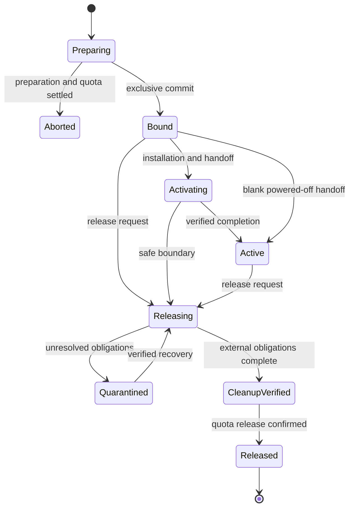

# Acceptance tests

Required validation for the [machine lifecycle contract](README.md).

Implement the following tests through Milo tenancy, IAM, entitlement, and quota.
No implementation tests exist yet.

The end-to-end scenario uses two consumer projects competing for one provider
machine. One claim binds while the other remains pending. The winner installs,
reinstalls, and releases; the waiting consumer acquires the machine only after
cleanup. The simulator persists state independently of Fleet. Tests restart each
component, lose responses, and delay old workers to verify recovery.

- **Projects reuse object names in `default`; clients forge context or recreate
  projects/namespaces:** Isolate CRUD, list/watch, caches, and status; reject
  forged context and stale UID work.
- **Consumer admin lacks source use; two local principals have different
  grants:** Deny unauthorized effects and source disclosure, including cached
  summaries and watches.
- **One profile serves multiple classes or projects:** Retain each local and
  canonical identity; keep capacity and authorization scoped to the offering.
- **Public references use names:** Accept scoped names without client-supplied
  UIDs; expose names in status references. Retain resolved UIDs privately and
  reject attempts to supply UIDs in Fleet reference fields.
- **Consumer copies a named profile or reuses its name:** Require the custom
  path or protected publication provenance; reject lifetime substitution.
- **Provider recreates an allowed profile under the same name:** Block use until
  the provider removes and re-adds the entry in separate accepted class revisions,
  or selects a new name. An unrelated class edit cannot renew approval.
- **Custom profiles are disabled, unsupported, or temporarily unverifiable:**
  Report the specific admission result without reserving capacity or purchasing.
- **Profiles require physical cores, per-device GPU memory, or multiple disks:**
  Reject aggregate-only matches, double-counted devices, and missing or stale
  observations. Distinguish supported configurations from available supply.
- **Profile deletion, catalog changes, or hardware drift:** Order pending
  admission against invalidation; retain active requirements, assigned hardware,
  exact execution inputs, and cleanup targets.
- **Inactive entitlement or suspension:** Block new work while preserving
  authorized cleanup.
- **Two projects, overlapping classes, or duplicate enrollment target one
  asset:** Commit one binding; reject duplicate supply.
- **Replicas reconcile one claim after lost quota/binding responses:** Recover
  one hold and one machine; repair status from private state.
- **Revocation, deletion, suspension, quota loss, or policy withdrawal races
  binding:** Enforce the defined admission order through real integrations.
- **Quota denial or interrupted preparation:** Produce no effects; settle the
  same hold before aborting.
- **Existing project networks, namespace reuse, or a forged foreign reference:**
  Check network-use permission in the referenced namespace, pin exact lifetimes,
  and reject substitution or cross-project access.
- **Multiple interfaces or an unsupported address family:** Report results per
  interface; withhold network readiness until every requested requirement passes.
- **Provider IP without Galactic membership, or preparation without programming:**
  Do not report the interface attached merely because an address or backing
  object exists.
- **Lost network responses:** Recover the same assignments without allocating twice.
- **Assignment drift or stale network evidence during installation:** Block
  affected effects and readiness; never replace retained execution inputs.
- **Reinstall, network deletion, or release with a reserved address:** Preserve
  valid assignments through reinstall; verify old-binding detachment and address
  obligations before reuse. Machine release must preserve the shared Network.
- **Consumer lists requested and allocated machines:** Return its claims with
  pending or bound state and sanitized allocation details, without requiring
  access to provider Machines.
- **Claim omits the initial Installation:** Allow prepared, powered-off handoff
  once the other gates pass; omit current installation status. Admit a later
  first Installation against the same claim with predecessor `None`.
- **Consumer reinstalls an allocated machine:** Create a new Installation with
  the same claim name and its current installation revision. Preserve the binding
  and `initialInstallationRef`; report disruptive work through claim readiness
  and the new request's status. Reject edits to an existing Installation's spec.
- **Initial Installation or network input arrives after the claim:** Resolve
  dependencies without deadlock or premature activation. Admit only the retained
  initial request while its gate remains unsatisfied.
- **Two first installs use `None`, or two reinstalls share a revision:** Admit
  one operation. Consume the precondition and retain exact inputs atomically
  before dispatch; reject the loser with `InstallationRevisionConflict` even
  when public status has not caught up.
- **Reinstall uses a stale or foreign revision, or a claim name is recreated:**
  Reject the precondition with no effects. Internal claim and allocation identity
  prevent a revision from moving to another lifetime. Revision possession does
  not bypass permissions.
- **Admission succeeds but its response is lost:** Recover the same operation
  for the same retained request identity without consuming another revision.
  Recreating its name cannot inherit that operation.
- **Installation succeeds:** Publish a fresh claim revision and the resulting
  Installation name. Record that revision on the completed Installation as a
  historical result; subsequent work changes only the claim's current revision.
- **Cancellation or failure proves the prior state is unchanged:** Issue a fresh
  revision only after fencing work and verifying no effects. Keep the initial
  handoff gate; never restore a consumed revision or reset to `None`.
- **Inputs change or dependency names recur after resolution:** Execute only
  retained identities and content; public names cannot retarget admitted work.
- **Executor response disappears or a retired worker returns after reuse:**
  Recover the existing operation; reject stale effects and callbacks.
- **Installation fails after partial effects:** Retain a dirty/unknown
  incarnation and withhold a usable revision; resume recovery or release.
- **Consumer claim, namespace, class, or project disappears during work:**
  Preserve reservations, operations, and required inputs in the provider project;
  complete cleanup or quarantine without reconstructing authority from status.
- **Provider retirement races preparation, quota acquisition, binding, or operation
  admission:** Order the transition. Either reject new work or retain its
  obligations before retirement can proceed.
- **Provider project or namespace deletion, record deletion, or finalizer removal
  is requested while obligations remain:** Reject bypass attempts by ordinary
  provider administrators. Keep records, artifacts, credentials, quota anchors,
  cleanup permissions, and the project API available; do not wipe active machines
  merely because retirement was requested.
- **Provider retirement encounters unknown operations, quarantine, or unsettled
  quota:** Keep the deletion guard closed. After authorized release and verified
  cleanup, retire enrollment and execution authority, satisfy history retention,
  and allow purge in the defined order. Exercise the same-project consumer case.
- **Provider API outage or forced storage loss:** Never treat absence as release.
  Restore exact identities and retained state, reconcile external executor and
  quota evidence, and reject stale work before resuming. Unresolved recovery
  blocks effects and deletion.
- **Cleanup or quota-release acknowledgment remains unknown:** Keep the machine
  unavailable.
- **Consumer deletes a completed Installation:** Preserve the OS, binding,
  initial gate, and installation revision. Reusing its name cannot replace the
  retained predecessor identity or authorize another operation.
- **Fleet, project API, simulator, or backing store restarts/restores:** Recover
  the same identities and revision consumption; verify fences before resuming
  effects. Restoring an old public revision cannot make it usable again.

## Lifecycle reference

The tests cover these reservation transitions as well as the required
[release gates](README.md#release-and-project-lifecycle).

