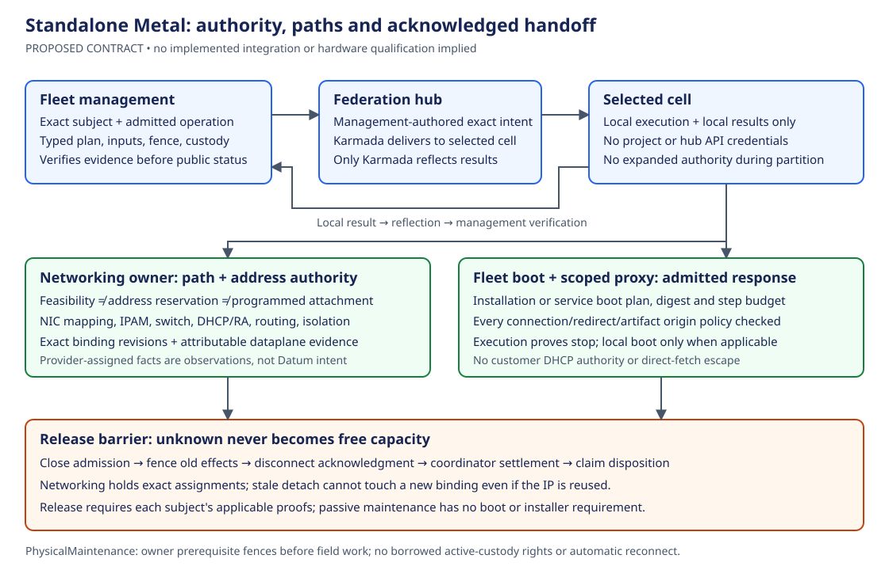

# Standalone Metal network handoff

- [Summary](#summary)
- [Motivation](#motivation)
- [Proposal](#proposal)
- [Design details](#design-details)
- [Threat partition and race matrix](#threat-partition-and-race-matrix)
- [Qualification tests](#qualification-tests)
- [Production readiness review questionnaire](#production-readiness-review-questionnaire)
- [Drawbacks and alternatives](#drawbacks-and-alternatives)
- [Infrastructure needed](#infrastructure-needed)

## Summary

Define the **proposed Fleet-to-networking owner contract** for standalone Metal:
placement feasibility, physical attachment, bounded commissioning/provisioning,
customer handoff, and acknowledged disconnect. No network integration, CRD, RPC,
provider capability, or hardware qualification described here is implemented by
this enhancement. This is a docs-only design, not production readiness evidence.

Fleet retains admitted authority and asks for paths; networking owns addresses,
attachments, switch/DHCP policy and realization. Fleet's boot service alone chooses
the admitted boot response. Neither owner can substitute for the other's evidence.
An allocation is immutable, an Installation has one immutable execution driver,
and uncertain effects retain custody rather than make capacity available.

### Sources and boundaries

Reviewed on 2026-11-14 against fetched `origin/main` at
`8ebec19513a0cbc8f219d3acae46f89ab471510b`. Read with the
[design context](../../architecture/design.md),
[machine lifecycle](../machine-lifecycle/README.md), and pinned
[provisioning source](../../proposals/fleet-management/bare-metal-provisioning.md).
These refreshed companion heads are inputs, not merged dependencies:

| Companion | Exact reviewed head | Contract retained here |
| --- | --- | --- |
| [BMC #41][bmc] | `f04e63ddd9d10cbf306daf3a0232961debd85e7f` | Installation-bound customer provisioning session; shared fencing, no independent boot authority |
| [Fleet management #51][management] | `fa07c2236801a33a58efc914b555586c8e146cc6` | Provider custody; management intent, cell-local results, Karmada reflection |
| [Profile access #58][offerings] | `a922ff1eb3275e26af6ae750a7515ddde245a754` | Retained MachineOffering contract; current action/input authorization distinct from acquisition |
| [PXE #59][pxe] | `d7ff793b03711203dbfc9fac87d43922cc649b6f` | ManagedImage/DelegatedPXE; immutable ProviderAutomatic/CustomerRedfish driver; stop and local-disk evidence |

The linked source files use those exact heads. Their older embedded companion
citations do not replace the refreshed heads above. This branch imports none of
their proposal files. Earlier illustrative provider MachineClass policy and
direct cell-to-hub reporting are not target contracts; no compatibility layer is
proposed. MachineOffering owns capabilities, MachineClass is a published view,
and MachineProfile contains hardware requirements, not network entitlement.

The pinned [NSO claim][nso-claim], [interface][nso-interface], and
[Network][nso-network] schemas inform address-family, claim binding, namespace,
MTU and readiness semantics. Their Netns/Hypervisor attachment vocabulary does
not establish a qualified physical-server attachment. The lifecycle's historical
[cloud VPC attachment reference][cloud-attachment] returned HTTP 404 during this
review; its contents were not verified. A reachable, owner-approved realization
contract is a prerequisite, not an assumed implementation.

Allocation and execution architects own reservation, admission, predecessor
consumption and driver sequencing. Future inventory-trust, provider-fulfillment,
release and deployment proposals own their respective implementations. This
proposal defines the inputs/results they must exchange, not a second allocator,
inventory verifier, provider executor, release controller or deployment topology.
Managed nodes, clusters, node services, guest-agent lifecycle and backward
compatibility are out of scope.

## Motivation

A claim with addresses is not evidence that a particular physical NIC carries
them. A successful HTTPS probe is not permission to access a private endpoint.
A deleted attachment object does not prove that switch state, DHCP leases, a
running installer or an old address assignment stopped having effects.

### Goals

- Reject impossible placement before allocation without pretending to reserve IPs.
- Bind all materialized work and evidence to admitted allocation/operation inputs.
- Separate commissioning, provisioning and customer paths, even on a shared NIC.
- Preserve provider-assigned observations without making Fleet an IPAM writer.
- Require verifiable effect barriers before handoff, detach, address reuse or release.
- Remain recoverable across project deletion, network outages and federation delay.

### Non-goals

This design neither creates customer Networks nor selects switches, VRFs, VLANs,
routes, DHCP implementations, DNS services or service exposure policy. Networking
chooses those implementations. There is no promise of arbitrary private-origin
connectivity, arbitrary customer DHCP, permanent network-boot runtime, or universal
hardware support. Unsupported configurations fail explicitly rather than falling
back to a shared provisioning segment or direct Internet access.

## Proposal

A customer supplies logical slot-to-Network intent on a Machine. Allocation
admission captures exact authorized inputs after a side-effect-free feasibility
check. After allocation, the coordinator admits network materialization and, if
requested, an Installation. Customer network preparation can finish without an
installed guest; network realization must not wait for Installation success.

Fleet requests isolated paths and consumes typed evidence. The networking owner
materializes address claims and physical attachments and returns attribution,
revision and validity, not a generic `network ready` boolean. Fleet validates the
evidence against its retained operation before boot, handoff or release decisions.

### User stories

1. Allocate without installing: prove the admitted physical attachment, expose
   only customer address/status facts, and leave provisioning disabled.
2. Install a managed image: prepare isolated boot/artifact paths, serve the exact
   admitted image workflow, stop/fence the installer, revoke provisioning and
   activate the customer path only when the shared coordinator permits it.
3. Delegate PXE: reach an authorized public or private customer endpoint through
   a scoped proxy without customer DHCP access or provider credentials.
4. Delete the consumer project mid-install: retain service-owned network custody,
   fence all old paths, detach exact bindings, and withhold reuse until verified.

## Design details

### Ownership and concrete records

The names in this section are **new proposed internal contract records**, not
existing public resources. Transport/API group/storage decisions belong to the
respective owners. Public name references are resolved under current permission;
protected records retain exact project and object incarnations across API domains.
Namespace names or Kubernetes UIDs alone are not cross-control-plane identities.

| Record and scope | Sole authoritative writer | Retained contents and lifetime |
| --- | --- | --- |
| `NetworkFeasibility` in networking decision storage | Networking admission service | Query digest, exact Network/policy identities, candidates, supported families/path modes, expiry; no reservation/effects |
| `NetworkHandoffIntent` in protected hub namespace | Fleet management handoff controller | Admission reference, exact target and immutable request digest, selected cell, permitted steps, validity; retained through custody settlement |
| `NetworkRequestReceipt` in networking durable storage | Networking owner | Idempotency binding, accepted preconditions, claim/attachment identities, current step, highest accepted fence and terminal evidence references |
| `PhysicalNetworkObservation` in protected provider/network evidence storage | Qualified observation adapter; networking validates use | Exact asset/NIC/link and provider facts, observer provenance, revision and validity; no desired network policy |
| `NetworkBinding` in networking custody storage | Networking owner | Tagged subject/asset/slot-to-claim/interface binding, exact network/routing domain, address identities, physical realization revisions and release disposition |
| `NetworkTransitionResult` in selected cell | Selected-cell adapter, carrying attributable networking-owner evidence | Request/step result and evidence bundle, not authority to allocate or edit hub status |
| Reflected handoff status in hub | Karmada only | Selected-cell result copied without promoting its trust |
| Operation journal, cleanup obligation and public projection | Fleet lifecycle coordinator / its status projector | Accepted evidence, original binding and cleanup scope; project deletion cannot garbage-collect these obligations |

Networking alone writes NSO claim intent through its integration adapter in this
contract; NSO/IPAM and networking realizers retain their existing status/config
ownership. Fleet sends requests, never writes claim status, routes, leases, switch
ports or an IPAM allocation. A provider adapter observes externally assigned
facts; it cannot reinterpret those observations as Datum routing policy. These
records do not add a parallel public attachment API or duplicate the immutable
MachineAllocation.

Before accepting materialization, networking durably records a cleanup custodian,
the provider-owned obligation reference and retained exact inputs. Its internal
binding must survive consumer Network, namespace, Machine and project deletion.
If underlying claim deletion would auto-return addresses, the networking owner
must interlock that deletion with custody; Fleet finalizers alone cannot provide
this guarantee. An owner lacking this interlock is not qualified for this handoff.

### Request envelope and admission binding

Every effectful request carries the following immutable envelope, retained by
Fleet **before** dispatch and by networking **before** effects:

| Field | Required meaning |
| --- | --- |
| `requestID`, `requestDigest`, `stepID`, `idempotencyKey` | Exact canonical request and admitted step; same key with different digest returns `IdempotencyConflict` |
| `authorityRef`, `authorityDigest`, `validFrom`, `validUntil`, `stepBudget` | Verifiable retained coordinator admission, allowed operation/steps and time bound; possession of names is not authority |
| `subject` | Tagged `Allocation`, `Preparation` or `AdoptedCustody` from #60/#62; not an optional allocation field with ambiguous meaning |
| Allocation subject | Provider/consumer project incarnations, Machine, MachineAllocation, MachineCapacity and Device (or retained provider supply identity), accepted offering contract digest |
| Preparation subject | Exact custody UID/epoch, enrollment UID/epoch, Device/supply and canonical asset; admitted operation, commissioning policy and shared asset slot. Allocation Disabled and no conflicting allocation/adoption/maintenance/release/domain hold; no consumer identity or connectivity |
| AdoptedCustody subject | Exact original custody UID, trusted resolution revision and enrollment/asset, release case and approved ownership/cleanup transition; unresolved identity cannot authorize network mutations |
| `installationBinding` | Required for customer Installation provisioning: exact Installation, source mode, immutable driver, operation identity, retained predecessor consumption and optional bound management-session identity. Forbidden for non-consumer subjects |
| `serviceBinding` | Required for Commissioning or ServiceCleanup: immutable service plan, explicit action/input authority, custody/release obligation, exact Network inputs, finite steps and selected executor; no fabricated Installation predecessor |
| `target` | Selected cell incarnation/location, physical mapping revision and slot map; cell cannot choose another asset or network |
| `networkInputs` | Exact Network/namespace/project incarnations, families in priority order, extra address classes, authorized path/origin policy and their revisions |
| `fence`, `expectedBindingRevision`, `expectedPreviousStep` | Shared asset-operation domain: restore, asset/enrollment/custody epochs, tagged subject, operation sequence and executor generation; compare-and-set preconditions, never a cell-local counter |
| `cleanupObligationRef`, `disposition` | Durable owner and obligations; per-claim `Delete` or `Retain`, captured before effects |

The management coordinator is the issuer of runtime authority. Networking checks
the issuer, audience, request digest, target, fence, validity, allowed steps and
resource-use authorization evidence, including any explicit suspension. Invalid
authority is `Denied`; unavailable validation is `Unknown`. Networking's
allocation/fence checks consume the coordinator's contract; they do not allocate
or consume the Installation predecessor themselves.

For an allocated Machine without Installation, materialization still has an
admitted allocation operation; it cannot borrow an installation-shaped null ID.
For CustomerRedfish, the provisioning session attaches to the already admitted
Installation and its fence/step budget. It cannot change driver, endpoint or NIC,
mint network authority, extend a lease or start a second provisioning workflow.
ProviderAutomatic and CustomerRedfish use the same network request contract.

### Non-consumer service paths

The proposed `custody-subjects-v1` join consumes #60's atomic custody/asset-slot
admission and #62's operation envelope, not a networking-created preparation ID.
New enrolled commissioning requires pre-boot witnessed mapping and read-only
trust evidence, current service/input gates and a qualified commissioning plan.
It does not require the boot-verification result it is intended to produce.
L1 commits the service operation before `Materialize`; networking's prepared
receipt is a prerequisite for the later boot step, not for L1 itself.

An authorized adopted cleanup keeps its original occupied custody identity.
#63 first resolves exact hardware and all intersecting holds without effects;
#65 then supplies the separately authorized transition and closure inventory.
Networking records old bindings/claims from prior-owner histories, including
bindings not created by Fleet. A missing local receipt is not an empty path set.
Prior-owner authority and effective revocation/disposition receipts are required;
unreachable or unidentifiable paths block settlement. Networking does not take
ownership of another authority's configuration merely by importing its facts.

Both paths use service-owned isolated Networks and scoped endpoints, never a
customer route or a consumer management session. ServiceCleanup may also use an
Allocation subject after its release closure. Exact service image/recipe, origins,
credentials, allowed targets and cleanup obligation are retained before effects.
Only the networking owner creates a **new binding incarnation** after predecessor
paths are fenced; no old customer binding is relabeled Commissioning. Every owner
receipt, boot capability and proxy step binds the tagged subject and full fence.
The boot service validates the service plan instead of requiring a nonexistent
Installation, while preserving one-use steps and the same origin/egress controls.

On completion or cancellation, stop the verifier/cleaner through #62, revoke and
drain boot/proxy sessions, fence every service path and acknowledge per-claim
Delete/Retain disposition. #65 accepts these receipts for preparation clearance
or adopted settlement; networking cannot clear occupancy or publish eligibility.
Its restored receipts/tombstones must reconcile custody UID, resolution history,
binding generations and current lineage before replay or new materialization.
Losing the response retains unknown custody, not permission to recreate a binding.

### Physical maintenance dependency barriers

The proposed `physical-maintenance-v1` path does not add a network materialization
mode. A `PhysicalMaintenance(custodyUID)` field procedure uses the same #60/#62
ledger and cell journal, but may not call Materialize as if it were Commissioning
or ServiceCleanup. A passive panel needs no NetworkBinding, image or bootstrap.
The materialization subject union above remains intentionally narrower than the
execution subject union. Do not invent an empty Allocation to cross this boundary.

Before maintenance L1, networking supplies an attributable, revisioned impact
inventory for the exact old/new physical graph, ports/Cables and connection
incarnations. It either positively attests no affected active connections or
identifies every existing binding, authority owner and required barrier. An empty
Fleet claim list cannot prove no external/active connection exists. Networking
and inventory interlock dependency additions/use against this graph revision
through registered #60 gates; an untracked writer makes the workflow unqualified.

Each necessary disconnect/isolation is separately authorized and admitted under
the affected binding's existing Allocation/AdoptedCustody or qualified owner
authority. Retain current active-use/disruption consent or an independently
authorized termination decision. Neither panel ownership nor its field permit
grants rights over connected servers, switches, ports or tenants. Networking
alone performs configuration, returns effective data-plane/old-writer fences
including existing flows, and protects exact address/claim dispositions. Existing
opaque external ownership without a qualified fence contract blocks the move.

Before L1 retain an owner-signed prerequisite receipt bound to transition request,
target/dependency identities, graph/mapping revision, exact binding/claim IDs,
owner authorization and operation fences, effective cutoff, no-reuse/disposition
obligations, gate epochs, validity and restore lineage. Required owner barriers
must be effective and held against new use; their expected closed ordinary-effect
gates are predicates, not a bypass of current maintenance safety gates. #60 L1
checks this frozen set atomically with its inventory closure and target custody.
Any dependency change closes the relevant gate before becoming effective and
blocks further field starts/renewals; already-started work still needs #62 cessation.

After field cessation and new physical verification, networking revalidates the
exact mapping and current active-custody permissions before separately admitting
resumption or replacement bindings. Maintenance L5/R2 never reopens a connection
or transfers its authority. Retained connections/addresses are not deleted merely
because the panel moved. The barrier/receipt inventory and permanent stale-request
rejection survive retirement and restore; missing receipts retain Unknown and
reconcile with the owner's journal before reuse. #65 consumes these scoped
dispositions, not a fictional passive-device network disconnect acknowledgment.

### Fleet to networking API

These are semantic operations, not a claim that RPC routes exist. Requests and
responses must be schema-validated; missing evidence is never default success.
All effectful operations use the envelope above and exact binding identities.

| Operation | Inputs beyond envelope | Required response/effects |
| --- | --- | --- |
| `EvaluateFeasibility` | Caller-authorized Network identities, candidate location/cell and profile slots, families, address classes, boot mode, endpoint/private path needs, policy revisions | `Feasible`, `Infeasible(reason)` or `Unknown`; decision digest and expiry; no claim, address reservation, switch write or endpoint fetch |
| `Materialize` | Fresh feasibility reference, exact physical mapping, requested path inventory and serviceBinding when applicable | Durable receipt; claim/interface/address identities and staged binding revision. Reject invalid admission before any effect. Preparation permits only Commissioning; AdoptedCustody only authorized ServiceCleanup |
| `SetPhase` | Desired `Commissioning`, `ServiceCleanup`, `Provisioning`, `Customer` or `Isolated`; expected current revision; exact permitted path set | Transition receipt and independently reported conditions; a phase label alone proves nothing |
| `ProbePaths` | Exact existing binding, source vantage, destination/origin policy and expected realization revision | Scoped reachability/deny-test evidence; cannot create routes or expand allowed destinations |
| `FenceAndDisconnect` | Target binding/claim incarnations, old fence, successor fence admitted by coordinator, all path classes to revoke | Durable deny barrier then attributable disconnect acknowledgment; no address release implied |
| `DisposeClaims` | Verified disconnect acknowledgment and coordinator settlement authorization, exact claims and disposition | `DeletedAndReturned` or `RetainedDetached` per claim with networking/IPAM acknowledgment; never delete the shared Network/VPC |
| `GetRequest` | Exact request identity and caller capability | Durable receipt, observed effects and result revision, or `Unknown`; missing receipt is not proof effects did not occur |

`EvaluateFeasibility` is advisory and bounded. It checks location capabilities,
network membership permission, family support, approved endpoint/private path
possibility, physical mode and isolation requirements. It may report current
capacity but reserves none. `Feasible` cannot satisfy `Prepared`, boot admission,
or customer readiness. Allocation admission rechecks its expiry and input digest;
networking rechecks actual feasibility at materialization. Address exhaustion
after allocation becomes `AddressCapacityUnavailable`, retains the allocation and
permits bounded retry of the same request, not reassignment to another machine.

No guest is required for claim allocation or attachment preparation. `Prepared`
means the networking owner staged the specified attachment; `Programmed` proves
the specified addresses and policy in the selected dataplane. Unsupported physical
mode is `PhysicalAttachmentUnsupported`, not a fabricated Netns attachment.
Unsupported family is `AddressFamilyNotCarried`; missing location support is
`NetworkNotAvailableInLocation`. A recreated Network yields `IdentityMismatch`,
not an implicit new request against its reused name.

#### Request lifecycle and conflict semantics

An accepted request progresses through `Accepted`, `Applying`, and `Satisfied`;
`Rejected` means no effects were admitted. Failures after acceptance are
`Blocked` with known partial-effect inventory or `OutcomeUnknown`, never a
no-effect rejection. Every response contains request/digest, result revision,
known effects, unmet conditions and retry classification. A timeout is unknown
until the same durable receipt is recovered. No new idempotency key may be used
to conceal an unknown predecessor.

Networking serializes effects on a binding with compare-and-set revisions and
the coordinator fence. Duplicate delivery returns the same receipt. A delayed
old step returns `StaleFence` or `RevisionConflict` without effects. The networking
owner retains tombstones/high-water fences across restart and address reuse;
restoration must not roll them back. Cancellation is a request to fence and
settle, not receipt deletion. A failed multi-port transition reports each partial
effect and blocks aggregate completion until all required ports settle.

### Physical NIC mapping and address provenance

Each logical profile slot resolves to an immutable operation input containing:
asset/capacity identity, inventory and verification revisions, NIC stable hardware
identifier (serial/PCI path where qualified), physical port, permanent MAC,
observed boot MAC, firmware boot selector, link peer and peer-port identity,
networking attachment identity and mapping evidence validity. Guest interface
name is a generated installation input, never a physical identity. MAC alone,
LLDP alone or a customer-supplied OS name is insufficient proof.

The inventory trust owner supplies authenticated mapping evidence; networking
corroborates the physical attachment point. Mismatch, ambiguous mapping, NIC
replacement, cable/port move or expired verification blocks effects with
`PhysicalMappingUnverified` or `PhysicalMappingChanged`. Fleet cannot pick the
first remaining NIC. Bond/LAG, SR-IOV, shared uplink and multi-port hardware require
an explicitly qualified mapping and fencing unit; unsupported combinations fail
feasibility. Every externally usable NIC, including unrequested ports, must be
accounted for and isolated or explicitly retained in the authorized path set.

| Address or link datum | Record and authority | Interpretation |
| --- | --- | --- |
| Datum-assigned address | Networking claim/interface and IPAM assignment identity/revision | Desired allocation managed only by networking; include family, CIDR, primary order and external-address class |
| Provider-assigned uplink/address | Observation with provider, external assignment ID, asset/NIC, address/prefix, source/time/revision and validity | External fact, not a free Datum pool address and not a Fleet-configurable value |
| Provider gateway/peer | Observation of gateway, peer address/ASN, uplink and routing-domain identity | Fact requiring networking validation; does not authorize a BGP peer or route |
| Datum routes, isolation and exposure | Networking policy identity/revision and realization evidence | Intent owned by networking/Galactic, never derived as authority from a provider observation |
| MTU, gateway and DNS supplied to installer | Validated networking configuration digest, source references and availability | Unknown fields remain unknown; no guessed gateway, default resolver or MAC |

Fleet's installation renderer may translate the accepted networking configuration
into guest syntax, but cannot choose different addresses, routes or DNS policy.
It retains the source configuration digest and reports translation failures to
the execution owner; rendering is not an additional network intent writer.

An external assignment needs an owner-approved exclusive-use/hold contract before
activation. Conflicts between provider facts and Datum intent report
`ProviderAssignmentConflict` and quarantine the affected binding. Reconciliation
does not overwrite either owner or import provider space into IPAM. Release asks
the provider-fulfillment owner to prove external withdrawal/no-reuse obligations;
Fleet never claims that deleting a Datum claim released a provider address.

### Commissioning provisioning and customer transitions

| Phase | Allowed path | Entry and exit gates |
| --- | --- | --- |
| `Isolated` | Only separately authorized provider management; all workload paths denied | Default safe state; a controller restart alone does not prove isolation |
| `Commissioning` | Approved verifier/installer bootstrap endpoints, no customer network | Explicit preparation authority, no active allocation; exit requires verifier stopped, bootstrap revoked and isolation acknowledged |
| `ServiceCleanup` | Approved service cleaner/verification endpoints only, no customer network | Exact release obligation and serviceBinding on Allocation or resolved AdoptedCustody, predecessor paths fenced; exit requires cleaner settlement and its own disconnect/dispositions |
| `Provisioning` | Fleet first-boot endpoint and scoped installer/artifact proxy/callback destinations | Admitted Installation, current NIC mapping, boot/path evidence and driver binding; customer runtime path staged but inactive |
| `Customer` | Exactly the accepted customer Networks, families and exposure policy | Provisioning revoked, installer stopped/fenced by execution owner, and coordinator-authorized transition; no continuing PXE authority |

A shared physical NIC requires a networking-qualified break-before-make transition:
deny old path, flush its residual state, acknowledge isolation, then activate the
new path. Separate NICs still require complete path inventory and no forwarding
between provisioning, customer and management networks. Customer reachability
cannot become a bridge into the provisioning segment. A qualified private
installer endpoint uses a restricted provisioning-proxy path into the authorized
customer Network; it does not enable unrestricted customer runtime networking.

Reinstallation first quiesces and disconnects the old customer path under the
shared operation coordinator; only then may provisioning start. Completion
requires execution-owner stop/fence and observed local-disk boot, Fleet boot
revocation, networking provisioning disconnect and fresh customer programming
evidence. Execution owns the exact order of power/local-disk actions within those
constraints. A customer callback, DHCP lease, Job exit or network probe is not
installer shutdown or proof of a correctly installed OS.

The Machine without an Installation may enter `Customer` after materialization
and required gates without inventing an install. Its absence of provisioning
requires an authoritative empty boot/session inventory and networking path
inventory, not merely missing local objects. An empty customer interface list is
`NotRequested` for customer connectivity only; it never bypasses provisioning
fencing, BMC segregation or unknown physical-path obligations.

### DHCP iPXE and endpoint isolation

Networking owns DHCP/relay/RA policy, boot-network isolation and path realization.
Only approved provider DHCP/RA sources may reach firmware. Customer DHCP servers,
relay destinations or DHCP options cannot be injected onto shared networks.
Networking binds ingress port/attachment and machine boot identity; Fleet boot
service validates the admitted Installation or exact serviceBinding, fence, expiry, request digest and
one-time step before serving a response. A guessed/spoofed MAC is not enough.
Without valid admitted authority it returns only a qualified local-boot response
or denies boot; no customer fallback or persistent network-boot loop is allowed.

DHCP may advertise Fleet's first-hop boot endpoint but cannot choose a customer
installer. Fleet boot owns the response digest and allowed boot steps. Networking
reports path/isolation evidence, not which script to serve. Firmware with only
unauthenticated initial bootstrap requires physically enforced port binding and
a qualified immutable first-stage chain; otherwise that hardware/firmware is
unsupported. Downloads after that stage require the admitted HTTPS policy.

#### Public and private origins

An admitted `OriginPolicy` contains exact HTTPS scheme/host/port, permitted path
prefixes, method set, trust-bundle digest, credential capability, redirect policy,
allowed destination ranges, resolver identity/view, routing-domain/Network
identity, and whether private destinations are authorized. It is part of the
retained Installation input. A URL alone grants no private reachability. Secret
values stay out of public status and hub intent; scoped capabilities are redeemed
through an approved secret-delivery path, never by giving cells project clients.

| Enforcement point | Mandatory behavior |
| --- | --- |
| Management admission | Authorize endpoint, Network use, private origin grant and secret use; retain exact policy/digests; reject userinfo, unsupported schemes and ambiguous URL encodings |
| Cell proxy, every connection | Resolve through admitted resolver/view; normalize IPv4/IPv6 and mapped forms; validate destination against policy, pin validated address for that connection, verify TLS hostname/trust; no validate-then-reresolve race |
| DNS changes | Validate all selectable answers and CNAME resolution under the same policy on every new connection; stale/unavailable resolution is unknown; prohibited answers deny, never fall back to another resolver |
| Redirects | Deny by default; when explicitly admitted, revalidate every hop against exact allowed origins/path policy and a bounded hop count; never forward credentials across origins or downgrade HTTPS |
| Artifact fetch | Restrict kernel, initrd, script includes and installer downloads, not just initial iPXE URL; approved origin proxy with scoped URLs and connection enforcement |
| Dataplane | Deny direct firmware/installer egress outside Fleet boot/proxy/callback paths; isolate other tenants and provider management even if a script contains raw IPs or arbitrary network commands |

Private origin grants bind a customer routing domain and explicit destination set.
Loopback, link-local/metadata, multicast, control-plane/BMC/provider management
and another tenant's addresses remain prohibited even if customer DNS returns
them. Legitimate private destinations are not banned wholesale: they require a
networking-owned route and explicit authorization from the selected proxy vantage.
Overlapping tenant CIDRs are disambiguated by Network incarnation/routing domain,
not by IP address. A public endpoint resolving to private space is denied unless
that exact private grant was admitted; the cell cannot broaden the policy.

The origin allowlist is immutable but DNS answers may change within its admitted
destination policy; each connection records answer set, chosen address and
resolution time. A stricter pinned-address contract is allowed when admitted.
Managed artifacts require exact content digests. For delegated dynamic scripts,
the proxy retains response digest, origin and request identity before serving any
bytes; retries of that boot step use the retained response, not newly fetched
script bytes. Artifacts must match declared digests where supplied, otherwise
evidence establishes origin/response provenance only, not immutable customer OS
contents. Script parsing is not a security boundary: if indirect fetches cannot
be constrained by proxy plus dataplane enforcement, reject the workflow as
`ArtifactOriginUnsupported`. No token or credential is embedded in public audit
content; machine-facing capabilities are short-lived and allocation/step scoped.

`ProbePaths` records source attachment/proxy identity, routing domain, destination
origin/resolved address, protocol, TLS identity, result and policy revision. It
proves only that path at that time, never customer application or OS readiness.
No probe sends credentials before TLS/policy validation. Probes are effects and
require admitted scope; preallocation feasibility never probes customer URLs.

### Evidence freshness and federation

Each evidence item contains issuer and authenticated provenance, exact subject,
request/digest/step, operation/fence, Installation when applicable, selected cell,
binding/claim/address incarnations, physical mapping revision, policy and
realization revisions, observed generation, monotonic result revision,
`observedAt`, `validUntil`, and measured or authoritative result with reason.
The issuer must distinguish observation from desired configuration and say which
paths/ports/address families were actually checked.

Required independent predicates are `BindingAccepted`, `AddressesAssigned`,
`PhysicalMappingVerified`, `IsolationEnforced`, `PathPrepared`,
`AddressesProgrammed`, `EndpointReachable` when needed, and for teardown
`ProvisioningDisconnected`/`CustomerDisconnected`. Fleet adds boot-service and
execution-owner evidence; networking cannot attest that an installer stopped.
Each predicate is True/False/Unknown with reason, not inferred from another one.

Management retains a qualification policy with finite `maxObservationAge`,
`maxClockSkew`, authority TTL and required predicate set for each transition.
Qualification must supply concrete tested values; unset or unbounded values deny
activation. Acceptance time must be within the item's validity and age bounds,
with skew within policy, and all input/result revisions must match the admitted
transition. A new observation cannot refresh an older dataplane result by changing
only its timestamp. Policy, address, NIC or realization drift invalidates affected
predicates immediately; silent refresh to new inputs is prohibited. A changed
input requires coordinator re-admission of an exact successor step/revision after
any old effects settle, never mutation of allocation identity or Installation.

Management writes intent to the hub; federation selects **one exact cell**;
that cell writes only local results; Karmada reflects them; management validates
issuer, selected-cell identity, retained binding, fence, revision and freshness
before public projection. Cells have no project or hub API credentials. Networking
central intent may be prepared by management-side integrations and delivered to
networking's cell realizer; a cell uses only local scoped owner APIs/capabilities.
Cross-owner credentials and transport must be established before qualification.

A reflected success with wrong cell, old incarnation, future timestamp, stale
revision or unverifiable issuer is rejected and audited. Transport authenticity
alone is not dataplane proof. Lost reflection is `EvidenceUnavailable`; expired
evidence is `EvidenceStale`; conflicting valid issuer results are
`EvidenceConflict` and require reconciliation. None may advance readiness.
Known policy denial yields False, accepted incomplete work is Pending, and
uncertain execution/observation is Unknown. Public summaries omit provider ports,
management addresses, secrets and unrelated tenant details.

During a hub/cell partition, no new effects may start beyond retained scope,
step budget and authority validity. Local enforcement must expire provisioning
and proxy capabilities and prevent queued stale work even after restart. Expiry
does not prove shutdown of a remote installer. Existing customer connectivity is
not automatically torn down merely because observation freshness expires;
readiness becomes Unknown and transitions block. Explicit revocation uses the
disconnect protocol. Safety fencing may continue only under retained cleanup
authority, not an open-ended cell-local renewal.

### Disconnect acknowledgment and release interface

The lifecycle/release owner closes new admission and records a durable obligation
before asking networking to disconnect. Release and installation cannot obtain
independent execution authority. The coordinator advances its shared fence only
under its takeover protocol; networking must reject all old effect paths before
acknowledging the barrier. If any path cannot be fenced, custody remains occupied.

`DisconnectAcknowledgment` must identify the exact tagged subject, original request,
binding and claim incarnations, old and successor fences, all physical ports,
network/routing-domain identities, addressed assignments and realization revision.
It contains separately attributable results for:

1. Durable rejection of old/queued/replayed work at every networking writer and
   downstream enforcement point, including restored controllers.
2. Provisioning and/or customer port/attachment disablement as requested, DHCP
   and relay/RA authorization withdrawal, and suppression of old boot paths.
3. Route/advertisement/translation withdrawal, neighbor and flow-state cleanup,
   or a qualified isolation barrier proving residual state cannot deliver traffic.
4. Proxy capability revocation and termination of active streams/connections;
   credential/session TTL alone is not sufficient acknowledgment.
5. Dataplane readback or qualified independent verification, plus address hold
   state and the networking owner's no-reuse barrier identity.

Fleet separately requires boot-service revocation, gateway/session revocation,
execution stop/fence and provider cleaning evidence from their owners. Networking
acknowledgment is necessary, not sufficient, for capacity release. Deleting API
objects, lease expiry, a switch command returning success, or a timeout is not
this acknowledgment. For unreachable hardware, a qualified upstream isolation
barrier may prove networking disconnect but cannot prove disk cleaning or remote
installer settlement.

After the coordinator verifies required settlement evidence, it admits
`DisposeClaims`. `Delete` returns Datum assignments only after networking/IPAM
records return against the exact held assignment identities. `Retain` preserves
the addresses/interface in a detached owner record; a successor must obtain
fresh permission and explicit exact-identity adoption, never inherit by name.
Retain does not retain physical attachment or let an old operation reactivate it.
Provider-assigned facts additionally need provider-owner settlement evidence.

Acknowledgments are time-bounded observations until committed as durable
settlement barriers. Networking keeps an irreversible tombstone for the old
binding/fence and verifies its no-reuse barrier atomically with address return or
retention. A later attachment gets a new binding/assignment incarnation. A stale
detach for a reused IP fails identity/fence preconditions; it must never target
the current owner by address alone. Missing tombstones after backup restore block
reuse pending reconciliation; stale success cannot serve as a new acknowledgment.

If any obligation is unknown, the subject remains in custody/quarantine. The
release owner decides capacity availability only after all obligations settle.
The networking owner exposes per-claim progress so completed work need not be
repeated. Consumer deletion, Network deletion, offering withdrawal or loss of
customer permission cannot delete custody or prevent retained service-authorized
cleanup. They do prevent new customer activation absent fresh authorization.

## Threat partition and race matrix

| Scenario | Required defense and evidence | Failure/custody behavior |
| --- | --- | --- |
| IP reused, delayed old detach arrives | Binding + claim + assignment incarnation and fence CAS; old-binding tombstone | `StaleFence`/`IdentityMismatch`, no new-owner dataplane writes |
| Wrong NIC, moved cable, spoofed boot MAC | Authenticated mapping plus attachment-port corroboration; verify all external NICs | Block boot/activation; `PhysicalMappingChanged`; no first-NIC fallback |
| Two tenants use overlapping CIDRs | Routing-domain/Network identity in every route, proxy and probe | Deny cross-tenant resolution/reachability; unknown mapping keeps isolation |
| Release races an Installation or customer reset | Shared admission reservation/fence; revoke session and queued boot/network steps | No independent release reset; unknown installer retains custody |
| DNS rebinds public name to metadata/private target | Validate at each connect, pinned selected address, explicit private grants | Deny prohibited answer before credentials or connection |
| Redirect or nested artifact escapes origin | Per-hop proxy validation plus dataplane egress deny | `EndpointDenied`/`ArtifactOriginUnsupported`; never direct-fetch fallback |
| Mutable delegated script changes on retry | Persist served bytes/digest per admitted boot step | Replay retained bytes or block; no silent new installer |
| Hub/cell or networking owner partition | Bounded authority, local capability expiry, reflected evidence validity | No new readiness/release; customer path may persist; provisioning outcome unknown |
| Disconnect response lost after effect | Recover same durable receipt and retained barrier, no blind re-create | `OutcomeUnknown` until owner evidence recovered |
| Only half of multi-NIC attachment programs | Per-port state, deny-before-activate and aggregate required predicates | Block handoff; retain known partial effects for cleanup |
| Consumer/Network deleted during cleanup | Service-owned obligation and IPAM return interlock outside consumer GC | No address return by garbage collection; cleanup survives |
| Duplicate or forged cell success | Issuer/cell/fence/input and monotonic revision verification | Reject reflection; audit; no projection or activation |
| Provider silently changes assignment/gateway | Source revision/validity and conflict detection | Invalidate affected evidence; no Fleet rewrite of provider facts |
| Old controller restored after release | Durable downstream high-water fence and binding tombstones | Fail closed on lost barrier; prohibit reuse until reconciled |
| Rogue DHCP or installer bridges networks | DHCP/RA source enforcement and physical isolation, including unrequested ports | Quarantine; revoke provisioning; callback cannot override |

## Qualification tests

These are required future tests, **not executed or passing implementation tests**.
Each fixture records all identities, admitted digest, request and evidence
revisions, effect logs and address-pool state. Synthetic contract tests cannot
qualify real switch/firmware behavior.

| ID | Test and injected fault | Required assertion |
| --- | --- | --- |
| N1 | Evaluate feasible placement, then exhaust address pool before Materialize | Evaluation created no resources; allocation unchanged; explicit exhaustion without readiness |
| N2 | Duplicate request, changed digest on same key, concurrent stale revision | Exactly one effect set; conflict before changed effects; recovered original receipt |
| N3 | Replace Network/project/cell with same name; forge consumer binding | No cross-incarnation or wrong-cell acceptance |
| N4 | Swap cable/NIC, spoof MAC, leave second port connected | No boot or customer activation until verified full path inventory |
| N5 | Program addresses but withhold physical or family programming evidence | No materialized readiness; missing required family blocks entire attachment |
| N6 | Commission an occupied asset or create/import inventory records | Admission rejects occupied preparation; import alone causes zero effects |
| N7 | Both drivers attempt same PXE step; delete/expire customer session | Only admitted driver/step runs; session expiry never implies remote shutdown |
| N8 | Reinstall and release race while installer keeps running in RAM | Revocation barrier blocks old work; no release until execution settles |
| N9 | Rebind DNS, mapped IPv6 metadata, redirect chain, alternate resolver, nested fetch | No prohibited connection/credential leak; authorized private same-tenant origin succeeds |
| N10 | Two isolated Networks with identical CIDRs and endpoint names | Proxy/probe bound to correct routing domain; cross-tenant packet tests fail |
| N11 | Change delegated script after first fetch; interrupt proxy persistence | No bytes served before durable digest/response; retry uses same bytes |
| N12 | Partition Karmada, expire evidence/authority, skew cell clock | No new readiness or expired steps; customer-path persistence not misreported as teardown |
| N13 | Lose disconnect reply and replay old detach after address reallocation | Receipt recovery; replay performs zero writes to new binding |
| N14 | Delete consumer project/Network and restart all controllers mid-cleanup | Obligations and assignment holds survive; no premature IPAM return |
| N15 | Restore pre-fence backup; leave active proxy stream/DHCP lease/flow | Missing barrier or residual reachable path blocks acknowledgment and reuse |
| N16 | Delete versus Retain, external provider assignment changes | Exact IPAM return or detached retention; provider discrepancy blocks settlement |
| N17 | No Installation; no customer interfaces; unrelated BMC isolation fails | Customer NotRequested cannot suppress required safety/cleanup predicates |
| N18 | Managed non-Talos image and delegated local-disk boot on real hardware | Packet captures/readback prove phase isolation, installer stop, boot revocation and independent customer handoff |
| N19 | First enrolled Preparation with no Machine/Allocation/Installation; delay Materialize acknowledgment | Same custody/operation/binding recovered; boot waits for prepared receipt; no customer path; complete stop/disconnect/disposal precedes release-owner clearance |
| N20 | Resolve adopted custody and authorize service cleanup; replay pre-resolution request or old tenant detach | Only exact resolved subject/current fence accepted; prior-owner paths need real evidence; no mutation by IP/name or inherited consumer authority |
| N21 | Restore before commissioning/cleanup binding existed; race new allocation with delayed service request | Reconcile owner histories/tombstones; unknown path holds custody; late request cannot touch successor binding and no missing Installation is synthesized |
| N22 | Passive panel move, first with no active connections, then with a tenant connection | Positive graph-bound no-dependency proof permits field-only admission; connected case requires the existing owner's current consent and effective prerequisite fences, never a maintenance-created consumer binding |
| N23 | Add a dependent connection, revoke a barrier, or restore before its receipt while a field permit exists | Gate-ordered dependency changes block starts/renewals; reconcile held owner and physical custody. Target R2 cannot reconnect or dispose another owner's retained claims |

Qualification covers every advertised hardware/firmware/NIC/networking backend,
IPv4/IPv6 combination and endpoint mode. Record finite freshness/clock/lease
limits and recovery timing measured under packet loss and controller restart.
Unsupported combinations stay disabled; a single successful happy path is not
qualification. Independent adversarial review and networking-owner acceptance
remain required; this proposal does not claim review sign-off.

## Production readiness review questionnaire

### How is it enabled or disabled?

Enable per qualified offering/location capability, with explicit owner API
support. Disable new admissions first; retain fencing, receipts and cleanup.
No feature flag may bypass evidence or delete obligations. Public status must
distinguish requested, staged, programmed, disconnected and unknown results.

### How are failures diagnosed and recovered?

Correlate allocation/operation, request digest, binding/claim and result revision.
Monitor pending age, stale/conflicting evidence, failed fences, retained address
holds, origin denials and stranded obligations. Keep full protected evidence;
publish redacted reasons. Recovery reads the same request and fences before
takeover; operators cannot mark readiness or force free capacity to clear alerts.

### What must restoration and scaling preserve?

Restore authority, exact inputs, networking receipts, IPAM holds, tombstones and
issuer trust together. A cache rebuild is not a new binding. Bound outstanding
requests, retained artifact size, proxy concurrency, redirect counts, capability
TTL and evidence retention through owner policy without dropping unresolved
custody. Deployment architecture and availability budgets need their own review.

## Drawbacks and alternatives

The contract adds durable cross-owner state and makes unavailable evidence an
availability cost. This is preferable to two configuration writers or reuse while
an old endpoint can still reach the machine. Reusing only NSO `Ready` is simpler
but omits operation admission, physical mapping and disconnect barriers. Letting
Fleet write switches/DHCP duplicates networking authority. Customer DHCP on a
shared segment and unrestricted direct iPXE fetches have unacceptable cross-tenant
and SSRF exposure. An exclusive isolated per-machine network is an acceptable
networking implementation, not a substitute for attribution and cleanup evidence.

## Infrastructure needed

### External networking prerequisites

1. Networking owner acceptance of this API and its durable receipt/custody schema,
   physical attachment realization, claim namespace translation and exact binding
   checks. The pinned NSO schemas alone do not supply these guarantees.
2. Networking/IPAM interlocks preventing assignment reuse and GC-driven returns
   until verified disconnect, including external assignment and Retain semantics.
3. Qualified switch/relay/DHCP/RA isolation, policy-owned routing and private-origin
   proxy reachability with dataplane readback and persistent fencing barriers.
4. Owner-authenticated freshness/revision evidence, invalidation and error contracts;
   reachable reviewed Galactic/cloud realization documentation replacing the
   inaccessible historical reference before integration decisions rely on it.

### Proposed Fleet and platform changes

1. Coordinator integration for feasibility, admitted handoff, immutable physical
   mapping/origin inputs and per-obligation settlement; no second authority.
2. Hub/cell schemas and Karmada targeting/reflection validation; scoped local
   networking capabilities and secret delivery without project/hub cell credentials.
3. Fleet boot/proxy enforcement, per-step response retention and shared BMC/PXE
   fencing; execution-owner stop/local-disk proofs consumed without duplication.
4. Inventory-trust evidence, provider-fact adapters and external withdrawal proofs
   supplied by their future owners; release-owner coordination consuming the exact
   acknowledgments above; deployment-owner failure-domain and recovery design.
5. Contract fixtures and hardware qualification for N1–N23, then separate security
   and networking-owner reviews. No implementation, rollout or sign-off is implied.

### Decisions still requiring owner agreement

Choose transport/versioning and durable custody placement; qualify physical
attachment backends and enforcement barriers; set tested finite freshness/lease
limits; define issuer trust and private-origin secret delivery; agree retention
and restoration of disconnected tombstones across owners. These are shipping
blockers, not optional defaults or permission for Fleet to fill ownership gaps.

[bmc]: https://github.com/datum-cloud/fleet/blob/f04e63ddd9d10cbf306daf3a0232961debd85e7f/docs/enhancements/secure-bmc-access.md
[management]: https://github.com/datum-cloud/fleet/blob/fa07c2236801a33a58efc914b555586c8e146cc6/docs/enhancements/fleet-management/README.md
[offerings]: https://github.com/datum-cloud/fleet/blob/a922ff1eb3275e26af6ae750a7515ddde245a754/docs/enhancements/profile-access/README.md
[pxe]: https://github.com/datum-cloud/fleet/blob/d7ff793b03711203dbfc9fac87d43922cc649b6f/docs/enhancements/pxe-installation/README.md
[nso-claim]: https://github.com/datum-cloud/network-services-operator/blob/d7fdc43f852450c447d4b7bb44b564c970582b1a/api/v1alpha/networkinterfaceclaim_types.go
[nso-interface]: https://github.com/datum-cloud/network-services-operator/blob/d7fdc43f852450c447d4b7bb44b564c970582b1a/api/v1alpha/networkinterface_types.go
[nso-network]: https://github.com/datum-cloud/network-services-operator/blob/d7fdc43f852450c447d4b7bb44b564c970582b1a/api/v1alpha/network_types.go
[cloud-attachment]: https://github.com/datum-cloud/cloud/blob/cf31b2b71ded321ae95b411cd97765568aa05cde/api/v1alpha1/vpcattachment_types.go

## Alignment revision provenance

On 2026-11-14 the [prior integration review][custody-review] identified
commissioning and adopted-settlement gaps, addressed by `custody-subjects-v1`.
The [fresh complete-set review][maintenance-review] accepted those joins but
identified the remaining passive-maintenance execution-subject gap. This
`physical-maintenance-v1` alignment extends the same custody/slot/journal/clearance
protocol without changing those joins or catalog-withdrawal/runtime semantics.
All contracts remain proposed; fresh independent complete-set review and later
implementation/owner/hardware qualification are required. No self-signoff.
This proposal's contract-bearing revision is `25fef48790b13da95900de64ffd2d1b36e0510eb`.
The companion revisions below are immutable **contract-bearing snapshots**, not
claims about final PR heads or merge dependencies. Subsequent commits only refresh
pins and provenance. Read this aligned set together: older embedded companion
pins inside those snapshots describe their drafting baseline, not permission to
substitute an older contract for a join defined here. #66 records the final-head
complete-set review manifest. No circular exact-final-head dependency is required.
Any later normative change requires a new manifest and fresh complete-set review.

| Companion | Exact dependency revision |
| --- | --- |
| [#60 allocation-admission][custody-60] | `4bf770db8bd2b065748c3b9384d4c72f9b8ec0e1` |
| [#62 execution-recovery][custody-62] | `4f9934980b3f441c1d777157fa0ba1dcfce372d7` |
| [#63 inventory-trust][custody-63] | `2b384517fd08c04cf078923ebda2cddcfa1dc424` |
| [#64 provider-fulfillment][custody-64] | `58a6596d30b3819d0b3799192730626439ef9885` |
| [#65 release-reuse][custody-65] | `310a55d97394bb296c579bd3ad01177455c15cc4` |

[custody-review]: https://github.com/datum-cloud/fleet/pull/66#issuecomment-6883007682
[custody-60]: https://github.com/datum-cloud/fleet/blob/4bf770db8bd2b065748c3b9384d4c72f9b8ec0e1/docs/enhancements/allocation-admission/README.md
[custody-62]: https://github.com/datum-cloud/fleet/blob/4f9934980b3f441c1d777157fa0ba1dcfce372d7/docs/enhancements/execution-recovery/README.md
[custody-63]: https://github.com/datum-cloud/fleet/blob/2b384517fd08c04cf078923ebda2cddcfa1dc424/docs/enhancements/inventory-trust/README.md
[custody-64]: https://github.com/datum-cloud/fleet/blob/58a6596d30b3819d0b3799192730626439ef9885/docs/enhancements/provider-fulfillment/README.md
[custody-65]: https://github.com/datum-cloud/fleet/blob/310a55d97394bb296c579bd3ad01177455c15cc4/docs/enhancements/release-reuse/README.md

[maintenance-review]: https://github.com/datum-cloud/fleet/pull/66#issuecomment-6883682145
