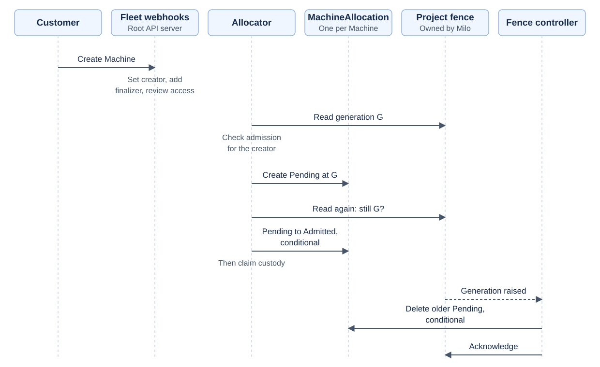

# Production allocation admission

[Documentation overview](../../README.md) · [Functionality guide](../../functionality/README.md)

- [Summary](#summary)
- [Motivation](#motivation)
- [Proposal](#proposal)
- [Design details](#design-details)
  - [What Milo provides today](#what-milo-provides-today)
  - [Caller identity](#caller-identity)
  - [Request authorization](#request-authorization)
  - [Admission fence](#admission-fence)
  - [Quota custody](#quota-custody)
  - [Project lifecycle](#project-lifecycle)
  - [Requests to Milo](#requests-to-milo)
  - [Implementation decisions](#implementation-decisions)
  - [Acceptance tests](#acceptance-tests)
- [Production readiness review questionnaire](#production-readiness-review-questionnaire)
- [Implementation history](#implementation-history)
- [Drawbacks](#drawbacks)
- [Alternatives](#alternatives)
- [Infrastructure needed](#infrastructure-needed)

## Summary

Fleet allocates machines today only in a synthetic mode. In that mode, Fleet
writes an admission decision itself instead of checking the customer's access,
entitlement, and quota. The [machine
lifecycle](../machine-lifecycle/README.md#implementation-decisions) needs three
things from Milo before production allocation can run:

- the identity of the caller who created a Machine, recorded so that a
  controller can trust it;
- an admission fence that orders allocation against revoked access, suspended
  entitlements and projects, and lost quota; and
- a quota hold that Fleet keeps until it releases the hardware.

This enhancement records what Milo already supports and designs the rest. Fleet
can capture the caller, authorize the request, and hold quota now. The fence,
purge guard, and protected finalizers need changes in Milo. They are listed as
[requests to Milo](#requests-to-milo).

This enhancement is a proposal. Nothing in it is implemented.

## Motivation

Synthetic admission accepts every Machine that matches a fixed shape. It cannot
tell whether the caller may use a class, whether the project is entitled or
suspended, or whether the project has quota. A production allocation must
answer all three, and must keep answering them correctly when access is
revoked while a request is in progress.

### Goals

- Fleet acts only for the caller who created the Machine, never with its own
  authority.
- A Machine binds only if every admission check still holds when the
  allocation commits.
- Quota stays held until the hardware is released, even if the Machine, its
  namespace, or its project is deleted first.
- Each requirement uses one-object conditional updates and deterministic names,
  with no database.

### Non-goals

- Changing the custody, operation, or release contracts of [Device
  custody](../device-operations/README.md).
- Pricing, quota limits, or entitlement policy.
- Authorization for installations and power changes. They follow the same
  pattern and are designed with their operations.

## Proposal

A Machine create passes through Fleet's admission webhook in Milo's root API
server. The webhook records the caller in the Machine and checks the caller's
permissions. The allocator later commits the allocation only if the fence of
each project involved has not moved since it checked admission. Fleet holds
the Machine's quota claim with its own finalizer until release closes the quota
gate.

## Design details

### What Milo provides today

The table records Milo's behavior at its current main branch. "Partial" means
Fleet can use the capability, but a gap remains that only Milo can close.

| Capability | Milo today | Gap |
| --- | --- | --- |
| Webhooks see the real caller | Exists. Project requests run the root server's authentication, authorization, and admission chain, and webhooks registered at the root see them. | None. |
| Trusted project context | Exists. Milo overwrites the caller's project context on every project request. | Root requests outside a project keep whatever context the caller supplied. |
| Creator recording | Partial. Some Milo kinds stamp a creator in their own webhooks. Nothing generic exists. | Fleet must record the creator itself. |
| Authorization check for a retained caller | Partial. Access reviews accept a named user. | Allowed decisions are cached for minutes, and no revision ties a decision to a point in time. |
| Project suspension | Partial. Suspension blocks creates and updates in the project's API. | It takes effect asynchronously, with no point at which it is known to be in force. |
| Invalidation acknowledgment | Missing. | No fence, epoch, or acknowledgment exists for access, entitlement, or suspension changes. |
| Quota claim lifecycle | Partial. Grants are exact and recovered after a crash. A deleting claim stays counted while a finalizer holds it. | Deleting a claim frees quota at once. Claim specs can change after the grant, which also frees quota. |
| Purge ordering | Partial. Purge honors finalizers on objects and namespaces. | Purge deletes every object at once, including credentials and quota claims, and a finalizer on the Project does not delay it. |
| Protected finalizers | Missing. | Anyone who can update an object can remove a service's finalizer. |

ServiceEntitlement is owned by the service catalog, not Milo. It has no
fence or acknowledgment either.

### Caller identity

The Machine gains a server-set `spec.creator` with the caller's username and
UID. Fleet's mutating webhook sets it on create from the authenticated
request, replacing any value the client sent. The same webhook adds Fleet's
Machine protection finalizer, so the caller and the finalizer are recorded in
the same write that creates the Machine.

Fleet's validating webhook then refuses a create whose creator differs from
the caller, and any change to the creator. A schema rule also keeps the field
unchanged after create. Both webhooks fail closed and refuse a request without
a Milo project context.

The controller trusts the creator because only the webhook could have set it.
A Machine without a creator was created before the webhooks were registered,
or while they were bypassed. Fleet does not allocate it and reports
`CreatorUnknown`.

Fleet retains the username and UID, never a token or group list. Group
membership is resolved when the permission is checked, so a removed group
member loses access.

### Request authorization

The validating webhook checks the caller's permissions with access reviews
while the caller is still on the request:

- `create` on Machines in the consumer namespace;
- `use` on the MachineClass in the provider project; and
- `use` on the MachineProfile, and on its provider source when the profile is
  published.

A cross-project check keeps the caller and changes only the project named in
the review. A denied create fails immediately, so the customer sees the error.
A review Fleet cannot complete also refuses the create.

The webhook's decision only gates the create. The allocator repeats the same
reviews, for the retained creator, when it [commits the
allocation](#admission-fence). A caller who loses access before the commit
gets no machine. A caller who loses access after the commit keeps the machine,
as the [active-allocation
contract](../machine-lifecycle/README.md#request-authority) requires.

### Admission fence

Each project has one fence with a generation. An authority that removes access
raises the generation first, then waits for every participating service to
acknowledge the new generation. Revoked access, a suspended entitlement, a
suspended or deleting project, and a retiring provider all raise it. Changes
that only grant access do not.

The allocator commits a Machine in this order:

1. Read the consumer and provider fences from the API server, not a cache.
2. Check admission for the retained creator: access reviews, an Active
   entitlement that is not suspended, a consumer project that is neither
   suspended nor deleting, a provider that is not retiring, and a granted quota
   claim held by Fleet.
3. Create the MachineAllocation as `Pending`, recording both fence generations
   and a digest of the decision.
4. Read both fences again. If either moved, delete the allocation and start
   again.
5. Change the allocation from `Pending` to `Admitted` with a conditional
   update.
6. Claim Device custody. If another holder took the Device, delete the
   allocation and start again from step 1. No effect ran under it.

When a fence moves, Fleet's fence controller lists the project's `Pending`
allocations from the API server. It deletes each one recorded at an older
generation, with a precondition on its resource version. It then acknowledges
the new generation.

The allocation record is the single object that both sides change, so one
conditional write decides each race:

- **Invalidation wins:** the fence controller deleted the `Pending`
  allocation. The Machine does not bind. The allocator checks admission again
  at the new generation, and refuses the Machine if access is gone.
- **Allocation wins:** the allocation became `Admitted` first. It was admitted
  before the acknowledgment, and the active-allocation contract applies.

An allocation created after the fence moved finds the new generation in step 4.
An acknowledgment therefore means that no admission checked at an older
generation can still commit. An `Admitted` allocation that loses its Device
returns to step 1, so an older admission is never reused.

Quota is not a fence participant. A granted claim stays granted, and Fleet
holds it until release, so quota cannot be withdrawn under a pending
allocation.

### Quota custody

Fleet creates one ResourceClaim per Machine, named from the Machine UID within
its project. The claim carries Fleet's quota custody finalizer from the moment
it is created. Milo keeps counting a claim while a finalizer holds it, so
deleting the claim, or purging its namespace, does not free quota early.

Release closes the quota gate after cleaning:

1. Delete the claim, if it is not already deleting.
2. Remove Fleet's finalizer with a conditional update.
3. Close the gate once the claim is gone.

The finalizer is the custody anchor, and its removal is the release
acknowledgment: quota is free only after Fleet removes it. A claim that is
missing while its allocation is active means someone removed Fleet's
finalizer. Fleet reports `QuotaCustodyLost` and keeps the allocation. It never
reclaims a customer's machine because quota accounting failed.

Two Milo gaps weaken this hold until they are closed. Anyone who can update
the claim can remove Fleet's finalizer, and a change to the claim's requests
frees quota without a delete. Fleet compares every claim it reads with the
claim it would create, and reports a mismatch.

### Project lifecycle

**Consumer project deletion.** Purge deletes every Machine and quota claim at
once. Their finalizers hold them, and purge waits for namespaces to empty. Fleet
releases each allocation through the provider project, so consumer deletion
works today, except that the finalizers are not protected.

**Provider retirement.** Purge deletes custody, operations, credentials, and
access grants at the same time. Cleanup can lose the access it needs before
obligations settle. Fleet adds a finalizer to the provider Project and removes
it only after the [retirement
guard](../machine-lifecycle/README.md#provider-project-retirement) settles.
Purge must not start while that finalizer remains. This needs a change in
Milo.

**Suspension.** A suspension raises the fence. Fleet's fence controller stops
pending allocations before it acknowledges.

### Requests to Milo

Each request is written so that its owner can file it as an issue. Changing
another team's repository is a decision for that team.

#### Milo 1: Protected service finalizers

**Problem.** Anyone who can update an object can remove a finalizer that a
service added. A service that holds an object until its work settles cannot
rely on the hold.

**Request.** A service registers the finalizer names it owns. Milo refuses to
add or remove a registered finalizer, in project and root requests, unless the
caller is that service's principal. Deleting the object stays allowed.

**Acceptance criteria.**

- A project owner cannot remove a registered finalizer from a Machine, a
  ResourceClaim, a namespace, or the Project.
- The owning service's principal can add and remove its own finalizers.
- Purge does not remove a registered finalizer.
- Unregistered finalizers behave as they do today.

#### Milo 2: ResourceClaim spec immutability

**Problem.** Changing a claim's requests after the grant frees quota without a
delete. Fleet cannot tell whether its hold still exists.

**Request.** Make a ResourceClaim's spec immutable after create. Keep counting
a claim while it is deleting and a finalizer holds it, as Milo does today.

**Acceptance criteria.**

- An update that changes a claim's consumer, resource reference, or requests is
  refused.
- A deleting claim held by a finalizer stays counted in its allowance bucket
  until the finalizer is removed.
- Both behaviors have tests.

#### Milo 3: Project purge guard

**Problem.** Purge starts as soon as a Project is deleted and deletes every
object at once. A provider can lose its credentials and access grants before
it finishes cleaning hardware that customers used.

**Request.** Do not start purge while the Project carries a registered service
finalizer. Report each finalizer that blocks purge in the Project's status.

**Acceptance criteria.**

- A deleted Project with a registered service finalizer keeps every object,
  credential, and access grant until the finalizer is removed.
- Removing the last service finalizer starts purge as it runs today.
- The Project's status names each blocking service.
- Admission into the project stays closed while purge waits.

#### Milo 4: Per-project admission fence

**Problem.** Nothing orders an allocation against a revocation. A service that
checks access and then commits can commit after the access was removed, and
cannot report when old decisions stop committing.

**Request.** Each project has one fence object with a generation that only Milo
raises. Milo raises it whenever access to the project can be removed:

- a PolicyBinding in the project is changed or deleted;
- a Role bound in the project changes;
- a member is removed from a group bound in the project;
- the Project is suspended or deleted; and
- a ServiceEntitlement for the project is suspended or deactivated. The service
  catalog owns this source.

Milo raises the generation only after the change takes effect in the
authorizer. Each participating service writes its own acknowledgment object
with the highest generation it has settled. Milo reports a suspension or
deletion as in force only after every registered participant has acknowledged
its generation.

**Acceptance criteria.**

- Each listed change raises the generation at least once, and nothing
  lowers it.
- An access review evaluated after the generation is raised reflects the
  change.
- Only Milo can write the fence. Each participant can write only its own
  acknowledgment.
- A suspension reports in force only after every participant acknowledges.
- A test covers a revocation that races a participant's commit.

#### Milo 5: Fresh access reviews for a retained caller

**Problem.** Access review results are cached, so an allowed answer can last
minutes after the access is revoked. Fleet checks access for a retained
creator with only a username and UID.

**Request.** Offer an access review that bypasses the decision cache and
resolves the user's current group membership from the username and UID. This
may need a change in the authorization provider as well as Milo.

**Acceptance criteria.**

- After a PolicyBinding is deleted, an uncached review for its subject is
  denied as soon as the change takes effect.
- A review naming only a user's name and UID reflects that user's current
  groups.
- The uncached path is limited to service principals that are granted it.

### Implementation decisions

Record these decisions before production allocation is enabled:

- **Interim fence.** Until Milo provides the fence, Fleet can raise a fence of
  its own when it observes invalidations. Its order is then only as good as
  Fleet's observation and the authorizer cache. Decide whether production
  allocation may run on it, and with which limit on the delay.
- **Unprotected finalizers.** Decide whether production allocation may run
  while customers can remove Fleet's quota and Machine finalizers.
- **Fence location.** Decide where the fence lives and which component owns
  the fence controller.

### Acceptance tests

These tests are required and not implemented:

- A client sends a creator, and the webhook replaces it with the caller.
- A client changes the creator, and admission refuses it.
- A Machine without a creator never binds.
- A caller without class `use` cannot create a Machine.
- Access is revoked between the check and the commit, and the Machine does not
  bind.
- A revocation and a commit race on one allocation, and exactly one wins.
- An admitted allocation loses its Device, and the allocator checks admission
  again.
- A Machine's namespace is purged during cleaning, and quota stays held until
  the quota gate closes.
- A quota claim's finalizer is removed while its allocation is active, and
  Fleet reports `QuotaCustodyLost` without reclaiming the machine.
- A provider project is deleted while an allocation is active, and purge waits
  for release.

## Production readiness review questionnaire

These controls are proposed, not implemented.

### How do operators enable or disable the feature?

Register the webhooks, then enable production admission in the manager.
Disabling it stops new commits. Committed allocations, releases, and quota
custody continue.

### Does enabling the feature change any default behavior?

Machine creates gain a creator and a finalizer, and creates by callers without
the required permissions fail. Synthetic admission remains a separate mode.

### What must operators monitor?

Fence generations that no participant acknowledges, `CreatorUnknown`
Machines, `QuotaCustodyLost` reports, and failed access reviews.

### What does the feature depend on?

Milo's root API server for webhooks, access reviews, quota, and project
lifecycle, and the service catalog for entitlements.

### Does the feature add API types or calls?

It adds the Machine creator, admission fields on MachineAllocation, two
webhooks, and one access review per permission for each create and each
commit.

## Implementation history

- 2026-11-25: Proposed.

## Drawbacks

- Every Machine create depends on Fleet's webhooks being available.
- Each commit repeats the access reviews, which adds latency to allocation.
- A conservative fence raises the generation for changes that did not affect
  the caller, and those Machines are checked again.

## Alternatives

- **Capture the caller in a controller:** a watch event does not carry the
  caller, so a controller cannot recover who created the object.
- **Trust an annotation the client sets:** any caller could name someone else.
- **A Fleet database of decisions:** it adds a database. The allocation record
  and the fence give the same order with one conditional write.
- **Milo-created quota claims through a claim creation policy:** Milo creates
  the claim before Fleet admits the Machine, and garbage-collects it with the
  Machine, before cleaning ends.

## Infrastructure needed

Testing needs Milo with the root webhooks registered, one provider project,
two consumer projects, quota grants, and entitlements. Race tests need a way
to pause the allocator between its fence reads and its commit.
