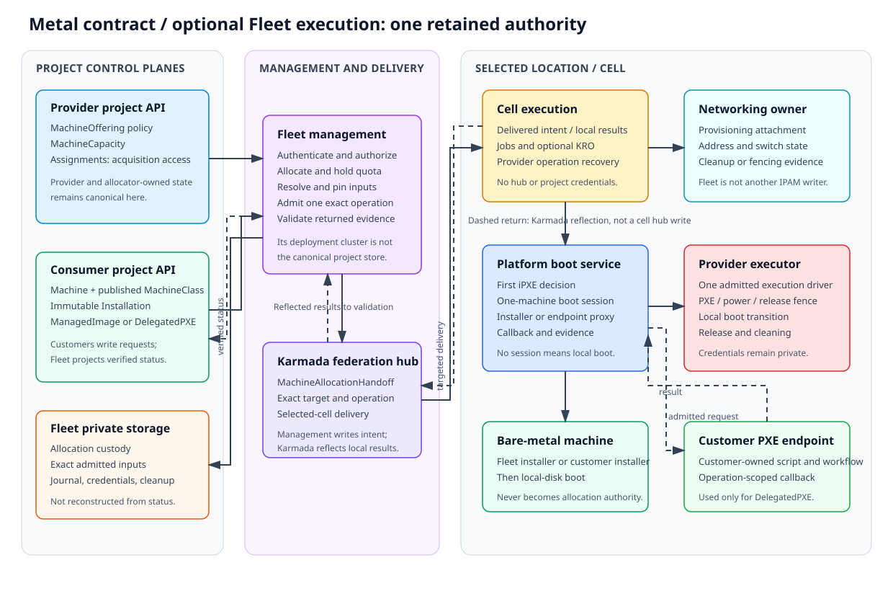
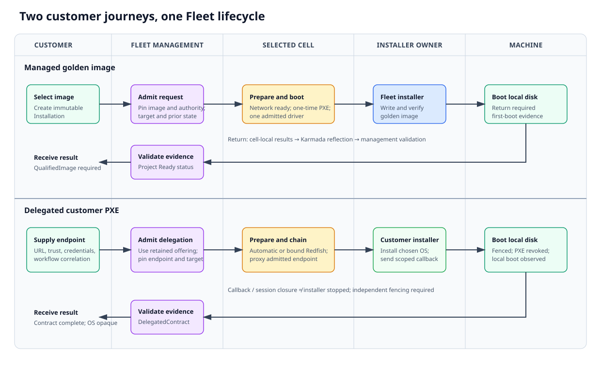
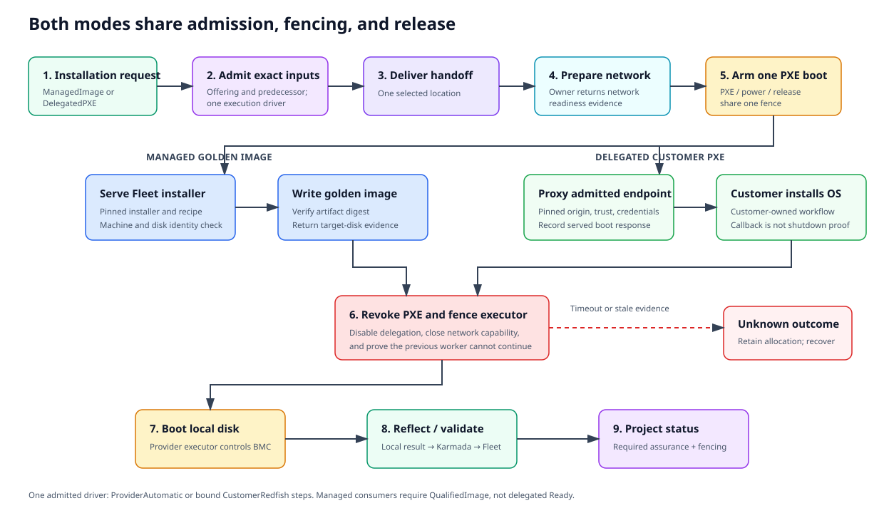

# PXE installation and delegated network boot

- [Summary](#summary)
- [Motivation](#motivation)
- [Proposal](#proposal)
  - [User stories](#user-stories)
  - [Installation modes](#installation-modes)
  - [Managed golden image](#managed-golden-image)
  - [Delegated customer PXE](#delegated-customer-pxe)
- [Design details](#design-details)
  - [Control-plane placement](#control-plane-placement)
  - [API design](#api-design)
  - [Admission and authority](#admission-and-authority)
  - [Shared BMC and installation execution](#shared-bmc-and-installation-execution)
  - [Location execution](#location-execution)
  - [Completion and evidence](#completion-and-evidence)
  - [Release and recovery](#release-and-recovery)
  - [Security boundaries](#security-boundaries)
  - [Acceptance tests](#acceptance-tests)
- [Production readiness review questionnaire](#production-readiness-review-questionnaire)
- [Drawbacks](#drawbacks)
- [Alternatives](#alternatives)
- [Open design questions](#open-design-questions)
- [Infrastructure needed](#infrastructure-needed)

## Summary

Metal defines the common public installation contract; Fleet is an optional
provider implementation, not a prerequisite for publishing or consuming it.
This proposal describes two ways to install an allocated bare-metal machine. Fleet can
automatically install a platform-approved golden image, or it can temporarily
chain the machine to a customer-supplied PXE service. Both paths use the same
immutable `Installation`, allocation, federation handoff, power, boot fencing,
and release contracts.

All behavior below is proposed, not implemented or hardware-qualified. These are
target contracts, with no compatibility or migration requirement for earlier
draft shapes. The [canonical lifecycle design](../machine-lifecycle/README.md)
and [examples](../machine-lifecycle/api-examples.md) use the same source union.

Companion review on 2026-11-14 used [BMC #41](https://github.com/datum-cloud/fleet/pull/41)
at `b72c314624bd0b05849059815619c9783607818c`,
[control planes #51](https://github.com/datum-cloud/fleet/pull/51) at
`16e7cb2a268cf20bc58d490493b5a3fef9237027`, and
[offerings #58](https://github.com/datum-cloud/fleet/pull/58) at
`031477d011090ea6ec378d526e975bbfae07a060`. The decisions here replace those drafts'
provider MachineClass policy, direct cell-to-hub status writing, and independent
provisioning-session boot authority where they differ. Companion branches must
converge on these contracts; this PR does not edit their branches or rewrite the
[pinned source provenance](../../proposals/fleet-management/MIGRATION.md).

The Fleet management control plane admits the exact operation before any effect.
The Federation Control Plane delivers that operation to one selected location
control plane. The location prepares networking, controls one-time network boot,
executes the selected installation mode, and returns attributable evidence.

Fleet does not adopt a separate provisioning platform. A location may use
Kubernetes CRDs, Jobs, and Kube Resource Orchestrator (KRO) to compose local work,
but those resources are execution details and cannot allocate a machine, expand
the admitted operation, or release capacity.



## Motivation

Some customers want a ready machine built from a supported platform image. Other
customers already operate an installation system and need Fleet to hand an
allocated machine to that system without giving it broad DHCP, BMC, or provider
inventory access.

Treating those as unrelated workflows would duplicate boot, power, fencing, and
recovery logic. Giving a customer direct control of a shared provisioning network
would let its system affect machines outside its allocation. Requiring Fleet to
understand each customer installer would create an unnecessary backend contract.

### Goals

- Install approved golden images through an automated PXE workflow.
- Chain one allocated machine to a customer PXE endpoint for a bounded session.
- Keep Fleet in control of allocation, power, the first boot decision, fencing,
  release, and provider cleanup.
- Use one immutable Installation and one durable handoff protocol for both modes.
- Keep DHCP, IPAM, switch configuration, and routing with their existing owners.
- Report what Fleet verified without claiming knowledge of an opaque customer OS.

### Non-goals

- Running or adopting Tinkerbell, Metal3, Ironic, or another provisioning control
  plane as part of Fleet.
- Giving customers BMC credentials or authority to answer DHCP on a shared
  provisioning network.
- Supporting a permanently network-booted workload in the first release.
- Continuously managing or monitoring the installed operating system.
- Making KRO, a Job, or a location-local record an allocation authority.

## Proposal

### User stories

- A customer selects a supported golden image and receives an installed machine
  without operating a provisioning service.
- A customer with an existing PXE service installs its own operating system on
  an allocated machine while Fleet retains power and boot control.
- A provider controls installation and management capabilities on MachineOffering.
- An operator can recover a lost response without repeating a destructive action
  or exposing uncertain capacity to another customer.

The two customer journeys share admission and fencing but differ in who supplies
the installer and what Fleet can verify:



### Installation modes

An Installation has exactly one source:

| Mode | Installer and image owner | Fleet verifies |
| --- | --- | --- |
| `ManagedImage` | Fleet resolves a platform-approved image and qualified recipe. | Exact image and recipe, target disk evidence, boot fencing, and required first-boot evidence. |
| `DelegatedPXE` | The customer supplies a PXE endpoint and controls its installer. | Exact delegation target, boot session, customer result, boot fencing, and the configured post-install boot observation. |

`MachineOffering` in `provider.metal.datumapis.com` owns installation and
management capability policy. `MachineClass` in `metal.datumapis.com` is only a
consumer-published, one-hop view of that offering. `MachineOfferingAssignment`
grants acquisition access, not runtime boot authority. `MachineProfile` contains
immutable hardware requirements, never installation, management, or audience policy.

Allocation retains the accepted offering identity and contract revision, exact
profile identity and requirements, and installation/management capabilities.
Offering or assignment withdrawal blocks new allocations, not retained runtime
rights. A reinstall uses that retained contract even if the catalog copy or
offering is gone; it cannot acquire capabilities added after allocation. Admission
still checks current Machine install permission, image-use permission for managed
images, secret-use and endpoint permission as applicable, explicit safety or
suspension controls, network feasibility, and predecessor state. Unavailable
authorization is unknown, not permission. Cleanup remains authorized by retained
provider obligations despite withdrawal, suspension, or project deletion.

### Managed golden image

Fleet resolves the approved image, bootstrap configuration, hardware compatibility,
and location recipe. It retains their exact identities, bytes or digests, and
revisions before dispatch. The selected location then:

1. obtains provisioning-network readiness from its owner;
2. authorizes one network boot for the selected machine;
3. boots a small Fleet installer;
4. writes and verifies the pinned image on the admitted target disk;
5. revokes network boot and requests local-disk boot; and
6. returns installation and required first-boot evidence.

### Delegated customer PXE

The customer provides an HTTPS iPXE endpoint, trust configuration, optional
endpoint credentials, and a completion policy. Fleet retains protected copies of
those inputs before dispatch. The location boot service remains the first boot
decision point and chains only the admitted machine to the customer endpoint.

The customer does not receive BMC credentials or DHCP authority. Its system may
install any OS allowed by service policy, then sends an operation-scoped completion
callback. That is only a customer assertion. The location separately proves the
installer stopped, revokes delegation, performs the admitted local-disk transition,
and returns the evidence required by the Installation contract.

The first release requires delegated PXE to finish with local-disk boot. A
permanently network-booted runtime needs a separate design because it retains boot
authority for the life of the allocation.

## Design details

### Control-plane placement

The design follows the Fleet management control-plane boundaries:

| Boundary | Responsibility |
| --- | --- |
| Provider project API | MachineOffering capability policy and MachineOfferingAssignment acquisition access; Fleet-backed providers additionally own MachineCapacity and inventory. |
| Consumer project API | Machine and immutable Installation requests and projected status. |
| Fleet private storage | Exact allocation, caller authority, admitted inputs, operation journal, credentials, and cleanup custody. |
| Fleet management runtime | Admission, allocation coordination, handoff creation, and result validation. |
| Federation hub | Management-authored admitted intent and Karmada-reflected selected-cell results. |
| Selected location control plane | Delivered intent, locally written execution results, network integration, PXE, power, fencing, and evidence. |

The Fleet runtime's deployment cluster is not the canonical store for project
objects or federation intent. Kubernetes UIDs are local evidence and do not cross
project, hub, or cell API boundaries as authored references.

The only status path is management-authored hub intent -> selected-cell delivery
-> cell-local results -> Karmada reflection -> management validation -> public
projection. Cells have no hub or project API credentials. Karmada transports
results, not authority or readiness decisions. Management validates selected-cell
identity, retained operation and revision, allocation, fencing token, and evidence
freshness before projection. Wrong-cell, duplicated, stale, or conflicting results
cannot advance readiness. A partition leaves results pending or unknown; absence
of a result never proves completion or cancellation.

### API design

The following shapes are proposals, not implemented schemas. `Installation.spec`
remains immutable and keeps the existing predecessor contract.

```yaml
apiVersion: metal.datumapis.com/v1alpha1
kind: Installation
metadata:
  name: example-os-1
  namespace: default
spec:
  machineRef: {name: example}
  expectedPredecessor: {type: None}
  source:
    managedImage:
      imageRef: {name: qualified-linux}
      bootstrapConfigRef: {name: example-bootstrap}
  execution:
    driver: ProviderAutomatic
  completion:
    mode: VerifiedImage
    requiredAssurance: QualifiedImage
    postCompletionBoot: LocalDisk
```

A delegated request selects the other union member:

```yaml
spec:
  machineRef: {name: example}
  expectedPredecessor: {type: None}
  source:
    delegatedPXE:
      endpoint:
        url: https://pxe.customer.example/boot.ipxe
        trustBundleRef: {name: customer-pxe-ca}
        authorizationRef: {name: customer-pxe-credentials}
      correlation:
        workflowID: example-workflow-1
        templateDigest: sha256:example
  execution:
    driver: CustomerRedfish
  completion:
    mode: CustomerCallback
    requiredAssurance: DelegatedContract
    postCompletionBoot: LocalDisk
```

Exactly one non-null `source.managedImage` or `source.delegatedPXE` is required;
both, neither, and fields from the other member are rejected. Source, predecessor,
execution driver, and completion contract are immutable. Completion and assurance
are explicit, not inferred from a callback or `Ready`. ManagedImage requires
`VerifiedImage` and `QualifiedImage`; delegated PXE initially supports only
`CustomerCallback` and `DelegatedContract`. Both require `LocalDisk`. Other
combinations are rejected until a separate qualified evidence contract exists.

The API server applies any other defaults before Fleet captures the request digest. Fleet
resolves referenced Secrets under the caller's authority and retains protected
copies needed for recovery. Credentials and rendered bootstrap content do not
enter the federation handoff.

MachineOffering defines allowed source modes, execution drivers, completion and
assurance combinations, and management profiles/Redfish steps. Publication exposes
only the permitted summary through MachineClass; it cannot override the source. The exact
provider executor, BMC enrollment, installer recipe, and boot-service configuration
remain private location state.

### Admission and authority

Before dispatch, Fleet retains:

- provider and consumer Project identities;
- Machine, MachineAllocation, MachineCapacity, and Installation incarnations;
- the retained MachineOffering identity, accepted contract and capability policy,
  MachineClass publication provenance, and immutable MachineProfile requirements;
- the consumed predecessor and operation identity;
- target location, boot interface, and qualified firmware mode;
- image, recipe, bootstrap, endpoint, trust, and credential digests as applicable;
- current action/source permissions and explicit safety/suspension decisions,
  plus the allocation's retained acquisition and quota evidence; and
- an executor fencing token and required completion evidence.

The handoff contains the exact admitted target and non-secret execution inputs or
protected capability references. Delivery to a cell is not fresh authorization.
The cell cannot select another machine, endpoint, image, or installation mode.

Retain the operation's validity interval and allowed step budget before dispatch.
Disconnected cells may only recover/execute within that retained scope and
validity; expiry prevents new effects but does not prove a running installer
stopped. Renewal is a management decision for the same exact operation, never a
cell-local expansion. Fencing and cleanup continue under retained obligations.

Admission atomically consumes the exact predecessor with the operation record.
`None` means a verified blank allocation with no previously admitted installation;
otherwise use the current Installation name, resolved to its retained incarnation.
Competing successors cannot both win. Active or uncertain work offers no usable
predecessor. Request deletion, session closure, or a callback does not restore it.
After failure, a successor requires proven fencing and intact prior state;
partial or uncertain effects require recovery of the same operation or release.

### Shared BMC and installation execution

A provisioning-profile `MachineManagementSession` must name an already admitted
Installation in the same project/namespace and allocation. Admission privately
binds its exact incarnation, operation, selected cell, fence, driver, and permitted
step set. Missing, foreign, stale, or completed bindings fail closed. A session
cannot create an Installation, select another endpoint or image, or arm independent
boot authority. Read-only observation does not grant provisioning permissions.
Current session create/use permissions and explicit suspension checks still apply;
neither the retained capability nor knowledge of an Installation name grants access.

Exactly one execution driver is selected at Installation admission. The public
`ProviderAutomatic` name is provider-neutral: Fleet runs the automatic sequence
when Fleet fulfills the offering; another provider implements the same retained
authority and evidence contract without deploying Fleet:

| Driver | Effect authority |
| --- | --- |
| `ProviderAutomatic` | The provider (Fleet in this design) orders all boot/power steps. Customer provisioning-session writes are rejected; observation may be allowed. |
| `CustomerRedfish` | The customer submits the offering-permitted Redfish steps through a bound provisioning session. The gateway journals and executes only steps of the admitted Installation; Fleet does not run an automatic competing sequence. |

CustomerRedfish is permitted only for delegated PXE in the initial qualification.
The gateway maps allowed one-time PXE, reset, and local-disk transitions to the
retained plan; arbitrary boot targets, persistent overrides, virtual media, and
unadmitted resets are rejected. Source choice and execution driver are distinct:
delegated PXE may also use ProviderAutomatic. Switching drivers requires settlement
and a new admitted successor, not editing a session.

All automatic, gateway, runtime power, and release effects share one durable
per-allocation serialization and fencing domain. A provisioning session attaches
to the Installation's reservation, not a second operation authority. Concurrent
sessions cannot duplicate a step. Power intent queues or fails with an explicit
conflict while installation owns the reservation. Release closes new admission,
revokes sessions, and takes over only through verified fencing and settlement;
there is no lock-free emergency reset path. Recovery deduplicates provider steps
using retained operation identity, including after a lost Redfish response.

Closing or expiring a session revokes access but does not settle an installer
already running in RAM or remotely. A callback proves neither executor shutdown
nor boot revocation. Completion requires independent stop/fence evidence for all
old effect paths, verified PXE/network revocation, and observed local-disk boot.
If those cannot be proven, keep the Installation unknown and capacity occupied.
Safety/release fencing is retained recovery authority, not a second install driver.

### Location execution

A qualified location runs a small platform boot service. Provider DHCP directs
eligible firmware to that service. With no active admitted boot session, the
service returns local boot. With a valid session, it serves the Fleet installer or
chains through an allocation-scoped proxy to the admitted customer endpoint.

The proxy validates the endpoint and TLS policy, prevents unapproved redirects,
keeps endpoint credentials away from the machine, and records the response digest.
Customer artifacts referenced by the returned script must use approved HTTPS
origins or the same scoped proxy.

Location implementation may use:

- a Deployment or facility-edge DaemonSet for boot scripts and callbacks;
- a private execution CRD for the delivered handoff;
- Jobs for bounded Redfish, power, verification, and fencing actions; and
- KRO to create and order the per-operation resources: one bounded Job and its
  scoped identity and RBAC for each delivered handoff.

Long-lived location services, their policies and RBAC, and durable provider state
have one configuration owner: the environment's GitOps writer (Flux), not an
operation graph. An operation graph references them and cannot create, change or
delete them, so its lifecycle cannot remove a shared service or a provider
journal. Jobs must recover a retained provider operation before retrying. Job
completion does not by itself prove a remote effect. A KRO instance is derived
state and cannot replace the hub handoff, operation journal, or provider fence.

The local multi-plane acceptance implements this pattern for a disposable
libvirt cell with kro v0.9.4. Flux owns the VM runtime Deployment, the boot
Deployment and Service, the journal-only status observer and the retained
journal volume. kro creates only per-handoff RBAC and bounded Jobs. See
[Kubernetes-native site execution](../../operations/site-execution.md). That is
local evidence for the contract above, not hardware qualification.



### Completion and evidence

The cell issues a short-lived callback capability for delegated PXE. The callback
can report the retained operation's result but cannot choose another target,
extend authority, request release, or write public status.

Managed-image success proves the qualified image and recipe evidence required by
the retained offering. Delegated success proves only that Fleet delegated the correct
machine, the customer reported completion, Fleet revoked the delegation, and the
configured local boot was observed, with the old executor demonstrably stopped.
Public status reports `sourceMode`, `completionMode`, and achieved `assurance`
(`QualifiedImage` or `DelegatedContract`), separately from conditions. Pending or
unknown work has no achieved assurance. An opaque customer OS is not platform verified.

Managed consumers must explicitly require `QualifiedImage` at admission and
activation/join gates; `Ready=True` with `DelegatedContract` cannot satisfy them.
The same rule applies to a Machine's initial-installation gate for that consumer.
There is no callback-based promotion from delegated to qualified assurance.

Fleet validates the target, operation revision, fencing token, evidence freshness,
and required conditions before setting Installation `Ready=True`. Installation
readiness reports completion of the admitted contract, not continuing guest health.

### Release and recovery

A timeout or lost response does not prove that an installer stopped. Fleet marks
the outcome unknown, retains the allocation, and recovers the same operation. A
takeover must fence the old executor at the boot, network, power, and provider
effect boundaries before continuing.

Release closes new boot and power admission, revokes PXE and console sessions,
fences provisioning networking, settles in-flight work, and performs required
provider cleanup. Capacity returns to supply only after cleanup is verified.
Consumer project deletion does not remove these provider-side obligations.

### Security boundaries

- The platform remains the first DHCP and iPXE decision point.
- A delegated endpoint applies to one allocation and one admitted operation.
- Customer endpoint access is restricted against server-side request forgery and
  cross-allocation data exposure.
- BMC, provider, bootstrap, and endpoint credentials remain in protected stores.
- Boot requests authenticate more than a caller-supplied MAC address.
- Callback capabilities are short lived, single operation, and non-authoritative.
- Logs and evidence retain correlation and digests without secret content.

### Acceptance tests

Qualify one UEFI, Redfish, non-Talos hardware and OS combination. Test both modes
through real project admission, federation delivery, networking, and disposable
hardware.

These are required cross-system tests, not executed tests in this documentation
PR. In addition to the cases below, acceptance requires:

- only the allocated machine can use a boot session;
- a managed install writes the retained image and boots from the selected disk;
- a delegated endpoint cannot affect another machine or shared DHCP;
- duplicate delivery and duplicate Jobs recover one retained operation;
- endpoint, cell, image, predecessor, and fencing mismatches cause no effects;
- lost callbacks and cell outages remain unknown rather than ready;
- revocation prevents another network boot after completion;
- release cannot expose capacity before network and provider cleanup; and
- customer project deletion preserves recovery and cleanup custody.

| Scenario and fault injection | Required observable result |
| --- | --- |
| Submit both/neither source members, mixed fields, an unsupported completion/assurance pair, or a provisioning session without an admitted Installation (including foreign/recreated names). | Reject before effects; no predecessor consumption or boot authority for invalid requests. Session access also requires current create/use permission. |
| Race ProviderAutomatic PXE with a provisioning-session boot override, two successor requests, and runtime power-on. | One predecessor consumption and one install driver; session write rejected, other successor conflicts, power blocked; provider journal has no duplicate or competing effect. |
| CustomerRedfish sends duplicate resets through two sessions; lose the provider response, then recover gateway and Fleet workers. | Both sessions bind the same admitted operation; one retained step is recovered, never blindly replayed. No automatic installer driver starts. |
| Close the provisioning session or send a successful callback while its installer remains active; concurrently release. | No Ready or usable predecessor; release blocks new steps, fences all old paths and verifies cleanup before reuse. Closure/callback alone never settles work. |
| Withdraw offering/assignment and delete the published class after allocation; request a reinstall and a new Machine. | New allocation denied; reinstall retains original offering/profile/capabilities and succeeds only with current install/source permissions. A later offering capability expansion is not inherited. |
| Repeat that reinstall with revoked image/secret/endpoint permission or explicit runtime suspension. | No new install effects; an authorization outage is unknown. Retained cleanup still completes without reacquiring the withdrawn offering. |
| Partition hub from selected cell during boot; expire authority, duplicate delivery, inject wrong-cell and stale-fence results, then reconnect. | Cell writes only local results, has no hub credentials, and starts no effects beyond its retained validity. Karmada reflects; management rejects mismatches and reconciles the same operation without inferring stop from expiry. |
| Customer callback and local boot succeed but image evidence is absent. | At most DelegatedContract after independent fencing proof; managed admission/join/initial gates requiring QualifiedImage remain closed even if Installation Ready is true. |
| Managed image has wrong digest or stale first-boot evidence; later deliver valid qualified evidence through reflection. | No initial readiness or assurance on invalid evidence; only the validated exact operation can report QualifiedImage and open the managed gate. |

## Production readiness review questionnaire

### How is the feature enabled or disabled?

Enable installation modes per accepted MachineOffering and qualified location.
Rollback stops new admission while preserving handoff recovery, boot revocation,
and release. Disabling a controller does not cancel remote work.

### What must operators monitor?

Monitor active and expired boot sessions, handoff delivery lag, endpoint failures,
unknown operations, stale callbacks, fencing failures, cleanup age, and quarantined
capacity. Correlate each event with the retained allocation and operation.

### How are failures recovered?

Query the retained operation and location evidence before retrying. Reuse its
identity and exact inputs. Fence the previous executor before takeover. Missing or
conflicting evidence blocks readiness and capacity reuse.

### What must upgrades preserve?

Preserve allocation custody, immutable Installation inputs, handoff revisions,
executor fencing, active boot sessions, callback correlation, and cleanup
obligations. Test restore while both installation modes run. This proposal imposes
no backwards-compatibility contract on earlier draft APIs.

## Drawbacks

The platform must operate a boot service and small ephemeral installer at each
qualified location. Delegated PXE adds endpoint security and weaker OS assurance.
Strict fencing can keep a machine unavailable when a customer system or location
cannot prove that work stopped.

## Alternatives

- **Adopt a provisioning platform:** rejected because it adds overlapping hardware,
  workflow, networking, and lifecycle authorities.
- **Give customers direct DHCP or BMC access:** rejected because it can affect
  machines outside the allocation and is difficult to revoke safely.
- **Treat delegated PXE as allocate-only with no Fleet operation:** insufficient
  when Fleet must provide one-time PXE, power, network isolation, and recovery.
- **Create a public ProvisioningClass now:** deferred. MachineOffering policy and the
  immutable Installation source establish the first required contract without a
  second offering hierarchy.

## Open design questions

- Detailed MachineOffering capability schema and union validation implementation.
- Portable handoff encoding and Karmada reflection enforcement.
- Boot identity beyond MAC address for the first qualified hardware.
- Customer endpoint connectivity, TLS trust, proxying, and artifact-origin policy.
- The managed installer image, action format, target-disk selector, and signing.
- Callback authentication and the minimum delegated completion evidence.
- Whether repeated endpoint configuration later warrants a reusable public kind.
- Durable journal, credential broker, evidence retention, and restore protocols.

Record these decisions and their rationale before enabling hardware effects.

## Infrastructure needed

Testing needs one provider project, two consumer projects, a federation hub, one
selected location control plane, networking-owner integration, a platform boot
service, an independent customer PXE endpoint, protected artifact and credential
storage, and disposable Redfish/UEFI hardware. Failure injection must cover lost
responses, duplicate delivery, stale workers, endpoint outages, control-plane
outages, credential revocation, and storage restoration.
