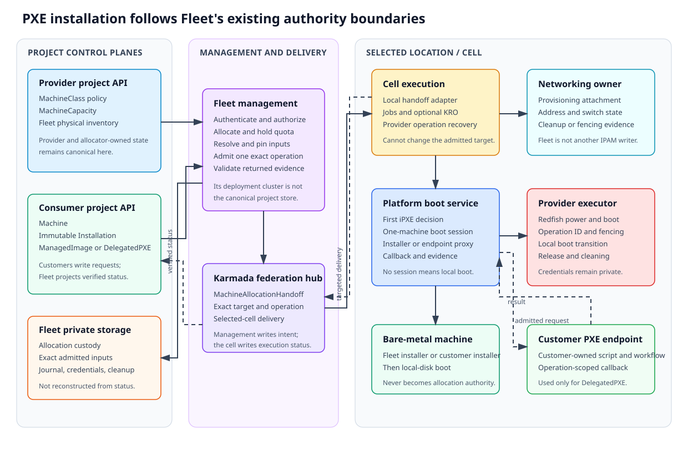
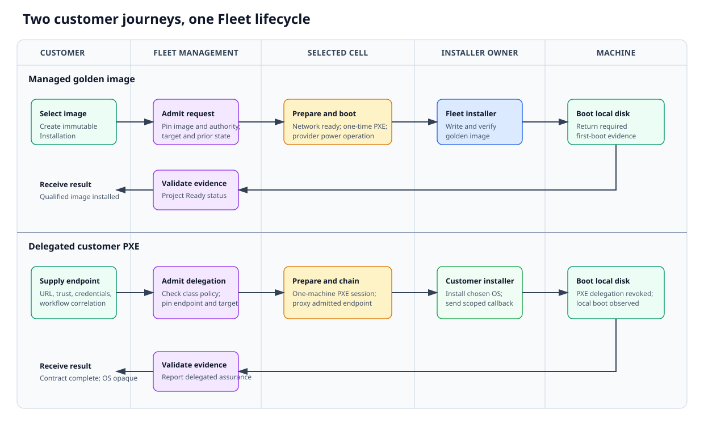
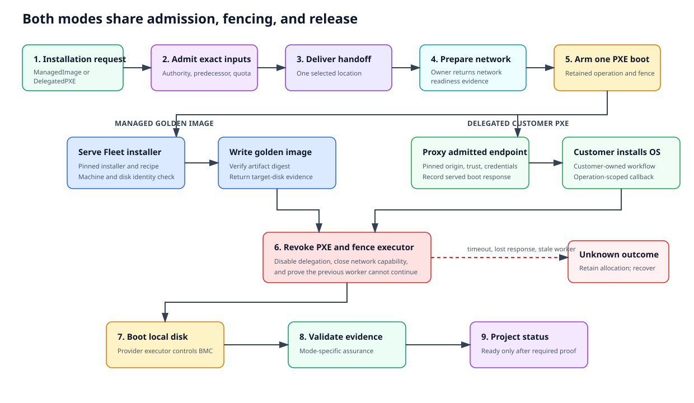

# PXE installation and delegated network boot

- [Summary](#summary)
- [Motivation](#motivation)
- [Proposal](#proposal)
  - [User stories](#user-stories)
  - [Installation modes](#installation-modes)
  - [Managed golden image](#managed-golden-image)
  - [Delegated customer PXE](#delegated-customer-pxe)
- [Design details](#design-details)
  - [Control-plane placement](#control-plane-placement)
  - [API design](#api-design)
  - [Admission and authority](#admission-and-authority)
  - [Location execution](#location-execution)
  - [Completion and evidence](#completion-and-evidence)
  - [Release and recovery](#release-and-recovery)
  - [Security boundaries](#security-boundaries)
  - [Acceptance tests](#acceptance-tests)
- [Production readiness review questionnaire](#production-readiness-review-questionnaire)
- [Drawbacks](#drawbacks)
- [Alternatives](#alternatives)
- [Open design questions](#open-design-questions)
- [Infrastructure needed](#infrastructure-needed)

## Summary

Fleet will support two ways to install an allocated bare-metal machine. Fleet can
automatically install a platform-approved golden image, or it can temporarily
chain the machine to a customer-supplied PXE service. Both paths use the same
immutable `Installation`, allocation, federation handoff, power, boot fencing,
and release contracts.

The Fleet management control plane admits the exact operation before any effect.
The Federation Control Plane delivers that operation to one selected location
control plane. The location prepares networking, controls one-time network boot,
executes the selected installation mode, and returns attributable evidence.

Fleet does not adopt a separate provisioning platform. A location may use
Kubernetes CRDs, Jobs, and Kube Resource Orchestrator (KRO) to compose local work,
but those resources are execution details and cannot allocate a machine, expand
the admitted operation, or release capacity.



## Motivation

Some customers want a ready machine built from a supported platform image. Other
customers already operate an installation system and need Fleet to hand an
allocated machine to that system without giving it broad DHCP, BMC, or provider
inventory access.

Treating those as unrelated workflows would duplicate boot, power, fencing, and
recovery logic. Giving a customer direct control of a shared provisioning network
would let its system affect machines outside its allocation. Requiring Fleet to
understand each customer installer would create an unnecessary backend contract.

### Goals

- Install approved golden images through an automated PXE workflow.
- Chain one allocated machine to a customer PXE endpoint for a bounded session.
- Keep Fleet in control of allocation, power, the first boot decision, fencing,
  release, and provider cleanup.
- Use one immutable Installation and one durable handoff protocol for both modes.
- Keep DHCP, IPAM, switch configuration, and routing with their existing owners.
- Report what Fleet verified without claiming knowledge of an opaque customer OS.

### Non-goals

- Running or adopting Tinkerbell, Metal3, Ironic, or another provisioning control
  plane as part of Fleet.
- Giving customers BMC credentials or authority to answer DHCP on a shared
  provisioning network.
- Supporting a permanently network-booted workload in the first release.
- Continuously managing or monitoring the installed operating system.
- Making KRO, a Job, or a location-local record an allocation authority.

## Proposal

### User stories

- A customer selects a supported golden image and receives an installed machine
  without operating a provisioning service.
- A customer with an existing PXE service installs its own operating system on
  an allocated machine while Fleet retains power and boot control.
- A provider controls which MachineClasses permit managed images or delegated PXE.
- An operator can recover a lost response without repeating a destructive action
  or exposing uncertain capacity to another customer.

The two customer journeys share admission and fencing but differ in who supplies
the installer and what Fleet can verify:



### Installation modes

An Installation has exactly one source:

| Mode | Installer and image owner | Fleet verifies |
| --- | --- | --- |
| `ManagedImage` | Fleet resolves a platform-approved image and qualified recipe. | Exact image and recipe, target disk evidence, boot fencing, and required first-boot evidence. |
| `DelegatedPXE` | The customer supplies a PXE endpoint and controls its installer. | Exact delegation target, boot session, customer result, boot fencing, and the configured post-install boot observation. |

MachineClass policy advertises supported modes. It does not grant permission to
use them. Fleet checks current source-use authority, allocation identity, class
revision, endpoint policy, networking feasibility, and predecessor state when it
admits each Installation.

### Managed golden image

Fleet resolves the approved image, bootstrap configuration, hardware compatibility,
and location recipe. It retains their exact identities, bytes or digests, and
revisions before dispatch. The selected location then:

1. obtains provisioning-network readiness from its owner;
2. authorizes one network boot for the selected machine;
3. boots a small Fleet installer;
4. writes and verifies the pinned image on the admitted target disk;
5. revokes network boot and requests local-disk boot; and
6. returns installation and required first-boot evidence.

### Delegated customer PXE

The customer provides an HTTPS iPXE endpoint, trust configuration, optional
endpoint credentials, and a completion policy. Fleet retains protected copies of
those inputs before dispatch. The location boot service remains the first boot
decision point and chains only the admitted machine to the customer endpoint.

The customer does not receive BMC credentials or DHCP authority. Its system may
install any OS allowed by service policy, then sends an operation-scoped completion
callback. The location revokes delegation, requests local-disk boot, and returns
the evidence required by the Installation contract.

The first release requires delegated PXE to finish with local-disk boot. A
permanently network-booted runtime needs a separate design because it retains boot
authority for the life of the allocation.

## Design details

### Control-plane placement

The design follows the Fleet management control-plane boundaries:

| Boundary | Responsibility |
| --- | --- |
| Provider project API | MachineClass policy, MachineCapacity, physical inventory, and provider eligibility. |
| Consumer project API | Machine and immutable Installation requests and projected status. |
| Fleet private storage | Exact allocation, caller authority, admitted inputs, operation journal, credentials, and cleanup custody. |
| Fleet management runtime | Admission, allocation coordination, handoff creation, and result validation. |
| Federation hub | Canonical admitted location handoff and cell-owned execution status. |
| Selected location control plane | Network integration, PXE authorization, power, installation execution, fencing, and evidence. |

The Fleet runtime's deployment cluster is not the canonical store for project
objects or federation intent. Kubernetes UIDs are local evidence and do not cross
project, hub, or cell API boundaries as authored references.

### API design

The following shapes are proposals, not implemented schemas. `Installation.spec`
remains immutable and keeps the existing predecessor contract.

```yaml
apiVersion: metal.datumapis.com/v1alpha1
kind: Installation
metadata:
  name: example-os-1
  namespace: default
spec:
  machineRef: {name: example}
  expectedPredecessor: {type: None}
  source:
    managedImage:
      imageRef: {name: qualified-linux}
      bootstrapConfigRef: {name: example-bootstrap}
```

A delegated request selects the other union member:

```yaml
spec:
  machineRef: {name: example}
  expectedPredecessor: {type: None}
  source:
    delegatedPXE:
      endpoint:
        url: https://pxe.customer.example/boot.ipxe
        trustBundleRef: {name: customer-pxe-ca}
        authorizationRef: {name: customer-pxe-credentials}
      correlation:
        workflowID: example-workflow-1
        templateDigest: sha256:example
      completion:
        mode: Callback
        postCompletionBoot: LocalDisk
```

The API server applies defaults before Fleet captures the request digest. Fleet
resolves referenced Secrets under the caller's authority and retains protected
copies needed for recovery. Credentials and rendered bootstrap content do not
enter the federation handoff.

MachineClass definitions add policy describing supported installation modes and
boot capabilities. Publication exposes only the permitted summary. The exact
provider executor, BMC enrollment, installer recipe, and boot-service configuration
remain private location state.

### Admission and authority

Before dispatch, Fleet retains:

- provider and consumer Project identities;
- Machine, MachineAllocation, MachineCapacity, and Installation incarnations;
- the MachineClass and MachineProfile revisions;
- the consumed predecessor and operation identity;
- target location, boot interface, and qualified firmware mode;
- image, recipe, bootstrap, endpoint, trust, and credential digests as applicable;
- current IAM, entitlement, quota, and source-use decisions; and
- an executor fencing token and required completion evidence.

The handoff contains the exact admitted target and non-secret execution inputs or
protected capability references. Delivery to a cell is not fresh authorization.
The cell cannot select another machine, endpoint, image, or installation mode.

### Location execution

A qualified location runs a small platform boot service. Provider DHCP directs
eligible firmware to that service. With no active admitted boot session, the
service returns local boot. With a valid session, it serves the Fleet installer or
chains through an allocation-scoped proxy to the admitted customer endpoint.

The proxy validates the endpoint and TLS policy, prevents unapproved redirects,
keeps endpoint credentials away from the machine, and records the response digest.
Customer artifacts referenced by the returned script must use approved HTTPS
origins or the same scoped proxy.

Location implementation may use:

- a Deployment or facility-edge DaemonSet for boot scripts and callbacks;
- a private execution CRD for the delivered handoff;
- Jobs for bounded Redfish, power, verification, and fencing actions; and
- KRO to create and order those local resources.

Jobs must recover a retained provider operation before retrying. Job completion
does not by itself prove a remote effect. A KRO instance is derived state and
cannot replace the hub handoff, operation journal, or provider fence.



### Completion and evidence

The cell issues a short-lived callback capability for delegated PXE. The callback
can report the retained operation's result but cannot choose another target,
extend authority, request release, or write public status.

Managed-image success proves the qualified image and recipe evidence required by
the class. Delegated success normally proves only that Fleet delegated the correct
machine, the customer reported completion, Fleet revoked the delegation, and the
configured local boot was observed. Public status identifies the result mode and
assurance rather than describing an opaque customer OS as platform verified.

Fleet validates the target, operation revision, fencing token, evidence freshness,
and required conditions before setting Installation `Ready=True`. Installation
readiness reports completion of the admitted contract, not continuing guest health.

### Release and recovery

A timeout or lost response does not prove that an installer stopped. Fleet marks
the outcome unknown, retains the allocation, and recovers the same operation. A
takeover must fence the old executor at the boot, network, power, and provider
effect boundaries before continuing.

Release closes new boot and power admission, revokes PXE and console sessions,
fences provisioning networking, settles in-flight work, and performs required
provider cleanup. Capacity returns to supply only after cleanup is verified.
Consumer project deletion does not remove these provider-side obligations.

### Security boundaries

- The platform remains the first DHCP and iPXE decision point.
- A delegated endpoint applies to one allocation and one admitted operation.
- Customer endpoint access is restricted against server-side request forgery and
  cross-allocation data exposure.
- BMC, provider, bootstrap, and endpoint credentials remain in protected stores.
- Boot requests authenticate more than a caller-supplied MAC address.
- Callback capabilities are short lived, single operation, and non-authoritative.
- Logs and evidence retain correlation and digests without secret content.

### Acceptance tests

Qualify one UEFI, Redfish, non-Talos hardware and OS combination. Test both modes
through real project admission, federation delivery, networking, and disposable
hardware.

Acceptance requires:

- only the allocated machine can use a boot session;
- a managed install writes the retained image and boots from the selected disk;
- a delegated endpoint cannot affect another machine or shared DHCP;
- duplicate delivery and duplicate Jobs recover one retained operation;
- endpoint, cell, image, predecessor, and fencing mismatches cause no effects;
- lost callbacks and cell outages remain unknown rather than ready;
- revocation prevents another network boot after completion;
- release cannot expose capacity before network and provider cleanup; and
- customer project deletion preserves recovery and cleanup custody.

## Production readiness review questionnaire

### How is the feature enabled or disabled?

Enable installation modes per accepted MachineClass and qualified location.
Rollback stops new admission while preserving handoff recovery, boot revocation,
and release. Disabling a controller does not cancel remote work.

### What must operators monitor?

Monitor active and expired boot sessions, handoff delivery lag, endpoint failures,
unknown operations, stale callbacks, fencing failures, cleanup age, and quarantined
capacity. Correlate each event with the retained allocation and operation.

### How are failures recovered?

Query the retained operation and location evidence before retrying. Reuse its
identity and exact inputs. Fence the previous executor before takeover. Missing or
conflicting evidence blocks readiness and capacity reuse.

### What must upgrades preserve?

Preserve allocation custody, immutable Installation inputs, handoff revisions,
executor fencing, active boot sessions, callback correlation, and cleanup
obligations. Test mixed versions and restore while both installation modes run.

## Drawbacks

The platform must operate a boot service and small ephemeral installer at each
qualified location. Delegated PXE adds endpoint security and weaker OS assurance.
Strict fencing can keep a machine unavailable when a customer system or location
cannot prove that work stopped.

## Alternatives

- **Adopt a provisioning platform:** rejected because it adds overlapping hardware,
  workflow, networking, and lifecycle authorities.
- **Give customers direct DHCP or BMC access:** rejected because it can affect
  machines outside the allocation and is difficult to revoke safely.
- **Treat delegated PXE as allocate-only with no Fleet operation:** insufficient
  when Fleet must provide one-time PXE, power, network isolation, and recovery.
- **Create a public ProvisioningClass now:** deferred. MachineClass policy and the
  immutable Installation source establish the first required contract without a
  second offering hierarchy.

## Open design questions

- Exact MachineClass policy and Installation union schemas.
- Portable handoff encoding and the location status writer contract.
- Boot identity beyond MAC address for the first qualified hardware.
- Customer endpoint connectivity, TLS trust, proxying, and artifact-origin policy.
- The managed installer image, action format, target-disk selector, and signing.
- Callback authentication and the minimum delegated completion evidence.
- Whether repeated endpoint configuration later warrants a reusable public kind.
- Durable journal, credential broker, evidence retention, and restore protocols.

Record these decisions and their rationale before enabling hardware effects.

## Infrastructure needed

Testing needs one provider project, two consumer projects, a federation hub, one
selected location control plane, networking-owner integration, a platform boot
service, an independent customer PXE endpoint, protected artifact and credential
storage, and disposable Redfish/UEFI hardware. Failure injection must cover lost
responses, duplicate delivery, stale workers, endpoint outages, control-plane
outages, credential revocation, and storage restoration.
