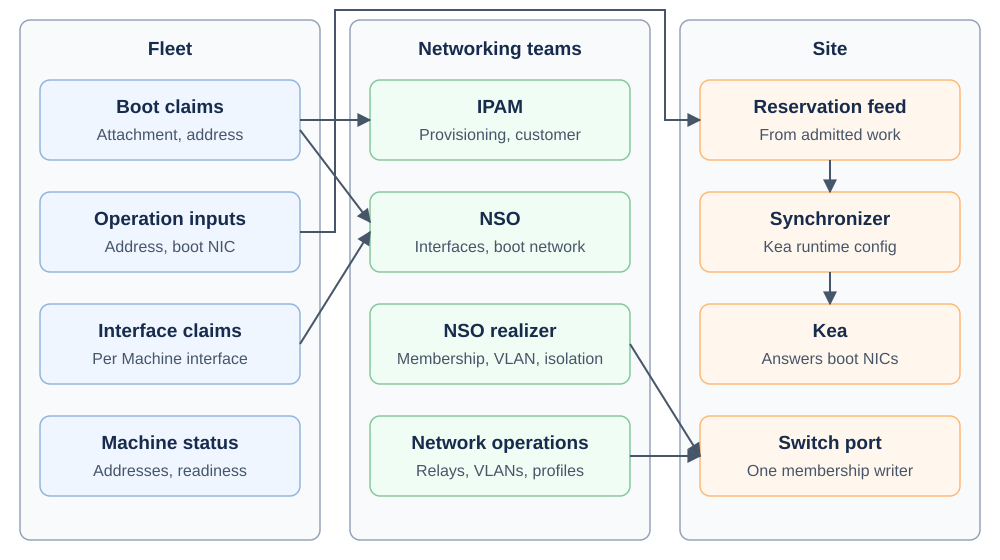

# Server networking

[Documentation overview](../../README.md) · [Functionality guide](../../functionality/README.md)

- [Summary](#summary)
- [Motivation](#motivation)
- [Proposal](#proposal)
- [Design details](#design-details)
  - [Ownership](#ownership)
  - [Boot network](#boot-network)
  - [Customer network attachment](#customer-network-attachment)
  - [When NSO is unavailable](#when-nso-is-unavailable)
  - [Boot NIC choice](#boot-nic-choice)
  - [Write order and crash recovery](#write-order-and-crash-recovery)
  - [Dependencies and requests to other teams](#dependencies-and-requests-to-other-teams)
  - [Decisions for a person](#decisions-for-a-person)
  - [Acceptance tests](#acceptance-tests)
- [Production readiness review questionnaire](#production-readiness-review-questionnaire)
- [Implementation history](#implementation-history)
- [Drawbacks](#drawbacks)
- [Alternatives](#alternatives)
- [Infrastructure needed](#infrastructure-needed)

## Summary

A bare-metal server uses two kinds of network. Firmware needs a boot network
while Fleet installs or wipes the server. The customer's operating system needs
the customer's networks for as long as the customer holds the server.

This enhancement defines both on top of [Device custody and
operations](../device-operations/README.md):

- **Boot network.** The boot network is a provider-owned NSO network. Each
  installation and wipe carries a provisioning address and the boot NIC from
  Device inventory. Fleet's boot services, which run in a central cluster rather
  than at the site, answer that NIC over relayed DHCP only while the operation
  is admitted, boot it over UEFI HTTP boot into the installer, and end the
  operation only after every DHCP instance reports the reservation withdrawn.
- **Customer network attachment.** The Fleet provider for Metal asks NSO for one
  interface per requested Machine interface. NSO assigns addresses through
  IPAM. Handing the server to the customer is one NSO step on each switch port,
  off the boot network and onto the customer's networks. Fleet reports the
  result on the Machine.

NSO is the only writer of a switch port's network membership, boot and
customer alike. Fleet never configures a switch, a router, or a relay. NSO's
physical attachment mode is a planned dependency, designed separately. Until
it lands, the provisioning address comes from a direct IPAM claim, and that
source is built to be replaced by an NSO interface on the boot network.

A reservation feed, two evidence gates, and a Kea synchronizer exist today and
take their values from site enrollment. This enhancement changes all three,
and everything in it is proposed.

## Motivation

Today a site's enrollment lists each server's boot NIC MAC and provisioning
address by hand, and the site's DHCP reservations come from those values.
A Machine can request network interfaces, but Fleet cannot attach a physical
NIC to a customer network, because NSO has no attachment mode for a physical
server yet. That mode is planned.

### Goals

- Take provisioning addresses from IPAM and boot NICs from Device inventory.
- Answer DHCP for a boot NIC only while an operation that network-boots it
  runs, and prove the answer stopped before the operation succeeds.
- Ship the DHCP service as a deployable component that runs in a central
  cluster and serves each site through the site's relays.
- Attach an allocated server's NICs to the boot network and the customer's
  networks through NSO, with NSO as the one writer of each switch port's
  network membership.
- Report each Machine interface's addresses and readiness on the Machine.
- State exactly what network operations and the networking teams must provide.

### Non-goals

- Allocating customer addresses in Fleet. NSO and IPAM own them.
- Routing, network policy, DNS, and public exposure. Networking owns them.
- The underlay a managed node uses. Galactic and IPAM own it.
- Changing the attachment of a running server. Interfaces are fixed for the
  life of the allocation.

## Proposal



### User stories

- A customer creates a Machine on two networks. When it reports
  `NetworkReady`, its OS has an address on each network, and no other
  customer's network reaches its ports.
- A customer installs an OS. Firmware gets a provisioning address only during
  the install, and a later reboot finds no DHCP answer and boots from disk.
- A customer deletes a Machine. The server leaves the customer's networks and
  is wiped on the boot network before anyone else can allocate it.
- A DHCP instance restarts or goes silent. Installation waits instead of
  booting, and success waits until withdrawal is proven.
- A network engineer gets one list of what each site's switches and routers
  must do.

### Relationship to other proposals

- **[Device custody](../device-operations/README.md):** the boot network
  becomes an input of `DeviceInstallation` and `DeviceWipe`, checked at
  admission and delivered with the operation. The `Network` and `Address`
  release gates close on evidence from NSO instead of at once.
- **[Machine lifecycle](../machine-lifecycle/README.md#galactic-vpc-api-integration):**
  this enhancement defines the physical attachment that the lifecycle leaves
  open, and keeps its `NetworkReady` contract.
- **Boot network reservations ([#87][boot-pr]):** this enhancement keeps its
  reservation feed and evidence gates, and replaces its enrollment values and
  its static mode at synchronized sites.
- **Network handoff ([#61][handoff-pr]):** both propose physical attachment
  and disconnect. See [Decisions for a person](#decisions-for-a-person).
- **NSO physical attachment (planned):** NSO's own design for physical
  interfaces, a provider-owned boot network, and moving a port between
  networks in one step. This enhancement depends on it. See
  [Dependencies](#dependencies-and-requests-to-other-teams).

## Design details

### Ownership

| Surface | Single writer |
| --- | --- |
| Which boot NIC holds a reservation, and when | The site, from its admitted operations |
| Network boot over UEFI HTTP boot: boot loader, iPXE, and the installer | The boot service, in the central cluster |
| Provisioning addresses | IPAM, from claims the operation's requester makes; later NSO, through the boot network |
| Kea runtime configuration | The synchronizer next to each Kea instance |
| Kea base configuration: subnets, gateways, boot options | Network operations |
| The boot network and its segment at each site | NSO, as a network the provider owns |
| A switch port's network membership: boot and customer, native VLAN, and isolation on the boot network | NSO, through its physical realizer |
| Boot attachment claims, one per network-booting operation | The operation's requester |
| Relays, the provisioning VLAN, DHCP snooping on it, and each switch port's base profile | Network operations |
| Customer addresses and interfaces | NSO, through IPAM |
| Interface requests for a Machine, and their claims' UIDs in the allocation's status | The Fleet provider for Metal |
| Machine network status | The Fleet provider for Metal |

Network operations sets a switch port's base profile once: speed, bond, bond
fallback, edge mode, and LLDP. It provides each site's provisioning VLAN to NSO
as the boot network's segment there. NSO alone decides which networks a port
belongs to, including whether the boot network is its untagged VLAN and the
isolation that comes with it. NSO derives a port's membership from the claims
that name the port:

- While a boot attachment claim names the port, the port is on the boot
  network and nothing else.
- Otherwise, the port carries the customer networks of the allocation's
  interface claims that name it.
- With neither, the port is on no network.

Each change is one NSO step on the port. Handing a server to a customer is the
step that follows the release of the installation's boot attachment claim:
NSO detaches the port from the boot network and attaches the customer's
networks. Fleet writes claims and never writes a port.

### Boot network

#### What Fleet keeps

Fleet keeps the boot services, because they follow custody and NSO's do not:

- DHCP that serves a boot NIC's reservation only while its operation is
  admitted under custody's fence;
- network boot over UEFI HTTP boot: the boot loader, iPXE, and the
  installer; and
- proof that every DHCP instance dropped the reservation before the operation
  succeeds.

NSO owns where the boot NIC's port is attached. Fleet owns what answers it
there, and when.

#### Boot attachment

Before the requester creates an operation that network-boots the server, it
creates one NSO boot attachment claim for the boot NIC, named from the
operation: a `Physical` interface claim on the boot network, with the boot
NIC's MAC address and switch port from inventory. It waits until NSO reports
the claim `Programmed`, then claims the provisioning address and creates the
operation. The operation's own checks are unchanged: the site still powers the
server on only after DHCP reports the reservation served.

The requester deletes the boot attachment claim under the same rules as the
address claim below, so a port stays on the boot network until no DHCP
instance can still serve its operation's address. While a held operation keeps
its claim, the port stays on the boot network.

At release, the Machine's interface claims are deleted first, so the port has
already left the customer's networks when the wipe's boot attachment claim is
made. On a shared boot NIC, a reinstall's boot attachment moves the port off
the customer's networks for the install, and the Machine reports
`NetworkReady=False` until the claim is released and NSO moves the port back.
The same holds for a first install on a shared boot NIC: that port's interface
stays unprogrammed, and `NetworkReady` stays `False`, until the installation's
boot attachment claim is released. A held operation keeps its claim, so the
Machine stays `NetworkReady=False`, with the hold as the reason, until the hold
is settled. On a dedicated boot NIC, the customer's ports are attached
independently of any install.

#### Provisioning address

Each site has one provisioning subnet. Network operations defines one IPAM
class for provisioning addresses, with one pool per site that covers that
subnet, reserves its gateway, and keeps each address unique within the pool.

Until NSO serves addresses on the boot network, the address comes from a
direct IPAM claim. The requester of an operation that network-boots the server
makes one IPAM claim for it, in the provider project, after its boot
attachment is programmed and before it creates the operation:

- the Fleet provider for Metal, for a `DeviceInstallation`;
- the release controller, for a `DeviceWipe`.

The claim is named from the operation and scoped to the site's location, so a
requester that crashes and runs again finds the same claim. IPAM assigns a host
address when the claim is created. The requester copies a typed reference to
the claim, its API group, kind and name, and the address into the operation.
Like every spec in this enhancement, it holds no object UID:

```yaml
apiVersion: fleet.datumapis.com/v1alpha1
kind: DeviceInstallation
metadata:
  name: alloc-3b9d61c2-install-1
spec:
  # ...the envelope and other inputs are unchanged.
  bootInterface: primary
  bootNetwork:
    addressClaim:
      apiGroup: ipam.miloapis.com
      kind: IPClaim
      name: alloc-3b9d61c2-install-1-boot
    address: 198.51.100.10
```

`DeviceWipe` gains the same `bootInterface` and `bootNetwork` fields.

Admission adds one kind check, chosen by the claim's kind. IPAM's claim is the
only kind it knows. A claim of any other kind can never be checked, so the
operation fails at once with `UnsupportedBootAddressClaim`, naming the kind,
and is never retried. The claim must be the operation's own by its name and
labels, be bound, hold that address, and be created no later than the
operation, since the requester always creates it first. A claim deleted and
recreated under the name after the operation is refused, even with the same
address. Otherwise the operation fails with `BootAddressClaimMismatch`. Only
when the claim cannot be read, because its address source is unavailable,
does the operation wait instead, `Pending` with `BootAddressUnavailable`, and
admission checks it again. The Device snapshot already records the boot NIC's
MAC from Device inventory, and the site uses only that MAC.

A claim's address belongs to the operation until no DHCP instance can still
serve it. The requester deletes the claim when one of these holds:

- The operation succeeded. Success already proves withdrawal.
- The operation failed or was cancelled. Both mean the site published no
  reservation, because the site records publishing a reservation as a sent
  step before the reservation enters the feed, and an operation with a sent
  step never ends `Failed`.
- The operation ended `OutcomeUnknown`, and its recovery hold was settled.
  Every settling operation for an installation or a wipe is a later network
  boot that succeeded at the same site, and its success gate covers every
  reservation the site ever published for the Device.
- The Device was retired.

A [custody `Retry`](../device-operations/README.md#unknown-outcomes) creates a
new operation with a new name, so it claims a new address while the held claim
stays. A claim whose operation will never be created, because the Installation
or the release that would create it is gone, is deleted by its requester when
the allocation is released, and so is any claim still left then.

#### Replacing the address source

The address source has two seams. Each requester uses a claimer that claims a
bound address under a name derived from the operation, releases it when the
rules above allow, and lists the claims of an allocation. Admission picks its
check by the kind the operation's claim reference names. IPAM's claim is the
only claimer and the only check today.

Once NSO serves addresses on the boot network, the operation's boot attachment
claim also binds its provisioning address, from the same IPAM class, and the
separate IPAM claim goes away. The swap is a new claimer, which makes the boot
attachment claim with an address, and a new admission check for that kind,
with the same rules for name, labels, bound address, creation time, and
verified release. The operation's fields, the reservation feed, the DHCP
service, the evidence gates, and the release rules do not change.

Rollout order matters. The coordinator gains the new check first, because a
coordinator without it fails an operation of the new kind with
`UnsupportedBootAddressClaim`. Requesters switch next. Each keeps the IPAM
claimer for releasing and listing its existing claims until no operation of
the allocation names the IPAM kind.

#### Reservation lifecycle


A site declares whether its DHCP is synchronized. A synchronized site refuses an
operation without a boot network input, and other sites refuse one with it.
Either refusal sends nothing.

The feed changes shape. A reservation carries the boot NIC's MAC and a host
address only. The gateway and prefix come from the base configuration.

At a synchronized site, the boot NIC holds the operation's address while all of
these hold:

- the operation's boot window is open;
- the operation's fence is the Device's stored fence; and
- the operation has no result.

The site serves the full reservation set as a feed. Each synchronizer applies
the feed to its Kea instance and reports the exact feed it applied. Kea places
each reservation in the base subnet that contains its address. A reservation
whose address no base subnet contains fails the cycle and is never dropped, so
a provisioning class that does not match the base configuration stops every
boot at the site until it is fixed.

The site worker gates effects on those reports:

1. Before it powers on the server for a network boot, it waits for a report,
   accepted after the operation's boot window opened, that serves the boot NIC
   at the operation's address.
2. Before it reports success, it waits until at least one of the site's
   declared instances served the reservation during the operation, and every
   declared instance's latest report is of a feed issued after the reservation
   was published and serves no MAC or address the site ever published for the
   Device. A declared instance that never reports, or went silent while it may
   serve one, keeps the outcome unknown until an operator stops it and then
   removes it from the declared set.

#### DHCP service

The DHCP service runs in a central cluster, not at the site, and so does the
boot service. No DHCP or boot service runs at the site; the site's relays,
which network operations already operates, carry the boot traffic there. Each
site has its own set of instances, because each set applies one site's feed
and reports to that site alone. It has these parts:

- **Instances.** At least two Kea DHCPv4 servers per site, each paired with one
  synchronizer and each with a stable name. They share one load-balancer
  address on UDP port 67, which the site's relays reach over the site's WAN
  link. Kea accepts only relayed requests, so it needs no broadcast and no
  host networking. Any instance may answer. Each applies the same feed and
  reports under its own name; one that has not applied a reservation yet stays
  silent, and the firmware retries.
- **Declared set.** The site declares its instances' names. The feed serves and
  accepts reports only from a declared name, so an undeclared replica never
  receives a reservation to serve. Scaling up declares the new name first.
  Scaling down drains the instance until it reports an empty feed, then removes
  its name. Removing a name is the only way to stop the withdrawal proof from
  waiting on that instance, and an operator removes it only after that
  instance is stopped and out of the load balancer, so a removed instance can
  never answer with a reservation the proof no longer watches. Fleet enforces
  the order where it can see it: the feed records every request from an
  undeclared name, and the withdrawal proof does not pass while a removed
  instance still contacts the feed. The feed cannot see the cluster's Pods,
  so an instance whose synchronizer stopped while Kea keeps serving is not
  detected; for that case the order still rests on the operator.
- **Replies.** Kea answers each request at the relay address the request
  carries, on UDP port 67. The central cluster must route to every relay
  address, and each relay must accept replies from the cluster's egress
  address, which is not always the load-balancer address it forwarded to.
- **Base configuration.** Network operations owns it. It names the site's
  provisioning subnet, gateway, and boot options, accepts only relayed
  requests from the site's relay addresses, and has no address pools.
- **Feed.** Fleet serves each site's feed over TLS only, apart from the
  firmware-facing boot listener. Each synchronizer authenticates with that
  site's token. The token and the TLS key are delivered as secrets, never in
  Git.

#### Boot files

Firmware boots over UEFI HTTP boot, never TFTP, because the boot files now
cross from the central cluster to the site. The base configuration answers the
HTTP boot vendor class with the boot service's URL in the central cluster.

The boot service identifies the booting NIC by the MAC address in the request
path, never by the request's source address, which relays and address
translation can change. It answers that NIC only while its operation's boot
window is open. The boot files hold no secrets, and the boot service serves
the installer from an image pinned by digest. Over plain HTTP that pin protects
the files only if the path between the site and the central cluster is
private; whether boot files require HTTPS, which needs the boot service's CA in
each server's firmware, is listed under [Decisions for a
person](#decisions-for-a-person). Servers whose firmware cannot boot over HTTP
are not supported.

#### Fence and withdrawal proof across the WAN

Moving DHCP out of the site changes where Kea runs, not what decides a
reservation or proves it gone:

- The feed is still computed from the site's admitted operations under
  custody's fence, so only the operation holding the Device's stored fence has
  a reservation, wherever Kea runs.
- Each report names a declared instance and the exact feed it applied, so the
  power-on gate and the withdrawal gate read the same evidence as before, over
  a set of instances fixed in advance rather than whichever replica answered.
- A WAN outage cuts the site's relays off from the central cluster. The feed
  and the reports are unaffected, but no DHCP request or boot file reaches the
  site, so boots stall: firmware gets no answer, and an operation that cannot
  boot ends unknown, never succeeded.
- An instance that cannot reach the feed, or goes silent, keeps its last
  applied configuration. Its last report still shows what it may be serving,
  so the withdrawal gate keeps any operation it may serve unknown until an
  operator stops it, takes it out of the load balancer, and removes its name.

#### Network operations requirements

Each site needs:

1. **Provisioning VLAN.** One per site or per rack, provided to NSO as the boot
   network's segment, and untagged on a boot NIC's port while NSO attaches it
   to the boot network, so firmware boots without VLAN settings.
2. **Isolation on the provisioning VLAN only.** A private VLAN or equivalent,
   so a server reaches only the gateway on the provisioning VLAN. Isolation
   must not apply to customer VLANs on the same port.
3. **Edge ports.** Spanning tree edge mode on server ports, so a port forwards
   before firmware's DHCP times out.
4. **Bond fallback.** Where the boot NIC is a member of an LACP bond, LACP
   fallback to an individual port, so a member with no LACP partner forwards on
   its native VLAN. Configure the fallback timeout below the DHCP timeout of
   every firmware qualified at the site, measured during qualification.
   Vendors call this "LACP fallback", "no suspend-individual", or "force-up".
5. **DHCP relay.** On the gateway of each provisioning subnet, relay to the Kea
   instances' load-balancer address in the central cluster, with the
   gateway address as the relay address, and accept the replies described in
   [DHCP service](#dhcp-service).
6. **Reachability.** Provisioning subnets reach only the central cluster's DHCP
   and boot service addresses, over the site's WAN link. They reach no customer
   network, no BMC network, and no other internet address. Measure the DHCP
   round trip across the link against every firmware's DHCP timeout during
   qualification.
7. **Spoofing protection.** DHCP snooping and source address binding on the
   provisioning VLAN, so a server cannot use another server's boot NIC MAC or
   provisioning address.
8. **LLDP.** Switches send LLDP on server ports, so BMC discovery can confirm
   which switch port each NIC is cabled to.
9. **Names.** Fleet inventory's cable records use the switch and port names the
   network owner uses.
10. **UEFI HTTP boot.** Firmware on every server boots over HTTP. There is no
    TFTP path.

### Customer network attachment


#### Request

Each entry in `Machine.spec.networkInterfaces` names a MachineProfile interface
slot and a Network. Each slot maps to one interface in Device inventory, and
inventory's cable record names the switch port at its other end.

Before allocation, the Fleet provider for Metal checks:

- each slot exists in the profile;
- each Network exists in the Machine's project, is ready, and carries the
  requested address families;
- the Machine's creator may use each Network and address class; and
- the location supports physical attachment.

A failed check leaves the Machine `Pending` and reserves no capacity.
Interfaces are checked again after allocation. If one no longer fits, the
Machine keeps its server and reports `NetworkReady=False`, and deleting the
Machine releases the server.

#### Attachment

After allocation, the Fleet provider for Metal creates one NSO interface claim
per Machine interface, named from the allocation and the interface. Claims live
where only the Fleet provider can write them, so a customer cannot create or
replace one. Each claim uses NSO's planned `Physical` attachment mode and names
its attachment point:

- the host interface's MAC address, from Device inventory; and
- the switch and port it is cabled to, from inventory's cable records.

Then:

1. NSO assigns addresses through IPAM and writes the interface: addresses,
   gateway, and MTU.
2. NSO's physical realizer checks that the attachment point belongs to the
   allocation and reports the interface `Prepared`. Once no boot attachment
   claim names the port, it attaches the port to the Network's segment at that
   location, moving it off the boot network in the same step if it was there,
   and reports it `Programmed`.
3. Fleet copies the interface's addresses, gateway, MTU, and the host
   interface's MAC address into `Machine.status.network`.

`NetworkReady` keeps the [machine lifecycle
contract](../machine-lifecycle/README.md#network-interfaces): every interface
must be `Allocated`, `Prepared`, and `Programmed` at the Machine's generation.

#### Host configuration

A physical server has no node agent to configure its NICs. An installation
therefore carries the host network configuration: for each Machine interface,
its MAC address, addresses, gateway, and MTU. It is pinned by digest like the
other installation inputs, and a later change to an interface does not change an
admitted installation. An installation waits for every interface to be
`Allocated`, not `Programmed`. A Machine handed off without an installation
reports the same values in status, and the customer configures the OS.

#### Release

When a Machine is deleted, the Fleet provider for Metal deletes its interface
claims. NSO keeps each claim until the realizer has removed the port from the
customer's segment. Then it returns the addresses to IPAM, or keeps them for an
interface that asked to retain them. The release controller closes the
`Network` and `Address` gates when every claim of the allocation is gone, and a
claim that never goes away keeps the server out of use. The `Network` gate
closes before the wipe is created. Release then wipes the server on the boot
network, through the wipe's own boot attachment claim.

### When NSO is unavailable

Every network boot depends on NSO, because only NSO attaches a port to the
boot network. That includes the wipe at release and every recovery that
settles a hold with a later network boot. While NSO is unavailable:

- Fleet creates no installation or wipe whose boot attachment it cannot
  confirm, and claims no address for one. The request waits, sends nothing,
  and is tried again.
- An operation already admitted keeps running. Its port is already on the boot
  network, and its DHCP, boot, and withdrawal proof are Fleet's own.
- Release waits with the server held. The `Network` gate stays open, the
  server stays out of capacity, and no wipe starts on a port that may still
  be on a customer's network.
- A recovery that settles a hold by network boot waits the same way. One that
  only records a decision, such as retiring the Device, does not need NSO.
- Handoff to the customer waits, and the Machine reports `NetworkReady=False`
  with the reason.
- Fleet never writes a switch port to work around NSO.

If NSO stays unavailable, or a claim never goes away, the server stays out of
use: release cannot close its `Network` gate. Retiring the Device needs no NSO,
but its claims remain until NSO removes them. What an operator does then is
listed under [Decisions for a person](#decisions-for-a-person).

### Boot NIC choice

Whether the boot NIC is dedicated or shared with customer networks stays open.
It changes what NSO does at handoff, not what Fleet's boot services do:

- **Shared boot NIC.** The boot NIC also carries customer networks. NSO moves
  that port between the boot network, untagged and isolated, and the
  customer's networks, tagged, whenever a boot attachment claim is made or
  released. A reinstall takes the customer's networks off that port for the
  install. Where the NIC is in an LACP bond, the port needs bond fallback.
- **Dedicated boot NIC.** The boot NIC carries only the boot network, and
  customer ports never do. NSO attaches the boot port only while a boot
  attachment claim names it, and the port is on no network otherwise. The
  customer's ports keep their networks through a reinstall. Handoff is the
  first attachment of the customer's ports, not a move. It costs a port per
  server and needs no bond fallback.

### Write order and crash recovery

| Change | Order | After a crash between the writes |
| --- | --- | --- |
| Boot address for an operation | IPAM claim, then operation, both named from the operation | The requester finds the claim by name and creates the operation. A claim whose operation will never be created is deleted. |
| Release a boot address | Operation ends, then the requester deletes the address claim and the boot attachment claim | The requester deletes them again. |
| Interface claims | Allocation, then each claim, named from the allocation and interface, then the claim's UID in the allocation's status | The provider finds each claim by name in a namespace only it can write, requires its spec and its Machine label to match, and records its UID in status. A claim with another spec or another UID is a conflict, and the Machine reports `NetworkReady=False`. |
| Release an interface | Delete the claim, then observe it gone | The release controller observes again. A gate closes only on absence. |
| Boot attachment before an operation | Boot attachment claim, then `Programmed`, then the address claim and the operation, all named from the operation | The requester finds the boot attachment claim by name, waits for `Programmed`, and continues. A claim whose operation will never be created is deleted with the address claim. |

### Dependencies and requests to other teams

Fleet opens nothing in other repositories.

#### NSO (planned dependency)

NSO's physical attachment mode is being designed in NSO. This enhancement
assumes it provides:

1. **Physical attachment mode.** A `Physical` interface attachment mode, for an
   interface with no node, container, or hypervisor.
2. **Attachment point.** A host MAC address and a switch and port name on the
   interface claim, copied to the interface.
3. **Provider-owned boot network.** A network the provider owns at each site,
   on the provisioning VLAN, with isolation between servers on it.
4. **Membership from claims.** A port is on the boot network while a boot
   attachment claim names it, and otherwise carries the customer networks its
   interface claims name. Each change is one step, NSO's realizer is the only
   writer of the port's membership, and `Prepared` and `Programmed` are
   reported for each interface.
5. **Claim placement and authority.** Claims a provider creates for a consumer
   project live where the consumer cannot write, and only the Fleet
   provider's identity may create `Physical` claims.
6. **Detach before delete.** A `Physical` claim stays until its port is off the
   customer's network, then its addresses are released or retained.
7. **Boot network addresses (later).** A boot attachment claim that also binds
   one provisioning address from the site's IPAM class, for the address
   source swap.

Fleet relies on NSO being available for every network boot. See [When NSO is
unavailable](#when-nso-is-unavailable).

#### Network operations

1. **Base port profiles and site requirements.** The list under [Network
   operations requirements](#network-operations-requirements), with each
   site's provisioning VLAN provided to NSO as the boot network's segment.

#### IPAM

1. **Provisioning class.** One IPAM class for provisioning addresses: private,
   one pool per site scoped to the site's location, one host address per
   claim, the gateway reserved, and addresses unique within the pool. No IPAM
   code change is needed.

### Decisions for a person

- **HTTPS for boot files.** Over plain HTTP, boot files are only as trustworthy
  as the path between the site and the central cluster. HTTPS needs the boot
  service's CA enrolled in every server's firmware. Decide which the platform
  requires.
- **Who operates the DHCP service.** This enhancement ships Kea as a Fleet
  component in a central cluster, and network operations owns its base
  configuration. Someone must be on call for it.
- **Dedicated or shared boot NIC.** See [Boot NIC choice](#boot-nic-choice) for
  how each option changes NSO's role.
- **A port NSO cannot release.** When NSO stays unavailable or a claim never
  goes away, the server is out of use until someone acts. Decide whether an
  operator may force the claim's removal through NSO, and who confirms the
  switch port is off the customer's network first.
- **Overlap with network handoff ([#61][handoff-pr]).** Both propose physical
  attachment and disconnect. Decide which one owns them.

### Acceptance tests

These tests are required and not implemented:

- An installation or wipe at a synchronized site without a bound boot address
  is refused, and nothing is sent.
- A boot address whose claim was deleted or rebound is refused at admission.
- Firmware gets a DHCP answer only while its operation runs, and a later boot
  gets none.
- A silent DHCP instance keeps the operation unknown, and its boot address
  stays claimed until the hold is settled.
- An operation that fails after its site published a reservation ends
  unknown, not failed.
- A requester crash between the claim and the operation creates one claim and
  one operation.
- A Machine on a Network its creator cannot use stays `Pending` without
  capacity.
- A Machine reports `NetworkReady` only after every interface is programmed, and
  its status shows each interface's addresses and MAC address.
- While NSO is unavailable, no installation or wipe is created, an admitted
  operation runs to its result, and release keeps the server held.
- Release closes the `Network` and `Address` gates only after every interface
  claim is gone.
- End to end at a site with real switches: a relayed boot on an LACP member,
  handoff from the boot network to two customer networks in one NSO step,
  isolation from a second customer, and release with the port off both
  customer networks before the wipe's boot attachment puts it on the boot
  network.

## Production readiness review questionnaire

### How do operators enable or disable the feature?

A site enables the boot network by declaring synchronized DHCP and deploying its
DHCP instances in the central cluster, whose names it declares. The declaration
requires NSO's boot network at that location: without it, every installation
and wipe there waits with nothing sent. A location enables customer attachment
when NSO supports `Physical` there. Disabling attachment refuses new Machines
with interfaces and leaves existing ones attached.

### What must operators monitor?

Operations waiting for a DHCP report, DHCP instances that served and went
silent, rejected reports, boot address claims older than their operation,
interfaces not `Programmed`, and releases waiting on interface claims.

### What does the feature depend on?

IPAM for addresses. NSO and its physical realizer for every port's attachment,
including the boot network, so every installation, wipe, and recovery by
network boot needs NSO. The central cluster and the site's WAN link for DHCP
and boot files, so a site cannot network-boot a server while either is down.
Network operations for relays, VLANs, and port profiles.

### Does the feature add API types or calls?

It adds no kinds. It adds the boot network input to two operation kinds; per
network-booting operation, one NSO boot attachment claim and one IPAM claim,
until the swap folds the address into the boot attachment claim; and one NSO
claim per Machine interface.

## Implementation history

- 2026-11-25: Proposed.
- 2026-11-25: NSO owns the boot network and every port's attachment; the direct
  IPAM claim becomes the interim address source.
- 2026-11-25: DHCP and boot files move to a central cluster, over relays and
  UEFI HTTP boot.

## Drawbacks

- Every network boot depends on the central cluster, the site's WAN link, the
  DHCP service, and its reports.
- Customer attachment and every network boot wait on NSO's physical mode, and
  on NSO being available.
- Installations carry static network configuration, so a customer who changes
  addresses later must also change the OS.

## Alternatives

- **One provisioning address per server.** Simpler and stable, but it holds an
  address for every idle server and cannot tell whether a silent DHCP instance
  still serves it.
- **Fleet configures switch ports.** Fleet would hold the switches'
  credentials and write the network owner's systems.
- **Network operations owns the boot attachment.** A static native VLAN on every
  port needs no NSO step to boot, but gives each port two writers, and a
  handoff would need both to change the same port in the right order.
- **NSO serves boot DHCP.** NSO would need custody's fence and the withdrawal
  proof, which Fleet already has.
- **DHCP on customer networks.** NSO has no DHCP, and a server would get a
  customer address before Fleet hands it off.
- **DHCP at each site.** A boot would not depend on the WAN link, but every
  site would run and operate provisioning services of its own.

## Infrastructure needed

The lab can run IPAM, NSO's API with a test realizer, and Kea, the
synchronizer, and the feed against emulated DHCP clients. The lab has no WAN
link, so its Kea sits beside the emulated site. Real switches are needed for
relays, LACP fallback, port isolation, the realizer, and moving a port between
the boot network and customer networks.

[boot-pr]: https://github.com/datum-cloud/fleet/pull/87
[handoff-pr]: https://github.com/datum-cloud/fleet/pull/61
