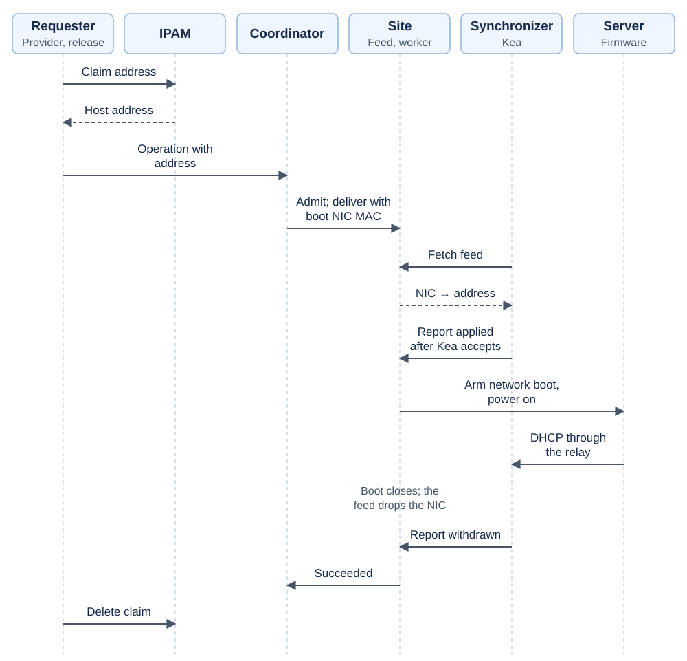
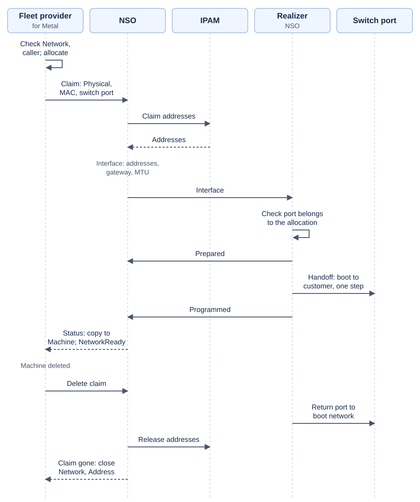

# Server networking

[Documentation overview](../../README.md) · [Functionality guide](../../functionality/README.md)

- [Summary](#summary)
- [Motivation](#motivation)
- [Proposal](#proposal)
- [Design details](#design-details)
  - [Ownership](#ownership)
  - [Boot network](#boot-network)
  - [Customer network attachment](#customer-network-attachment)
  - [Write order and crash recovery](#write-order-and-crash-recovery)
  - [Requests to other teams](#requests-to-other-teams)
  - [Decisions for a person](#decisions-for-a-person)
  - [Acceptance tests](#acceptance-tests)
- [Production readiness review questionnaire](#production-readiness-review-questionnaire)
- [Implementation history](#implementation-history)
- [Drawbacks](#drawbacks)
- [Alternatives](#alternatives)
- [Infrastructure needed](#infrastructure-needed)

## Summary

A bare-metal server uses two kinds of network. Firmware needs a boot network
while Fleet installs or wipes the server. The customer's operating system needs
the customer's networks for as long as the customer holds the server.

This enhancement defines both on top of [Device custody and
operations](../device-operations/README.md):

- **Boot network.** Each installation and wipe carries a provisioning address
  from IPAM and the boot NIC from Device inventory. A site DHCP service answers
  that NIC only while the operation runs, and the operation ends only after
  DHCP reports the reservation withdrawn.
- **Customer network attachment.** The Fleet provider for Metal asks NSO for one
  interface per requested Machine interface. NSO assigns addresses through
  IPAM, and the network owner connects the server's switch port to the
  customer's network. Fleet reports the result on the Machine.

Fleet never configures a switch, a router, or a relay. A reservation feed, two
evidence gates, and a Kea synchronizer exist today and take their values from
site enrollment. This enhancement changes all three, and everything in it is
proposed.

## Motivation

Today a site's enrollment lists each server's boot NIC MAC and provisioning
address by hand, and the site's DHCP reservations come from those values.
A Machine can request network interfaces, but Fleet cannot attach a physical
NIC to a customer network, because NSO has no attachment mode for a physical
server.

### Goals

- Take provisioning addresses from IPAM and boot NICs from Device inventory.
- Answer DHCP for a boot NIC only while an operation that network-boots it
  runs, and prove the answer stopped before the operation succeeds.
- Ship the site DHCP service as a deployable site component.
- Attach an allocated server's NICs to the customer's networks through NSO and
  IPAM, with one writer for each switch port.
- Report each Machine interface's addresses and readiness on the Machine.
- State exactly what network operations and the networking teams must provide.

### Non-goals

- Allocating customer addresses in Fleet. NSO and IPAM own them.
- Routing, network policy, DNS, and public exposure. Networking owns them.
- The underlay a managed node uses. Galactic and IPAM own it.
- Changing the attachment of a running server. Interfaces are fixed for the
  life of the allocation.

## Proposal


### User stories

- A customer creates a Machine on two networks. When it reports
  `NetworkReady`, its OS has an address on each network, and no other
  customer's network reaches its ports.
- A customer installs an OS. Firmware gets a provisioning address only during
  the install, and a later reboot finds no DHCP answer and boots from disk.
- A customer deletes a Machine. The server leaves the customer's networks and
  is wiped on the boot network before anyone else can allocate it.
- A DHCP instance restarts or goes silent. Installation waits instead of
  booting, and success waits until withdrawal is proven.
- A network engineer gets one list of what each site's switches and routers
  must do.

### Relationship to other proposals

- **[Device custody](../device-operations/README.md):** the boot network
  becomes an input of `DeviceInstallation` and `DeviceWipe`, checked at
  admission and delivered with the operation. The `Network` and `Address`
  release gates close on evidence from NSO instead of at once.
- **[Machine lifecycle](../machine-lifecycle/README.md#galactic-vpc-api-integration):**
  this enhancement defines the physical attachment that the lifecycle leaves
  open, and keeps its `NetworkReady` contract.
- **Boot network reservations ([#87][boot-pr]):** this enhancement keeps its
  reservation feed and evidence gates, and replaces its enrollment values and
  its static mode at synchronized sites.
- **Network handoff ([#61][handoff-pr]):** both propose physical attachment
  and disconnect. See [Decisions for a person](#decisions-for-a-person).

## Design details

### Ownership

| Surface | Single writer |
| --- | --- |
| Which boot NIC holds a reservation, and when | The site, from its admitted operations |
| Provisioning addresses | IPAM, from claims the operation's requester makes |
| Kea runtime configuration | The synchronizer next to each Kea instance |
| Kea base configuration: subnets, gateways, boot options | Network operations |
| Relays, the provisioning VLAN, and each switch port's base profile | Network operations |
| A switch port's membership in customer networks | The network owner's physical realizer |
| Customer addresses and interfaces | NSO, through IPAM |
| Interface requests for a Machine, and their claims' UIDs in the allocation's status | The Fleet provider for Metal |
| Machine network status | The Fleet provider for Metal |

A switch port has two writers in the network owner's systems, each for its own
fields. Network operations sets the base profile once: speed, bond, native
provisioning VLAN, isolation, and LLDP. The physical realizer adds and removes
customer network membership. Neither changes the other's fields.

### Boot network

#### Provisioning address

Each site has one provisioning subnet. Network operations defines one IPAM
class for provisioning addresses, with one pool per site that covers that
subnet, reserves its gateway, and keeps each address unique within the pool.

The requester of an operation that network-boots the server makes one IPAM
claim for it, in the provider project, before it creates the operation:

- the Fleet provider for Metal, for a `DeviceInstallation`;
- the release controller, for a `DeviceWipe`.

The claim is named from the operation and scoped to the site's location, so a
requester that crashes and runs again finds the same claim. IPAM assigns a host
address when the claim is created. The requester copies the claim's name and
address into the operation. Like every spec in this enhancement, it holds no
object UID:

```yaml
apiVersion: fleet.datumapis.com/v1alpha1
kind: DeviceInstallation
metadata:
  name: alloc-3b9d61c2-install-1
spec:
  # ...the envelope and other inputs are unchanged.
  bootInterface: primary
  bootNetwork:
    addressClaim: {name: alloc-3b9d61c2-install-1-boot}
    address: 198.51.100.10
```

`DeviceWipe` gains the same `bootInterface` and `bootNetwork` fields.

Admission adds one kind check. The claim must be the operation's own by its
name and labels, be bound, hold that address, and be created no later than the
operation, since the requester always creates it first. A claim deleted and
recreated under the name after the operation is refused, even with the same
address. Otherwise admission refuses the operation with
`BootAddressUnavailable`. The Device snapshot already records the boot NIC's
MAC from Device inventory, and the site uses only that MAC.

A claim's address belongs to the operation until no DHCP instance can still
serve it. The requester deletes the claim when one of these holds:

- The operation succeeded. Success already proves withdrawal.
- The operation failed or was cancelled. Both mean the site published no
  reservation, because the site records publishing a reservation as a sent
  step before the reservation enters the feed, and an operation with a sent
  step never ends `Failed`.
- The operation ended `OutcomeUnknown`, and its recovery hold was settled.
  Every settling operation for an installation or a wipe is a later network
  boot that succeeded at the same site, and its success gate covers every
  reservation the site ever published for the Device.
- The Device was retired.

A [custody `Retry`](../device-operations/README.md#unknown-outcomes) creates a
new operation with a new name, so it claims a new address while the held claim
stays. A claim whose operation will never be created, because the Installation
or the release that would create it is gone, is deleted by its requester when
the allocation is released, and so is any claim still left then.

#### Reservation lifecycle



A site declares whether its DHCP is synchronized. A synchronized site refuses an
operation without a boot network input, and other sites refuse one with it.
Either refusal sends nothing.

The feed changes shape. A reservation carries the boot NIC's MAC and a host
address only. The gateway and prefix come from the base configuration.

At a synchronized site, the boot NIC holds the operation's address while all of
these hold:

- the operation's boot window is open;
- the operation's fence is the Device's stored fence; and
- the operation has no result.

The site serves the full reservation set as a feed. Each synchronizer applies
the feed to its Kea instance and reports the exact feed it applied. Kea places
each reservation in the base subnet that contains its address. A reservation
whose address no base subnet contains fails the cycle and is never dropped, so
a provisioning class that does not match the base configuration stops every
boot at the site until it is fixed.

The site worker gates effects on those reports:

1. Before it powers on the server for a network boot, it waits for a report,
   accepted after the operation's boot window opened, that serves the boot NIC
   at the operation's address.
2. Before it reports success, it waits until at least one instance served the
   reservation during the operation, and no instance's latest report, however
   old, serves any MAC or address the site ever published for the Device. An
   instance that went silent while serving one keeps the outcome unknown until
   an operator retires the instance at the site.

#### Site DHCP service

The site DHCP service is a site component with these parts:

- **Instances.** At least two Kea DHCPv4 servers, each paired with one
  synchronizer. Each instance has a stable name and a fixed address that
  relays can reach.
- **Base configuration.** Network operations owns it. It names the site's
  provisioning subnet, gateway, and boot options, accepts only relayed
  requests from known relay addresses, and has no address pools.
- **Feed.** The site serves the feed over TLS, apart from the firmware-facing
  boot listener. Each synchronizer authenticates with the site's token. The
  token and the TLS key are delivered to the site as secrets, never in Git.

Scaling down drains the instance first, until it reports an empty feed.

#### Network operations requirements

Each site needs:

1. **Provisioning VLAN.** One per site or per rack, untagged on each server's
   boot NIC port, so firmware boots without VLAN settings.
2. **Isolation on the provisioning VLAN only.** A private VLAN or equivalent,
   so a server reaches only the gateway on the provisioning VLAN. Isolation
   must not apply to customer VLANs on the same port.
3. **Edge ports.** Spanning tree edge mode on server ports, so a port forwards
   before firmware's DHCP times out.
4. **Bond fallback.** Where the boot NIC is a member of an LACP bond, LACP
   fallback to an individual port, so a member with no LACP partner forwards on
   its native VLAN. Configure the fallback timeout below the DHCP timeout of
   every firmware qualified at the site, measured during qualification.
   Vendors call this "LACP fallback", "no suspend-individual", or "force-up".
5. **DHCP relay.** On the gateway of each provisioning subnet, relay to every
   Kea instance address, with the gateway address as the relay address.
6. **Reachability.** Provisioning subnets reach only the site's DHCP service and
   boot service. They reach no customer network, no BMC network, and no
   internet.
7. **Spoofing protection.** DHCP snooping and source address binding on the
   provisioning VLAN, so a server cannot use another server's boot NIC MAC or
   provisioning address.
8. **LLDP.** Switches send LLDP on server ports, so BMC discovery can confirm
   which switch port each NIC is cabled to.
9. **Names.** Fleet inventory's cable records use the switch and port names the
   network owner uses.
10. **UEFI HTTP Boot.** The base configuration answers the HTTP Boot vendor
    class with the boot service's URL, for firmware that boots over HTTP.

### Customer network attachment



#### Request

Each entry in `Machine.spec.networkInterfaces` names a MachineProfile interface
slot and a Network. Each slot maps to one interface in Device inventory, and
inventory's cable record names the switch port at its other end.

Before allocation, the Fleet provider for Metal checks:

- each slot exists in the profile;
- each Network exists in the Machine's project, is ready, and carries the
  requested address families;
- the Machine's creator may use each Network and address class; and
- the location supports physical attachment.

A failed check leaves the Machine `Pending` and reserves no capacity.
Interfaces are checked again after allocation. If one no longer fits, the
Machine keeps its server and reports `NetworkReady=False`, and deleting the
Machine releases the server.

#### Attachment

After allocation, the Fleet provider for Metal creates one NSO interface claim
per Machine interface, named from the allocation and the interface. Claims live
where only the Fleet provider can write them, so a customer cannot create or
replace one. Each claim uses the proposed `Physical` attachment mode and names
its attachment point:

- the host interface's MAC address, from Device inventory; and
- the switch and port it is cabled to, from inventory's cable records.

Then:

1. NSO assigns addresses through IPAM and writes the interface: addresses,
   gateway, and MTU.
2. The network owner's physical realizer checks that the attachment point
   belongs to the allocation, reports the interface `Prepared`, adds the
   switch port to the Network's segment at that location, and reports it
   `Programmed`.
3. Fleet copies the interface's addresses, gateway, MTU, and the host
   interface's MAC address into `Machine.status.network`.

`NetworkReady` keeps the [machine lifecycle
contract](../machine-lifecycle/README.md#network-interfaces): every interface
must be `Allocated`, `Prepared`, and `Programmed` at the Machine's generation.

#### Host configuration

A physical server has no node agent to configure its NICs. An installation
therefore carries the host network configuration: for each Machine interface,
its MAC address, addresses, gateway, and MTU. It is pinned by digest like the
other installation inputs, and a later change to an interface does not change an
admitted installation. An installation waits for every interface to be
`Allocated`, not `Programmed`. A Machine handed off without an installation
reports the same values in status, and the customer configures the OS.

#### Release

When a Machine is deleted, the Fleet provider for Metal deletes its interface
claims. NSO keeps each claim until the realizer removes the port from the
customer's segment. Then it returns the addresses to IPAM, or keeps them for
an interface that asked to retain them. The release controller closes the
`Network` and `Address` gates when every claim of the allocation is gone, and
a claim that never goes away keeps the server out of use. Release then wipes
the server on the boot network as before.

### Write order and crash recovery

| Change | Order | After a crash between the writes |
| --- | --- | --- |
| Boot address for an operation | IPAM claim, then operation, both named from the operation | The requester finds the claim by name and creates the operation. A claim whose operation will never be created is deleted. |
| Release a boot address | Operation ends, then the requester deletes the claim | The requester deletes the claim again. |
| Interface claims | Allocation, then each claim, named from the allocation and interface, then the claim's UID in the allocation's status | The provider finds each claim by name in a namespace only it can write, requires its spec and its Machine label to match, and records its UID in status. A claim with another spec or another UID is a conflict, and the Machine reports `NetworkReady=False`. |
| Release an interface | Delete the claim, then observe it gone | The release controller observes again. A gate closes only on absence. |

### Requests to other teams

Fleet opens nothing in other repositories. These are the asks, in priority
order.

#### NSO

1. **Physical attachment mode.** Add `Physical` to the interface attachment
   modes. A physical interface has no node, container, or hypervisor.
2. **Attachment point.** Add an attachment point to the interface claim and
   copy it to the interface: a host MAC address, and a switch and port name.
   Validate the MAC's format and require both names for `Physical`.
3. **Claim placement.** Define where a provider that is not compute creates
   claims for a consumer project, in a namespace the consumer cannot write.
   Compute creates them in a location cell's namespace. Fleet runs in the
   provider project and reaches the consumer project through Milo.
4. **Who may attach a port.** Allow only the Fleet provider's identity to
   create `Physical` claims.
5. **Detach before delete.** Keep a `Physical` claim until the realizer reports
   the port removed from the segment, then release or retain its addresses.

#### Networking and network operations

1. **Physical realizer.** A component that reads `Physical` interfaces, checks
   each attachment point against the allocation Fleet records for that
   server, adds and removes the named port's membership in the Network's
   segment, and writes `Prepared`, `Programmed`, and the attachment reference.
   It is the only writer of that membership.
2. **Base port profiles and site requirements.** The list under [Network
   operations requirements](#network-operations-requirements).

#### IPAM

1. **Provisioning class.** One IPAM class for provisioning addresses: private,
   one pool per site scoped to the site's location, one host address per
   claim, the gateway reserved, and addresses unique within the pool. No IPAM
   code change is needed.

### Decisions for a person

- **Who operates the site DHCP service.** This enhancement ships Kea as a Fleet
  site component, and network operations owns its base configuration. Someone
  must be on call for it.
- **Dedicated boot NIC.** Isolation on the provisioning VLAN is enough when the
  boot NIC also carries customer networks as tagged VLANs. A dedicated boot NIC
  costs a port per server and avoids bond fallback.
- **The `Physical` attachment contract.** NSO and Networking must accept or
  change the asks above. Until they do, Fleet refuses Machines that request
  interfaces.
- **Overlap with network handoff ([#61][handoff-pr]).** Both propose physical
  attachment and disconnect. Decide which one owns them.

### Acceptance tests

These tests are required and not implemented:

- An installation or wipe at a synchronized site without a bound boot address
  is refused, and nothing is sent.
- A boot address whose claim was deleted or rebound is refused at admission.
- Firmware gets a DHCP answer only while its operation runs, and a later boot
  gets none.
- A silent DHCP instance keeps the operation unknown, and its boot address
  stays claimed until the hold is settled.
- An operation that fails after its site published a reservation ends
  unknown, not failed.
- A requester crash between the claim and the operation creates one claim and
  one operation.
- A Machine on a Network its creator cannot use stays `Pending` without
  capacity.
- A Machine reports `NetworkReady` only after every interface is programmed, and
  its status shows each interface's addresses and MAC address.
- Release closes the `Network` and `Address` gates only after every interface
  claim is gone.
- End to end at a site with real switches: a relayed boot on an LACP member,
  attachment to two customer networks, isolation from a second customer, and
  release with the port removed from both networks.

## Production readiness review questionnaire

### How do operators enable or disable the feature?

A site enables the boot network by declaring synchronized DHCP and deploying the
site DHCP service. A location enables customer attachment when NSO and the
realizer support `Physical` there. Disabling attachment refuses new Machines
with interfaces and leaves existing ones attached.

### What must operators monitor?

Operations waiting for a DHCP report, DHCP instances that served and went
silent, rejected reports, boot address claims older than their operation,
interfaces not `Programmed`, and releases waiting on interface claims.

### What does the feature depend on?

IPAM for addresses. NSO and the physical realizer for attachment. Network
operations for relays, VLANs, and port profiles.

### Does the feature add API types or calls?

It adds no kinds. It adds the boot network input to two operation kinds, one
IPAM claim per network-booting operation, and one NSO claim per Machine
interface.

## Implementation history

- 2026-11-25: Proposed.

## Drawbacks

- Every network boot depends on the site DHCP service and its reports.
- Customer attachment waits on two other teams.
- Installations carry static network configuration, so a customer who changes
  addresses later must also change the OS.

## Alternatives

- **One provisioning address per server.** Simpler and stable, but it holds an
  address for every idle server and cannot tell whether a silent DHCP instance
  still serves it.
- **Fleet configures switch ports.** Fleet would hold the switches'
  credentials and write the network owner's systems.
- **DHCP on customer networks.** NSO has no DHCP, and a server would get a
  customer address before Fleet hands it off.
- **Central DHCP outside the site.** Possible behind the same feed, but each
  boot would depend on a link out of the site.

## Infrastructure needed

The lab can run Kea, the synchronizer, and the feed against emulated DHCP
clients, and NSO's API with a test realizer. Real switches are needed for
relays, LACP fallback, port isolation, and the realizer.

[boot-pr]: https://github.com/datum-cloud/fleet/pull/87
[handoff-pr]: https://github.com/datum-cloud/fleet/pull/61
