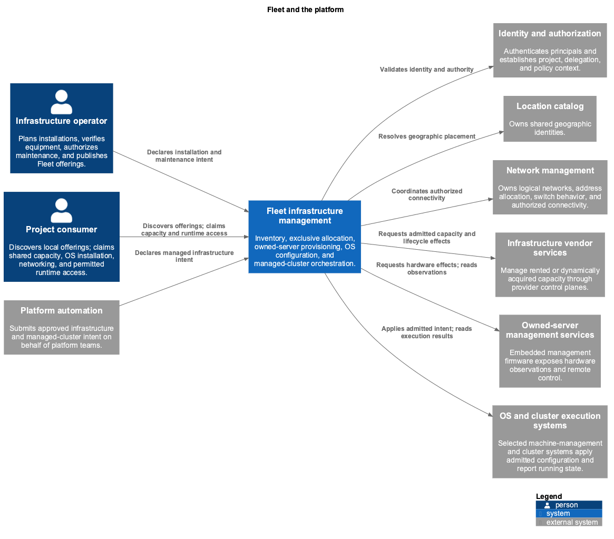

<!-- omit from toc -->
# Fleet infrastructure management service

> Provisional design imported from infra PRs #5782 and #7705. See the
> [migration record](MIGRATION.md) for exact source revisions, review history,
> and unresolved follow-ups. Examples are proposed contracts, not deployable APIs.

- [Summary](#summary)
- [Problem](#problem)
- [Goals](#goals)
- [Non-goals](#non-goals)
- [Proposal](#proposal)
  - [Enhancement scope and experiences](#enhancement-scope-and-experiences)
  - [Subsystems](#subsystems)
  - [How Fleet works](#how-fleet-works)
  - [Service architecture](#service-architecture)
  - [Resource model](#resource-model)
  - [Authority and references](#authority-and-references)
  - [Providers](#providers)
  - [Platform integrations](#platform-integrations)
- [Rollout plan](#rollout-plan)
- [Acceptance gates](#acceptance-gates)
- [Open questions](#open-questions)

## Summary

Fleet is Datum's infrastructure management service. It brings physical inventory,
capacity allocation, provisioning, operating system configuration, and cluster
orchestration under one product. Operators can plan installations, verify what
arrived, prepare equipment, and offer capacity. Customers can obtain machines and
manage their permitted installation, networking, power, and console capabilities.
The same service supports owned and rented infrastructure and managed clusters.

Each subsystem has a separate authority and lifecycle. Inventory records intended
physical installations and actual assets. Provisioning performs authorized
hardware work. Allocation reserves usable compute capacity. OS configuration
produces and applies approved software inputs. Cluster orchestration manages node
identity, membership, and coordinated changes. Being part of Fleet does not give
one controller permission to edit every subsystem's intent.

Fleet's service model supports user, developer, and agent experiences over the
same capabilities and lifecycle guarantees. APIs are one integration surface;
portals, command-line tools, automation, and authorized agents are ways to use the
service. Each must present consistent outcomes, progress, and authority. Detailed
experience designs can evolve through their own enhancements.

This enhancement area covers the service as a whole. Its current foundation
defines responsibilities, domain concepts, lifecycle and execution contracts,
architecture, and rollout. It does not select a provisioning engine. The
[us-east-1 example](examples/us-east-1-alice.md) covers adoption of rented capacity
and managed clusters. The [owned bare-metal journey](examples/owned-bare-metal/README.md)
covers planning, registration, cabling verification, preparation, customer
allocation, installation, networking, and OOB access.

## Problem

Operators copy site and node facts across overlays, Omni templates, IPAM
registers, BGP configuration, and inventory. Nothing establishes which copy is
authoritative or whether the physical installation matches the plan. Hardware
identity and node identity are mixed, so replacing a machine can change a node's
name and network identity. OS configuration has multiple writers. Provider IDs
can disappear into short-lived CI artifacts while billing continues.

Owned infrastructure adds another lifecycle: equipment must be planned, installed,
authenticated, connected, verified, prepared, and maintained before allocation.
A discovered serial number is neither an approved installation nor permission to
wipe the machine. A healthy link does not prove rack position or the identity of
every cable. Customer bare-metal use also needs allocation-scoped console, power,
installation, and networking without access to operator credentials.

## Goals

- Keep physical installation intent, actual assets, compute allocation, OS
  incarnation, and managed node identity independently understandable.
- Plan racks and required connections before equipment arrives, then compare
  trusted evidence against the approved plan.
- Use one allocator for standalone customers and managed clusters.
- Let a consumer size its pools from demand, without a human editing replicas.
- Run per-node platform services as a Fleet capability rather than per-host
  manifests or a consumer's tenant API.
- Automatically publish eligible machine classes into consumer projects and
  allocate shared provider inventory across project boundaries.
- Support owned bare metal and rented infrastructure through typed provider
  contracts; keep service behavior independent of the provisioning backend.
- Make disruptive actions explicit, authorized, recoverable, and scoped to exact
  asset and allocation identities.
- Preserve owned assets through customer release while revoking access and
  completing required isolation and cleaning before reuse.
- Give each fact and configuration surface one authoritative writer.
- Report desired state, observed state, uncertainty, and actionable discrepancies.
- Give user, developer, and agent experiences a consistent service foundation
  for discovery, planning, execution, and understanding results.

## Non-goals

- Selecting a provisioning product or building a replacement execution engine.
- Treating all Fleet resources as one API group, permission scope, or controller.
- Purchasing physical capacity automatically when owned inventory is exhausted.
- Detailed procurement, warehouse, and field-work scheduling in the initial
  physical-inventory implementation.
- Making every physical fact electronically discoverable. Scans and verified
  installation records are valid evidence with explicit provenance.
- Adding a Fleet `Node` kind; Kubernetes already has one.
- Taking over tenant network, IPAM, service address, DNS, certificate, or Galactic
  routing intent. Fleet integrates with those authorities.

## Proposal

### Enhancement scope and experiences

This is the umbrella enhancement area for Fleet. Subsystem and experience
enhancements can develop independently while preserving common service behavior
and ownership.

The [first bare-metal version](bare-metal-provisioning.md#first-version-scope)
delivers general-purpose provisioning for customer and internal workloads, with
OS-independent allocation, networking, installation, power, console access, and
release. Internal Talos/Kubernetes hosts consume this same service. Customers
can use supported operating systems without joining a Fleet-managed cluster.

- **Service foundation:** Define capabilities, subsystem responsibilities, lifecycle
  guarantees, architecture, integration contracts, and operations. Established by this
  proposal and its companions.
- **User experience:** Help operators plan and verify installations, diagnose issues, and
  manage capacity; help customers obtain and operate infrastructure. Future enhancements
  for journeys, information presentation, and interaction design.
- **Developer experience:** Make integration predictable through APIs, SDKs, command-line
  tools, documentation, examples, and automation workflows. Current contract examples
  provide a foundation; dedicated developer tooling and experience follow separately.
- **Agent experience:** Let authorized agents discover capabilities, understand
  requirements, plan actions, follow long-running work, and explain results. Future
  enhancements for agent interaction, delegated actions, and structured feedback.

Experiences share service identities, permissions, and operation semantics. A
portal action, SDK call, or agent task does not create a separate allocator or
change the meaning of readiness. Future experience work can improve how intent
is expressed and results are understood without exposing backend workflows.

### Subsystems

- **[Inventory](inventory.md):** Plan installations, register physical assets, and
  verify equipment, placement, cabling, and power against approved expectations.
  Maintain provider-neutral records of facilities, racks, devices, and topology.
- **[Machine allocation](bare-metal-hardware.md):** Offer eligible capacity, reserve
  machines exclusively for customers or managed clusters, and coordinate
  activation, delegated access, and release. [Capacity publication](capacity-publication.md)
  registers local machine classes so consumer projects can claim provider-owned
  inventory without direct access to it.
- **[Bare-metal provisioning](bare-metal-provisioning.md):** Prepare and operate
  owned servers through qualified execution adapters. Manage inspection,
  provisioning, power and boot control, console access, cleaning, and recovery.
- **[Operating system configuration](os-configuration.md):** Resolve approved
  software and configuration, coordinate requested installations, and manage
  admitted configuration changes for managed infrastructure.
- **[Cluster orchestration](cluster-lifecycle.md):** Manage cluster capacity,
  membership, node continuity, and coordinated changes using the shared
  allocation and OS services.
- **[Node services](node-services.md):** Run platform services once per managed
  node slot, such as the Private DNS resolvers, and gate node readiness on them.
  Consumers inherit them on every node; standalone machines never run them.

Allocation and OS installation are service capabilities available without a
Cluster or NodeClaim. Cluster orchestration consumes those same capabilities as
standalone projects. Networking manages switch behavior and logical attachments;
inventory remains the source of physical endpoints and wiring.

### How Fleet works

1. **Plan and verify infrastructure.** Operators describe expected equipment,
   placement, cabling, and power before installation. Trusted registration ties
   actual equipment to that plan. Fleet reports what matches, what is missing,
   and what needs correction while preserving both expectations and observations.
2. **Prepare and offer capacity.** Operators authorize preparation and publish the
   capabilities customers may use. Equipment becomes available only when its
   verification, preparation, and management requirements are satisfied. Rented
   capacity enters through provider adoption or explicitly permitted acquisition.
   Fleet automatically registers references to provider MachineClasses in eligible
   consumer projects, while the machines remain in their provider project.
3. **Fulfill a claim.** A customer selects a local machine class and requests the
   required location, capabilities, networks, and optional initial OS installation.
   Fleet reserves compatible provider-owned capacity exclusively across projects,
   coordinates installation and connectivity, and reports progress. When eligible
   capacity is unavailable, the request stays pending with an explanation;
   owned capacity is finite.
4. **Operate the allocation.** Customers use their permitted power, console, and
   reinstall capabilities through the platform. They retain control of a
   self-managed OS after handoff. Managed clusters use the same allocation path,
   with additional orchestration for membership, configuration, and replacement.
5. **Release and reuse.** Fleet revokes customer access, disconnects or isolates
   networking, and completes the owner's cleanup requirements before making an
   owned machine available again. Incomplete work remains visible and keeps the
   machine unavailable.

The [owned-server journey](examples/owned-bare-metal/README.md) follows these steps
with YAML examples. The [us-east-1 journey](examples/us-east-1-alice.md) applies the
same responsibilities to rented infrastructure and managed clusters.

### Service architecture

Fleet coordinates these workflows while relying on shared platform services for
identity, geographic locations, and networking. Operators, customers, and
automation use the same service guarantees. Provider integrations connect Fleet
to owned hardware, rented infrastructure, and OS or cluster execution systems.

Within Fleet, inventory verification, allocation, provisioning, OS configuration,
and cluster orchestration retain separate responsibilities. The
[service architecture](architecture.md) explains how they coordinate a request
and recover interrupted work. The [provisioning architecture](bare-metal-provisioning.md#architecture)
describes execution and console access for owned machines.

### Resource model

The resource model describes the service's durable concepts and programmable
contracts. These API shapes are proposed, not implemented CRDs; they do not
define the entire product or prescribe a user interface. Inventory is designed
for the target service, independent of today's inventory schema.

Proposed groups are `fleet.datumapis.com` for shared allocation,
OS, and cluster APIs; `inventory.fleet.datumapis.com` for physical inventory;
and `baremetal.fleet.datumapis.com` for the owned bare-metal provider. Vendor
and OS adapters have their own typed groups. Group names and administrative
scope remain schema decisions; subsystem authority does not depend on a domain
name.

MachineClass defines capacity in the provider project or references that definition
from a consumer project through `spec.source`. Definition and reference are
mutually exclusive forms. Service publication and IAM determine which projects
receive and may use those references, separately from the capacity definition.
MachineClaim is the consumer's request; its private binding can reserve a Machine
in a different project. Class discovery, permission, and exclusive allocation
have separate authority and lifetimes.

A Facility represents physical premises, independent of vendors. A Site expresses
operational placement policy under a Location, including a selector over eligible
Facilities. Provider facility codes remain adapter mappings to those Facilities.
Changing a selector affects future selection; it does not move equipment, change
its verified location, or terminate existing allocations.

### Authority and references

1. **Expected installation and actual asset are different objects.** Operators
   author DeviceClaim and Cable plans. A trusted registration service creates a
   Device only against an accepted, authorized claim and commits an exclusive
   UID binding. Equipment cannot manufacture its own approval. Registration can
   precede complete physical verification so wiring errors remain diagnosable.
2. **Cable owns expected topology.** Planned endpoints may reference DeviceClaim
   ports before registration. Status resolves them to Device components after
   binding; no competing expected-peer list lives on DeviceClaim. Rack position,
   passive cable identity, and power paths need appropriate trusted evidence.
3. **Physical readiness is not effect authorization.** DeviceClaim readiness,
   provider management mode, Machine preparation, and allocation eligibility are
   separate gates. None implicitly grants permission to erase disks.
4. **One binder owns allocation.** MachineClaim binds one immutable Machine UID.
   A DeviceClaim reserves an operator installation; a MachineClaim reserves
   consumer use. They cannot release or garbage-collect each other. The binder
   validates publication provenance, current cross-project entitlement, and
   quota, and commits provider/consumer Project UIDs with the reservation.
5. **Installation names the allocation.** It requests an immutable initial
   install or reinstall through `claimRef`, with predecessor preconditions.
   Before effects, persist exact asset/binding identities, resolved input
   digests, disk targets, and operation authority. Changing a class or policy
   cannot silently authorize a new installation.
6. **Managed node identity is above allocation.** NodeClaim retains a managed
   node's name and permitted network identity across replacement using a new
   MachineClaim and Installation. The predecessor is fenced before shared
   identity is activated. Standalone consumers do not implicitly get this
   continuity contract.
7. **Reference permission is explicit.** Customers may reference only entitled
   classes, images, and networks. Private Device, switch, and BMC details stay in
   operator scope. Controllers retain the initiating authority and enforce
   UID/binding preconditions; a reference is not itself authorization.
8. **Deletion does not bypass release.** Finalizers or equivalent durable
   protocols retain reservations until sessions are revoked, networking is
   detached or fenced, and required cleanup succeeds. Owned assets use Retain
   semantics. Owner references alone cannot perform this protocol.

The model follows desired-state/operational-state separation and explicit
reconciliation. RFC 8348 informs hardware component modeling, but no cited
standard mandates these CRD names or certifies this proposal as implemented.
[Kubernetes API conventions](https://github.com/kubernetes/community/blob/master/contributors/devel/sig-architecture/api-conventions.md),
[IETF hardware management](https://www.rfc-editor.org/rfc/rfc8348.html).

### Providers

- **Infrastructure providers** acquire or adopt capacity and execute admitted
  hardware work. Rented providers may create capacity under explicit procurement
  policy. The owned bare-metal provider supplies enrolled, prepared inventory
  to the shared binder; exhaustion remains `InsufficientCapacity`.
  A procurement policy has no fixed ceiling but carries guardrails: demand must
  be sustained before an order, orders are rate-limited per location, spend is
  reported per location, and growth beyond committed demand alerts operators.
  Fleet operators own the procurement policy and set its values per provider
  and location. Consumers cannot change them. Starting values for the pilot are
  demand sustained for 30 minutes before an order, at most two orders per
  location per day, and an alert when ordered capacity exceeds committed
  demand by 20%. Fleet operators review them against the spend reports.
- **Bare-metal execution** is supplied by a pluggable execution layer behind a
  provider adapter. The contract specifies admitted work, capability requirements,
  operation recovery, and evidence. Backend nodes and workflows stay private;
  no engine is selected or given a second allocation authority. See the
  [execution contract](bare-metal-provisioning.md#execution-layer-contract).
- **OS providers** resolve qualified artifacts and configuration delivery. One
  selected executor applies a managed configuration revision. The provider must
  not choose a newer image or competing OS writer on its own.
- **Cluster providers** join, label, taint, drain, and coordinate cluster changes.
  They request hardware actions through the shared contracts rather than bypass
  allocation and provisioning.

Provider deployment follows the platform's multicluster controller and credential
management conventions. Facility management and recovery services must remain
operable independently of the workload machines they manage.

### Platform integrations

- **Locations:** geographic identity and the platform's location offering.
- **Networking and IPAM:** network feasibility before allocation, logical
  NetworkAttachments, physical port configuration, address claims, and verified
  transitions between commissioning, provisioning, and customer networks.
- **Galactic and routing:** fabric topology, routing roles and configuration;
  consumes Fleet identity/placement and contributes admitted OS requirements.
- **Services, IAM, audit, and telemetry:** service registration, project/operator
  authorization, activity records, and health reporting.
- **Compute:** consumes managed pools on shared cell clusters. It sizes them
  from tenant demand and gates node readiness and disruption with its own
  conditions. It may offer a standalone machine to its customers as a runtime
  class backed by a MachineClaim. Per-node platform services that Compute hosts
  run as Fleet [node services](node-services.md), not as Compute tenants.
- **Existing inventory records:** migration inputs or optional read models. They
  must not become a second writable authority over Fleet inventory. Adoption
  requires reconciliation and evidence, not blind acceptance of legacy values.

Service VIPs, anycast space, DNS, and certificates remain with their owning
services. A hardware class does not own routing policy or tenant network intent.

## Rollout plan

Each stage is gated by evidence before replacing existing writers. Existing
workloads start in observation/adoption mode; creating records does not reprovision
them. Owned-metal qualification and rented-provider adoption can progress
independently against the same contracts.

The first bare-metal release is qualified through the standalone customer
lifecycle. Managed-cluster adoption uses the same service and can progress
independently of that release.

1. **Define schemas and authority.** Specify scope, typed references, IAM,
   immutable fields, binding ownership, conditions, finalization, and conflict
   rules. Backfill proposed records and report contradictions without effects.
2. **Introduce Fleet inventory.** Plan a lab rack with DeviceClaims and Cables;
   enroll equipment through trusted registration; verify placement and paths.
   Preserve unknown evidence and test conflicting plans and wrong-host rejection.
3. **Qualify the owned bare-metal provider.** Use disposable lab servers and
   independent management services. Prove exact-disk preparation, authenticated
   bootstrap, protected provisioning, the offered boot outcome, console revocation,
   cleaning, and recovery after uncertain outcomes.
4. **Deliver general-purpose bare-metal provisioning.** Exercise a standalone
   customer workload on a qualified OS other than Talos, with no Cluster or
   NodeClaim dependency. Automatically register references to one provider class
   in two consumer projects and prove exclusive cross-project allocation, quota
   enforcement, network feasibility, installation and reinstall, power and
   console access, release and reuse, and rejection of stale operations after
   reassignment. Managed consumers use
   the same binder and installation contracts.
5. **Adopt rented providers and managed clusters.** Reconcile servers.com and
   NetActuate inputs; adopt active claims without reinstalling. Take ownership
   of one generated output at a time, with byte-equivalent managed configuration
   before retiring its old writer. Add cluster readiness and Karmada output.
6. **Enable controlled changes and wider rollout.** Qualify managed replacement,
   configuration waves, physical maintenance, provider failure recovery, and
   cross-consumer reuse before expanding beyond staging facilities.

## Acceptance gates

- The first bare-metal version supports a standalone customer workload on a
  qualified general-purpose OS other than Talos, including installation,
  networking, power, console, reinstall, and release without managed-cluster
  resources or a mandatory ongoing guest agent.
- Conflicting rack/port reservations and concurrent allocation attempts cannot
  double-bind equipment or capacity.
- Forged or stale catalog entries cannot authorize cross-project allocation;
  source-use revocation stops new bindings, while class withdrawal and project
  deletion preserve active release obligations.
- An unknown device, spoofed identifier, wrong cable, stale observation, or changed
  dependency cannot produce a false physical-ready result.
- Physical registration never triggers wiping or customer boot by itself.
- Console sessions, reset requests, installations, and network changes cannot
  affect a later allocation after their original claim is released.
- A failed or unknown cleanup/isolation result retains ownership or quarantines
  the machine; capacity is not immediately reused.
- A standalone customer can retain control of its OS after initial handoff;
  Fleet does not continuously overwrite it with cluster configuration.
- Managed hardware replacement preserves logical identity only after fencing;
  physical identity is never overwritten to simulate replacement.
- Plan drift on an active asset is visible and blocks applicable new work; it
  does not implicitly evict the customer or initiate destructive repair.
- Different provisioning implementations can fulfill the same service contracts
  without changing consumer intent; unsupported capabilities remain explicit.

## Open questions

- Exact API group/version and project/operator scope conventions for the new
  inventory and owned-provider resources.
- Trusted enrollment mechanism and evidence freshness requirements for each
  supported hardware family and physical verification method.
- Durable storage and concurrency protocol for physical reservations, exclusive
  machine bindings, effect admission, and controller failover.
- Qualified image/bootstrap/firmware/cleaning combinations and the assurance
  offered to successive bare-metal consumers.
- Repository and team ownership for each Fleet subsystem and provider adapter.
- Priorities and success measures for the first user, developer, and agent
  experience enhancements built on this service foundation.
- Which node roles run [node services](node-services.md), and how Private DNS
  reaches standalone machines beyond the platform node of their VPC attachment.

The companion documents turn these into implementation and qualification gates;
none permits uncertain evidence to be treated as success.
