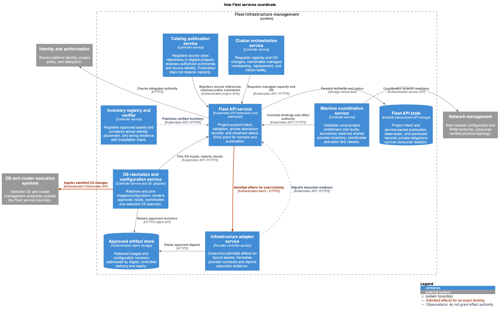

<!-- omit from toc -->
# Fleet service architecture

Part of the [Fleet infrastructure management service](README.md). Fleet turns
verified infrastructure into capacity that customers and managed clusters can
use. This document follows a request through the service and explains the
responsibilities and retained state that support that experience.

- [Fulfilling an infrastructure request](#fulfilling-an-infrastructure-request)
- [Coordinating Fleet subsystems](#coordinating-fleet-subsystems)
- [Operating owned infrastructure](#operating-owned-infrastructure)
- [Recovering interrupted work](#recovering-interrupted-work)
- [Keeping management available](#keeping-management-available)

## Fulfilling an infrastructure request

An operator makes capacity available after the equipment has been registered,
verified, and prepared, then defines the machine classes it can offer. Service
publication registers references to those classes in eligible consumer projects. A
customer selects a class and requests the location and capabilities they
need, along with networking and an optional OS installation. Fleet checks current
source-use permission, entitlement, quota, and compatibility, reserves one machine
in the provider project, and coordinates the work needed to make it usable.
A request can wait for capacity without committing to an unsuitable machine.

Customers see progress and actionable unmet requirements throughout this process.
Platform readiness means the agreed hardware, installation, and network handoff
has completed; guest or application health is reported separately when supported.
Once active, the allocation provides the permitted power, console, and reinstall
capabilities. Releasing it revokes access and completes required cleanup before
the machine can serve another customer.

Managed clusters use the same allocation and installation capabilities. Cluster
orchestration adds membership, coordinated updates, and node continuity across
replacement. Standalone customers retain control of their OS after handoff.
Both paths rely on one allocation authority and the same protections against
conflicting work.

The [service overview](README.md#service-architecture) shows Fleet's relationship
to operators, customers, and neighboring platform services. The
[owned-server journey](examples/owned-bare-metal/README.md) makes the lifecycle
concrete with proposed YAML definitions.

## Coordinating Fleet subsystems

Fleet separates verification, allocation, configuration, and execution so each
can report its own progress and enforce its own responsibilities. For example,
correct cabling can make a server eligible for preparation, but authorizing a
disk wipe requires a separate admitted operation. A cluster requesting another
node uses the shared allocator instead of selecting hardware independently.

The API service provides a common entry point for authenticated intent and
observed results. Controllers reconcile their part of the request through that
service. Protected admission records retain permission for specific effects;
provider adapters execute those records against the reserved asset.

Project-scoped APIs preserve separate consumer and provider ownership, including
when projects have separate API servers. The catalog publisher registers source
class references in consumer projects; the shared coordinator reserves
provider inventory without moving it into the consumer's ownership. Service-owned
publication and allocation records outlive the consumer project's API objects.

The responsibilities work together as follows:

- **Catalog publication service** integrates with service enablement to register
  MachineClass source references in consumer projects. It checks source-use
  permission before resolving safe capability/availability summaries and retains
  protected source identity and revision. It reports publication progress but
  cannot reserve stock or grant access through copied class fields.
- **Inventory registry and verifier** establishes which asset has arrived and
  whether its identity, placement, and connections match the approved plan.
  Allocation consumes that evidence; registration alone cannot authorize
  preparation or installation.
- **Machine coordination service** checks physical eligibility and network
  placement feasibility together with current cross-project entitlement and
  quota, then commits the exclusive machine binding. It coordinates activation,
  permitted runtime effects, and release for standalone
  and managed consumers.
- **OS resolution and configuration service** resolves and pins approved images
  and configuration. The artifact store retains those exact inputs and delivers
  them under scoped authorization. One selected OS executor applies admitted
  managed configuration changes.
- **Cluster orchestration service** requests capacity and OS changes through the
  shared contracts, then coordinates membership, disruption, and replacement.
  It preserves logical node continuity only after fencing the predecessor.
- **Infrastructure adapter service** translates admitted work into owned-hardware
  or vendor operations and reports execution evidence. It preserves the machine
  selection and approved inputs established by Fleet.
- **Fleet API service and state** retain intent, exclusive bindings, admitted
  plans, publication provenance, inventory evidence, and progress across those
  steps. Authorization distinguishes writers of private admission records from writers of observed
  status, including Fleet's own controllers.

Networking owns connectivity, IPAM, and switch configuration. It consumes
verified physical endpoints through the API and returns attachment evidence for
the current allocation. Fleet waits for that evidence before customer activation;
the machine coordinator does not program switches. Shared identity, geography,
and OS or cluster execution systems retain their own responsibilities as well.

Controllers watch relevant intent and publish their results through the API;
the diagram omits repeated watches for readability. The service and store
boundaries describe responsibility and communication. Deployment may combine or
separate them while preserving authorization, durability, and independent
ownership. Subsystem contracts are defined in [inventory](inventory.md),
[machine allocation](bare-metal-hardware.md), [OS configuration](os-configuration.md),
and [cluster orchestration](cluster-lifecycle.md).

## Operating owned infrastructure

Operators need to prepare servers, diagnose failed provisioning, restore hardware,
and maintain access even when a guest OS or workload cluster is unavailable.
Customers need the console and runtime operations allowed by their allocation
without receiving operator management credentials. These capabilities belong
to Fleet's bare-metal provisioning subsystem and remain available independently
of managed-cluster membership.

A provider adapter connects these capabilities to a pluggable execution layer.
Fleet retains the selected asset, approved inputs, and permitted effects; the
backend supplies its qualified execution mechanisms and completion evidence.
Supported capabilities can differ between integrations, but changing a backend
does not change consumer intent or create another allocation authority.

The [bare-metal provisioning design](bare-metal-provisioning.md) describes
enrollment, installation, runtime access, and reuse. Its
[architecture](bare-metal-provisioning.md#architecture) then explains how the
adapter, execution service, operation journal, and console gateway deliver
those capabilities.

## Recovering interrupted work

A customer should not receive another machine or lose an active reservation
because a controller restarted or a provider response was lost. Operators need
to know what was approved, what may already have happened, and what remains to
be completed before continuing work or returning capacity to service.

Fleet retains three kinds of records to support that recovery:

- **Fleet admission records** hold the exclusive reservation and permitted effect
  plan for provider and consumer Project UIDs, the actual asset, consumer claim,
  retained source-class contract and revision, quota hold, binding epoch, and
  expected predecessor. Only authorized admission writers can establish that permission.
- **Provider operation journal** retains the exact admitted inputs and correlates
  them with backend operations, progress, and evidence before effects begin.
  It preserves existing authority and cannot approve additional work.
- **Backend execution evidence** records the recoverable outcome of the work,
  obtained through supported queries or observations. The backend's private
  storage is an implementation choice. Completion is evaluated against the
  admitted plan before Fleet permits the next action.

A timeout leaves an unknown outcome. Recovery queries the existing operation
and physical evidence before retrying. Before another executor takes over,
the system must exclude the previous executor at the actual effect boundary;
a controller lease alone cannot revoke a remote worker's management access.
Restoring old storage must not resurrect a released allocation or authorize
replay against a later consumer.

Release stops new consumer effects, accounts for work already underway, closes
sessions, revokes capabilities, and detaches or fences networking. Required
cleaning and restoration follow. Unknown results retain the reservation or
quarantine the asset. These records survive deletion of a short-lived request,
consumer project, controller replacement, and backend recovery. Source-use
revocation stops new bindings; explicit release or reclaim governs active
allocations. The [cross-project lifecycle](capacity-publication.md#changes-withdrawal-and-project-deletion)
defines project retirement and cleanup ownership.

## Keeping management available

Provisioning and recovery run on independently recoverable management capacity.
Their required state, artifact delivery, credentials, networking, and bootstrap
services must remain recoverable when the workload cluster they manage is
unavailable. Management, privileged provisioning, and consumer access remain
separate enforced trust boundaries.

Physical placement, replica counts, failure domains, secret custody, and network
segments belong in deployment design. A subsystem can share infrastructure with
another only while preserving its access control, durable authority, and
recovery guarantees. Provisioning backend workers, agents, and internal storage
remain behind the adapter contract.

Before offering a hardware and backend combination, qualification must establish
correct-host authentication, exact-target effects, the requested installation
and boot outcome, controlled network handoff, operation recovery, exclusion of
stale executors, console revocation, and required cleanup. Unsupported behavior
and uncertain results stay visible so they cannot become false readiness.

Diagram source files and local rendering instructions are in
[diagram maintenance](diagrams/README.md).
