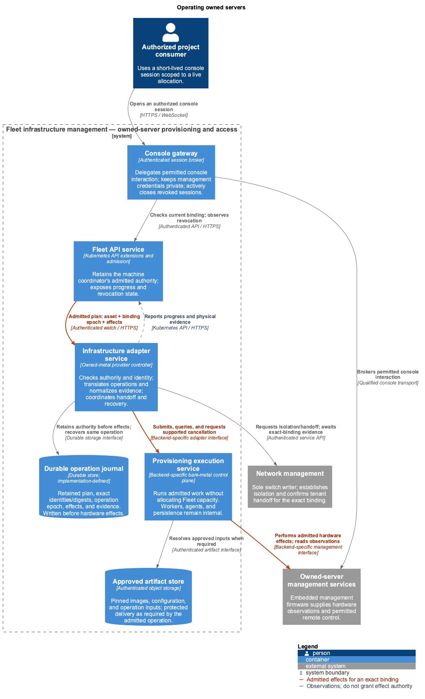

<!-- omit from toc -->
# Bare-metal provisioning

Part of the [Fleet infrastructure management service](README.md). This companion
defines the contract between Fleet's control plane and a pluggable bare-metal
execution layer. [Physical inventory](inventory.md),
[machine allocation](bare-metal-hardware.md), [OS configuration](os-configuration.md),
and networking retain their own APIs, responsibilities, and authorization.
The [owned bare-metal example](examples/owned-bare-metal/README.md) follows one
server from planned installation to a standalone consumer allocation.

- [Summary](#summary)
- [Proposal](#proposal)
  - [First-version scope](#first-version-scope)
  - [Responsibility boundaries](#responsibility-boundaries)
  - [Provider resources](#provider-resources)
  - [Enrollment and explicit preparation](#enrollment-and-explicit-preparation)
  - [Installation and network handoff](#installation-and-network-handoff)
  - [Console and runtime control](#console-and-runtime-control)
  - [Release and reuse](#release-and-reuse)
- [Architecture](#architecture)
  - [Durable operation authority](#durable-operation-authority)
- [Execution layer contract](#execution-layer-contract)
  - [Capabilities and outcomes](#capabilities-and-outcomes)
  - [Operation lifecycle](#operation-lifecycle)
  - [Artifacts and configuration delivery](#artifacts-and-configuration-delivery)
  - [Backend configuration and replacement](#backend-configuration-and-replacement)
  - [Independent management environment](#independent-management-environment)
- [Rollout plan](#rollout-plan)
- [Acceptance gates](#acceptance-gates)

## Summary

Fleet's first bare-metal version is a general-purpose provisioning service for
customer and internal workloads. Operators turn owned servers into capacity
that consumers can claim, install, and operate. They enroll management access,
authorize preparation, and offer qualified capabilities. Customers receive
permitted power and console access through the platform, including when their
guest OS is unavailable. Release removes customer access and completes required
cleaning and restoration before another allocation can use the server.

Inventory establishes which asset exists and what has been verified. The shared
allocator reserves compute capacity, and the OS provider supplies approved
installation inputs. The bare-metal provider executes admitted work through the
selected execution layer and reports results. These responsibilities support
the same `Machine`, `MachineClaim`, and `Installation` contracts across backends.

The provisioning backend is an operator integration choice. Different execution
systems can implement the same Fleet contract through adapters, provided they
satisfy the requirements for their offered capabilities. Consumers select an
offering and desired outcomes; native workflow, task identifiers, and execution
state machines stay inside the integration.

The execution layer may use workflows, remote management, boot services,
installation media, temporary agents, or other mechanisms. Fleet specifies the
asset, approved inputs, permitted effects, and completion evidence. Each adapter
owns the translation and qualifies its implementation. Owned capacity remains
finite; additional claims stay pending when no eligible server is available.

## Proposal

### First-version scope

The initial service covers the complete standalone machine lifecycle:

- Plan, register, verify, and prepare owned servers through Fleet inventory and
  operator-authorized provisioning.
- Discover automatically published MachineClasses in the consumer project,
  claim compatible provider-owned capacity across projects, and attach authorized
  customer networks.
- Install or reinstall a supported OS through an OS-independent request and a
  qualified image/bootstrap integration. A blank, powered-off allocation is
  also supported.
- Use allocation-scoped power and OOB console access while keeping operator
  management credentials private.
- Release the allocation, revoke access, and complete required isolation,
  cleaning, and restoration before reuse.

OS support is published through a qualified catalogue of images, bootstrap
contracts, and hardware compatibility. The first release must demonstrate a
standalone customer workload on an OS other than Talos; the exact initial OS
families are qualification decisions. Customer-owned guest administration
continues after handoff, with no mandatory ongoing guest agent or cluster membership.

Datum's internal Talos/Kubernetes hosts are consumers of the same service.
Cluster orchestration adds its own membership, managed configuration, and
replacement behavior above the shared machine lifecycle. The provisioning
service remains usable independently of those features and of the chosen
execution backend.

### Responsibility boundaries

The API groups below are proposed. Shared Fleet ownership does not merge resource
lifetimes, write authority, or access controls.

- **Physical identity, components, and placement evidence:** `Device` in
  `inventory.fleet.datumapis.com/v1alpha1`.
- **Approved installation and wiring:** Inventory `DeviceClaim` and `Cable`, with verified
  bindings to actual components.
- **Capacity definition, eligibility, exclusive reservation, and consumer operation admission:**
  Provider MachineClass and Machine, plus consumer-local MachineClass references
  and MachineClaim in `fleet.datumapis.com/v1alpha1`. Service publication and IAM
  separately govern reference delivery and source-use permission.
- **Management integration and translation to physical execution:** `BareMetalMachine`,
  `BareMetalMachineClass`, and the configured provider adapter in
  `baremetal.fleet.datumapis.com/v1alpha1`.
- **Execution of admitted hardware work:** A selected provisioning backend through the
  adapter contract. Its native records remain private implementation details.
- **Image contents and bootstrap/configuration semantics:** The OS provider and immutable
  `Installation` request.
- **Network entitlement, IPAM, and switch/attachment configuration:** The networking
  authority.
- **Logical node continuity, membership, and managed update coordination:** Fleet's
  cluster subsystem, using the shared allocation and installation contracts.

A Facility is provider-neutral physical premises. The provider derives identity
and placement from the Machine's registered Device and current inventory evidence.
Neither a backend node ID, reachable management endpoint, nor resource name
establishes asset identity. DeviceClaim reserves the operator's physical
installation; MachineClaim reserves consumer use. Neither substitutes for the
other or grants permission to erase disks.

Fleet remains the sole allocation authority for exposed capacity. A backend must
not independently allocate, reassign, release, or destructively reconcile the
same asset outside Fleet's admitted operations. A native scheduler may dispatch
execution workers; it cannot choose a different customer machine from the one
Fleet reserved.

### Provider resources

`BareMetalMachine` is the one-to-one management extension referenced by a Machine's
typed `providerRef`. It records operator management policy and the connection
configuration needed for that hardware integration. Device owns actual physical
identity; Machine/MachineClaim owns allocation. Native backend enrollment IDs,
workflow IDs, and progress are retained in private adapter records.

The following example illustrates direct BMC and console connection configuration.
It does not require every backend to expose BMC credentials to Fleet or use these
transports. An integration may instead hold connection material in the backend;
operator-only configuration must resolve and authenticate the same registered
asset. The binding and permission contract is common in either case.

```yaml
apiVersion: baremetal.fleet.datumapis.com/v1alpha1
kind: BareMetalMachine
metadata:
  name: iad1-r12-srv01
  namespace: infra-ops
spec:
  managementMode: ObserveOnly
  bmc:
    endpoint: https://srv01.r12.iad1.bmc.example.invalid
    systemID: /redfish/v1/Systems/System.Embedded.1
    credentialsSecretRef: {name: srv01-bmc}
    trustSecretRef: {name: bmc-ca}
  console:
    transport: RedfishGraphical
```

Enforce an exclusive UID-based relationship between the managed Device, Machine,
provider extension, and adapter's enrolled backend identity. Resolve authoring
references to retained UIDs before effects. Reusing a name or BMC address cannot
transfer authority to another server. Credential rotation preserves identity and
does not initiate provisioning. These records outlive disposable installation
requests and consumer claims.

`BareMetalMachineClass` describes reusable hardware compatibility and preparation
requirements. The configured adapter resolves supported boot and installation
methods and deterministic disk-selection rules. Operator integration configuration
chooses the execution backend. The provider's MachineClass definition references
the private class and selects eligible supply; automatically registered consumer
MachineClasses reference that definition and expose only resolved public capabilities.
Backend connection details or native workflow templates stay in adapter-specific
operator configuration rather than becoming fields of DeviceClaim, MachineClaim,
or Installation.

Class edits affect future admission. Each accepted operation retains the exact
resolved inputs and selected execution route. Disk requirements resolve to stable
physical identities and fail on ambiguity or unexpected replacement. A transient
OS disk name or a backend's unspecified default disk is insufficient authority.

### Enrollment and explicit preparation

Management enrollment begins in `ObserveOnly`, with Machine allocation disabled.
An adapter may read authorized observations, but enrollment or discovery must not
trigger backend automatic cleaning, power changes, boot-based inspection, or
configuration changes. If a backend cannot register a running server without
those effects, that adapter cannot offer non-disruptive adoption.

`Managed` permits execution of separately admitted operations; it does not request
a wipe or make the Machine available. Initial preparation is an explicit operator
operation. The proposed `/prepare` surface admits a retained plan identifying the
asset, exact targets, required effects, and the owner-selected cleaning/restoration
policy. An adapter may realize that plan as native jobs, workflow steps, or API
calls without exposing their sequence to the caller.

Admission requires allocation disabled, current physical binding and applicable
verification, and no conflicting consumer allocation or operation. Retain the
idempotency key and preconditions before execution. Only completed preparation,
current physical verification, management health, and enabled allocation together
allow the shared binder to select the Machine.

Returning to ObserveOnly stops new operation admission. Committed work must reach
its defined safe boundary before the transition is acknowledged. A mode edit
cannot undo an irreversible operation already in progress. Adopting an active
server reconciles its existing reservation and never briefly exposes it as free.

### Installation and network handoff

MachineClaim binding is immutable. Installation requests an explicit first OS
incarnation or reinstall against that claim, with predecessor preconditions.
The provider executes the retained plan; a mutable image, class, or backend
workflow edit cannot silently change it. A blank, powered-off claim is valid.

The common handoff contract is:

1. Validate consumer, image, and network entitlement. Resolve required initial
   resources, evaluate placement feasibility, and exclusively reserve one Machine.
   Pin the exact identities and relevant input digests.
2. Networking resolves verified endpoints, reserves attachment resources, and
   establishes the restricted connectivity required by the selected provisioning
   method. Consumer connectivity remains unavailable wherever it would expose
   privileged provisioning access.
3. The adapter submits the authorized plan for the reserved asset. The execution
   layer installs the approved OS and delivers bootstrap/configuration through the
   qualified method. The OS provider owns input contents and semantics.
4. Establish evidence that privileged provisioning access has ended and temporary
   boot paths cannot reactivate unexpectedly. Networking confirms the authorized
   tenant attachment for the same binding before consumer activation proceeds.
5. Honor the claim's admitted power intent and verify the offered installation
   and boot outcome. Report guest/application health separately when supported.

An implementation can use an authenticated temporary agent to write a disk image,
an installer environment, or another qualified deployment method. Neither a
particular agent nor whole-disk imaging is required by the public API. The worked
example uses image deployment and a powered-off transition to make the handoff
concrete; other methods must supply equivalent isolation, boot-control, and
completion evidence.

Networking remains the sole authority for switch and logical network configuration.
A backend's native network integration must operate through that authority. Cable
specifies physical wiring, not VLANs, routes, or tenant entitlement. Every effect
carries the current binding and interface identity so stale work cannot alter the
next consumer's connection.

The integration must expose a controllable handoff boundary. Observing backend
completion and racing its automatic reboot is insufficient. An adapter that
cannot prevent premature activation cannot offer that deployment path. Power,
installation, attachment transitions, and cleanup remain coordinated even when
the backend implements them in a single workflow.

The initial activation gate is completed durably; deleting historical Installation
requests does not reopen it. Standalone consumers own their OS after handoff.
Managed nodes retain their separate configuration/admission contract and one
selected OS executor. Neither mode gives a backend independent allocation or
upgrade authority.

### Console and runtime control

Consumers use claim-scoped access. The console gateway authenticates the caller,
checks capabilities and current allocation, and binds the session to the project,
principal, Claim UID, Machine UID, and binding epoch. It keeps management
credentials private and actively disconnects sessions when authority ends.
Generally readable status never contains a console bearer capability.

The backend may supply console transport, or the adapter may integrate a separate
console service. Both implementations satisfy the same authorization and revocation
contract. Backend support alone does not grant consumer access.

Persistent On/Off intent belongs to MachineClaim. Reset, reboot, and supported
rescue/media actions are bounded operations with idempotency keys and current
binding preconditions. They serialize with installation and release. Unsupported
operations are reported explicitly; an adapter cannot substitute a more disruptive
action. Operator overrides require coordinated, audited authority.

Artifact access is constrained to admitted inputs. Consumers cannot make a
privileged management service fetch arbitrary URLs or gain raw BMC administration
through the ordinary console offering. Qualification accounts for persistent
firmware or management changes possible through guest root or console access.

### Release and reuse

Release stops new consumer effects, accounts for in-flight work, disconnects
console sessions, revokes capabilities, and detaches or fences customer networking.
The adapter then executes the owner-selected sanitization/restoration policy and
returns evidence for every relevant device and obligation. The shared allocator
releases the reservation only after evaluating those results.

A generic backend success flag does not establish the required cleaning assurance.
Missing or replaced disks, incomplete erasure, or unknown restoration results keep
the asset unavailable according to operator policy. Disk cleaning is distinct
from firmware integrity and management-state restoration.

Owned Machines normally use Retain: preserve the asset, management identity, and
required operation history after customer release. Reuse requires current physical
verification and enabled allocation as well as successful reclamation. Unknown
outcomes retain the reservation or quarantine the asset. Deleting an Installation
or removing a finalizer is not evidence that release completed.

## Architecture

Preparation, installation, runtime access, and reuse share the same physical
machine and must remain coordinated throughout its allocation. The provider
adapter connects these capabilities to the execution layer. It consumes the
admitted allocation and installation decisions established by Fleet, retains
the operation before dispatch, and coordinates network handoff and recovery.



The supporting services each preserve a part of the lifecycle:

- **Provisioning execution service** performs qualified hardware work against
  the admitted asset and inputs. The adapter translates submission, outcome
  queries, supported cancellation, and recovery into the backend's mechanisms,
  then reports capabilities, progress, uncertainty, and completion evidence.
- **Durable operation journal** retains the admitted plan, exact identities and
  input digests, operation epoch, and evidence. It lets recovery continue the
  same operation after a lost response or restart.
- **Approved artifact store** retains images, configuration, and other admitted
  inputs and delivers them under scoped authorization. The OS provider owns
  their contents and bootstrap semantics.
- **Console gateway** authenticates the caller and checks the live allocation,
  brokers permitted console interaction, and actively disconnects revoked
  sessions while keeping management credentials private.

The selected execution path is the sole writer of admitted power and boot state.
Console transport grants only the permitted interaction, with no blanket
management administration. Networking remains responsible for switch changes,
restricted provisioning connectivity, and the verified tenant handoff. The
adapter must establish that privileged temporary access has ended before
consumer activation; backend automation cannot race that transition.

The API service, adapter, and artifact store are shared with the broader
[Fleet architecture](architecture.md#coordinating-fleet-subsystems). An execution
backend may use workflows, agents, embedded management, or other qualified
mechanisms. Its internal workers and storage stay behind the adapter contract,
and its native workflow identifiers do not become consumer configuration.

### Durable operation authority

Before external effects, persist the authority, exact asset/provider/binding
identities, Installation and predecessor where applicable, operation epoch,
resolved input digests, target components, permitted effects, and prerequisites.
The adapter retains the correspondence between this Fleet operation and its
backend execution. Only authorized admission writers can create that authority.

A provider journal can share infrastructure with the Fleet authority store if
its durability and access guarantees hold. The API does not require a particular
database, message broker, number of services, or backend state schema. Observable
progress alone is not a substitute for the retained authorization and inputs.

A timeout is an unknown result. Recover or query the existing operation before
retrying; do not start another installation or wipe just because a response was
lost. Deduplicate using the Fleet operation identity and backend correlation.
Late callbacks must match the current operation, binding, and incarnation.

Exactly one admitted execution authority controls an asset's management effects
at a time. Epoch checks cannot fence a worker that still possesses usable
management credentials. Takeover must exclude it at the actual effect boundary.
Native retry, recovery, automatic cleaning, and power reconciliation are subject
to the same retained authority. A backend completion state does not authorize
another action or release Fleet's reservation.

## Execution layer contract

### Capabilities and outcomes

Adapters publish supported capabilities and their preconditions. Offerings select
only qualified combinations; there is no claim that every backend supports every
operation. The contract is outcome based, not a mandated set of native endpoints.

- **Inspection:** Fleet supplies enrolled asset identity and separately authorized
  effects, if needed. The adapter returns attributable component/capability observations;
  unsupported or unknown facts remain explicit.
- **Preparation:** Fleet supplies approved hardware baseline, exact targets, and owner
  policy. The adapter returns evidence of the requested result, including partial failure
  and remaining obligations.
- **Installation:** Fleet supplies immutable image/configuration requirements, the exact
  binding and targets, predecessor, and activation gates. The adapter returns the
  installation and boot outcome and supported configuration-delivery evidence for the
  admitted inputs.
- **Power and boot control:** Fleet supplies admitted desired state or bounded action for
  the current binding. The adapter returns observed result and uncertainty; command
  acceptance is distinct from completion.
- **Console and optional rescue access:** Fleet supplies scoped grant, capabilities,
  permitted transport/artifacts, and expiry. The adapter returns a revocable session or
  supported operation with active teardown evidence.
- **Reclamation:** Fleet supplies exact asset, ended consumer authority, and
  sanitization/restoration requirements. The adapter returns per-target results and
  unresolved obligations; no independent release of Fleet capacity.
- **Operation recovery:** Fleet supplies stable Fleet operation identity and retained
  preconditions. The adapter returns correlated native execution, current
  progress/outcome, supported cancellation boundary, and recovery evidence.

Requirements may be fulfilled by the adapter and supporting services together;
for example, a console service need not be part of the provisioning engine.
Admission rejects unsupported mandatory capabilities before effects or reports
an actionable unsatisfied requirement while the request remains pending. It must
not silently weaken the customer's or operator's request.

### Operation lifecycle

The adapter must distinguish request acceptance, execution, and verified completion.
It maps backend observations to Fleet conditions and preserves enough protected
evidence for diagnosis. Backend-native phases and workflow identifiers are not
part of the customer-facing desired state.

Operations can execute asynchronously. The common contract requires stable
correlation, idempotent submission or equivalent deduplication, progress discovery,
terminal evidence, and recovery after lost responses. If native idempotency is
absent, the adapter must still prevent duplicate effects; lack of that guarantee
blocks the capability. Cancellation is a request to reach a declared safe boundary,
not a promise that a completed disk write can be undone.

Before continuing after a restart, verify the retained plan, current binding,
prerequisites, and exclusive execution authority. A controller may not reinterpret
a backend retry as permission to use newly edited images or workflows. Reconcile
restored state with actual execution before authorizing further effects.

### Artifacts and configuration delivery

The OS provider specifies the supported installation/bootstrap contract and resolves
immutable input content. The adapter negotiates or validates a compatible execution
method against the offered capability. Raw images, installer media, network boot,
and agent-based delivery are possible implementation choices, not universal
requirements or preferences in this enhancement.

Pin the exact artifacts, configuration, native execution inputs, and permitted
method before effects. Backend-native workflow templates are versioned operator
integration inputs; editing a template cannot change an admitted operation.
Artifact verification and bootstrap must authenticate the intended asset and
protect consumer configuration. Transport selection must not expose privileged
credentials or permit cross-host bootstrap impersonation.

Verify outcomes appropriate to the offering: exact target selection, installed
contents, supported boot state, configuration handoff, removal or revocation of
privileged temporary access, and recovery behavior. A backend reporting that a
machine booted into an installer does not prove an installed, usable OS.

### Backend configuration and replacement

Operators configure backend connections, credentials, enrollment mappings, and
native execution templates in the adapter's private integration domain. Shared
Fleet resource references and consumer workflows do not change when another
backend implements the same offered capabilities. Backend-specific extensions
must stay explicit and access controlled; they cannot redefine the meaning of
a generic Ready condition or bypass common admission.

The selected execution route and backend asset mapping are pinned for active
operations. Replacing an integration requires a controlled handover: account for
unfinished work, exclude the previous executor, verify the same physical asset,
and reconcile state before enabling the successor. Changing configuration must
not re-enroll a different asset, replay completed work, or release a live claim.
Inventory and Machine identities remain independent of backend record lifetimes.

### Independent management environment

The execution layer and its required stores, artifact delivery, credentials,
networking, and bootstrap services must be recoverable without the workload
cluster they manage. The API does not mandate how these services are packaged.
A backend's private database, queue, or worker fleet is its implementation concern;
the Fleet integration must demonstrate durable ownership and recovery regardless.

Keep management, privileged provisioning, and consumer access in separate enforced
trust boundaries. Exact protocols and network segments depend on the selected
method. Automated power fencing additionally requires verified physical mappings.
During control-plane loss, no new destructive work is authorized. Committed work
can continue only while its retained authority, prerequisites, and exclusive
execution ownership remain valid.

## Rollout plan

1. **Contract and adapter qualification.** Define the backend-neutral capability
   and operation contract, verify lab inventory, and evaluate an implementation.
   Demonstrate correct-host authentication, exact targets, operation deduplication
   and recovery, isolated handoff, and qualified boot and cleaning outcomes.
2. **General-purpose customer pilot.** Exercise claim, install, operate, reinstall,
   and release with a qualified OS other than Talos and a standalone customer
   workload. Integrate the shared binder, network handoff, power, and console
   access. Prove exclusive allocation, serialized operations, access revocation,
   stale callback rejection, and preservation of consumer OS ownership. Internal
   managed consumers use these same contracts.
3. **Portability and production readiness.** Exercise adapter conformance against
   another execution implementation, and qualify backup, recovery, and handover.
   Verify equivalent service behavior and explicit capability differences.
   Failures and state restoration must not replay unauthorized work or prematurely
   reuse capacity.

## Acceptance gates

- Complete the first-version customer lifecycle with no Cluster, NodeClaim,
  Kubernetes guest, or mandatory ongoing guest agent. Validate a supported
  OS other than Talos, including recovery through OOB access when the guest
  is unavailable.
- Keep DeviceClaim, Device, MachineClaim, and Installation semantics independent
  of backend node identifiers, workflow schemas, and native lifecycle names.
- Specify capability discovery, operation correlation, deduplication, querying,
  cancellation boundaries, and evidence normalization before enabling effects.
- Qualify each offered hardware/OS/method combination for correct-host bootstrap,
  exact targets, protected network handoff, boot outcome, and recovery.
- Demonstrate actual stale-executor exclusion, including backend retries and
  recovery after state restoration.
- Prove console/network revocation and required sanitization/restoration before
  reuse; incomplete evidence keeps the asset unavailable.
- Exercise the same Fleet contract across adapters and expose capability gaps
  without selecting a preferred provisioning product in the service design.

These are requirements for an implementation to satisfy, not presumed features
of any named backend. The enhancement defines the control-plane contract and
makes no provisioning-engine selection.
